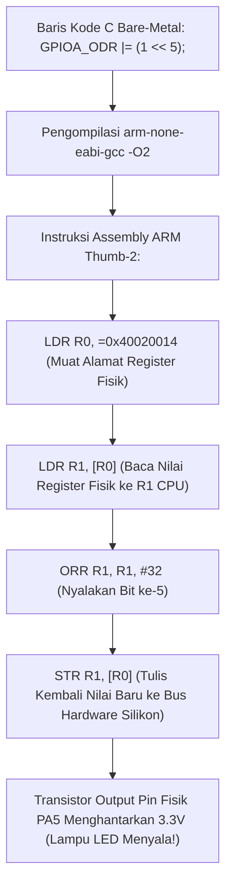

# Modul 072: Pemrograman Bare-Metal C/C++/Rust (Manipulasi Bitwise, Pointer Fisik, Kata Kunci Volatile)

**Navigasi**: [⬅️ Master Index](../../INDEX.md) | [Tingkat 5: Tingkat 5: Embedded Systems, Firmware Bare-Metal & RTOS / IoT](./README.md)
*Sebelumnya*: [071. metodologi-pembacaan-lembar-data](./071-metodologi-pembacaan-lembar-data.md) | *Berikutnya*: [073. anatomi-booting-mikrokontroler-linker-script](./073-anatomi-booting-mikrokontroler-linker-script.md)

---

## 1. Intuisi Dasar Tanpa Jargon ("Seperti Bayi Baru Lahir")
Bayangkan seorang pengemudi mobil balap profesional: ia menolak menggunakan transmisi otomatis yang lambat, menolak menggunakan power steering elektrik yang mati rasa, dan menolak sistem navigasi komputer yang mengambil alih kendali. Ia ingin merasakan setiap getaran aspal jalan langsung di ujung jari tangannya dan memindahkan gigi persneling secara mekanis seketika tanpa jeda milidetik pun.

Dalam pemrograman komputer, itulah **Pemrograman Bare-Metal (C/C++ dan Rust)**:
Anda menulis kode yang berjalan **LANGSUNG DI ATAS LOGAM SILIKON FISIK (Bare-Metal)** tanpa ada sistem operasi Windows, Linux, atau driver perantara di bawahnya!
- Setiap baris kode yang Anda ketik langsung mengubah tegangan kabel tembaga mikroskopis di pin chip silikon.
- Anda memegang kendali mutlak $100\%$ atas setiap siklus clock CPU dan setiap byte alamat memori RAM.
- Di sinilah dua senjata terhebat insinyur sistem beroperasi: **Manipulasi Bitwise** untuk membolak-balik saklar register, dan kata kunci ajaib **`volatile`** yang melarang compiler komputer bersikap sok pintar menghapus instruksi Anda.
[📚 Pelajari: Embedded Rust Book Official Documentation](https://docs.rust-embedded.org/book/)

## 2. Fondasi Teoretis & Aksiomatik / Matematis
### 72.1 Operasi Manipulasi Bitwise Primitif ([Kernighan & Ritchie The C Programming Language](https://www.pearson.com/))
Dalam pemrograman sistem tingkat rendah, register kendali perangkat keras dimanipulasi per-bit menggunakan operasi bitwise biner:
1. **Set Bit ke '1' (Mengaktifkan Fitur)**: Menggunakan operator bitwise OR (`|`):
   $$\text{REG} = \text{REG} \mid (1 \ll n)$$
2. **Clear Bit ke '0' (Mematikan Fitur)**: Menggunakan operator bitwise AND dengan inversi tilde (`& ~`):
   $$\text{REG} = \text{REG} \ \& \ \sim(1 \ll n)$$
3. **Toggle Bit (Membalikkan Keadaan $0 \leftrightarrow 1$)**: Menggunakan operator bitwise XOR (`^`):
   $$\text{REG} = \text{REG} \oplus (1 \ll n)$$
4. **Membaca Status Bit Tunggal**: Menggunakan masking bitwise AND:
   $$\text{Status} = (\text{REG} \gg n) \ \& \ 1$$
5. **Modifikasi Multi-Bit Masking**: Menghapus field lama sebelum menulis nilai baru:
   $$\text{REG} = (\text{REG} \ \& \ \sim(0xF \ll \text{shift})) \mid ((\text{value} \ \& \ 0xF) \ll \text{shift})$$

### 72.2 Akses Pointer Fisik & Kata Kunci `volatile` ([Meyers Effective Modern C++](https://www.oreilly.com/))
Dalam arsitektur Memory-Mapped I/O, register hardware diakses melalui pointer C yang menunjuk langsung ke alamat memori fisik integer 32-bit:
```c
#define GPIOA_ODR  (*(volatile uint32_t *)0x40020014)
```
Mengapa Wajib Menggunakan Kata Kunci `volatile`?
Compiler modern (GCC / Clang dengan optimasi `-O2` atau `-O3`) mengasumsikan bahwa nilai di memori hanya berubah jika program perangkat lunak itu sendiri yang memodifikasinya:
- Jika Anda menulis loop penunggu status hardware: `while (*status_reg == 0);`, compiler cerdas akan menganggap nilai `*status_reg` tidak pernah berubah di dalam loop, sehingga compiler memindahkan pembacaan ke luar loop menjadi `if (*status_reg == 0) while(1);` (Loop Macet Abadi!).
- Kata kunci `volatile` adalah perintah tegas kepada compiler: *"Nilai di alamat fisik ini dapat berubah sewaktu-waktu oleh perangkat keras fisik eksternal di luar kendali software! Jangan pernah meng-cache nilai ini di register CPU, dan wajib baca/tulis langsung ke kabel memori fisik di setiap baris!"*

### 72.3 Pemrograman Embedded Aman Menggunakan Rust Bare-Metal (`no_std`) ([The Embedded Rust Book](https://docs.rust-embedded.org/book/))
Rust menghadirkan keamanan memori mutlak (*Memory Safety without Garbage Collector*):
- Direktif `#![no_std]`: Mematikan runtime standar sistem operasi, hanya menggunakan pustaka inti `core`.
- Tipe Pembungkus Register Zero-Cost Abstraction (PAC / HAL): Mengubah manipulasi bit mentah menjadi API tipe data yang kebal terhadap kesalahan salah ketik bit:
```rust
// Rust Embedded HAL: Menjamin secara tipe data bahwa pin tidak bisa salah konfigurasi
gpioa.odr.modify(|_, w| w.odr5().set_bit());
```
- Menghilangkan bahaya data race dan pointer liar (*Dangling Pointers*) saat kompilasi (*Compile-Time Borrow Checker*).

## 3. Anatomi Teknis & Cara Kerja Internal

Bit-Banding Memory Aliasing (Cortex-M3 / M4):
Fitur khusus perangkat keras yang memetakan setiap 1 bit individual di dalam SRAM dan periferal menjadi satu kata 32-bit terpisah di wilayah alias ($0x22000000$ dan $0x42000000$). Memungkinkan operasi modifikasi bit tunggal secara atomik murni dalam 1 instruksi `STR` tanpa memerlukan siklus Read-Modify-Write yang rentan interupsi race condition.

## 4. Implementasi Praktis & Kode / Simulasi Riil
#include <stdint.h>
#include <stdbool.h>

// Definisi Alamat Dasar Register Fisik STM32F4 (RCC dan GPIOA)
#define RCC_BASE        0x40023800
#define RCC_AHB1ENR     (*(volatile uint32_t *)(RCC_BASE + 0x30))

#define GPIOA_BASE      0x40020000
#define GPIOA_MODER     (*(volatile uint32_t *)(GPIOA_BASE + 0x00))
#define GPIOA_ODR       (*(volatile uint32_t *)(GPIOA_BASE + 0x14))
#define GPIOA_BSRR      (*(volatile uint32_t *)(GPIOA_BASE + 0x18))

// Demonstrasi Menyalakan Lampu LED pada Pin PA5 Bare-Metal Murni
void led_init(void) {
    // 1. Nyalakan clock bus untuk port GPIOA (Set Bit ke-0 pada RCC_AHB1ENR)
    RCC_AHB1ENR |= (1U << 0);
    
    // 2. Konfigurasikan Pin PA5 sebagai General Purpose Output (Mode '01' pada bit 11:10)
    GPIOA_MODER &= ~(3U << (5 * 2)); // Bersihkan 2 bit konfigurasi lama
    GPIOA_MODER |=  (1U << (5 * 2)); // Tulis mode '01' (Output)
}

void led_toggle(void) {
    // Balikkan keadaan bit ke-5 menggunakan XOR bitwise
    GPIOA_ODR ^= (1U << 5);
}

void led_set_atomic(bool state) {
    // Menggunakan register BSRR (Bit Set/Reset Register) untuk operasi atomik 1-siklus bebas race condition!
    if (state) {
        GPIOA_BSRR = (1U << 5);       // Menyalakan PA5 (Bit 0-15 adalah Set)
    } else {
        GPIOA_BSRR = (1U << (5 + 16)); // Mematikan PA5 (Bit 16-31 adalah Reset)
    }
}

## 5. Miskonsepsi & Jebakan Industri
1. **Omitting `volatile` on Hardware Register Pointers**: Menulis driver periferal tanpa `volatile`; compiler yang mengoptimalkan kode dengan `-O2` atau `-O3` akan menganggap operasi baca-tulis berulang ke alamat yang sama sebagai kode redundan yang tidak berguna (*Dead Code Elimination*) dan menghapus seluruh rutinitas inisialisasi hardware Anda.
2. **Non-Atomic Read-Modify-Write Race Condition**: Menggunakan operasi `GPIOA_ODR |= (1 << 5)` untuk menyalakan pin di dalam kode utama, sementara fungsi interupsi ISR memodifikasi pin lain di port yang sama secara mendadak di tengah siklus eksekusi; nilai yang baru diubah ISR akan tertimpa kembali oleh kode utama. Solusi: selalu gunakan register atomik khusus hardware seperti `BSRR`!
3. **Signed Bit Shift Overflow**: Melakukan pergeseran bitwise pada bilangan bertanda signed integer tanpa akhiran unsigned `U` (misal `1 << 31`); menggeser bit ke posisi MSB memicu signed overflow yang merupakan *Undefined Behavior* dalam standar bahasa C/C++. Selalu tulis `1U << 31`.

## 6. Proyek Latihan & Rubrik Penilaian Mandiri
### Tingkat 1 (Pemula) - Makro Bitwise Standar C Industri
Tulis file header bahasa C `bitwise_utils.h` yang mendefinisikan 5 makro prapemroses yang aman dan bertanda kurung lengkap: `BIT(n)`, `SET_BIT(reg, n)`, `CLEAR_BIT(reg, n)`, `TOGGLE_BIT(reg, n)`, dan `READ_BIT(reg, n)`. Tulis program uji verifikasi konsistensinya.

### Tingkat 2 (Menengah) - Driver Bare-Metal Pengirim Karakter UART Serial
Tulis driver bare-metal murni dalam bahasa C tanpa library HAL vendor untuk menginisialisasi periferal USART2 pada mikrokontroler STM32 (Baud Rate $115.200	ext{ bps}$ pada clock $16	ext{ MHz}$): konfigurasikan register baud rate `USART_BRR`, aktifkan transmitter pada `USART_CR1`, dan buat fungsi transmisi `uart_send_char(char c)` yang memantau register status `USART_SR_TXE` dengan benar menggunakan `volatile`.

### Tingkat 3 (Mahir) - Driver Sensor I2C Bare-Metal Aman dalam Rust `no_std`
Tulis driver perangkat tertanam bare-metal (*Bare-Metal Embedded Driver*) dalam bahasa Rust menggunakan direktif `#![no_std]` untuk membaca sensor akselerometer I2C 3-sumbu: bangun struktur abstraksi register zero-cost, implementasikan pembacaan data koordinat akselerasi $(X, Y, Z)$ 16-bit Two's Complement, dan cegah pembagian dengan nol menggunakan enum Rust `Result<T, SensorError>`.

#### Rubrik Penilaian
- **40% Ketepatan Sintaks Bitwise & Penggunaan Volatile**: Seluruh manipulasi register menggunakan masking aman dan kata kunci `volatile` wajib.
- **30% Keamanan Atomik Eksekusi**: Menghindari fenomena Read-Modify-Write race condition menggunakan register BSRR atau bit-banding.
- **30% Portabilitas & Kerapian Kode**: Tidak ada hardcoded magic number tanpa pendefinisian konstanta simbolik yang jelas.

## 7. Rekomendasi Sumber Belajar Standar Emas
| Kategori | Judul Sumber & Tautan Langsung | Deskripsi Singkat |
|---|---|---|
| 📖 Buku Teks | [The C Programming Language (Brian Kernighan & Dennis Ritchie)](https://www.pearson.com/) | Kitab suci bahasa C yang mendefinisikan operasi bitwise, pointer memori, dan tipe data. |
| 🎓 Kuliah Terbuka | [The Embedded Rust Book Documentation](https://docs.rust-embedded.org/book/) | Panduan resmi komunitas Rust mengenai pengembangan firmware bare-metal aman `no_std`. |
| 🔬 Makalah Seminal | [Volatile: Almost Useless for Multi-Threading (Boehm, 2005)](https://doi.org/10.1145/1105651.1105659) | Analisis mendalam Hans Boehm mengenai fungsi sejati kata kunci volatile untuk memory-mapped I/O. |
| 💻 Lab Interaktif | [Compiler Explorer (Godbolt): Bare-Metal C to ARM Assembly](https://godbolt.org/) | Eksplorasi langsung bagaimana kode C bare-metal diubah menjadi instruksi assembly mesin nyata oleh GCC. |

---
*Navigasi Cepat*: [Ke Tingkat 5](./README.md) | [Ke Master Index](../../INDEX.md) | *Sebelumnya*: [071. metodologi-pembacaan-lembar-data](./071-metodologi-pembacaan-lembar-data.md) | *Berikutnya*: [073. anatomi-booting-mikrokontroler-linker-script](./073-anatomi-booting-mikrokontroler-linker-script.md)
