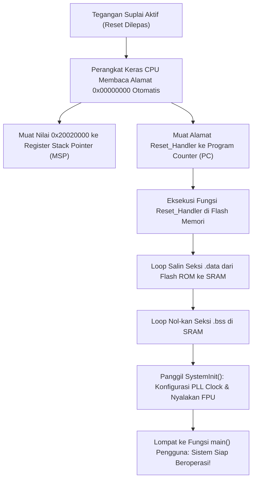

# Modul 073: Anatomi Booting Mikrokontroler & Linker Script (Reset Vector, Startup crt0, Linker Script .ld)

**Navigasi**: [⬅️ Master Index](../../INDEX.md) | [Tingkat 5: Tingkat 5: Embedded Systems, Firmware Bare-Metal & RTOS / IoT](./README.md)
*Sebelumnya*: [072. pemrograman-bare-metal-c-cpp-rust](./072-pemrograman-bare-metal-c-cpp-rust.md) | *Berikutnya*: [074. toolchain-kompilasi-silang-debugging-hardware](./074-toolchain-kompilasi-silang-debugging-hardware.md)

---

## 1. Intuisi Dasar Tanpa Jargon ("Seperti Bayi Baru Lahir")
### 1.1 Konsep Inti & Analogi Tanpa Jargon
Pernahkah Anda bertanya apa yang terjadi di dalam chip komputer pada **sepersejuta detik pertama** setelah Anda menekan tombol power?

### 1.2 Urgensi Rekayasa & Signifikansi Sistemik
Saat listrik mengalir:
- Semua variabel di RAM masih berupa angka sampah acak.
- Program bahasa C belum berjalan: fungsi `main()` Anda belum ada di dunia!
- Siapa yang menyalakan prosesor? Siapa yang memberi tahu CPU harus melompat ke alamat memori mana untuk membaca instruksi pertamanya?

Jawabannya adalah **Anatomi Booting & Linker Script**:
Begitu listrik mengalir, perangkat keras CPU secara otomatis membaca 8 byte pertama di memori Flash:
1. Empat byte pertama dibaca untuk menentukan di mana letak puncak tumpukan memori (**Initial Stack Pointer / MSP**).
2. Empat byte berikutnya dibaca untuk melompat ke alamat instruksi pertama (**Reset Vector Handler**)!
Kode assembler kecil (*Startup Code / crt0*) kemudian menyalin seluruh variabel global Anda dari Flash ke RAM, mengosongkan memori variabel nol, dan baru kemudian memanggil fungsi `main()` Anda.
Dan sang arsitek yang membagi-bagi peta wilayah memori Flash dan RAM ini adalah file sakti bernama **Linker Script (`.ld`)**.
[📚 Pelajari: Vivien From Scratch: Bare Metal C Execution](https://vivienm.github.io/posts/bare-metal-c-startup/)

## 2. Fondasi Teoretis & Aksiomatik / Matematis
### 2.1 Kerangka Teori Aksiomatik & Formulasi Matematis
### 73.1 Vektor Interupsi Perangkat Keras & Urutan Booting ARM Cortex-M ([ARM Cortex-M Generic User Guide](https://developer.arm.com/))
Pada saat pin sinyal reset fisik dilepaskan ($NRST = 1$):
CPU perangkat keras ARM Cortex-M secara otomatis melakukan dua siklus pembacaan memori berturutan dari alamat awal memori kode ($0x00000000$, yang di-aliaskan ke Flash $0x08000000$ di STM32):
1. **Alamat $0x00000000$**: Dimuat langsung ke dalam register tumpukan utama $SP$ (*Main Stack Pointer* MSP).
2. **Alamat $0x00000004$**: Dimuat langsung ke dalam Program Counter ($PC$). Alamat ini adalah **Reset Vector**, yang menunjuk ke fungsi assembler `Reset_Handler`.
3. CPU mulai mengeksekusi instruksi pertama di dalam fungsi `Reset_Handler`.

### 2.2 Penurunan Matematis Langkah-demi-Langkah
Tabel Vektor Interupsi (*Vector Table*):
Larik pointer fungsi 32-bit di awal memori Flash yang berisi alamat fungsi handler untuk eksepsi sistem dan interupsi perangkat keras:
- Vektor 1: Initial Stack Pointer (MSP)
- Vektor 2: Reset Handler
- Vektor 3: NMI Handler (Non-Maskable Interrupt)
- Vektor 4: HardFault Handler
- Vektor 11: SVCall Handler (Supervisor Call)
- Vektor 14: PendSV Handler (Peralihan konteks RTOS)
- Vektor 15: SysTick Handler (Detak waktu sistem)
- Vektor 16+: Interupsi Periferal Khusus Vendor (WWDG, RTC, TIM2, USART1, dll).

### 73.2 Anatomi Berkas Startup Assembler (`startup_stm32.s` / crt0) ([GNU ld Manual](https://sourceware.org/binutils/docs/ld/))
Rutinitas `Reset_Handler` (*C-Runtime Startup 0 / crt0*) bertugas menyiapkan lingkungan memori sebelum fungsi `main()` dapat berjalan dengan aman:
1. **Inisialisasi Seksi `.data`**:
   Variabel global/statis yang memiliki nilai awal (misal: `int counter = 42;`) disimpan nilai awalnya di Flash ROM, tetapi saat runtime variabel tersebut harus bisa diubah di RAM.
   Rutinitas startup menyalin (*memcpy*) blok memori dari alamat awal Flash (`_sidata`) ke alamat awal RAM (`_sdata` s/d `_edata`).
2. **Inisialisasi Seksi `.bss` (Block Started by Symbol)**:
   Variabel global/statis yang tidak diinisialisasi atau diinisialisasi ke nol (misal: `int buffer[100];` atau `int flag = 0;`).
   Standar bahasa C mensyaratkan variabel ini bernilai nol mutlak saat program mulai.
   Rutinitas startup mengisi nol (*memset zero*) wilayah memori RAM dari `_sbss` hingga `_ebss`.
3. **Panggilan Sistem Awal**:
   Memanggil `SystemInit()` untuk mengonfigurasi osilator jam PLL eksternal dan unit FPU.
4. **Melompat ke Kode Pengguna**:
   Mengeksekusi instruksi lompat cabang `bl main`.

### 73.3 Perancangan Berkas Linker Script GNU (`*.ld`) ([Embedded Artistry Linker Script Guide](https://embeddedartistry.com/blog/2017/10/11/demystifying-firmware-linker-scripts/))
Linker Script mengarahkan compiler linker (`ld`) bagaimana memetakan objek biner input (`*.o`) ke dalam memori fisik perangkat keras:
- **Blok `MEMORY`**: Mendefinisikan nama, alamat dasar awal (`ORIGIN`), dan kapasitas (`LENGTH`) wilayah memori fisik chip:
```ld
MEMORY
{
  FLASH (rx)  : ORIGIN = 0x08000000, LENGTH = 512K
  RAM   (rwx) : ORIGIN = 0x20000000, LENGTH = 128K
}
```
- **Blok `SECTIONS`**: Mengelompokkan kode dan data ke dalam wilayah memori yang didefinisikan:
  - `.isr_vector`: Wajib diletakkan tepat di alamat awal mutlak Flash ($0x08000000$).
  - `.text`: Instruksi kode mesin program executable (hanya baca, disimpan di Flash).
  - `.rodata`: Konstanta read-only dan string literal (disimpan di Flash).
  - `.data`: Variabel terinisialisasi: disimpan di Flash (LMA - Load Memory Address), dipetakan saat eksekusi ke RAM (VMA - Virtual Memory Address) menggunakan operator `AT> FLASH`.
  - `.bss`: Variabel nol di RAM (`NOLOAD`).
  - `._user_heap_stack`: Menghitung batas akhir alokasi tumpukan Stack dan Heap.

## 3. Anatomi Teknis & Cara Kerja Internal

Perbedaan LMA (Load Memory Address) vs VMA (Virtual Memory Address):
Seksi `.data` memiliki dua alamat:
- **LMA**: Alamat fisik tempat nilai awal tersimpan secara permanen di dalam Flash memori saat chip dimatikan.
- **VMA**: Alamat tempat data tersebut diakses dan dimanipulasi oleh instruksi program saat berjalan di dalam RAM. Linker script menghubungkan kedua alamat ini secara presisi.

#### Tabel Penelusuran Tabrakan Tumpukan Memori (Stack-Heap Collision) & Penimpaan Return Address
| Alamat Memori SRAM ($Addr$) | Segmen Memori Fisik | Aksi Alokasi Memori CPU | Nilai Tersimpan di Alamat | Perubahan Nilai Pointer | Dampak Integritas Perangkat Lunak |
|---|---|---|---|---|---|
| `0x2000_0000` (Dasar SRAM) | Data BSS / Static | Inisialisasi awal variabel global | Variabel global program | - | Normal |
| `0x2000_0800` (Awal Heap) | Heap Memori Dinamis | Panggilan `malloc(512)` berulang kali | Alokasi blok memori heap | Pointer heap `_brk` tumbuh ke ATAS ($\uparrow$)| Heap terus membesar di bawah beban kerja |
| `0x2000_1500` (Zona Kritis) | Celah Bebas Tersisa | Heap tumbuh ke atas; Stack tumbuh ke bawah| Memori bebas tersisa 64 byte! | Jarak margin keselamatan menipis | Sistem mendekati batas kolaps |
| `0x2000_1520` (TABRAKAN!) | Titik Tabrakan Fisik | Panggilan fungsi nested mem-push stack | Penunjuk stack $SP$ melintasi batas heap!| Stack Pointer $SP < \_brk$! | TABRAKAN TUMPUKAN TERJADI! (Stack-Heap Collision)|
| Penimpaan Frame Stack | Frame Fungsi Kritis | Panggilan `malloc()` menulis data heap baru| Data heap menimpa Return Address di stack!| Saved LR (Link Register) terkorupsi data acak | Return pointer fungsi menunjuk ke alamat liar! |
| Pengeksekusian Fungsi | Instruksi `BX LR` / `RET` | CPU mencoba kembali ke fungsi pemanggil | Melompat ke alamat acak terkorupsi | Melompat ke alamat invalid `0x4141_4141` | HARDFAULT CRASH! Mikrokontroler hang mati |

## 4. Implementasi Praktis & Kode / Simulasi Riil
```c
/* Cuplikan Berkas Linker Script Minimalis STM32F4 (linker_script.ld) */
ENTRY(Reset_Handler)

MEMORY
{
  FLASH (rx)  : ORIGIN = 0x08000000, LENGTH = 512K
  RAM   (rwx) : ORIGIN = 0x20000000, LENGTH = 128K
}

_estack = ORIGIN(RAM) + LENGTH(RAM); /* Puncak Alamat RAM untuk Initial Stack Pointer */

SECTIONS
{
  /* 1. Vektor Interupsi diletakkan tepat di awal memori Flash */
  .isr_vector :
  {
    . = ALIGN(4);
    KEEP(*(.isr_vector))
    . = ALIGN(4);
  } > FLASH

  /* 2. Kode Program Executable dan Konstanta Read-Only */
  .text :
  {
    . = ALIGN(4);
    *(.text*)
    *(.rodata*)
    . = ALIGN(4);
    _etext = .;        /* Akhir kode program di Flash */
  } > FLASH

  /* 3. Seksi .data: Disimpan di Flash (LMA), dieksekusi di RAM (VMA) */
  _sidata = LOADADDR(.data);
  .data :
  {
    . = ALIGN(4);
    _sdata = .;        /* Awal seksi .data di RAM */
    *(.data*)
    . = ALIGN(4);
    _edata = .;        /* Akhir seksi .data di RAM */
  } > RAM AT> FLASH

  /* 4. Seksi .bss: Variabel nol di RAM */
  .bss :
  {
    . = ALIGN(4);
    _sbss = .;         /* Awal seksi .bss di RAM */
    *(.bss*)
    *(COMMON)
    . = ALIGN(4);
    _ebss = .;         /* Akhir seksi .bss di RAM */
  } > RAM
}
```

## 5. Miskonsepsi & Jebakan Industri
1. **Stack Overflow Colliding with BSS/Heap**: Membiarkan tumpukan stack membesar ke arah bawah (*grows downward*) tanpa batas; jika fungsi rekursif atau array lokal terlalu besar, stack akan menembus dan menimpa variabel global seksi `.bss` dan `.data` di RAM, memicu bug korupsi data misterius yang sangat sulit dilacak.
2. **Missing `KEEP()` Directive in Linker Script**: Menghilangkan direktif `KEEP(*(.isr_vector))` di linker script; jika opsi optimasi penghapusan fungsi mati (*Garbage Collection* `--gc-sections`) aktif di compiler GCC, linker akan menganggap tabel vektor interupsi tidak pernah dipanggil oleh fungsi lain dan menghapusnya dari Flash, menghasilkan chip mati total (*bricked on boot*).
3. **Unaligned Stack Pointer at Reset**: Alamat initial stack pointer tidak sejajar kelipatan 8-byte (melanggar standar ARM Architecture Procedure Call Standard AAPCS); memicu instruksi dorong stack floating point ganda menghasilkan pengecualian *UsageFault*.

### Studi Kasus Kegagalan Nyata: Tabrakan Tumpukan Memori (Stack-Heap Collision) Menghancurkan Return Address Fungsi Kritis
- **Insiden Kegagalan Perangkat Medis Pasien**: Pada sebuah pompa infus obat medis portabel berbasis mikrokontroler dengan memori RAM terbatas (hanya 16 KB SRAM), perangkat tiba-tiba mengalami crash *HardFault Exception* setelah beroperasi terus-menerus selama 72 jam di ruang perawatan intensif, memutus injeksi obat penting ke pasien.
- **Akar Masalah Anatomi Memori Embedded & Ketiadaan Pembatas MPU**: Dalam arsitektur memori sistem tertanam standar, alokasi memori dinamis (*Heap*) dialokasikan tepat di atas segmen `.bss` dan tumbuh ke atas menuju alamat memori tinggi, sedangkan tumpukan pemanggilan fungsi (*Stack*) dialokasikan di batas puncak RAM fisik dan tumbuh ke bawah menuju alamat memori rendah. Pada sistem tanpa unit proteksi memori Memory Protection Unit (MPU) aktif, tidak ada pembatas fisik antara kedua segmen ini. Di bawah beban komunikasi jaringan tinggi, fragmentasi memori akibat pemanggilan fungsi `malloc()` dan `free()` mendorong batas heap ke atas, bersamaan dengan terjadinya interupsi bersarang (*nested interrupts*) yang menumpuk *stack frames* ke bawah. Keduanya bertabrakan (*Stack-Heap Collision*). Alokasi heap menulis data payload jaringan tepat di atas frame stack fungsi, menimpa alamat kembali fungsi (*saved return address / Link Register*). Ketika fungsi aktif selesai dan mengeksekusi instruksi perakitan kembali `BX LR`, prosesor melompat ke alamat acak yang terkorupsi, memicu *HardFault Handler* dan mematikan perangkat medis seketika.

- **Potongan Kode / Arsitektur Cacat (Vulnerable Implementation)**:
```ld
/* Linker Script GNU ld Minimal (linker.ld) dengan Simbol Deteksi Stack-Heap Crash */
MEMORY
{
    FLASH (rx)  : ORIGIN = 0x08000000, LENGTH = 256K
    RAM   (rwx) : ORIGIN = 0x20000000, LENGTH = 64K
}

_estack = ORIGIN(RAM) + LENGTH(RAM); /* Batas atas RAM: Awal Stack tumbuh ke bawah */
_min_stack_size = 0x1000;            /* Wajib menyisakan minimal 4KB untuk Stack */
_min_heap_size  = 0x1000;            /* Wajib menyisakan minimal 4KB untuk Heap */

SECTIONS
{
    .text : {
        *(.isr_vector)
        *(.text*)
        *(.rodata*)
        _etext = .;
    } > FLASH

    .data : AT(_etext) {
        _sdata = .;
        *(.data*)
        _edata = .;
    } > RAM

    .bss : {
        _sbss = .;
        *(.bss*)
        _ebss = .;
    } > RAM

    /* Pemeriksaan Batas Tabrakan pada Link-Time */
    ._user_heap_stack : {
        . = ALIGN(8);
        PROVIDE(_end = .);
        PROVIDE(_heap_start = .);
        . = . + _min_heap_size;
        . = . + _min_stack_size;
        . = ALIGN(8);
    } > RAM
}
```

- **Mitigasi Standar Industri Embedded**: Standar keselamatan otomotif dan medis (MISRA-C / ISO 26262) melarang keras penggunaan alokasi heap dinamis (`malloc/free`) dalam sistem waktu nyata kritis; seluruh struktur data wajib dialokasikan secara statis pada waktu kompilasi. Jika alokasi dinamis terpaksa digunakan, MPU perangkat keras wajib dikonfigurasi untuk menyisipkan *Guard Region* (wilayah terlarang tanpa izin akses) selebar minimal 64 byte di antara heap dan stack untuk membangkitkan MemManage Fault terkontrol sebelum korupsi memori terjadi.

## 6. Proyek Latihan & Rubrik Penilaian Mandiri
### Tingkat 1 (Pemula) - Penulisan Tabel Vektor Interupsi C Minimal
Tulis implementasi tabel vektor interupsi dalam bahasa C murni `vector_table.c`: deklarasikan array pointer fungsi 32-bit atribut khusus `__attribute__((section(".isr_vector")))` yang memuat initial stack pointer dan penunjuk fungsi `Reset_Handler`, `NMI_Handler`, dan `HardFault_Handler` yang melakukan loop tak hingga (`while(1)`).

### Tingkat 2 (Menengah) - Implementasi Rutinitas Startup `Reset_Handler` dalam C
Tulis fungsi `Reset_Handler(void)` dalam bahasa C murni tanpa assembler: impor simbol linker eksternal (`_sidata`, `_sdata`, `_edata`, `_sbss`, `_ebss`), lakukan perulangan penyalinan byte untuk inisialisasi `.data` dan pengisian nol untuk `.bss`, lalu panggil fungsi `main()`. Uji dengan mengompilasi program ke berkas ELF.

### Tingkat 3 (Mahir) - Perancangan Linker Script Bootloader Dual-Partition dengan Signature Header
Rancang berkas Linker Script kustom untuk aplikasi yang berjalan di atas sistem bootloader: posisikan aplikasi mulai dari offset Flash `0x08010000`, sisipkan blok struktur metadata header khusus 256-byte di alamat awal (nomor versi semantik firmware, ukuran byte payload, nilai hash SHA-256 integritas, dan magic number validasi `0xDEADBEEF`), dan perbarui register relocatable vector table `SCB->VTOR` saat startup.

#### Rubrik Penilaian
- **40% Kepatuhan Urutan Booting Hardware**: Tabel vektor interupsi dan initial stack pointer terposisikan tepat di offset memori nol Flash.
- **30% Integritas Inisialisasi Memori .data dan .bss**: Seluruh variabel terinisialisasi dan variabel nol dijamin konsisten sebelum fungsi `main()` berjalan.
- **30% Sintaks Linker Script Valid**: Penggunaan operator LMA/VMA, simbol alignment 4-byte, dan alokasi memori bebas tumpang tindih.

### Tingkat 1: Dasar
- **Tugas**: Bangun fungsi startup booting C minimal (`Reset_Handler`) untuk mikrokontroler ARM Cortex-M yang menyalin segmen data inisialisasi `.data` dari Flash ROM ke SRAM fisik dan mengisi segmen `.bss` dengan nilai nol biner murni sebelum melompat ke `main()`.
- **Petunjuk Perancangan Arsitektur**:
  - Gunakan simbol linker eksternal: `extern uint32_t _etext, _sdata, _edata, _sbss, _ebss;`.
  - Salin memori: looping dari `&_sdata` hingga `&_edata` menyalin data dari `&_etext`.
  - Nol-kan memori: looping dari `&_sbss` hingga `&_ebss` mengisi nol.
- **Test Vector & Kasus Uji Ekstrem**:
  - *Inisialisasi BSS Lengkap*: Verifikasi seluruh variabel global tanpa nilai inisialisasi bernilai tepat 0 saat memasuki `main()`.
  - *Data Inisialisasi Tepat*: Variabel global terinisialisasi `int g_val = 0x12345678;` memuat nilai yang benar di RAM.
- **Rubrik Penilaian Mandiri**: 40% Implementasi Loop Inisialisasi `.data` dan `.bss` Presisi, 30% Kepatuhan Konvensi ABI ARM EABI Startup, 30% Verifikasi Integritas Variabel Global.

### Tingkat 2: Menengah
- **Tugas**: Implementasikan fungsi sistem alokasi heap `_sbrk()` kustom dalam C yang mendeteksi tabrakan fisik antara heap yang tumbuh ke atas dan penunjuk tumpukan stack pointer aktif ($SP$) saat ini, mengembalikan `-1` (`ENOMEM`) secara aman saat batas margin keselamatan terlampaui.
- **Petunjuk Perancangan Arsitektur**:
  - Baca nilai Stack Pointer perangkat keras aktif menggunakan assembly inline: `__asm volatile("mrs %0, msp" : "=r"(sp));`.
  - Jika `(current_heap_end + incr) > (sp - STACK_SAFETY_MARGIN)`, batalkan alokasi dan kembalikan `(void*)-1`.
- **Test Vector & Kasus Uji Ekstrem**:
  - *Alokasi Melebihi Kapasitas*: Minta alokasi memori yang menabrak stack pointer; fungsi harus mengembalikan NULL secara elegan tanpa crash.
  - *Alokasi Normal*: Alokasikan beberapa blok kecil; buktikan penunjuk heap tumbuh mulus selama berada di wilayah aman.
- **Rubrik Penilaian Mandiri**: 40% Implementasi `_sbrk()` dengan Deteksi Stack Pointer Tepat, 30% Penggunaan Assembly Inline ARM MSP Presisi, 30% Verifikasi Penolakan Alokasi Tabrakan.

### Tingkat 3: Mahir
- **Tugas**: Rancang konfigurasi Memory Protection Unit (MPU) perangkat keras ARM Cortex-M untuk mempartisi ruang alamat memori fisik menjadi 4 wilayah terisolasi: Wilayah Flash Executable Read-Only (Privileged/Unprivileged), Wilayah Data/BSS Read-Write Execute-Never, Wilayah Guard Zone Terlarang (No-Access) pemisah Stack dan Heap, serta Wilayah Periferal MMIO Device Memory Execute-Never, dan buat *MemManage Fault Handler* yang mencatat konteks registrasi pelanggaran alamat fault address (`MMFAR`).
- **Petunjuk Perancangan Arsitektur**:
  - Konfigurasi register MPU ARM: `MPU->RBAR` dan `MPU->RASR`.
  - Wilayah Guard Zone: Sub-region disabled atau region terpisah dengan bit permission `AP = 000` (All Access Prohibited).
  - Saat pelanggaran akses terjadi, prosesor memicu interupsi MemManage; handler mengekstrak alamat penyebab dari `SCB->MMFAR`.
- **Test Vector & Kasus Uji Ekstrem**:
  - *Uji Pelanggaran Guard Zone*: Eksekusi penulisan ilegal ke zona pemisah; buktikan terjadinya MemManage fault seketika tanpa korupsi stack.
  - *Eksekusi Data Terlarang (XN)*: Coba eksekusi kode mesin dari RAM; buktikan MPU memblokir instruksi melalui fault XN.
- **Rubrik Penilaian Mandiri**: 40% Konfigurasi Register MPU ARM Cortex-M Presisi, 30% Pengaturan Atribut Keamanan Region (RO, RW, XN, No-Access) Tepat, 30% Handler MemManage Fault Ekstraksi Register MMFAR.

## 7. Rekomendasi Sumber Belajar Standar Emas
| Kategori | Judul Sumber & Tautan Langsung | Deskripsi Singkat |
|---|---|---|
| 📖 Buku Teks | [Linkers and Loaders (John R. Levine)](https://www.elsevier.com/) | Buku klasik paling otoritatif mengenai arsitektur internal linker, loader, dan format file objek biner ELF. |
| 🎓 Kuliah Terbuka | [Embedded Artistry: Demystifying Linker Scripts](https://embeddedartistry.com/blog/2017/10/11/demystifying-firmware-linker-scripts/) | Panduan tutorial komprehensif penulisan linker script dari nol untuk insinyur firmware. |
| 🔬 Makalah Seminal | [System V Application Binary Interface (ELF Specification)](https://refspecs.linuxfoundation.org/elf/elf.pdf) | Standar resmi format file biner Executable and Linkable Format (ELF). |
| 💻 Lab Interaktif | [GNU Binutils Object Dump & Readelf Tool](https://www.gnu.org/software/binutils/) | Utilitas baris perintah untuk memeriksa seksi memori dan tabel simbol berkas objek firmware. |

---
*Navigasi Cepat*: [Ke Tingkat 5](./README.md) | [Ke Master Index](../../INDEX.md) | *Sebelumnya*: [072. pemrograman-bare-metal-c-cpp-rust](./072-pemrograman-bare-metal-c-cpp-rust.md) | *Berikutnya*: [074. toolchain-kompilasi-silang-debugging-hardware](./074-toolchain-kompilasi-silang-debugging-hardware.md)
