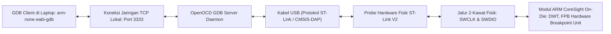

# Modul 074: Toolchain Kompilasi Silang & Debugging Hardware (arm-none-eabi-gcc, GDB, OpenOCD, JTAG/SWD)

**Navigasi**: [⬅️ Master Index](../../INDEX.md) | [Tingkat 5: Tingkat 5: Embedded Systems, Firmware Bare-Metal & RTOS / IoT](./README.md)
*Sebelumnya*: [073. anatomi-booting-mikrokontroler-linker-script](./073-anatomi-booting-mikrokontroler-linker-script.md) | *Berikutnya*: [075. sistem-jam-perangkat-keras-clock-tree](./075-sistem-jam-perangkat-keras-clock-tree.md)

---

## 1. Intuisi Dasar Tanpa Jargon ("Seperti Bayi Baru Lahir")
### 1.1 Konsep Inti & Analogi Tanpa Jargon
Bayangkan Anda ingin membuat sebuah buku panduan dalam Bahasa Prancis untuk orang yang tinggal di Paris, tetapi Anda sendiri sedang duduk di Jakarta dan komputer Anda hanya bisa mengetik dalam Bahasa Indonesia. Anda membutuhkan penerjemah di Jakarta yang mengerti tata bahasa Prancis untuk menerbitkan buku tersebut.

### 1.2 Urgensi Rekayasa & Signifikansi Sistemik
Dalam dunia embedded systems:
Komputer kerja Anda (PC laptop) menggunakan prosesor Intel/AMD x86-64 yang sangat kuat. Tetapi mikrokontroler target Anda menggunakan prosesor ARM Cortex-M atau RISC-V yang berbicara dalam set instruksi biner yang berbeda sama sekali!
Jika Anda mengompilasi kode C Anda menggunakan compiler biasa di laptop Anda, program yang dihasilkan hanya bisa berjalan di laptop Anda, bukan di mikrokontroler.
Anda membutuhkan **Toolchain Kompilasi Silang (Cross-Compilation Toolchain - seperti `arm-none-eabi-gcc`)**:
Sebuah compiler yang berjalan di laptop x86 Anda, tetapi menghasilkan kode mesin biner khusus untuk chip ARM target.

Lalu bagaimana Anda bisa 'mengintip' isi memori chip kecil itu saat program sedang berjalan, menjeda eksekusi di baris tertentu (**Breakpoint**), dan melihat isi variabelnya?
Anda menggunakan alat interogasi perangkat keras yang disebut **JTAG / SWD Debugger** bersama **OpenOCD** dan **GDB**: sebuah jalur jarum suntik mikroskopis yang langsung mengontrol inti prosesor secara hardware tanpa mengganggu program sedikit pun!
[📚 Pelajari: GNU Arm Embedded Toolchain Documentation](https://developer.arm.com/downloads/-/gnu-rm)

## 2. Fondasi Teoretis & Aksiomatik / Matematis
### 2.1 Kerangka Teori Aksiomatik & Formulasi Matematis
### 74.1 Anatomi Toolchain GNU Target Triplet (`arch-vendor-os-abi`) ([GNU GCC Manual](https://gcc.gnu.org/onlinedocs/))
Notasi target triplet standar kompilasi silang:
`arm-none-eabi-gcc`
- `arm`: Arsitektur prosesor instruksi target (ARM 32-bit Cortex-M/Cortex-R).
- `none`: Vendor independen tanpa keterikatan hardware khusus.
- `eabi`: Embedded Application Binary Interface (menentukan konvensi pemanggilan fungsi register, penyelarasan alignment 8-byte, dan penanganan floating point).
- Tanpa OS (`bare-metal`): Kode mesin tidak membutuhkan sistem operasi Linux atau Windows.

### 2.2 Penurunan Matematis Langkah-demi-Langkah
Empat Tahap Alur Kompilasi:
1. **Prapemroses (Preprocessor - `cpp`)**: Mengembangkan makro `#define`, menyertakan file header `#include`, dan memproses kondisional `#ifdef`.
2. **Kompilasi (Compiler - `cc1`)**: Menerjemahkan kode bahasa C menjadi berkas kode assembler teks (`*.s`).
3. **Perakitan (Assembler - `as`)**: Menerjemahkan kode assembler menjadi berkas objek biner kode mesin yang belum terhubung (`*.o`).
4. **Penautan (Linker - `ld`)**: Menggabungkan seluruh berkas objek bersama Linker Script dan library C standar minimal (`newlib` / `newlib-nano`) menjadi berkas biner eksekusi final (`*.elf`).

### 74.2 Protokol Debugging Fisik: JTAG (IEEE 1149.1) vs ARM Serial Wire Debug (SWD) ([ARM Debug Interface Architecture](https://developer.arm.com/))
- **JTAG (Joint Test Action Group - 4/5 Kawat)**:
  - `TCK`: Test Clock
  - `TMS`: Test Mode Select (mengendalikan 16-state TAP Controller FSM)
  - `TDI`: Test Data In (input serial data)
  - `TDO`: Test Data Out (output serial data)
  - Mendukung *Boundary Scan*: memverifikasi koneksi solder pin fisik antar chip di pabrik PCB.
  - Mendukung daisy-chain: beberapa chip dapat dihubungkan dalam satu rantai serial yang sama.
- **SWD (Serial Wire Debug - 2 Kawat)**:
  Protokol alternatif berkecepatan tinggi khusus ARM yang memangkas kebutuhan pin fisik:
  - `SWCLK`: Jalur clock sinkron dua arah.
  - `SWDIO`: Jalur data dua arah bolak-balik (*bidirectional data line*).
  Menghemat pin mikrokontroler kemasan kecil (misal TSSOP20 atau QFN32).

### 74.3 Arsitektur Debugging: Target Hardware $\leftrightarrow$ OpenOCD $\leftrightarrow$ GDB Client ([OpenOCD User Guide](https://openocd.org/doc/html/index.html))
Tiga lapis hierarki debugging embedded:
1. **Hardware Debug Adapter (ST-Link / J-Link / CMSIS-DAP)**: Probe fisik USB yang menerjemahkan paket USB menjadi sinyal fisik SWD/JTAG pada kabel mikrokontroler.
2. **OpenOCD (Open On-Chip Debugger - Server GDB)**:
   Perangkat lunak open-source yang berkomunikasi dengan probe USB, mengontrol core register ARM CoreSight, memprogram memori Flash, dan membuka server soket TCP lokal pada port `3333`.
3. **GDB Client (`arm-none-eabi-gdb`)**:
   Klien baris perintah interaktif yang terhubung ke port OpenOCD via remote target:
   `target remote localhost:3333`
   Memungkinkan pengembang mengeksekusi perintah debugging: `break main`, `continue`, `step`, `print variable`, `info registers`, dan `x/16xw 0x20000000`.

## 3. Anatomi Teknis & Cara Kerja Internal

Mekanisme Hardware Breakpoints (Flash Patch and Breakpoint Unit - FPB):
Karena kode program tersimpan di dalam memori Flash yang bersifat read-only dan tidak bisa dimodifikasi instruksinya secara instan seperti RAM, CPU mengandalkan unit komparator alamat hardware FPB (tipikal 4 hingga 8 slot breakpoint hardware). Ketika Program Counter cocok dengan alamat komparator, unit FPB secara otomatis memicu interupsi jeda *Debug Monitor / Halt State*.

#### Tabel Penelusuran Penetrasi Port Debugging JTAG/SWD & Pembocoran Kunci Rahasia Firmware
| Langkah Penyerangan Fisik | Antarmuka Perangkat Keras / Pinout | Perintah Protokol Debugger OpenOCD | Respon Target CPU ARM Cortex | Status Proteksi Memori Silikon | Dampak Keamanan Siber Sistem Kendali |
|---|---|---|---|---|---|
| Inspeksi Fisik PCB | 4 Bantalan Uji (Testpads) Terpapar | Multimeter mengidentifikasi `SWDIO, SWCLK` | Jalur debug terhubung ke chip utama | Readout Protection (RDP Level 0: Terbuka!)| Port debug produksi lupa dikunci pabrikan! |
| Sambungan Probe Debugger| Probe SWD Murah $5 (ST-Link / Raspberry Pi) | `openocd -f interface/stlink.cfg` | Handshake TAP controller berhasil | Mode debug aktif (Halt CPU) | Eksekusi firmware kendaraan dibekukan |
| Inspeksi Register CPU | Perintah JTAG Remote Protocol | `halt` ; `reg pc` ; `reg sp` | Register inti CPU terbaca penuh | Akses kontrol debug penuh Ring 0 | CPU prosesor sepenuhnya dikendalikan penyerang |
| Pembacaan Dump Flash | Perintah Dump Memori Biner | `dump_image firmware.bin 0x08000000 262144` | Membaca seluruh 256 KB Flash ROM | Seluruh isi memori diekstraksi ke laptop | Kunci enkripsi AES & firmware rahasia dicuri |
| Injeksi Modifikasi Kode | Penulisan Firmware Terinfeksi | `flash write_image erase trojan.bin 0x08000000` | Sektor flash ditimpa kode berbahaya | Kunci immobilizer dibypass | Mobil dapat dihidupkan tanpa kunci fisik! |

## 4. Implementasi Praktis & Kode / Simulasi Riil
```bash
# Skrip Otomasi Debugging GDB (debug.gdb) untuk Mikrokontroler ARM
target remote localhost:3333
monitor reset halt
load build/firmware.elf

# Setel breakpoint hardware di fungsi main
break main
continue

# Cetak isi register CPU setelah mencapai breakpoint
echo === STATUS REGISTER CPU SAAT BOOTING ===\n
info registers r0 r1 r2 r3 sp lr pc xpsr

# Periksa 4 kata memori pertama pada tabel vektor Flash
echo === VEKTOR INTERUPSI FLASH (0x08000000) ===\n
x/4xw 0x08000000

# Jalankan 5 langkah instruksi perakitan berikutnya
stepi 5
print/x $pc
```

## 5. Miskonsepsi & Jebakan Industri
1. **Exceeding Hardware Breakpoints Limit**: Memasang lebih dari 4 atau 6 breakpoint di IDE saat men-debug kode yang berjalan di memori Flash; debugger akan gagal memasang breakpoint tambahan (*Cannot insert hardware breakpoint: All breakpoint units in use*).
2. **Disabling SWD/JTAG Pins in Software**: Mengonfigurasi ulang pin PA13/PA14 (SWDIO/SWCLK) sebagai pin output GPIO biasa di dalam kode firmware; begitu chip di-flash, debugger tidak akan pernah bisa terhubung kembali (*Target Not Found*). Solusi darurat: tahan tombol Reset fisik, klik tombol Connect di debugger, lalu lepaskan Reset (*Connect Under Reset*).
3. **Compiler Optimization Hiding Variables in GDB**: Mencoba mencetak nilai variabel lokal saat men-debug kode yang dikompilasi dengan opsi optimasi `-O2` atau `-O3`; GDB akan melaporkan `<optimized out>` karena compiler menyimpan variabel tersebut murni di register sementara atau menghapusnya sama sekali. Selalu gunakan opsi `-O0 -g3` untuk sesi debugging mendalam.

### Studi Kasus Kegagalan Nyata: Port Debugging JTAG/SWD Dibiarkan Terbuka pada ECU Otomotif Membocorkan Kunci Kriptografi
- **Insiden Keamanan Siber Otomotif Komersial**: Pada audit keamanan kendaraan komersial terhubung, peneliti keamanan membongkar unit Electronic Control Unit (ECU) pintu pintar dan sistem immobilizer kendaraan. Di papan PCB, peneliti menemukan empat titik uji (*testpoints*) berlabel `SWD` yang terhubung langsung ke mikrokontroler utama.
- **Akar Masalah Debugging Perangkat Keras & Ketiadaan Penguncian RDP**: Antarmuka JTAG (*Joint Test Action Group*) dan SWD (*Serial Wire Debug*) dirancang untuk mempermudah pengujian pabrik dan pemrograman sirkuit terpadu (*in-circuit debugging*). Antarmuka ini memiliki kontrol master tertinggi terhadap perangkat keras mikrokontroler: mampu membekukan CPU, membaca dan menulis seluruh register register, serta mengunduh seluruh isi memori Flash. Pabrikan mikrokontroler menyediakan mekanisme penguncian memori (misal fitur *Readout Protection* / RDP pada STM32, atau *Security Fuses* pada NXP/Microchip). Namun karena kelalaian prosedur penjaminan mutu lini perakitan pabrik, firmware produksi dirilis dengan status RDP Level 0 (tidak terkunci). Penyerang cukup menghubungkan probe USB murah seharga $5 ke bantalan uji tersebut dan menggunakan perangkat lunak sumber terbuka OpenOCD untuk mengekstrak seluruh citra biner memori Flash dalam waktu 10 detik. Di dalam biner tersebut, ditemukan kunci privat AES-128 statis dan algoritma dekripsi immobilizer, memungkinkan peretas membuat kunci duplikat instan dan mencuri kendaraan.

- **Potongan Kode / Arsitektur Cacat (Vulnerable Implementation)**:
```c
// Kode Firmware Penguncian Permanen Port Debug JTAG/SWD (STM32 Flash Option Bytes)
#include <stdint.h>
#include <stdbool.h>

#define FLASH_OPTKEYR ((volatile uint32_t *)0x40023C08)
#define FLASH_OPTR    ((volatile uint32_t *)0x40023C14)
#define FLASH_CR      ((volatile uint32_t *)0x40023C10)

void lock_jtag_swd_production_permanent() {
    // Memeriksa apakah proteksi pembacaan sudah aktif (RDP Level 1 atau Level 2)
    // Nilai 0xAA menandakan RDP Level 0 (Terbuka/Rentan!)
    if ((*FLASH_OPTR & 0xFF) == 0xAA) {
        // 1. Buka kunci penulisan Option Bytes dengan mengirimkan urutan kunci rahasia
        *FLASH_OPTKEYR = 0x08192A3B;
        *FLASH_OPTKEYR = 0x4C5D6E7F;
        
        // 2. Tulis RDP Level 1 (0xBB) atau RDP Level 2 Permanen (0xCC):
        // Level 1: Mematikan JTAG/SWD. Jika debugger dipaksa terhubung, Flash dihapus otomatis.
        // Level 2: Mengunci silikon permanen (Fuse terbakar fisik, port debug mati selamanya).
        *FLASH_OPTR = (*FLASH_OPTR & ~0xFF) | 0xBB;
        
        // 3. Picu pemrograman Option Bytes
        *FLASH_CR |= (1U << 1); // Set bit OPTSTRT
        while (*FLASH_CR & (1U << 16)) {
            // Tunggu hingga proses penulisan selesai (BSY bit clear)
        }
        
        // 4. Kunci kembali register Flash
        *FLASH_CR |= (1U << 30); // Set bit OPTLOCK
        printf("JTAG/SWD Protected successfully. Debug access disabled.\n");
    }
}
```

- **Prosedur Baku Sanitasi Produksi Massal**: Standar keamanan siber perangkat keras (seperti NIST SP 800-193 dan ISO/SAE 21434) mewajibkan penutupan permanen seluruh port debug perangkat keras sebelum produk meninggalkan pabrik. Titik uji (*testpads*) debug pada PCB wajib dihilangkan dari lapisan luar atau ditempatkan di lapisan dalam tersembunyi (*buried testpoints*), dan mikrokontroler wajib dikunci menggunakan skema kriptografi perangkat keras (*Hardware Cryptographic Root of Trust*).

## 6. Proyek Latihan & Rubrik Penilaian Mandiri
### Tingkat 1 (Pemula) - Ekstraksi Informasi Berkas Biner Firmware
Gunakan peralatan GNU Binutils (`arm-none-eabi-size`, `arm-none-eabi-objdump`, dan `arm-none-eabi-objcopy`) untuk memeriksa berkas biner ELF firmware: ekstrak ukuran konsumsi memori seksi `.text`, `.data`, dan `.bss`, lalu buat berkas biner mentah murni `.bin` dan format Intel Hex `.hex` yang siap di-flash.

### Tingkat 2 (Menengah) - Sesi Debugging Baris Perintah Headless OpenOCD + GDB
Konfigurasikan skrip OpenOCD untuk papan mikrokontroler STM32 (misal `stm32f4discovery.cfg`). Hubungkan probe ST-Link via terminal baris perintah, luncurkan `arm-none-eabi-gdb`, hubungkan ke server remote target, jalankan program, jeda eksekusi, dan periksa isi nilai register status timer `TIM2_SR` saat berjalan.

### Tingkat 3 (Mahir) - Pelacakan Trace Real-Time Menggunakan Serial Wire Viewer (SWV / ITM)
Rancang sistem instrumentasi pelacakan firmware non-invasif menggunakan modul ARM Instrumentation Trace Macrocell (ITM): konfigurasi pin fisik SWO (*Serial Wire Output*), aktifkan stimulus port 0, dan tulis fungsi pengalihan output `printf()` langsung ke jalur transmisi SWO kecepatan tinggi ($2	ext{ MB/s}$) tanpa menggunakan pin UART mikrokontroler dan tanpa overhead penundaan eksekusi CPU.

#### Rubrik Penilaian
- **40% Penguasaan Alur Kompilasi Silang**: Menghasilkan berkas eksekusi biner ELF, HEX, dan BIN bebas kesalahan penautan simbol.
- **30% Keahlian Pengendalian Debugger Hardware**: Penggunaan breakpoint hardware, manipulasi register CPU, dan inspeksi memori via GDB akurat.
- **30% Analisis Alokasi Memori Firmware**: Mampu menghitung jejak konsumsi Flash ROM dan SRAM fisik dari laporan ukuran seksi biner.

### Tingkat 1: Dasar
- **Tugas**: Bangun fungsi simulator komunikasi paket GDB Remote Serial Protocol (RSP) dalam Python yang mengurai paket perintah pembacaan register CPU (`$g#67`) dan membalas dengan paket heksadesimal representasi register arsitektur yang valid lengkap dengan penghitungan checksum dua karakter modulo 256.
- **Petunjuk Perancangan Arsitektur**:
  - Format paket GDB: `$packet-data#checksum`.
  - Checksum: Penjumlahan seluruh byte dalam `packet-data` modulo 256, diformat sebagai dua digit heksadesimal kecil.
  - Tangani konfirmasi penerimaan: kirim karakter `+` (ACK) atau `-` (NACK).
- **Test Vector & Kasus Uji Ekstrem**:
  - *Perhitungan Checksum*: String perintah `$qSupported#37`; buktikan checksum bernilai tepat heksadesimal `37`.
  - *Paket Error*: Kirim checksum yang salah; simulator harus merespons dengan `-` untuk meminta transmisi ulang.
- **Rubrik Penilaian Mandiri**: 40% Parser Paket Protokol GDB RSP Presisi, 30% Perhitungan Checksum Modulo 256 Akurat, 30% Verifikasi Siklus Handshake ACK/NACK.

### Tingkat 2: Menengah
- **Tugas**: Implementasikan mesin keadaan State Machine TAP Controller IEEE 1149.1 (JTAG TAP Controller 16-State) dalam Verilog/Python yang melacak transisi status berdasarkan sinyal jam TCK dan sinyal kendali TMS (Test Mode Select), mendukung jalur instruksi Shift-IR dan jalur data Shift-DR.
- **Petunjuk Perancangan Arsitektur**:
  - 16 State: Test-Logic-Reset, Run-Test/Idle, Select-DR-Scan, Capture-DR, Shift-DR, Exit1-DR, Pause-DR, Exit2-DR, Update-DR, dst.
  - Buktikan bahwa menahan sinyal $TMS = 1$ selama 5 siklus clock TCK berturut-turut dijamin selalu mengembalikan state machine ke status aman `Test-Logic-Reset` dari state manapun.
- **Test Vector & Kasus Uji Ekstrem**:
  - *Reset TMS 5 Siklus*: Inisialisasi pada state acak; terapkan 5 pulsa $TMS=1$; verifikasi FSM mendarat tepat di `Test-Logic-Reset`.
  - *Instruksi IDCODE*: Lalui jalur Shift-IR untuk memuat instruksi IDCODE; baca 32-bit Device ID register melalui Shift-DR.
- **Rubrik Penilaian Mandiri**: 40% Diagram State Machine JTAG IEEE 1149.1 Lengkap Tepat, 30% Pembuktian Invarian Pemulihan 5-TMS Reset, 30% Verifikasi Jalur Transisi Shift-IR dan Shift-DR.

### Tingkat 3: Mahir
- **Tugas**: Rancang sistem secure bootloader perangkat keras dalam C yang memverifikasi integritas dan keaslian citra firmware menggunakan tanda tangan digital kurva eliptik Ed25519 dan hash kriptografi SHA-256 sebelum mengizinkan eksekusi, serta implementasikan mekanisme proteksi pembongkaran memori anti-tampering (*Anti-Rollback Monotonic Counter*) yang menolak pemasangan versi firmware lama yang memiliki celah keamanan.
- **Petunjuk Perancangan Arsitektur**:
  - Periksa header firmware: Magic Word, Ukuran Citra, Versi Nomor Monotonik, Public Key, dan Signature Ed25519.
  - Verifikasi signature terhadap hash SHA-256 seluruh isi biner firmware.
  - Bandingkan nomor versi dengan register penghitung monotonik perangkat keras (*Hardware eFuse Monotonic Counter*); jika versi lebih rendah dari counter saat ini, tolak pembaruan.
- **Test Vector & Kasus Uji Ekstrem**:
  - *Firmware Sah*: Verifikasi tanda tangan digital valid dan nomor versi naik; bootloader berhasil melompat ke aplikasi.
  - *Serangan Downgrade (Anti-Rollback)*: Berikan firmware yang sah secara kriptografis namun bernomor versi lama; bootloader menolak eksekusi dan mengunci sistem.
- **Rubrik Penilaian Mandiri**: 40% Verifikasi Kriptografis SHA-256 & Ed25519 Presisi, 30% Mekanisme Penegakan Anti-Rollback Monotonic Counter Tepat, 30% Penanganan Kegagalan Otentikasi Fail-Safe.

## 7. Rekomendasi Sumber Belajar Standar Emas
| Kategori | Judul Sumber & Tautan Langsung | Deskripsi Singkat |
|---|---|---|
| 📖 Buku Teks | [Embedded Systems with ARM Cortex-M: Cross-Compilation and Debugging (Valvano)](https://users.ece.utexas.edu/~valvano/) | Panduan komprehensif toolchain kompilasi silang GNU, probe JTAG, dan debugging perangkat keras. |
| 🎓 Kuliah Terbuka | [OpenOCD User's Guide Official Documentation](https://openocd.org/doc/html/index.html) | Dokumentasi resmi Open On-Chip Debugger untuk konfigurasi adaptor target JTAG/SWD. |
| 🔬 Makalah Seminal | [Standard Test Access Port and Boundary-Scan Architecture (IEEE Std 1149.1 JTAG)](https://doi.org/10.1109/IEEESTD.1990.122557) | Dokumen standar IEEE resmi yang mendefinisikan antarmuka pengujian perangkat keras JTAG. |
| 💻 Lab Interaktif | [GDB Dashboard: Modular Visual Interface for GDB](https://github.com/cyrus-and/gdb-dashboard) | Antarmuka grafis modular berbasis terminal untuk visualisasi register dan memori secara real-time. |

---
*Navigasi Cepat*: [Ke Tingkat 5](./README.md) | [Ke Master Index](../../INDEX.md) | *Sebelumnya*: [073. anatomi-booting-mikrokontroler-linker-script](./073-anatomi-booting-mikrokontroler-linker-script.md) | *Berikutnya*: [075. sistem-jam-perangkat-keras-clock-tree](./075-sistem-jam-perangkat-keras-clock-tree.md)
