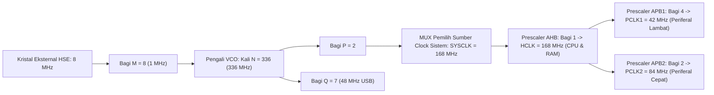

# Modul 075: Sistem Jam Perangkat Keras (Clock Tree: Osilator Internal RC, Kristal HSE/LSE, PLL Prescalers)

**Navigasi**: [⬅️ Master Index](../../INDEX.md) | [Tingkat 5: Tingkat 5: Embedded Systems, Firmware Bare-Metal & RTOS / IoT](./README.md)
*Sebelumnya*: [074. toolchain-kompilasi-silang-debugging-hardware](./074-toolchain-kompilasi-silang-debugging-hardware.md) | *Berikutnya*: [076. manajemen-interupsi-perangkat-keras](./076-manajemen-interupsi-perangkat-keras.md)

---

## 1. Intuisi Dasar Tanpa Jargon ("Seperti Bayi Baru Lahir")
Bayangkan sistem jaringan kereta api cepat modern:
- Kereta komuter antar kota melaju kencang pada kecepatan $300	ext{ km/jam}$.
- Trem listrik di dalam kota melaju santai pada kecepatan $40	ext{ km/jam}$.
- Pintu gerbang palang perlintasan hanya membutuhkan sinyal lambat $5	ext{ km/jam}$.
Jika seluruh kereta dan pintu gerbang dipaksa berjalan pada kecepatan $300	ext{ km/jam}$ yang sama, seluruh sistem kota akan boros energi raksasa dan cepat aus rusak!

Di dalam mikrokontroler, itulah fungsi **Pohon Jam Perangkat Keras (Clock Tree)**:
Chip memiliki beberapa sumber detak jantung yang berbeda:
1. **Osilator Internal RC (HSI)**: Seperti detak jantung darurat bawaan tubuh: langsung menyala instan saat bangun tidur, tidak butuh komponen luar, tetapi frekuensinya agak goyang (*jitter*) jika suhu ruangan berubah.
2. **Kristal Kuarsa Eksternal (HSE)**: Seperti jam atom super presisi: frekuensinya sangat stabil dan akurat hingga seperjuta persen (ppm), sangat wajib untuk komunikasi USB dan CAN bus.
3. **Phase-Locked Loop (PLL)**: Pompa pengganda frekuensi yang melipatgandakan detak kristal 8 MHz menjadi 168 MHz!
4. **Prescaler (Pembagi Detak)**: Membagi-bagikan frekuensi cepat tersebut ke berbagai jalur bus periferal sesuai kebutuhan daya dan kecepatannya.
[📚 Pelajari: STMicroelectronics Clock Tree Configuration Guide](https://www.st.com/resource/en/application_note/an3300-stm32f4-clock-configuration-stmicroelectronics.pdf)

## 2. Fondasi Teoretis & Aksiomatik / Matematis
### 75.1 Empat Sumber Jam Primer Mikrokontroler ([STM32 Reference Manual](https://www.st.com/))
1. **HSI (High-Speed Internal RC Oscillator)**:
   Osilator resistor-kapasitor internal pada die silikon (tipikal $8\text{ MHz} - 16\text{ MHz}$).
   - Startup instan ($< 2 \, \mu\text{s}$), biaya nol (tanpa komponen eksternal).
   - Akurasi sedang ($\pm 1\% - \pm 2\%$ drift terhadap suhu dan tegangan).
2. **HSE (High-Speed External Oscillator)**:
   Resonator kristal kuarsa eksternal ($4\text{ MHz} - 26\text{ MHz}$) dengan kestabilan frekuensi ultra-tinggi ($\pm 10\text{ s/d } \pm 50\text{ ppm}$).
3. **LSI (Low-Speed Internal RC Oscillator)**:
   Osilator internal berdaya nano-ampere ($\approx 32\text{ kHz}$) yang tetap menyala di seluruh mode deep-sleep untuk menggerakkan Watchdog Timer independen.
4. **LSE (Low-Speed External Crystal)**:
   Kristal kuarsa arloji eksternal berfrekuensi standar tepat $32.768\text{ kHz}$ ($2^{15}\text{ Hz}$). Dibagi dengan $2^{15}$ menghasilkan detak tepat 1 detik untuk Real-Time Clock (RTC).

### 75.2 Rumus Sintesis Pengganda Frekuensi PLL (Phase-Locked Loop) ([STM32F4 Clock Tree](https://www.st.com/))
Frekuensi sistem utama ($f_{\text{SYSCLK}}$) disintesis dari sumber jam masukan ($f_{\text{IN}}$) melalui jaringan pembagi dan pengali PLL:
$$f_{\text{VCO\_input}} = \frac{f_{\text{IN}}}{M}, \quad 1\text{ MHz} \le f_{\text{VCO\_input}} \le 2\text{ MHz}$$
$$f_{\text{VCO\_output}} = f_{\text{VCO\_input}} \times N, \quad 100\text{ MHz} \le f_{\text{VCO\_output}} \le 432\text{ MHz}$$
$$f_{\text{SYSCLK}} = \frac{f_{\text{VCO\_output}}}{P}$$
$$f_{\text{USB, SDIO, RNG}} = \frac{f_{\text{VCO\_output}}}{Q} = 48\text{ MHz} \quad (\text{Wajib tepat } 48\text{ MHz!})$$
Contoh Perhitungan ($f_{\text{IN}} = 8\text{ MHz}$ HSE ke $f_{\text{SYSCLK}} = 168\text{ MHz}$):
- $M = 8 \implies f_{\text{VCO\_in}} = 1\text{ MHz}$
- $N = 336 \implies f_{\text{VCO\_out}} = 336\text{ MHz}$
- $P = 2 \implies f_{\text{SYSCLK}} = 336 / 2 = 168\text{ MHz}$
- $Q = 7 \implies f_{\text{USB}} = 336 / 7 = 48\text{ MHz}$ (Sempurna!).

### 75.3 Hirarki Prescaler Bus (AHB, APB1, APB2) & Clock Security System (CSS) ([RM0090 Reference Manual](https://www.st.com/))
- **AHB Bus (Advanced High-Performance Bus - HCLK)**: Menyuplai CPU Core, Memori Flash, SRAM, dan DMA (maksimal $168\text{ MHz}$).
- **APB1 Low-Speed Bus (PCLK1)**: Menyuplai periferal berkecepatan rendah (maksimal $42\text{ MHz}$: UART2, I2C1, SPI2, Timer 2-7).
- **APB2 High-Speed Bus (PCLK2)**: Menyuplai periferal kecepatan tinggi (maksimal $84\text{ MHz}$: Timer 1 & 8, ADC, SPI1, USART1).
- **Clock Security System (CSS)**:
  Sirkuit pengawas hardware yang memantau getaran kristal eksternal HSE secara terus-menerus. Jika kristal fisik patah atau jalur kawatnya terputus, CSS secara otomatis memicu interupsi NMI darurat dan mengalihkan clock CPU seketika kembali ke osilator internal HSI untuk mencegah sistem kendali mobil/pesawat mati mendadak.

## 3. Anatomi Teknis & Cara Kerja Internal

Pengali Timer Periferal Otomatis (Timer Clock Multiplier):
Jika prescaler bus APB tidak sama dengan 1, perangkat keras arsitektur secara otomatis melipatgandakan clock input timer ($2	ext{x}$) sehingga timer PWM dapat mencacah pada frekuensi penuh tanpa terdegradasi oleh pembagian bus APB.

## 4. Implementasi Praktis & Kode / Simulasi Riil
def configure_stm32_pll_parameters(hse_mhz: float, target_sysclk_mhz: float) -> dict:
    """
    Menghitung parameter pembagi M, pengali N, dan pembagi P untuk pohon jam PLL STM32F4.
    Batas: VCO_IN = 1-2 MHz, VCO_OUT = 100-432 MHz, P in (2, 4, 6, 8)
    """
    # Tetapkan target VCO input tepat 1 MHz
    m = int(hse_mhz)
    vco_in_mhz = hse_mhz / m
    
    # Cari kombinasi P dan N yang memenuhi target SYSCLK
    valid_configs = []
    for p in (2, 4, 6, 8):
        vco_out_mhz = target_sysclk_mhz * p
        n = int(vco_out_mhz / vco_in_mhz)
        if 100 <= vco_out_mhz <= 432 and 50 <= n <= 432:
            q = vco_out_mhz / 48.0 # Cek kecocokan clock USB 48 MHz
            valid_configs.append({"M": m, "N": n, "P": p, "Q": q, "VCO_out": vco_out_mhz})
            
    if not valid_configs:
        raise ValueError("Kombinasi frekuensi target tidak dapat dicapai secara matematis.")
        
    # Pilih konfigurasi terbaik (prioritaskan yang memiliki Q mendekati integer)
    best = min(valid_configs, key=lambda c: abs(c["Q"] - round(c["Q"])))
    return best

res = configure_stm32_pll_parameters(hse_mhz=8.0, target_sysclk_mhz=168.0)
print(f"Konfigurasi Clock Tree STM32 168 MHz:")
print(f" - Pembagi PLL_M   : {res['M']} (VCO In: 1.0 MHz)")
print(f" - Pengali PLL_N   : {res['N']} (VCO Out: {res['VCO_out']:.1f} MHz)")
print(f" - Pembagi PLL_P   : {res['P']} (SYSCLK: 168.0 MHz)")
print(f" - Pembagi USB PLL_Q: {res['Q']:.2f} (Clock USB 48 MHz Tepat: {res['Q'] == 7.0})")

## 5. Miskonsepsi & Jebakan Industri
1. **Switching to PLL before Locking (`PLLRDY` Check Missing)**: Mengalihkan sumber clock sistem ke PLL sebelum menunggu bendera kuncian fase `RCC_CR_PLLRDY` bernilai '1'; CPU beralih ke sumber clock yang belum stabil atau mati, membekukan sistem seketika pada saat inisialisasi awal.
2. **Exceeding Maximum APB Bus Frequency Limits**: Mengatur prescaler bus APB1 terlalu rendah saat menaikkan SYSCLK ke $168	ext{ MHz}$; jika PCLK1 melampaui batas maksimum spesifikasi ($> 42	ext{ MHz}$), modul periferal I2C dan UART akan menghasilkan data korupsi biner acak.
3. **USB 48 MHz Clock Inaccuracy Failure**: Menyuplai subsistem USB Full-Speed dari osilator internal RC (HSI) tanpa kalibrasi sinkronisasi frame USB (SOF); deviasi frekuensi HSI yang melampaui $\pm 0.25\%$ membuat komputer host menolak perangkat USB dengan pesan kesalahan *Device Descriptor Request Failed*.

## 6. Proyek Latihan & Rubrik Penilaian Mandiri
### Tingkat 1 (Pemula) - Perhitungan Siklus Delay Berbasis Frekuensi Jam
Tulis fungsi penunda waktu perangkat lunak `delay_microseconds(uint32_t us)` dalam bahasa C: hitung secara tepat berapa siklus loop assembly `NOP` yang harus dieksekusi prosesor pada frekuensi clock $16	ext{ MHz}$, $72	ext{ MHz}$, dan $168	ext{ MHz}$ dengan memperhitungkan siklus cabang perulangan.

### Tingkat 2 (Menengah) - Inisialisasi Bare-Metal Clock Tree 168 MHz dalam C
Tulis fungsi inisialisasi jam bare-metal `system_clock_config_168mhz(void)` untuk STM32F4: nyalakan regulator voltase internal mode overdrive, setel Flash latency 5 wait-states, aktifkan osilator kristal eksternal HSE 8 MHz, tunggu kuncian `HSERDY`, konfigurasikan register `RCC_PLLCFGR`, aktifkan PLL, tunggu kuncian `PLLRDY`, konfigurasikan prescaler AHB/APB1/APB2, dan alihkan SYSCLK ke PLL.

### Tingkat 3 (Mahir) - Pengaktifan Clock Security System (CSS) dengan Pemulihan Darurat NMI
Aktifkan fitur Clock Security System pada register kontrol RCC: tulis handler interupsi Non-Maskable Interrupt (`NMI_Handler`) yang mendeteksi kegagalan sinyal detak kristal HSE eksternal, konfigurasi ulang prescaler PLL secara otomatis agar berjalan di atas sumber darurat internal HSI, dan kirimkan paket peringatan kegagalan sensor detak melalui port darurat UART.

#### Rubrik Penilaian
- **40% Ketepatan Urutan Inisialisasi Hardware**: Mematuhi aturan urutan: Pengaturan Regulator Voltase $	o$ Flash Wait-States $	o$ HSE $	o$ PLL $	o$ Switch Clock.
- **30% Validitas Parameter PLL**: Menjaga frekuensi input VCO, output VCO, dan batas bus APB dalam batas toleransi pabrikan.
- **30% Keandalan Mekanisme Failsafe CSS**: Sistem berhasil bertahan hidup dan tidak mati saat kristal eksternal dinonaktifkan secara sengaja.

## 7. Rekomendasi Sumber Belajar Standar Emas
| Kategori | Judul Sumber & Tautan Langsung | Deskripsi Singkat |
|---|---|---|
| 📖 Buku Teks | [Mastering STM32: A Step-by-Step Guide (Carmine Noviello)](https://leanpub.com/mastering-stm32) | Bab konfigurasi clock tree sistem paling mendalam dan praktis untuk mikrokontroler ARM. |
| 🎓 Kuliah Terbuka | [STMicroelectronics Application Note AN3300: STM32 Clock Configuration](https://www.st.com/resource/en/application_note/an3300-stm32f4-clock-configuration-stmicroelectronics.pdf) | Dokumen resmi panduan konfigurasi register RCC, prescaler, dan manajemen daya PLL. |
| 🔬 Makalah Seminal | [Crystal Oscillator Design and Temperature Compensation (Vig, 1999)](https://doi.org/10.1109/FREQ.1999.840742) | Makalah referensi standar karakteristik drift suhu kristal kuarsa dan kestabilan frekuensi. |
| 💻 Lab Interaktif | [STM32CubeMX Graphical Clock Tree Configuration Tool](https://www.st.com/en/development-tools/stm32cubemx.html) | Alat grafis interaktif resmi untuk menghitung dan memvalidasi konfigurasi clock tree mikrokontroler. |

---
*Navigasi Cepat*: [Ke Tingkat 5](./README.md) | [Ke Master Index](../../INDEX.md) | *Sebelumnya*: [074. toolchain-kompilasi-silang-debugging-hardware](./074-toolchain-kompilasi-silang-debugging-hardware.md) | *Berikutnya*: [076. manajemen-interupsi-perangkat-keras](./076-manajemen-interupsi-perangkat-keras.md)
