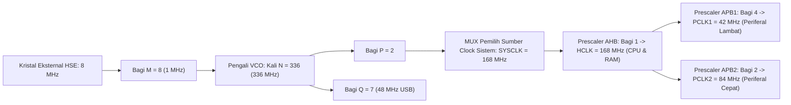

# Modul 075: Sistem Jam Perangkat Keras (Clock Tree: Osilator Internal RC, Kristal HSE/LSE, PLL Prescalers)

**Navigasi**: [⬅️ Master Index](../../INDEX.md) | [Tingkat 5: Tingkat 5: Embedded Systems, Firmware Bare-Metal & RTOS / IoT](./README.md)
*Sebelumnya*: [074. toolchain-kompilasi-silang-debugging-hardware](./074-toolchain-kompilasi-silang-debugging-hardware.md) | *Berikutnya*: [076. manajemen-interupsi-perangkat-keras](./076-manajemen-interupsi-perangkat-keras.md)

---

## 1. Intuisi Dasar Tanpa Jargon ("Seperti Bayi Baru Lahir")
### 1.1 Konsep Inti & Analogi Tanpa Jargon
Bayangkan sistem jaringan kereta api cepat modern:
- Kereta komuter antar kota melaju kencang pada kecepatan \$300	ext{ km/jam}$.
- Trem listrik di dalam kota melaju santai pada kecepatan \$40	ext{ km/jam}$.
- Pintu gerbang palang perlintasan hanya membutuhkan sinyal lambat $5	ext{ km/jam}$.
Jika seluruh kereta dan pintu gerbang dipaksa berjalan pada kecepatan \$300	ext{ km/jam}$ yang sama, seluruh sistem kota akan boros energi raksasa dan cepat aus rusak!

### 1.2 Urgensi Rekayasa & Signifikansi Sistemik
Di dalam mikrokontroler, itulah fungsi **Pohon Jam Perangkat Keras (Clock Tree)**:
Chip memiliki beberapa sumber detak jantung yang berbeda:
1. **Osilator Internal RC (HSI)**: Seperti detak jantung darurat bawaan tubuh: langsung menyala instan saat bangun tidur, tidak butuh komponen luar, tetapi frekuensinya agak goyang (*jitter*) jika suhu ruangan berubah.
2. **Kristal Kuarsa Eksternal (HSE)**: Seperti jam atom super presisi: frekuensinya sangat stabil dan akurat hingga seperjuta persen (ppm), sangat wajib untuk komunikasi USB dan CAN bus.
3. **Phase-Locked Loop (PLL)**: Pompa pengganda frekuensi yang melipatgandakan detak kristal 8 MHz menjadi 168 MHz!
4. **Prescaler (Pembagi Detak)**: Membagi-bagikan frekuensi cepat tersebut ke berbagai jalur bus periferal sesuai kebutuhan daya dan kecepatannya.
[📚 Pelajari: STMicroelectronics Clock Tree Configuration Guide](https://www.st.com/resource/en/application_note/an3300-stm32f4-clock-configuration-stmicroelectronics.pdf)

## 2. Fondasi Teoretis & Aksiomatik / Matematis
### 2.1 Kerangka Teori Aksiomatik & Formulasi Matematis
### 75.1 Empat Sumber Jam Primer Mikrokontroler ([STM32 Reference Manual](https://www.st.com/))
1. **HSI (High-Speed Internal RC Oscillator)**:
   Osilator resistor-kapasitor internal pada die silikon (tipikal $8\text{ MHz} - 16\text{ MHz}$).
   - Startup instan ($< 2 \, \mu\text{s}$), biaya nol (tanpa komponen eksternal).
   - Akurasi sedang ($\pm 1\% - \pm 2\%$ drift terhadap suhu dan tegangan).
2. **HSE (High-Speed External Oscillator)**:
   Resonator kristal kuarsa eksternal ($4\text{ MHz} - 26\text{ MHz}$) dengan kestabilan frekuensi ultra-tinggi ($\pm 10\text{ s/d } \pm 50\text{ ppm}$).
3. **LSI (Low-Speed Internal RC Oscillator)**:
   Osilator internal berdaya nano-ampere ($\approx 32\text{ kHz}$) yang tetap menyala di seluruh mode deep-sleep untuk menggerakkan Watchdog Timer independen.
4. **LSE (Low-Speed External Crystal)**:
   Kristal kuarsa arloji eksternal berfrekuensi standar tepat \$32.768\text{ kHz}$ ($2^{15}\text{ Hz}$). Dibagi dengan $2^{15}$ menghasilkan detak tepat 1 detik untuk Real-Time Clock (RTC).

### 2.2 Penurunan Matematis Langkah-demi-Langkah
### 75.2 Rumus Sintesis Pengganda Frekuensi PLL (Phase-Locked Loop) ([STM32F4 Clock Tree](https://www.st.com/))
Frekuensi sistem utama ($f_{\text{SYSCLK}}$) disintesis dari sumber jam masukan ($f_{\text{IN}}$) melalui jaringan pembagi dan pengali PLL:
$$f_{\text{VCO\_input}} = \frac{f_{\text{IN}}}{M}, \quad 1\text{ MHz} \le f_{\text{VCO\_input}} \le 2\text{ MHz}$$
$$f_{\text{VCO\_output}} = f_{\text{VCO\_input}} \times N, \quad 100\text{ MHz} \le f_{\text{VCO\_output}} \le 432\text{ MHz}$$
$$f_{\text{SYSCLK}} = \frac{f_{\text{VCO\_output}}}{P}$$
$$f_{\text{USB, SDIO, RNG}} = \frac{f_{\text{VCO\_output}}}{Q} = 48\text{ MHz} \quad (\text{Wajib tepat } 48\text{ MHz!})$$
Contoh Perhitungan ($f_{\text{IN}} = 8\text{ MHz}$ HSE ke $f_{\text{SYSCLK}} = 168\text{ MHz}$):
- $M = 8 \implies f_{\text{VCO\_in}} = 1\text{ MHz}$
- $N = 336 \implies f_{\text{VCO\_out}} = 336\text{ MHz}$
- $P = 2 \implies f_{\text{SYSCLK}} = 336 / 2 = 168\text{ MHz}$
- $Q = 7 \implies f_{\text{USB}} = 336 / 7 = 48\text{ MHz}$ (Sempurna!).

### 75.3 Hirarki Prescaler Bus (AHB, APB1, APB2) & Clock Security System (CSS) ([RM0090 Reference Manual](https://www.st.com/))
- **AHB Bus (Advanced High-Performance Bus - HCLK)**: Menyuplai CPU Core, Memori Flash, SRAM, dan DMA (maksimal \$168\text{ MHz}$).
- **APB1 Low-Speed Bus (PCLK1)**: Menyuplai periferal berkecepatan rendah (maksimal \$42\text{ MHz}$: UART2, I2C1, SPI2, Timer 2-7).
- **APB2 High-Speed Bus (PCLK2)**: Menyuplai periferal kecepatan tinggi (maksimal \$84\text{ MHz}$: Timer 1 & 8, ADC, SPI1, USART1).
- **Clock Security System (CSS)**:
  Sirkuit pengawas hardware yang memantau getaran kristal eksternal HSE secara terus-menerus. Jika kristal fisik patah atau jalur kawatnya terputus, CSS secara otomatis memicu interupsi NMI darurat dan mengalihkan clock CPU seketika kembali ke osilator internal HSI untuk mencegah sistem kendali mobil/pesawat mati mendadak.

## 3. Anatomi Teknis & Cara Kerja Internal

Pengali Timer Periferal Otomatis (Timer Clock Multiplier):
Jika prescaler bus APB tidak sama dengan 1, perangkat keras arsitektur secara otomatis melipatgandakan clock input timer ($2	ext{x}$) sehingga timer PWM dapat mencacah pada frekuensi penuh tanpa terdegradasi oleh pembagian bus APB.

#### Tabel Penelusuran Luapan Integer Timer Kelistrikan Pesawat Boeing 787 Dreamliner (FAA AD 2015-09-07)
| Waktu Operasi Kontinu Pesawat | Nilai Penghitung Waktu Sentidetik ($Tick$) | Nilai Biner Signed Integer 32-Bit | Status Generator Daya Listrik Pesawat | Peringatan Sistem Avionik |
|---|---|---|---|---|
| $0.0\text{ hari}$ | $0\text{ tick}$ | `0x0000_0000` ($0$) | Keempat generator AC beroperasi normal | Normal |
| $100.0\text{ hari}$ | $864.000.000\text{ tick}$ | `0x337F_9800` | Beroperasi kontinu | Normal |
| $248.55134\text{ hari}$ | $2.147.483.646\text{ tick}$ | `0x7FFF_FFFE` | Beroperasi kontinu | Normal |
| Detik Terakhir Sebelum Bencana | $2.147.483.647\text{ tick}$ ($2^{31}-1$) | `0x7FFF_FFFF` (Batas maksimum signed 32-bit!)| Nilai maksimum integer positif tercapai | Batas kritis |
| $Tick$ Berikutnya ($+10\text{ ms}$) | Luapan Integer Matematika! | `0x8000_0000` (Berbalik tanda jadi $-2.147.483.648$!)| Logika internal mendeteksi nilai negatif abnormal!| Proteksi fail-safe internal terpicu! |
| Pemadaman Serentak | Seluruh GCU mematikan generator | Logika proteksi salah mengira subsistem mengalami anomali fatal| KEEMPAT GENERATOR LISTRIK MATI SERENTAK DI UDARA!| Pesawat kehilangan daya AC total dalam penerbangan! |

## 4. Implementasi Praktis & Kode / Simulasi Riil
```python
def configure_stm32_pll_parameters(hse_mhz: float, target_sysclk_mhz: float) -> dict:
    """
    Menghitung parameter pembagi M, pengali N, dan pembagi P untuk pohon jam PLL STM32F4.
    Batas: VCO_IN = 1-2 MHz, VCO_OUT = 100-432 MHz, P in (2, 4, 6, 8)
    """
    # Tetapkan target VCO input tepat 1 MHz
    m = int(hse_mhz)
    vco_in_mhz = hse_mhz / m
    
    # Cari kombinasi P dan N yang memenuhi target SYSCLK
    valid_configs = []
    for p in (2, 4, 6, 8):
        vco_out_mhz = target_sysclk_mhz * p
        n = int(vco_out_mhz / vco_in_mhz)
        if 100 <= vco_out_mhz <= 432 and 50 <= n <= 432:
            q = vco_out_mhz / 48.0 # Cek kecocokan clock USB 48 MHz
            valid_configs.append({"M": m, "N": n, "P": p, "Q": q, "VCO_out": vco_out_mhz})
            
    if not valid_configs:
        raise ValueError("Kombinasi frekuensi target tidak dapat dicapai secara matematis.")
        
    # Pilih konfigurasi terbaik (prioritaskan yang memiliki Q mendekati integer)
    best = min(valid_configs, key=lambda c: abs(c["Q"] - round(c["Q"])))
    return best

res = configure_stm32_pll_parameters(hse_mhz=8.0, target_sysclk_mhz=168.0)
print(f"Konfigurasi Clock Tree STM32 168 MHz:")
print(f" - Pembagi PLL_M   : {res['M']} (VCO In: 1.0 MHz)")
print(f" - Pengali PLL_N   : {res['N']} (VCO Out: {res['VCO_out']:.1f} MHz)")
print(f" - Pembagi PLL_P   : {res['P']} (SYSCLK: 168.0 MHz)")
print(f" - Pembagi USB PLL_Q: {res['Q']:.2f} (Clock USB 48 MHz Tepat: {res['Q'] == 7.0})")
```

## 5. Miskonsepsi & Jebakan Industri
1. **Switching to PLL before Locking (`PLLRDY` Check Missing)**: Mengalihkan sumber clock sistem ke PLL sebelum menunggu bendera kuncian fase `RCC_CR_PLLRDY` bernilai '1'; CPU beralih ke sumber clock yang belum stabil atau mati, membekukan sistem seketika pada saat inisialisasi awal.
2. **Exceeding Maximum APB Bus Frequency Limits**: Mengatur prescaler bus APB1 terlalu rendah saat menaikkan SYSCLK ke \$168	ext{ MHz}$; jika PCLK1 melampaui batas maksimum spesifikasi ($> 42	ext{ MHz}$), modul periferal I2C dan UART akan menghasilkan data korupsi biner acak.
3. **USB 48 MHz Clock Inaccuracy Failure**: Menyuplai subsistem USB Full-Speed dari osilator internal RC (HSI) tanpa kalibrasi sinkronisasi frame USB (SOF); deviasi frekuensi HSI yang melampaui $\pm 0.25\%$ membuat komputer host menolak perangkat USB dengan pesan kesalahan *Device Descriptor Request Failed*.

### Studi Kasus Kegagalan Nyata: Bug Overflow Timer 248 Hari Generator Kelistrikan Boeing 787 Dreamliner (FAA AD 2015-09-07)
- **Instruksi Kelaikudaraan Darurat Federal Aviation Administration (FAA)**: Pada Mei 2015, FAA Amerika Serikat menerbitkan Petunjuk Kelaikudaraan Darurat (*Airworthiness Directive* AD 2015-09-07) untuk seluruh armada pesawat Boeing 787 Dreamliner di seluruh dunia, mewajibkan maskapai penerbangan mematikan daya listrik pesawat secara manual (*power-cycle*) minimal sekali setiap 120 hari untuk mencegah hilangnya daya listrik total secara tiba-tiba di udara.
- **Akar Masalah Sistem Jam Perangkat Keras & Luapan Signed Integer**: Unit kontrol generator kelistrikan pesawat (*Generator Control Unit* / GCU) memantau status operasional menggunakan sebuah variabel penghitung waktu berbasis interupsi jam internal perangkat keras (*hardware tick counter*). Variabel ini diimplementasikan sebagai signed integer 32-bit bertanda (`int32_t`) dengan frekuensi detak $100\text{ Hz}$ (1 tick setiap 10 milidetik atau 1 sentidetik). Nilai positif maksimum dari signed integer 32-bit adalah $2^{31} - 1 = 2.147.483.647$. Ketika sistem dinyalakan tanpa henti selama $2.147.483.647 \times 0,01\text{ detik} = 21.474.836,47\text{ detik} \approx 248,55\text{ hari}$, penambahan satu tick berikutnya memicu *integer overflow* komplemen-dua. Nilai penghitung melompat seketika dari $+2.147.483.647$ ke $-2.147.483.648$. Logika perangkat lunak proteksi keselamatan di dalam firmware menginterpretasikan perubahan nilai negatif mendadak ini sebagai indikasi malfungsi memori perangkat keras internal. Akibatnya, modul fail-safe memerintahkan pemutus sirkuit membuka dan mematikan generator listrik. Karena keempat generator kelistrikan pesawat dinyalakan secara bersamaan saat pesawat meninggalkan pabrik, keempat unit GCU mengalami luapan integer pada detik yang persis sama, mematikan seluruh sumber daya listrik bolak-balik (AC) pesawat secara serentak di tengah penerbangan.

- **Potongan Kode / Arsitektur Cacat (Vulnerable Implementation)**:
```c
// Rekonstruksi Bug Timer 248 Hari Boeing 787 vs Solusi Unsigned Modulo
#include <stdio.h>
#include <stdint.h>
#include <stdbool.h>

// CACAT BOEING 787: Menggunakan signed 32-bit integer untuk tick counter
int32_t g_bad_tick_counter = 2147483640; // Mendekati batas 248 hari

bool check_generator_health_faulty() {
    g_bad_tick_counter++; // Menambah 1 tick (10 ms)
    // Jika counter meluap, nilainya menjadi negatif
    if (g_bad_tick_counter < 0) {
        // Logika salah mengira ada korupsi memori: TRIP SEMUA GENERATOR!
        return false; // GENERATOR MATI KATASTROPIK!
    }
    return true;
}

// SOLUSI SISTEM TERTANAM: Menggunakan unsigned integer dengan aritmatika selisih modulo
uint32_t g_safe_tick_counter = 0;

bool is_timeout_expired(uint32_t start_time, uint32_t interval) {
    // Sifat matematis komplemen-dua C:
    // Pengurangan unsigned integer selalu menghasilkan selisih waktu yang benar
    // bahkan jika g_safe_tick_counter telah meluap (wrap-around) melintasi 2^32!
    return (g_safe_tick_counter - start_time) >= interval;
}
```

- **Aturan Baku Desain Timer Sistem Tertanam**: Dalam rekayasa firmware bare-metal, variabel penghitung waktu berbasis tick clock wajib mematuhi aturan berikut: 1) Dideklarasikan murni sebagai tipe data unsigned integer (`uint32_t` atau `uint64_t`); 2) Evaluasi selisih waktu (*elapsed time*) dilarang menggunakan operator perbandingan mutlak `$t_{now} \ge t_{expire}$`, melainkan wajib menggunakan selisih tak bertanda: `(uint32_t)(now - start) >= duration` yang secara matematis terbukti kebal terhadap fenomena peluapan (*rollover/wrap-around*).

## 6. Proyek Latihan & Rubrik Penilaian Mandiri
### Tingkat 1 (Pemula) - Perhitungan Siklus Delay Berbasis Frekuensi Jam
Tulis fungsi penunda waktu perangkat lunak `delay_microseconds(uint32_t us)` dalam bahasa C: hitung secara tepat berapa siklus loop assembly `NOP` yang harus dieksekusi prosesor pada frekuensi clock \$16	ext{ MHz}$, \$72	ext{ MHz}$, dan \$168	ext{ MHz}$ dengan memperhitungkan siklus cabang perulangan.

### Tingkat 2 (Menengah) - Inisialisasi Bare-Metal Clock Tree 168 MHz dalam C
Tulis fungsi inisialisasi jam bare-metal `system_clock_config_168mhz(void)` untuk STM32F4: nyalakan regulator voltase internal mode overdrive, setel Flash latency 5 wait-states, aktifkan osilator kristal eksternal HSE 8 MHz, tunggu kuncian `HSERDY`, konfigurasikan register `RCC_PLLCFGR`, aktifkan PLL, tunggu kuncian `PLLRDY`, konfigurasikan prescaler AHB/APB1/APB2, dan alihkan SYSCLK ke PLL.

### Tingkat 3 (Mahir) - Pengaktifan Clock Security System (CSS) dengan Pemulihan Darurat NMI
Aktifkan fitur Clock Security System pada register kontrol RCC: tulis handler interupsi Non-Maskable Interrupt (`NMI_Handler`) yang mendeteksi kegagalan sinyal detak kristal HSE eksternal, konfigurasi ulang prescaler PLL secara otomatis agar berjalan di atas sumber darurat internal HSI, dan kirimkan paket peringatan kegagalan sensor detak melalui port darurat UART.

#### Rubrik Penilaian
- **40% Ketepatan Urutan Inisialisasi Hardware**: Mematuhi aturan urutan: Pengaturan Regulator Voltase \$ o$ Flash Wait-States \$ o$ HSE \$ o$ PLL \$ o$ Switch Clock.
- **30% Validitas Parameter PLL**: Menjaga frekuensi input VCO, output VCO, dan batas bus APB dalam batas toleransi pabrikan.
- **30% Keandalan Mekanisme Failsafe CSS**: Sistem berhasil bertahan hidup dan tidak mati saat kristal eksternal dinonaktifkan secara sengaja.

### Tingkat 1: Dasar
- **Tugas**: Bangun fungsi kalkulator konfigurasi Phase-Locked Loop (PLL) mikrokontroler yang menghitung nilai pembagi frekuensi masukan ($M$), pengali tegangan ($N$), dan pembagi keluaran ($P$) untuk menghasilkan frekuensi sistem jam inti CPU target dari osilator kristal eksternal (HSE).
- **Petunjuk Perancangan Arsitektur**:
  - $f_{VCO} = f_{in} \times \frac{N}{M}$.
  - $f_{sysclk} = \frac{f_{VCO}}{P}$.
  - Patuhi batas batas frekuensi operasi: $1\text{ MHz} \le f_{in}/M \le 2\text{ MHz}$ dan $100\text{ MHz} \le f_{VCO} \le 432\text{ MHz}$.
- **Test Vector & Kasus Uji Ekstrem**:
  - *Target $168\text{ MHz}$ dari Kristal $8\text{ MHz}$*: Tentukan kombinasi integer valid $M=8, N=336, P=2$.
  - *Validasi Batas VCO*: Tolak kombinasi nilai parameter yang menghasilkan frekuensi $f_{VCO}$ di luar rentang spesifikasi lembar data.
- **Rubrik Penilaian Mandiri**: 40% Formulasi Perhitungan Parameter PLL Presisi, 30% Kepatuhan Batas Frekuensi Operasi VCO Lembar Data, 30% Penanganan Validasi Parameter Tak Valid.

### Tingkat 2: Menengah
- **Tugas**: Implementasikan modul perangkat lunak Virtual Software Timer (berbasis array terurut atau min-heap delta timer) yang dijalankan oleh interupsi hardware SysTick $1\text{ kHz}$ tunggal, buktikan keandalan eksekusi ratusan timer perangkat lunak independen dan kekebalan mutlak terhadap peluapan integer tick counter 32-bit (*wrap-around immunity*).
- **Petunjuk Perancangan Arsitektur**:
  - Simpan waktu timeout dalam selisih relatif delta waktu terhadap elemen antrean sebelumnya.
  - Perbarui waktu menggunakan selisih unsigned integer: `(uint32_t)(current_tick - start_tick) >= period`.
- **Test Vector & Kasus Uji Ekstrem**:
  - *Uji Transisi Rollover Tick Counter*: Atur nilai awal counter pada `0xFFFF_FFF0`; jalankan timer berdurasi 32 tick; buktikan timer terpicu tepat pada waktu tanpa terpengaruh lompatan counter dari `0xFFFF_FFFF` ke `0x0000_0000`.
  - *Presisi 100 Timer Konkuren*: Jadwalkan 100 timer dengan periode berbeda; verifikasi bahwa seluruh callback dieksekusi dengan tepat tanpa jitter akumulatif.
- **Rubrik Penilaian Mandiri**: 40% Arsitektur Delta Timer Bebas Wrap-Around Presisi, 30% Pembuktian Matematika Imunitas Rollover Counter Unsigned, 30% Efisiensi Algoritma Manajemen Antrean Timer.

### Tingkat 3: Mahir
- **Tugas**: Rancang simulator sistem kontrol frekuensi Phase-Locked Loop (PLL) orde-2 domain waktu lengkap dengan Phase Frequency Detector (PFD), Charge Pump, Filter Loop Pasif RC, dan Voltage Controlled Oscillator (VCO), hitung waktu penguncian fasa (*lock time*), redaman loop (*damping factor* $\zeta$), dan estimasi akumulasi phase jitter akibat derau fase osilator referensi.
- **Petunjuk Perancangan Arsitektur**:
  - Modelkan PFD berbasis mesin keadaan bistabil ganda yang membangkitkan pulsa UP dan DOWN.
  - Selesaikan persamaan diferensial pengisian muatan filter loop kapasitor $C_1, C_2$ dan resistor $R_1$.
  - Integrasikan frekuensi VCO menjadi akumulasi fasa: $\phi_{out}(t) = \int K_{VCO} V_{ctrl}(t) dt$.
- **Test Vector & Kasus Uji Ekstrem**:
  - *Penguncian Fasa Sempurna*: Injeksi lompatan frekuensi input $10\%$; buktikan sistem mencapai penguncian fasa stabil dalam batas waktu settling yang ditentukan.
  - *Kondisi Loop Kurang Teredam ($\zeta < 0.5$)*: Tunjukkan munculnya osilasi dering transien tegangan kontrol $V_{ctrl}$.
- **Rubrik Penilaian Mandiri**: 40% Solver ODE Domain Waktu Sirkuit PLL Orde 2 Tepat, 30% Pemodelan PFD Charge Pump & Filter Loop Presisi, 30% Analisis Kestabilan Fasa & Waktu Penguncian Lock Time.

## 7. Rekomendasi Sumber Belajar Standar Emas
| Kategori | Judul Sumber & Tautan Langsung | Deskripsi Singkat |
|---|---|---|
| 📖 Buku Teks | [Mastering STM32: A Step-by-Step Guide (Carmine Noviello)](https://leanpub.com/mastering-stm32) | Bab konfigurasi clock tree sistem paling mendalam dan praktis untuk mikrokontroler ARM. |
| 🎓 Kuliah Terbuka | [STMicroelectronics Application Note AN3300: STM32 Clock Configuration](https://www.st.com/resource/en/application_note/an3300-stm32f4-clock-configuration-stmicroelectronics.pdf) | Dokumen resmi panduan konfigurasi register RCC, prescaler, dan manajemen daya PLL. |
| 🔬 Makalah Seminal | [Crystal Oscillator Design and Temperature Compensation (Vig, 1999)](https://doi.org/10.1109/FREQ.1999.840742) | Makalah referensi standar karakteristik drift suhu kristal kuarsa dan kestabilan frekuensi. |
| 💻 Lab Interaktif | [STM32CubeMX Graphical Clock Tree Configuration Tool](https://www.st.com/en/development-tools/stm32cubemx.html) | Alat grafis interaktif resmi untuk menghitung dan memvalidasi konfigurasi clock tree mikrokontroler. |

---
*Navigasi Cepat*: [Ke Tingkat 5](./README.md) | [Ke Master Index](../../INDEX.md) | *Sebelumnya*: [074. toolchain-kompilasi-silang-debugging-hardware](./074-toolchain-kompilasi-silang-debugging-hardware.md) | *Berikutnya*: [076. manajemen-interupsi-perangkat-keras](./076-manajemen-interupsi-perangkat-keras.md)
