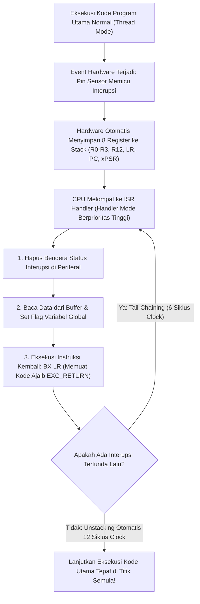

# Modul 076: Manajemen Interupsi Perangkat Keras (NVIC, Prioritas, Latensi, Tail-Chaining, Penulisan ISR Reentrant)

**Navigasi**: [⬅️ Master Index](../../INDEX.md) | [Tingkat 5: Tingkat 5: Embedded Systems, Firmware Bare-Metal & RTOS / IoT](./README.md)
*Sebelumnya*: [075. sistem-jam-perangkat-keras-clock-tree](./075-sistem-jam-perangkat-keras-clock-tree.md) | *Berikutnya*: [077. akselerasi-pengalihan-data-dma](./077-akselerasi-pengalihan-data-dma.md)

---

## 1. Intuisi Dasar Tanpa Jargon ("Seperti Bayi Baru Lahir")
### 1.1 Konsep Inti & Analogi Tanpa Jargon
Bayangkan Anda sedang membaca buku penting di kamar Anda sambil menunggu kurir paket pos tiba di rumah Anda:
- **Pendekatan Polling (Pemeriksaan Berkala)**: Anda berdiri dari meja setiap 10 detik, berjalan ke pintu depan rumah, membuka pintu untuk melihat apakah kurir sudah datang, lalu kembali ke meja. Anda tidak bisa fokus membaca buku, dan waktu serta tenaga Anda terbuang habis sia-sia!
- **Pendekatan Interrupt (Interupsi)**: Anda memasang **Bel Pintu (Doorbell)** di depan rumah. Anda duduk santai membaca buku dengan fokus penuh \$100\%$. Ketika kurir tiba, ia menekan bel: *Ting-Tong!* Anda menandai halaman buku Anda, berdiri membuka pintu untuk mengambil paket (5 detik), lalu langsung duduk kembali dan melanjutkan membaca buku tepat di kalimat yang tadi Anda tinggalkan.

### 1.2 Urgensi Rekayasa & Signifikansi Sistemik
Dalam mikrokontroler, itulah **Interupsi Perangkat Keras (Hardware Interrupt)**:
CPU tidak perlu membuang jutaan siklus clock untuk mengecek status pin GPIO atau sensor secara terus-menerus (*Polling*). Perangkat keras periferal itu sendiri yang akan 'menekan bel' ke inti prosesor saat data tiba.
Di dalam chip prosesor ARM Cortex-M terdapat pengatur lalu lintas interupsi perangkat keras paling canggih di dunia yang disebut **NVIC (Nested Vectored Interrupt Controller)**: ia bisa memprioritaskan interupsi rem darurat di atas interupsi lagu audio, dan menggabungkan eksekusi beberapa interupsi sekaligus secara berantai (*Tail-Chaining*) tanpa membuang satu siklus clock pun!
[📚 Pelajari: ARM NVIC Architecture Guide](https://developer.arm.com/documentation/dui0552/latest/)

## 2. Fondasi Teoretis & Aksiomatik / Matematis
### 2.1 Kerangka Teori Aksiomatik & Formulasi Matematis
### 76.1 Arsitektur Nested Vectored Interrupt Controller (NVIC) ([Joseph Yiu Definitive Guide](https://www.elsevier.com/))
NVIC terintegrasi erat di dalam inti silikon ARM Cortex-M:
- **Vectored Interrupts**: CPU tidak memerlukan polling perangkat lunak untuk mengetahui siapa yang memicu interupsi; perangkat keras secara otomatis melompat langsung ke alamat fungsi penangan (*Interrupt Service Routine* ISR) yang sesuai pada Tabel Vektor.
- **Nesting (Interupsi Bersarang)**: Interupsi dengan prioritas lebih tinggi berhak memotong (*preempt*) interupsi berprioritas lebih rendah yang sedang berjalan di tengah jalan.
- **Konfigurasi Prioritas**: Membagi tingkat prioritas menjadi *Preemption Priority* (menentukan hak pemotongan) dan *Sub-Priority* (menentukan urutan eksekusi jika dua interupsi tiba bersamaan) melalui register `AIRCR` (Application Interrupt and Reset Control Register).

### 2.2 Penurunan Matematis Langkah-demi-Langkah
### 76.2 Latensi Interupsi, Stacking Otomatis & Optimasi Tail-Chaining ([ARM CoreSight Architecture](https://developer.arm.com/))
1. **Hardware Context Stacking Otomatis (12 Siklus Clock)**:
   Saat interupsi diterima, perangkat keras CPU secara otomatis mendorong 8 register penting ke tumpukan Stack (`R0, R1, R2, R3, R12, LR, PC, xPSR`) secara paralel melalui bus matrix tanpa campur tangan instruksi assembler software!
   Register $LR$ (*Link Register*) dimuat dengan kode ajaib khusus **`EXC_RETURN`** (misal `0xFFFFFFF9`).
2. **Tail-Chaining Optimization (Hanya 6 Siklus Clock)**:
   Jika ada interupsi tertunda kedua saat interupsi pertama selesai:
   CPU **TIDAK MELAKUKAN UNSTACKING LALU STACKING ULANG**! CPU mempertahankan status register yang sudah ada di stack dan langsung melompat mengeksekusi ISR kedua, memangkas latensi transisi hingga \$75\%$!
3. **Late-Arrival Optimization**: Jika interupsi berprioritas tinggi tiba saat proses stacking interupsi prioritas rendah sedang berlangsung, CPU secara mulus mengalihkan eksekusi ke interupsi prioritas tinggi tersebut terlebih dahulu.

### 76.3 Aturan Emas Penulisan Fungsi ISR Reentrant & Volatile SigAtomic ([Barr Group Embedded C](https://barrgroup.com/embedded-systems/books/embedded-c-coding-standard))
Aturan mutlak penulisan Interrupt Service Routine (ISR):
1. **Jaga ISR Sesingkat Mungkin**: ISR tidak boleh melakukan penundaan (`delay`), tidak boleh melakukan komputasi berat, dan tidak boleh menunggu transfer bus serial I/O.
2. **Pola Deferral Kerja (Top-Half / Bottom-Half)**: ISR (Top-Half) hanya membaca data hardware, membersihkan bendera interupsi, menyimpan data ke dalam ring buffer, membangkitkan flag/task RTOS, lalu langsung keluar; komputasi berat diserahkan ke loop utama (Bottom-Half).
3. **Variabel Komunikasi Wajib Bertipe `volatile`**: Seluruh variabel yang dimodifikasi di dalam ISR dan dibaca oleh kode utama wajib dideklarasikan dengan kualifikasi `volatile`.
4. **Pembersihan Bendera Interupsi Wajib Segera**: Hapus flag interupsi hardware di awal ISR untuk mencegah eksekusi ganda palsu.

## 3. Anatomi Teknis & Cara Kerja Internal

Mekanisme Nilai Ajaib `EXC_RETURN`:
Ketika kembali dari ISR melalui instruksi `BX LR`, nilai $LR$ bukan alamat memori biasa, melainkan pola bit khusus (misal `0xFFFFFFFD` menandakan kembali ke Thread Mode menggunakan Process Stack Pointer PSP), yang memicu sirkuit logika CPU melakukan unstacking hardware secara otomatis.

#### Tabel Penelusuran Deadlock Pemanggilan Fungsi Non-Reentrant `malloc()` di Dalam ISR
| Thread / Konteks Eksekusi | Instruksi yang Sedang Berjalan | Status Kunci Mutex Heap Allocator | Penanganan Interupsi Perangkat Keras | Status CPU / Thread Eksekusi | Kondisi Sistem Operasi Tertanam |
|---|---|---|---|---|---|
| Main Thread (Prioritas Normal)| Mengeksekusi `malloc(128)` | Mengunci mutex heap (`heap_lock()`) | Interupsi hardware global diaktifkan | Normal | Thread sedang membagi bongkahan heap |
| Mutex Terkunci Penuh | Thread sedang memodifikasi pointer heap | Mutex internal berstatus TERKUNCI | Interupsi hardware Timer/Sensor tiba! | CPU diinterupsi paksa di tengah seksi kritis! | Eksekusi beralih seketika ke ISR |
| Interrupt Handler (ISR) | ISR aktif di mode Handler CPU | ISR memanggil fungsi logging `printf()` | - | ISR berjalan di konteks interupsi | `printf` memanggil `malloc` internal! |
| ISR Meminta Mutex Heap | `malloc()` di dalam ISR memanggil `heap_lock()`| Mutex sedang dipegang oleh Main Thread!| Mutex sibuk; ISR menunggu mutex terbuka | ISR menunggu thread yang sedang diinterupsinya!| DEADLOCK ABADI TERCIPTA! |
| Penguncian Mutlak Sistem | Main thread tidak bisa jalan karena diinterupsi | ISR tidak bisa selesai karena menunggu main thread | Keduanya saling mengunci selamanya | CPU membeku di dalam loop spinlock | SISTEM MATI TOTAL! Watchdog me-reboot mikrokontroler |

## 4. Implementasi Praktis & Kode / Simulasi Riil
```c
#include <stdint.h>
#include <stdbool.h>

// Deklarasi Variabel Berbagi Antara ISR dan Kode Utama (WAJIB VOLATILE!)
volatile uint32_t g_system_tick_counter = 0;
volatile bool g_uart_packet_ready = false;
volatile uint8_t g_rx_buffer[64];
volatile uint8_t g_rx_index = 0;

// 1. Penangan Interupsi Detak Waktu SysTick (Dipanggil Setiap 1 Milidetik Otomatis)
void SysTick_Handler(void) {
    g_system_tick_counter++; // Inkrementasi counter waktu milidetik aman
}

// 2. Penangan Interupsi UART RX (Dipanggil Setiap Kali 1 Byte Data Tiba di Pin RX)
void USART2_IRQHandler(void) {
    // Definisi register USART2
    volatile uint32_t *USART2_SR  = (volatile uint32_t *)(0x40004400 + 0x00);
    volatile uint32_t *USART2_DR  = (volatile uint32_t *)(0x40004400 + 0x04);
    
    // Periksa apakah interupsi disebabkan oleh byte yang baru tiba (RXNE: Read Data Register Not Empty)
    if (*USART2_SR & (1U << 5)) {
        uint8_t received_byte = (uint8_t)(*USART2_DR & 0xFF); // Membaca DR otomatis membersihkan flag RXNE!
        
        if (g_rx_index < sizeof(g_rx_buffer)) {
            g_rx_buffer[g_rx_index++] = received_byte;
            if (received_byte == '\n') { // Deteksi akhir baris paket
                g_uart_packet_ready = true;
            }
        }
    }
}
```

## 5. Miskonsepsi & Jebakan Industri
1. **Calling Non-Reentrant Functions inside an ISR**: Memanggil fungsi alokasi memori dinamis `malloc()`, `free()`, atau pemformat teks `printf()` di dalam ISR; fungsi pustaka standar C tersebut menggunakan variabel statis dan kunci internal non-reentrant yang memicu deadlock mematikan jika interupsi memotong panggilan `printf()` kode utama.
2. **Priority Inversion without Preemption Management**: Mengonfigurasi seluruh interupsi sistem pada tingkat prioritas preemption yang sama; interupsi komunikasi berkecepatan tinggi (seperti UART $1	ext{ Mbps}$) akan terblokir dan kehilangan byte data (*Receiver Overrun Error*) karena tertahan oleh interupsi timer yang lama berjalan.
3. **Forgetting to Clear Peripheral Interrupt Flag**: Menulis fungsi ISR tanpa membersihkan bit status bendera interupsi di register periferal; begitu ISR selesai dan keluar, CPU melihat bendera interupsi masih aktif dan langsung memanggil kembali ISR yang sama berulang-ulang, membekukan sistem operasi selamanya (*Interrupt Lockup*).

### Studi Kasus Kegagalan Nyata: Deadlock Pemanggilan Fungsi Non-Reentrant malloc() di Dalam Interrupt Service Routine (ISR)
- **Insiden Kegagalan Pengontrol Turbin Gas Pembangkit Listrik**: Pada sistem pemantauan vibrasi turbin pembangkit listrik berkecepatan tinggi, sistem kontrol digital tiba-tiba membeku (*system freeze*) rata-rata sekali setiap beberapa minggu. Pembekuan mendadak ini memicu sistem shutdown darurat turbin yang merugikan ratusan juta rupiah per kejadian akibat kehilangan pasokan listrik ke jaringan.
- **Akar Masalah Manajemen Interupsi & Fungsi Non-Reentrant**: Fungsi alokasi memori dinamis pustaka C standar (`malloc()`, `free()`) serta fungsi pemformatan teks (`printf()`, `sprintf()`) bersifat non-reentrant (*tidak dapat dipanggil ulang secara aman sebelum pemanggilan sebelumnya tuntas*). Untuk mencegah korupsi memori pada lingkungan multi-threading, pustaka C melindungi struktur data heap internal menggunakan mutex atau spinlock. Seorang pengembang firmware menambahkan pernyataan pencatatan jejak diagnostik `printf("Vibration spike detected: %d\n", val);` langsung di dalam Interrupt Service Routine (ISR) sensor getaran. Suatu saat, interupsi getaran perangkat keras terjadi tepat pada saat program utama (*main thread*) sedang mengeksekusi alokasi memori dinamis normal dan baru saja mengunci mutex heap. Ketika eksekusi dialihkan paksa ke ISR, fungsi `printf` di dalam ISR memanggil `malloc` internal dan mencoba mengunci mutex heap yang sama. Karena mutex sedang dipegang oleh program utama, ISR terhenti menunggu mutex terbebas. Namun, program utama tidak akan pernah bisa melanjutkan eksekusi untuk melepaskan mutex karena CPU sedang disandera penuh oleh ISR yang memiliki prioritas eksekusi lebih tinggi. Terjadilah situasi kebuntuan abadi (*deadlock*) yang melumpuhkan prosesor.

- **Potongan Kode / Arsitektur Cacat (Vulnerable Implementation)**:
```c
// Rekonstruksi Bahaya Deadlock Mutex di ISR vs Solusi Lock-Free Ring Buffer
#include <stdint.h>
#include <stdbool.h>

// POLA FATAL: Memanggil fungsi yang mengunci mutex di dalam ISR
void BAD_USART_IRQHandler(void) {
    // malloc/printf menggunakan mutex internal:
    // Jika main thread diinterupsi saat memegang mutex ini -> DEADLOCK SEKETIKA!
    // printf("IRQ Event!\n"); // DILARANG KERAS DI DALAM ISR!
}

// POLA AMAN: Menggunakan struktur data lock-free tanpa alokasi dinamis
#define EVENT_QUEUE_SIZE 16
volatile uint32_t g_event_queue[EVENT_QUEUE_SIZE];
volatile uint32_t g_head = 0;
volatile uint32_t g_tail = 0;

void SAFE_USART_IRQHandler(void) {
    // 1. Eksekusi cepat dalam hitungan mikrodetik (Top-Half)
    uint32_t sensor_data = 0x42; // Baca hardware register langsung
    
    // 2. Simpan ke ring-buffer lock-free tanpa alokasi dinamis
    uint32_t next_head = (g_head + 1) % EVENT_QUEUE_SIZE;
    if (next_head != g_tail) {
        g_event_queue[g_head] = sensor_data;
        g_head = next_head;
    }
    // 3. Selesai instan: Penanganan pemformatan berat diserahkan ke Main Thread!
}
```

- **Prinsip Emas Perancangan Handler Interupsi (ISR)**: Rutinitas layanan interupsi wajib mematuhi aturan berikut: 1) ISR harus berjalan sesingkat dan secepat mungkin (*Top-Half vs Bottom-Half paradigm*); 2) ISR dilarang keras memanggil fungsi pemblokir (*blocking functions* seperti `sleep`, `delay`, atau menunggu mutex/semaphore); 3) ISR dilarang memanggil fungsi pustaka yang mengalokasikan memori dinamis (`malloc`) atau format I/O kompleks (`printf`); 4) Komunikasi antara ISR dan thread utama wajib menggunakan struktur data bebas kunci (*lock-free*) atau penegasan bendera sinyal murni (*event flags*).

## 6. Proyek Latihan & Rubrik Penilaian Mandiri
### Tingkat 1 (Pemula) - Pengukuran Waktu Nyata Berbasis Interupsi SysTick
Konfigurasikan timer internal ARM SysTick untuk memicu interupsi hardware setiap tepat $1.0	ext{ milidetik}$ dari clock sistem \$168	ext{ MHz}$. Buat fungsi penunda waktu akurat non-blocking `millis()` dan buktikan ketiadaan drift waktu terhadap jam dinding nyata.

### Tingkat 2 (Menengah) - Konfigurasi Prioritas Bersarang NVIC Grouping dalam C
Rancang sistem penanganan interupsi untuk robot industri menggunakan register NVIC: konfigurasikan pembagian prioritas NVIC (*Priority Grouping 4-bit preemption, 0-bit subpriority*), tetapkan interupsi tombol darurat E-Stop pada prioritas tertinggi (Level 0), interupsi enkoder motor pada Level 1, dan interupsi komunikasi serial pada Level 3. Buktikan secara empiris bahwa interupsi Level 0 dapat memotong eksekusi Level 3.

### Tingkat 3 (Mahir) - Pemecah Masalah Ring Buffer Bebas Kunci (Lock-Free FIFO) untuk ISR
Implementasikan struktur data antrian melingkar bebas kunci (*Lock-Free Single-Producer Single-Consumer Circular Buffer*) untuk transfer data antara ISR penerima UART (Producer) dan loop pemrosesan latar belakang (Consumer) dalam bahasa C: buktikan ketiadaan race condition tanpa mematikan interupsi global (`__disable_irq()`) dengan memanfaatkan operasi penunjuk atomik dan barrier memori `__DMB()`.

#### Rubrik Penilaian
- **40% Kepatuhan Aturan Penulisan ISR**: ISR beroperasi ultra-singkat, membersihkan bendera status, dan variabel bersama berkualifikasi `volatile`.
- **30% Ketepatan Manajemen Prioritas NVIC**: Pembagian tingkat preemption dan sub-priority mencegah pemblokiran tugas kritis.
- **30% Keamanan Akses Bersama (Thread Safety)**: Pencegahan data race antara konteks interupsi dan konteks utas utama terverifikasi secara formal.

### Tingkat 1: Dasar
- **Tugas**: Bangun fungsi konfigurasi Nested Vectored Interrupt Controller (NVIC) mikrokontroler ARM Cortex-M dalam C yang mengatur tingkat prioritas interupsi (Preemption Priority dan Sub-Priority) untuk dua sumber periferal (UART dan Timer) dan mengaktifkan interupsi pada register NVIC.
- **Petunjuk Perancangan Arsitektur**:
  - Konfigurasi pengelompokan prioritas (*Priority Grouping*): `NVIC_SetPriorityGrouping(3)`.
  - Atur prioritas interupsi: `NVIC_SetPriority(USART1_IRQn, priority)`.
  - Aktifkan saluran interupsi: `NVIC_EnableIRQ(USART1_IRQn)`.
- **Test Vector & Kasus Uji Ekstrem**:
  - *Preemption Bersarang*: Set Timer dengan Preemption Priority 0 dan UART dengan Preemption Priority 1; buktikan interupsi Timer mampu memotong eksekusi ISR UART yang sedang berjalan.
  - *Prioritas Sama*: Set kedua interupsi dengan Preemption Priority sama; buktikan interupsi kedua tertahan hingga interupsi pertama selesai.
- **Rubrik Penilaian Mandiri**: 40% Konfigurasi Register NVIC CMSIS ARM Presisi, 30% Pengaturan Skema Preemption vs Sub-Priority Tepat, 30% Verifikasi Perilaku Interupsi Bersarang (Tail-Chaining).

### Tingkat 2: Menengah
- **Tugas**: Implementasikan mekanisme pemisahan penanganan interupsi dua-tahap (Top-Half / Bottom-Half Architecture) pada firmware bare-metal menggunakan interupsi perangkat lunak berprioritas terendah (PendSV / Software Triggered Interrupt), di mana Top-Half (ISR perangkat keras) hanya menyimpan data mentah ke buffer dan memicu PendSV untuk memproses algoritma komputasi berat di luar konteks interupsi kritis.
- **Petunjuk Perancangan Arsitektur**:
  - Pada hardware ISR: Baca data dari register sensor, tulis ke buffer, picu PendSV: `SCB->ICSR |= SCB_ICSR_PENDSVSET_Msk;`.
  - Pada `PendSV_Handler`: Jalankan pemrosesan komputasi dan pemformatan data berat pada prioritas interupsi terendah.
- **Test Vector & Kasus Uji Ekstrem**:
  - *Latensi Interupsi Kritis*: Ukur durasi waktu eksekusi hardware ISR; buktikan durasi berkurang $> 80\%$ dibanding eksekusi monolitik.
  - *Integritas Eksekusi Tertunda*: Buktikan seluruh paket data yang disimpan di buffer diproses tuntas oleh PendSV tanpa ada paket yang hilang.
- **Rubrik Penilaian Mandiri**: 40% Arsitektur Top-Half & Bottom-Half Menggunakan PendSV Tepat, 30% Pengurangan Latensi Hardware Jitter Presisi, 30% Sinkronisasi Data Antar-Tahap Bebas Race Condition.

### Tingkat 3: Mahir
- **Tugas**: Rancang simulator penanganan interupsi siklus-akurat untuk arsitektur ARM Cortex-M NVIC yang memodelkan penumpukan otomatis register perangkat keras (*Hardware Context Stacking: R0-R3, R12, LR, PC, xPSR* ke dalam PSP/MSP), menghitung latensi masuk interupsi (12 siklus jam), dan menyimulasikan optimasi perangkat keras tingkat lanjut: *Tail-Chaining* (pengalihan langsung ke ISR tertunda dalam 6 siklus tanpa unstacking/restacking) dan *Late-Arrival Preemption*.
- **Petunjuk Perancangan Arsitektur**:
  - Modelkan proses stack frame pushing ke memori RAM saat interupsi diterima.
  - Jika saat keluar interupsi terdapat interupsi lain yang tertunda dengan prioritas setara atau lebih rendah, aktifkan Tail-Chaining: lewati instruksi pemulihan register dan langsung lompat ke vektor ISR baru dalam 6 siklus.
- **Test Vector & Kasus Uji Ekstrem**:
  - *Verifikasi Tail-Chaining*: Dua interupsi masuk bersamaan; buktikan waktu jeda transisi antara akhir ISR pertama dan awal ISR kedua tepat 6 siklus jam (alih-alih $12 + 12 = 24$ siklus).
  - *Late-Arrival Preemption*: Interupsi prioritas tinggi tiba saat prosesor sedang men-stack register untuk interupsi prioritas rendah; buktikan hardware langsung mengalihkan eksekusi ke ISR prioritas tinggi terlebih dahulu.
- **Rubrik Penilaian Mandiri**: 40% Model Siklus-Akurat Stacking Hardware NVIC ARM Presisi, 30% Implementasi Optimasi Tail-Chaining 6-Siklus Tepat, 30% Simulasi Late-Arrival Preemption Sesuai Spesifikasi Arsitektur.

## 7. Rekomendasi Sumber Belajar Standar Emas
| Kategori | Judul Sumber & Tautan Langsung | Deskripsi Singkat |
|---|---|---|
| 📖 Buku Teks | [The Definitive Guide to ARM Cortex-M3 and Cortex-M4 Processors (Joseph Yiu)](https://www.elsevier.com/) | Analisis paling otoritatif mengenai arsitektur internal NVIC, tail-chaining, dan penanganan eksepsi. |
| 🎓 Kuliah Terbuka | [ARM Cortex-M Embedded Systems: Interrupt Management (Valvano)](https://users.ece.utexas.edu/~valvano/) | Praktikum komprehensif konfigurasi interupsi tombol eksternal, SysTick, dan prioritas bersarang. |
| 🔬 Makalah Seminal | [A Method for Comparing the Real-Time Properties of Microprocessor Architectures (Yiu, 2010)](https://developer.arm.com/) | Analisis komparatif latensi interupsi deterministik deterministik arsitektur ARM Cortex-M. |
| 💻 Lab Interaktif | [Microcontroller Peripheral Simulation in Wokwi](https://wokwi.com/) | Uji coba interaktif eksekusi interupsi tombol eksternal dan timer PWM secara real-time. |

---
*Navigasi Cepat*: [Ke Tingkat 5](./README.md) | [Ke Master Index](../../INDEX.md) | *Sebelumnya*: [075. sistem-jam-perangkat-keras-clock-tree](./075-sistem-jam-perangkat-keras-clock-tree.md) | *Berikutnya*: [077. akselerasi-pengalihan-data-dma](./077-akselerasi-pengalihan-data-dma.md)
