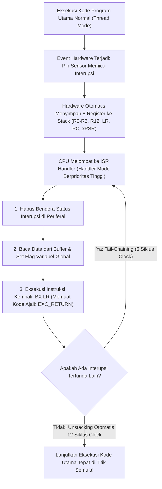

# Modul 076: Manajemen Interupsi Perangkat Keras (NVIC, Prioritas, Latensi, Tail-Chaining, Penulisan ISR Reentrant)

**Navigasi**: [⬅️ Master Index](../../INDEX.md) | [Tingkat 5: Tingkat 5: Embedded Systems, Firmware Bare-Metal & RTOS / IoT](./README.md)
*Sebelumnya*: [075. sistem-jam-perangkat-keras-clock-tree](./075-sistem-jam-perangkat-keras-clock-tree.md) | *Berikutnya*: [077. akselerasi-pengalihan-data-dma](./077-akselerasi-pengalihan-data-dma.md)

---

## 1. Intuisi Dasar Tanpa Jargon ("Seperti Bayi Baru Lahir")
Bayangkan Anda sedang membaca buku penting di kamar Anda sambil menunggu kurir paket pos tiba di rumah Anda:
- **Pendekatan Polling (Pemeriksaan Berkala)**: Anda berdiri dari meja setiap 10 detik, berjalan ke pintu depan rumah, membuka pintu untuk melihat apakah kurir sudah datang, lalu kembali ke meja. Anda tidak bisa fokus membaca buku, dan waktu serta tenaga Anda terbuang habis sia-sia!
- **Pendekatan Interrupt (Interupsi)**: Anda memasang **Bel Pintu (Doorbell)** di depan rumah. Anda duduk santai membaca buku dengan fokus penuh $100\%$. Ketika kurir tiba, ia menekan bel: *Ting-Tong!* Anda menandai halaman buku Anda, berdiri membuka pintu untuk mengambil paket (5 detik), lalu langsung duduk kembali dan melanjutkan membaca buku tepat di kalimat yang tadi Anda tinggalkan.

Dalam mikrokontroler, itulah **Interupsi Perangkat Keras (Hardware Interrupt)**:
CPU tidak perlu membuang jutaan siklus clock untuk mengecek status pin GPIO atau sensor secara terus-menerus (*Polling*). Perangkat keras periferal itu sendiri yang akan 'menekan bel' ke inti prosesor saat data tiba.
Di dalam chip prosesor ARM Cortex-M terdapat pengatur lalu lintas interupsi perangkat keras paling canggih di dunia yang disebut **NVIC (Nested Vectored Interrupt Controller)**: ia bisa memprioritaskan interupsi rem darurat di atas interupsi lagu audio, dan menggabungkan eksekusi beberapa interupsi sekaligus secara berantai (*Tail-Chaining*) tanpa membuang satu siklus clock pun!
[📚 Pelajari: ARM NVIC Architecture Guide](https://developer.arm.com/documentation/dui0552/latest/)

## 2. Fondasi Teoretis & Aksiomatik / Matematis
### 76.1 Arsitektur Nested Vectored Interrupt Controller (NVIC) ([Joseph Yiu Definitive Guide](https://www.elsevier.com/))
NVIC terintegrasi erat di dalam inti silikon ARM Cortex-M:
- **Vectored Interrupts**: CPU tidak memerlukan polling perangkat lunak untuk mengetahui siapa yang memicu interupsi; perangkat keras secara otomatis melompat langsung ke alamat fungsi penangan (*Interrupt Service Routine* ISR) yang sesuai pada Tabel Vektor.
- **Nesting (Interupsi Bersarang)**: Interupsi dengan prioritas lebih tinggi berhak memotong (*preempt*) interupsi berprioritas lebih rendah yang sedang berjalan di tengah jalan.
- **Konfigurasi Prioritas**: Membagi tingkat prioritas menjadi *Preemption Priority* (menentukan hak pemotongan) dan *Sub-Priority* (menentukan urutan eksekusi jika dua interupsi tiba bersamaan) melalui register `AIRCR` (Application Interrupt and Reset Control Register).

### 76.2 Latensi Interupsi, Stacking Otomatis & Optimasi Tail-Chaining ([ARM CoreSight Architecture](https://developer.arm.com/))
1. **Hardware Context Stacking Otomatis (12 Siklus Clock)**:
   Saat interupsi diterima, perangkat keras CPU secara otomatis mendorong 8 register penting ke tumpukan Stack (`R0, R1, R2, R3, R12, LR, PC, xPSR`) secara paralel melalui bus matrix tanpa campur tangan instruksi assembler software!
   Register $LR$ (*Link Register*) dimuat dengan kode ajaib khusus **`EXC_RETURN`** (misal `0xFFFFFFF9`).
2. **Tail-Chaining Optimization (Hanya 6 Siklus Clock)**:
   Jika ada interupsi tertunda kedua saat interupsi pertama selesai:
   CPU **TIDAK MELAKUKAN UNSTACKING LALU STACKING ULANG**! CPU mempertahankan status register yang sudah ada di stack dan langsung melompat mengeksekusi ISR kedua, memangkas latensi transisi hingga $75\%$!
3. **Late-Arrival Optimization**: Jika interupsi berprioritas tinggi tiba saat proses stacking interupsi prioritas rendah sedang berlangsung, CPU secara mulus mengalihkan eksekusi ke interupsi prioritas tinggi tersebut terlebih dahulu.

### 76.3 Aturan Emas Penulisan Fungsi ISR Reentrant & Volatile SigAtomic ([Barr Group Embedded C](https://barrgroup.com/embedded-systems/books/embedded-c-coding-standard))
Aturan mutlak penulisan Interrupt Service Routine (ISR):
1. **Jaga ISR Sesingkat Mungkin**: ISR tidak boleh melakukan penundaan (`delay`), tidak boleh melakukan komputasi berat, dan tidak boleh menunggu transfer bus serial I/O.
2. **Pola Deferral Kerja (Top-Half / Bottom-Half)**: ISR (Top-Half) hanya membaca data hardware, membersihkan bendera interupsi, menyimpan data ke dalam ring buffer, membangkitkan flag/task RTOS, lalu langsung keluar; komputasi berat diserahkan ke loop utama (Bottom-Half).
3. **Variabel Komunikasi Wajib Bertipe `volatile`**: Seluruh variabel yang dimodifikasi di dalam ISR dan dibaca oleh kode utama wajib dideklarasikan dengan kualifikasi `volatile`.
4. **Pembersihan Bendera Interupsi Wajib Segera**: Hapus flag interupsi hardware di awal ISR untuk mencegah eksekusi ganda palsu.

## 3. Anatomi Teknis & Cara Kerja Internal

Mekanisme Nilai Ajaib `EXC_RETURN`:
Ketika kembali dari ISR melalui instruksi `BX LR`, nilai $LR$ bukan alamat memori biasa, melainkan pola bit khusus (misal `0xFFFFFFFD` menandakan kembali ke Thread Mode menggunakan Process Stack Pointer PSP), yang memicu sirkuit logika CPU melakukan unstacking hardware secara otomatis.

## 4. Implementasi Praktis & Kode / Simulasi Riil
#include <stdint.h>
#include <stdbool.h>

// Deklarasi Variabel Berbagi Antara ISR dan Kode Utama (WAJIB VOLATILE!)
volatile uint32_t g_system_tick_counter = 0;
volatile bool g_uart_packet_ready = false;
volatile uint8_t g_rx_buffer[64];
volatile uint8_t g_rx_index = 0;

// 1. Penangan Interupsi Detak Waktu SysTick (Dipanggil Setiap 1 Milidetik Otomatis)
void SysTick_Handler(void) {
    g_system_tick_counter++; // Inkrementasi counter waktu milidetik aman
}

// 2. Penangan Interupsi UART RX (Dipanggil Setiap Kali 1 Byte Data Tiba di Pin RX)
void USART2_IRQHandler(void) {
    // Definisi register USART2
    volatile uint32_t *USART2_SR  = (volatile uint32_t *)(0x40004400 + 0x00);
    volatile uint32_t *USART2_DR  = (volatile uint32_t *)(0x40004400 + 0x04);
    
    // Periksa apakah interupsi disebabkan oleh byte yang baru tiba (RXNE: Read Data Register Not Empty)
    if (*USART2_SR & (1U << 5)) {
        uint8_t received_byte = (uint8_t)(*USART2_DR & 0xFF); // Membaca DR otomatis membersihkan flag RXNE!
        
        if (g_rx_index < sizeof(g_rx_buffer)) {
            g_rx_buffer[g_rx_index++] = received_byte;
            if (received_byte == '\n') { // Deteksi akhir baris paket
                g_uart_packet_ready = true;
            }
        }
    }
}

## 5. Miskonsepsi & Jebakan Industri
1. **Calling Non-Reentrant Functions inside an ISR**: Memanggil fungsi alokasi memori dinamis `malloc()`, `free()`, atau pemformat teks `printf()` di dalam ISR; fungsi pustaka standar C tersebut menggunakan variabel statis dan kunci internal non-reentrant yang memicu deadlock mematikan jika interupsi memotong panggilan `printf()` kode utama.
2. **Priority Inversion without Preemption Management**: Mengonfigurasi seluruh interupsi sistem pada tingkat prioritas preemption yang sama; interupsi komunikasi berkecepatan tinggi (seperti UART $1	ext{ Mbps}$) akan terblokir dan kehilangan byte data (*Receiver Overrun Error*) karena tertahan oleh interupsi timer yang lama berjalan.
3. **Forgetting to Clear Peripheral Interrupt Flag**: Menulis fungsi ISR tanpa membersihkan bit status bendera interupsi di register periferal; begitu ISR selesai dan keluar, CPU melihat bendera interupsi masih aktif dan langsung memanggil kembali ISR yang sama berulang-ulang, membekukan sistem operasi selamanya (*Interrupt Lockup*).

## 6. Proyek Latihan & Rubrik Penilaian Mandiri
### Tingkat 1 (Pemula) - Pengukuran Waktu Nyata Berbasis Interupsi SysTick
Konfigurasikan timer internal ARM SysTick untuk memicu interupsi hardware setiap tepat $1.0	ext{ milidetik}$ dari clock sistem $168	ext{ MHz}$. Buat fungsi penunda waktu akurat non-blocking `millis()` dan buktikan ketiadaan drift waktu terhadap jam dinding nyata.

### Tingkat 2 (Menengah) - Konfigurasi Prioritas Bersarang NVIC Grouping dalam C
Rancang sistem penanganan interupsi untuk robot industri menggunakan register NVIC: konfigurasikan pembagian prioritas NVIC (*Priority Grouping 4-bit preemption, 0-bit subpriority*), tetapkan interupsi tombol darurat E-Stop pada prioritas tertinggi (Level 0), interupsi enkoder motor pada Level 1, dan interupsi komunikasi serial pada Level 3. Buktikan secara empiris bahwa interupsi Level 0 dapat memotong eksekusi Level 3.

### Tingkat 3 (Mahir) - Pemecah Masalah Ring Buffer Bebas Kunci (Lock-Free FIFO) untuk ISR
Implementasikan struktur data antrian melingkar bebas kunci (*Lock-Free Single-Producer Single-Consumer Circular Buffer*) untuk transfer data antara ISR penerima UART (Producer) dan loop pemrosesan latar belakang (Consumer) dalam bahasa C: buktikan ketiadaan race condition tanpa mematikan interupsi global (`__disable_irq()`) dengan memanfaatkan operasi penunjuk atomik dan barrier memori `__DMB()`.

#### Rubrik Penilaian
- **40% Kepatuhan Aturan Penulisan ISR**: ISR beroperasi ultra-singkat, membersihkan bendera status, dan variabel bersama berkualifikasi `volatile`.
- **30% Ketepatan Manajemen Prioritas NVIC**: Pembagian tingkat preemption dan sub-priority mencegah pemblokiran tugas kritis.
- **30% Keamanan Akses Bersama (Thread Safety)**: Pencegahan data race antara konteks interupsi dan konteks utas utama terverifikasi secara formal.

## 7. Rekomendasi Sumber Belajar Standar Emas
| Kategori | Judul Sumber & Tautan Langsung | Deskripsi Singkat |
|---|---|---|
| 📖 Buku Teks | [The Definitive Guide to ARM Cortex-M3 and Cortex-M4 Processors (Joseph Yiu)](https://www.elsevier.com/) | Analisis paling otoritatif mengenai arsitektur internal NVIC, tail-chaining, dan penanganan eksepsi. |
| 🎓 Kuliah Terbuka | [ARM Cortex-M Embedded Systems: Interrupt Management (Valvano)](https://users.ece.utexas.edu/~valvano/) | Praktikum komprehensif konfigurasi interupsi tombol eksternal, SysTick, dan prioritas bersarang. |
| 🔬 Makalah Seminal | [A Method for Comparing the Real-Time Properties of Microprocessor Architectures (Yiu, 2010)](https://developer.arm.com/) | Analisis komparatif latensi interupsi deterministik deterministik arsitektur ARM Cortex-M. |
| 💻 Lab Interaktif | [Microcontroller Peripheral Simulation in Wokwi](https://wokwi.com/) | Uji coba interaktif eksekusi interupsi tombol eksternal dan timer PWM secara real-time. |

---
*Navigasi Cepat*: [Ke Tingkat 5](./README.md) | [Ke Master Index](../../INDEX.md) | *Sebelumnya*: [075. sistem-jam-perangkat-keras-clock-tree](./075-sistem-jam-perangkat-keras-clock-tree.md) | *Berikutnya*: [077. akselerasi-pengalihan-data-dma](./077-akselerasi-pengalihan-data-dma.md)
