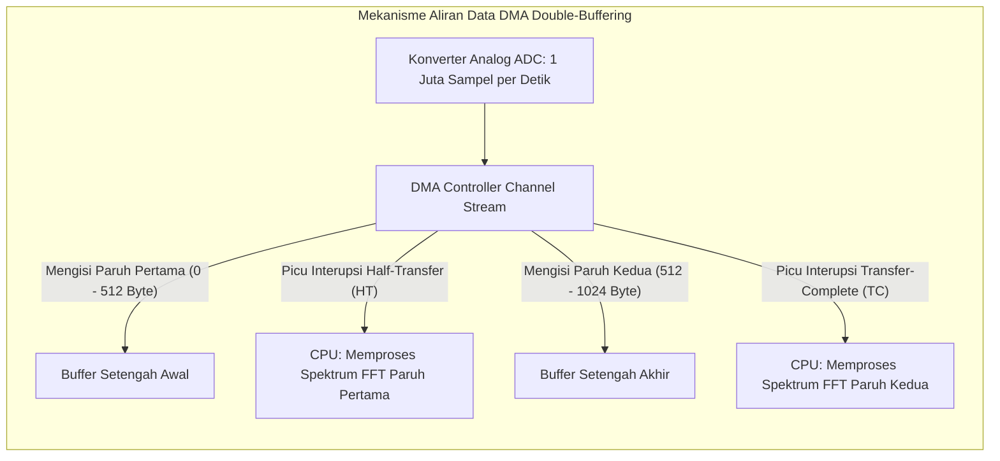

# Modul 077: Akselerasi Pengalihan Data DMA (Direct Memory Access: Peripheral-to-Memory, Double Buffering)

**Navigasi**: [⬅️ Master Index](../../INDEX.md) | [Tingkat 5: Tingkat 5: Embedded Systems, Firmware Bare-Metal & RTOS / IoT](./README.md)
*Sebelumnya*: [076. manajemen-interupsi-perangkat-keras](./076-manajemen-interupsi-perangkat-keras.md) | *Berikutnya*: [078. keandalan-sistem-pengatur-waktu-watchdog](./078-keandalan-sistem-pengatur-waktu-watchdog.md)

---

## 1. Intuisi Dasar Tanpa Jargon ("Seperti Bayi Baru Lahir")
Bayangkan seorang kasir di minimarket yang bertugas melayani antrean pembeli. Tiba-tiba truk pengantar barang tiba membawa 1.000 kardus minuman kaleng.
- Jika kasir tersebut dipaksa mengangkat 1.000 kardus itu satu per satu dari truk ke gudang belakang, ia harus meninggalkan meja kasir selama 2 jam, antrean pembeli mengular marah, dan toko lumpuh!
- Sebaliknya, toko menyewa **Kuli Panggul Khusus (DMA - Direct Memory Access)**:
Kasir cukup menandatangani surat jalan dan memberi tahu kuli: *"Tolong pindahkan 1.000 kardus itu dari truk ke gudang nomor 3, dan beri tahu saya jika sudah selesai."*
Kuli panggul bekerja memindahkan seluruh kardus secara mandiri, sementara kasir (CPU) tetap tenang melayani para pembeli di meja kasir tanpa terganggu sedikit pun!

Dalam mikrokontroler, **DMA Controller** adalah sang kuli panggul perangkat keras:
Ia mentransfer jutaan byte data sensor, audio, atau kamera langsung ke memori RAM di jalur bus khusus tanpa mengonsumsi satu pun siklus pemikiran prosesor CPU Anda.
[📚 Pelajari: STMicroelectronics DMA Controller Architecture Guide](https://www.st.com/resource/en/application_note/an4031-using-the-stm32f2-stm32f4-and-stm32f7-series-dma-controller-stmicroelectronics.pdf)

## 2. Fondasi Teoretis & Aksiomatik / Matematis
### 77.1 Arsitektur Multi-Stream DMA Controller ([STM32F4 Reference Manual](https://www.st.com/))
Pengontrol DMA pada mikrokontroler canggih (seperti STM32F4) memiliki dua pengontrol independen (DMA1 dan DMA2), masing-masing dilengkapi dengan 8 Stream independen dan 8 Channel multiplexing per stream:
- **DMA1**: Terhubung ke bus APB1 (periferal berkecepatan rendah: I2C, SPI2/3, USART2/3, DAC).
- **DMA2**: Memiliki akses langsung ke bus AHB berkecepatan tinggi (ADC, SPI1, USART1/6, SDIO, Antarmuka Kamera DCMI).

Tiga Mode Aliran Data:
1. **Peripheral-to-Memory (P2M)**: Mentransfer aliran byte yang diterima dari port serial/ADC langsung ke buffer array di RAM.
2. **Memory-to-Peripheral (M2P)**: Mengalirkan data buffer dari RAM ke periferal transmisi (misal memutar file audio ke modul DAC atau I2S).
3. **Memory-to-Memory (M2M)**: Menyalin blok memori antar alamat RAM fisik berkecepatan penuh bus matrix (hanya didukung oleh DMA2).

### 77.2 Mode Melingkar (Circular Mode) & Buffer Ganda (Double-Buffering) ([Noviello Mastering STM32](https://leanpub.com/mastering-stm32))
1. **Mode Normal (One-Shot)**: DMA berhenti setelah menghitung mundur register pencacah transfer `NDTR` mencapai nol.
2. **Mode Melingkar (Circular Mode)**: Begitu seluruh buffer selesai terisi, DMA secara otomatis memutar kembali pointer alamat ke awal buffer dan melanjutkan pengisian tanpa henti.
3. **Arsitektur Buffer Ganda (Double-Buffering / Ping-Pong Buffer)**:
   Menggunakan dua blok buffer terpisah di RAM (Buffer 0 dan Buffer 1):
   - Saat DMA sedang sibuk mengisi Buffer 0 dari perangkat keras...
   - CPU secara bersamaan sedang membaca dan memproses data yang sudah siap di Buffer 1!
   - Begitu Buffer 0 penuh, DMA secara otomatis beralih mengisi Buffer 1, dan memicu interupsi memberi tahu CPU untuk memproses Buffer 0.
   Menghasilkan pemrosesan data real-time kontinu tanpa pernah kehilangan sampel data (*Zero-Loss Continuous Streaming*).

### 77.3 Interupsi DMA: Half-Transfer (HT) vs Transfer-Complete (TC) ([STM32 DMA App Note](https://www.st.com/))
Untuk array buffer tunggal berukuran $2N$ elemen dalam mode Circular:
- **Interupsi Half-Transfer (HTIF)**: Dipicu tepat saat DMA selesai mengisi paruh pertama buffer (elemen $0$ s/d $N-1$). CPU langsung memproses paruh pertama tersebut!
- **Interupsi Transfer-Complete (TCIF)**: Dipicu saat DMA selesai mengisi paruh kedua buffer (elemen $N$ s/d $2N-1$). CPU langsung memproses paruh kedua tersebut!
Dengan teknik cerdas ini, satu buffer memori array tunggal bertindak seperti double-buffer tanpa memerlukan alokasi dua array terpisah!

## 3. Anatomi Teknis & Cara Kerja Internal

Prioritas Arbitrase Bus Multi-Layer AHB:
Jika CPU dan DMA mencoba mengakses modul RAM yang sama persis pada siklus clock yang sama, arbiter perangkat keras menggunakan algoritma Round-Robin untuk membagi siklus akses secara adil, mencegah CPU membeku total saat transfer DMA masif sedang berlangsung.

## 4. Implementasi Praktis & Kode / Simulasi Riil
#include <stdint.h>
#include <stdbool.h>

#define BUFFER_SIZE 1024
uint16_t adc_dma_buffer[BUFFER_SIZE]; // Buffer penampung DMA di SRAM

// Penangan Interupsi Perangkat Keras DMA Stream (misal DMA2_Stream0 untuk ADC1)
void DMA2_Stream0_IRQHandler(void) {
    volatile uint32_t *DMA2_LISR = (volatile uint32_t *)(0x40026400 + 0x00);
    volatile uint32_t *DMA2_LIFCR = (volatile uint32_t *)(0x40026400 + 0x08);
    
    // 1. Periksa Bendera Half-Transfer (HTIF0: Bit ke-4)
    if (*DMA2_LISR & (1U << 4)) {
        *DMA2_LIFCR = (1U << 4); // Hapus bendera HTIF0
        // CPU memproses paruh pertama buffer (Indeks 0 s/d 511) saat DMA sedang mengisi paruh kedua!
        process_audio_dsp_block(&adc_dma_buffer[0], BUFFER_SIZE / 2);
    }
    
    // 2. Periksa Bendera Transfer-Complete (TCIF0: Bit ke-5)
    if (*DMA2_LISR & (1U << 5)) {
        *DMA2_LIFCR = (1U << 5); // Hapus bendera TCIF0
        // CPU memproses paruh kedua buffer (Indeks 512 s/d 1023) saat DMA berputar kembali ke paruh pertama!
        process_audio_dsp_block(&adc_dma_buffer[BUFFER_SIZE / 2], BUFFER_SIZE / 2);
    }
}

## 5. Miskonsepsi & Jebakan Industri
1. **CPU Reading Stale Data Due to Cache Incoherency**: Pada mikrokontroler berperforma tinggi yang memiliki cache data L1 (seperti ARM Cortex-M7): DMA menulis data baru langsung ke RAM fisik, tetapi CPU membaca data usang yang tersimpan di cache D-Cache. Solusi: letakkan buffer DMA di wilayah memori non-cacheable menggunakan MPU atau panggil `SCB_InvalidateDCache_by_Addr()` sebelum membaca buffer.
2. **Buffer Overrun without Processing Confirmation**: Laju aliran transfer DMA terlalu cepat melebihi kemampuan CPU dalam memproses data di fungsi HT/TC; paruh buffer kedua tertimpa kembali oleh DMA sebelum CPU sempat selesai memprosesnya, menghasilkan data audio cacat (*Audio Distortion Glitching*).
3. **Placing DMA Buffers in Inaccessible Memory Regions**: Mengarahkan DMA1 (yang hanya memiliki akses ke bus APB1) untuk mengakses memori Tightly-Coupled Memory (DTCM); memicu interupsi kesalahan transfer DMA (*DMA Transfer Error TEIF*) seketika karena bus matrix tidak memiliki jalur fisik ke wilayah tersebut.

## 6. Proyek Latihan & Rubrik Penilaian Mandiri
### Tingkat 1 (Pemula) - Pengukuran Akselerasi Penyalinan Memori DMA M2M vs Memcpy
Tulis program benchmark perbandingan waktu penyalinan array data berukuran $64	ext{ KB}$ di RAM: bandingkan waktu eksekusi CPU menggunakan fungsi standar `memcpy()` vs pengontrol perangkat keras DMA mode Memory-to-Memory (M2M). Hitung penghematan utilisasi siklus clock CPU.

### Tingkat 2 (Menengah) - Perekam Audio Kontinu ADC Mode Circular DMA
Konfigurasikan modul ADC 12-bit mikrokontroler STM32 yang dipicu oleh Timer periodik pada laju sampling $44.1	ext{ kHz}$. Rutekan output konversi ADC langsung ke array RAM menggunakan DMA mode Circular dengan interupsi Half-Transfer dan Transfer-Complete aktif. Tulis fungsi pemrosesan sinyal audio tanpa ada satu pun sampel data yang hilang.

### Tingkat 3 (Mahir) - Driver Tampilan Layar TFT LCD SPI DMA Asinkron Bebas Blokir
Rancang pustaka driver tampilan layar grafis TFT LCD berbasis antarmuka bus SPI menggunakan DMA transmit Memory-to-Peripheral (M2P) asinkron: implementasikan fungsi penyegaran layar `lcd_draw_framebuffer_async()` yang mengirimkan seluruh framebuffer grafis ($320 	imes 240$ piksel, warna RGB565 16-bit) ke kontroler LCD di latar belakang via DMA tanpa memblokir CPU sama sekali, membebaskan CPU untuk menghitung logika frame game berikutnya.

#### Rubrik Penilaian
- **40% Konfigurasi Register DMA Tepat**: Parameter alamat sumber, tujuan, ukuran transfer byte, dan bit enable terkonfigurasi benar.
- **30% Integritas Penanganan Buffer Ganda**: Sinkronisasi interupsi HT/TC menjamin tidak ada tumpang tindih pembacaan dan penulisan buffer.
- **30% Manajemen Koherensi Cache Memori**: Penanganan pembersihan cache D-Cache atau pemetaan wilayah MPU non-cacheable valid.

## 7. Rekomendasi Sumber Belajar Standar Emas
| Kategori | Judul Sumber & Tautan Langsung | Deskripsi Singkat |
|---|---|---|
| 📖 Buku Teks | [Mastering STM32: DMA Controllers (Carmine Noviello)](https://leanpub.com/mastering-stm32) | Panduan langkah demi langkah implementasi DMA Circular dan Double-Buffering. |
| 🎓 Kuliah Terbuka | [STMicroelectronics Application Note AN4031: Using STM32 DMA](https://www.st.com/resource/en/application_note/an4031-using-the-stm32f2-stm32f4-and-stm32f7-series-dma-controller-stmicroelectronics.pdf) | Panduan resmi vendor arsitektur bus matrix DMA, stream, dan penanganan error FIFO. |
| 🔬 Makalah Seminal | [Direct Memory Access in Embedded Microcontrollers (ARM Whitepaper)](https://developer.arm.com/) | Analisis kuantitatif efisiensi energi dan reduksi beban CPU menggunakan DMA. |
| 💻 Lab Interaktif | [STM32CubeIDE DMA Peripheral Simulation Lab](https://www.st.com/en/development-tools/stm32cubeide.html) | Lingkungan uji coba konfigurasi DMA ADC dan UART interaktif. |

---
*Navigasi Cepat*: [Ke Tingkat 5](./README.md) | [Ke Master Index](../../INDEX.md) | *Sebelumnya*: [076. manajemen-interupsi-perangkat-keras](./076-manajemen-interupsi-perangkat-keras.md) | *Berikutnya*: [078. keandalan-sistem-pengatur-waktu-watchdog](./078-keandalan-sistem-pengatur-waktu-watchdog.md)
