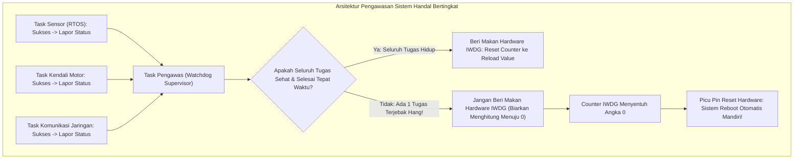

# Modul 078: Keandalan Sistem & Pengatur Waktu Watchdog (Independent Watchdog / IWDG, Window Watchdog)

**Navigasi**: [⬅️ Master Index](../../INDEX.md) | [Tingkat 5: Tingkat 5: Embedded Systems, Firmware Bare-Metal & RTOS / IoT](./README.md)
*Sebelumnya*: [077. akselerasi-pengalihan-data-dma](./077-akselerasi-pengalihan-data-dma.md) | *Berikutnya*: [079. mode-daya-rendah-efisiensi-energi](./079-mode-daya-rendah-efisiensi-energi.md)

---

## 1. Intuisi Dasar Tanpa Jargon ("Seperti Bayi Baru Lahir")
Bayangkan sebuah satelit cuaca luar angkasa seharga Rp 5 triliun yang sedang mengorbit di ketinggian 35.000 km di atas bumi:
Tiba-tiba sebutir partikel radiasi kosmik menabrak chip mikrokontroler satelit tersebut, membalikkan satu bit data di RAM dan membuat prosesor satelit terjebak di dalam loop macet abadi (`while(1)`)! Tidak ada astronot yang bisa terbang ke sana untuk menekan tombol tombol reset fisik dengan jari!

Jika satelit tidak memiliki sistem pemulihan mandiri, satelit Rp 5 triliun itu akan menjadi sampah antariksa mati selamanya.
Untuk mencegah bencana ini, setiap sistem embedded kritis memiliki seekor 'anjing penjaga' perangkat keras yang disebut **Watchdog Timer (WDT)**:
Watchdog adalah pencacah waktu hardware terpisah yang menghitung mundur tanpa henti: *10... 9... 8... 7...*
Program perangkat lunak Anda memiliki satu tugas wajib: secara berkala 'memberi makan anjing penjaga' (**Kick / Feed the Dog**) untuk mereset angka hitungan mundur kembali ke 10.
Jika program Anda macet, hang, atau terkena radiasi sehingga lupa memberi makan watchdog: angka hitungan mundur menyentuh **NOL (0)**, dan Watchdog akan seketika **MENGHANTAM PIN RESET HARDWARE CHIP SECARA OTOMATIS**, membangkitkan kembali sistem dari kematian seketika!
[📚 Pelajari: Jack Ganssle Designing Great Watchdogs](https://www.ganssle.com/watchdogs.htm)

## 2. Fondasi Teoretis & Aksiomatik / Matematis
### 78.1 Dua Jenis Watchdog: Independent (IWDG) vs Window Watchdog (WWDG) ([STM32 Reference Manual](https://www.st.com/))
1. **Independent Watchdog (IWDG)**:
   - Digerakkan oleh osilator internal independen terpisah (*Low-Speed Internal* LSI $\approx 32\text{ kHz}$) yang terisolasi sepenuhnya dari clock utama sistem.
   - Bahkan jika osilator kristal utama sistem atau PLL mati total, IWDG tetap mencacah mundur secara mandiri!
   - Sangat ideal untuk mendeteksi sistem macet total (*Deadlock / Infinite Loop Recovery*).
   - Waktu batas kedaluwarsa hitungan mundur ($T_{\text{timeout}}$):
     $$T_{\text{timeout}} = \frac{\text{Prescaler} \times (\text{Reload} + 1)}{f_{\text{LSI}}}$$
2. **Window Watchdog (WWDG)**:
   - Digerakkan oleh clock sistem utama (bus APB1).
   - **Konsep Jendela Waktu (Window)**: Perangkat lunak DILARANG memberi makan watchdog terlalu lambat, DAN DILARANG memberi makan watchdog terlalu cepat!
   - Perangkat lunak hanya boleh mereset timer saat nilai pencacah berada di dalam jendela waktu yang diizinkan ($W < \text{Counter} \le 0x3F$).
   - Jika program mereset watchdog sebelum jendela waktu terbuka: memicu reset sistem seketika! Sangat ideal untuk mendeteksi anomali perangkat lunak di mana kode melompat liar tak beraturan (*Runaway Code Execution*).

### 78.2 Analisis Titik Kegagalan Pemberian Makan Watchdog Naif ([Ganssle Watchdog Design](https://www.ganssle.com/))
Kesalahan paling fatal dan memalukan pemula:
Menaruh rutinitas pemberian makan watchdog di dalam fungsi interupsi timer periodik (misal di dalam `SysTick_Handler`):
- Interupsi timer hardware akan terus berjalan memberi makan watchdog setiap milidetik...
- Padahal program aplikasi utama di loop `main()` sedang macet total atau hang!
Watchdog tidak akan pernah meluap, dan sistem tidak akan pernah pulih dari hang!

### 78.3 Arsitektur Task-Level Health Monitoring Multithreaded ([Barr Group Watchdog Pattern](https://barrgroup.com/))
Pada sistem multitasking RTOS yang memiliki puluhan task paralel:
Watchdog hardware fisik tidak boleh di-reset oleh sembarang task tunggal.
Gunakan **Pola Pengawas Tingkat Tugas (Task Watchdog Manager)**:
1. Setiap task kritis memiliki bendera boolean atau counter mandiri di memori.
2. Setiap kali task selesai mengeksekusi satu siklus tugas dengan sukses, task tersebut menandai benderanya sendiri (`task_alive_flags |= TASK_A_BIT`).
3. Task Pengawas (*Watchdog Supervisor Task*) berprioritas paling rendah bangun secara periodik: memeriksa apakah SELURUH bendera task kritis bernilai lengkap.
4. HANYA jika seluruh task hidup dan sehat, Task Pengawas mereset watchdog fisik hardware dan membersihkan seluruh bendera untuk siklus berikutnya. Jika ada satu task saja yang macet, watchdog fisik dibiarkan meluap hingga sistem me-reboot dirinya sendiri.

## 3. Anatomi Teknis & Cara Kerja Internal

Penyimpanan Jejak Pasca-Reboot (Crash Dump Post-Mortem):
Saat chip melakukan booting setelah reset watchdog, firmware membaca register penanda penyebab reset `RCC_CSR_IWDGRSTF` untuk mendeteksi apakah sistem baru saja mengalami crash akibat watchdog. Jika ya, firmware mencatat laporan telemetri ke memori Flash non-volatil sebelum kembali beroperasi.

## 4. Implementasi Praktis & Kode / Simulasi Riil
def calculate_stm32_iwdg_timeout_ms(prescaler_div: int, reload_value: int, lsi_freq_hz: float = 32000.0) -> dict:
    """
    Menghitung batas waktu kedaluwarsa Independent Watchdog (IWDG) STM32.
    Prescaler yang valid: 4, 8, 16, 32, 64, 128, 256
    Reload value: 12-bit integer (0 s/d 4095)
    """
    t_tick_s = prescaler_div / lsi_freq_hz
    timeout_s = (reload_value + 1) * t_tick_s
    timeout_ms = timeout_s * 1000.0
    
    return {
        "prescaler": f"Bagi {prescaler_div}",
        "reload_val": reload_value,
        "tick_duration_us": t_tick_s * 1e6,
        "timeout_ms": timeout_ms
    }

# Konfigurasi IWDG: Prescaler 64, Reload = 1000 pada LSI 32 kHz
res = calculate_stm32_iwdg_timeout_ms(prescaler_div=64, reload_value=1000)
print(f"Konfigurasi Watchdog Hardware ({res['prescaler']}):")
print(f" - Durasi 1 Tick Clock: {res['tick_duration_us']:.1f} us")
print(f" - Batas Waktu Timeout : {res['timeout_ms']:.1f} ms")
print(f"Catatan: Firmware wajib memberi makan watchdog setidaknya setiap {res['timeout_ms'] * 0.7:.0f} ms!")

## 5. Miskonsepsi & Jebakan Industri
1. **Feeding the Watchdog in an Interrupt Service Routine**: Menaruh kode reset watchdog di dalam rutin interupsi timer periodik; sistem utama di loop aplikasi bisa macet total selamanya sementara interupsi timer tetap rajin memberi makan watchdog, melenyapkan seluruh fungsi proteksi sistem.
2. **Watchdog Timeout Shorter than Long Flash Erase Operations**: Mengatur batas waktu timeout watchdog terlalu pendek (misal $50	ext{ ms}$) saat firmware melakukan operasi penghapusan blok sektor Flash internal atau komunikasi modem yang memakan waktu $200	ext{ ms}$; chip me-reset dirinya sendiri secara acak di tengah penulisan Flash.
3. **Leaving Watchdog Active during Hardware Breakpoint Debugging**: Membiarkan watchdog timer tetap mencacah saat prosesor dijeda oleh debugger JTAG/SWD; saat developer sedang meneliti kode, watchdog meluap di latar belakang dan tiba-tiba me-reset CPU. Selalu aktifkan fitur pembeku clock watchdog saat debug (`DBGMCU_APB1_FZ_DBG_IWDG_STOP`).

## 6. Proyek Latihan & Rubrik Penilaian Mandiri
### Tingkat 1 (Pemula) - Inisialisasi Bare-Metal Independent Watchdog (IWDG)
Tulis fungsi C bare-metal untuk mengaktifkan modul IWDG STM32: tulis kode kunci akses `0x5555` ke register `IWDG_KR` untuk membuka proteksi penulisan, atur prescaler pembagi 64 pada `IWDG_PR`, atur nilai reload untuk timeout $1.0	ext{ detik}$ pada `IWDG_RLR`, mulai timer dengan kode `0xCCCC`, dan buat fungsi pemberian makan berkala `watchdog_feed()` dengan menulis `0xAAAA`.

### Tingkat 2 (Menengah) - Deteksi Alasan Reboot dan Pencatatan Log Crash
Rancang rutinitas awal booting firmware yang membaca register status reset mikrokontroler (`RCC_CSR`): periksa apakah bit `IWDGRSTF` (Independent Watchdog Reset) atau `WWDGRSTF` (Window Watchdog Reset) aktif. Jika aktif, kirimkan pesan peringatan panik ke port serial UART dan simpan counter insiden kegagalan ke memori backup RTC register yang tidak terhapus oleh reset.

### Tingkat 3 (Mahir) - Arsitektur FreeRTOS Task Watchdog Manager Mandiri
Rancang sistem pengawas kesehatan tugas lengkap (*Task Watchdog Supervisor*) untuk aplikasi FreeRTOS 4-tugas (Tugas Sensor, Tugas Kontrol, Tugas GUI, Tugas Jaringan): setiap tugas wajib memanggil `task_wdt_checkin(TASK_ID)` dalam interval waktu yang ditentukan. Jika salah satu tugas gagal check-in sebelum batas toleransi waktu maksimum akibat deadlock mutex, Task Supervisor sengaja menghentikan pemberian makan ke IWDG hardware untuk memicu reboot fisik sistem.

#### Rubrik Penilaian
- **40% Ketepatan Konfigurasi Hardware WDT**: Perhitungan register prescaler, reload, dan sekuens kode kunci pengaktifan akurat.
- **30% Arsitektur Pengawasan Bebas Titik Kegagalan Tunggal**: Menghindari pemberian makan watchdog di dalam ISR dan memverifikasi kesehatan seluruh task secara komprehensif.
- **30% Manajemen Pasca-Kegagalan (Post-Mortem Handling)**: Pencatatan diagnosis penyebab reset dan pembersihan bendera status reset hardware bekerja sempurna.

## 7. Rekomendasi Sumber Belajar Standar Emas
| Kategori | Judul Sumber & Tautan Langsung | Deskripsi Singkat |
|---|---|---|
| 📖 Buku Teks | [Designing Great Watchdogs (Jack Ganssle)](https://www.ganssle.com/watchdogs.htm) | Panduan klasik legendaris industri mengenai filosofi perancangan sistem anjing penjaga handal. |
| 🎓 Kuliah Terbuka | [Embedded C Coding Standard: Watchdog Timers (Michael Barr)](https://barrgroup.com/embedded-systems/books/embedded-c-coding-standard) | Standar industri pengkodean C aman mengenai penempatan rutinitas watchdog hardware. |
| 🔬 Makalah Seminal | [Watchdog Architecture for Embedded Real-Time Systems (Mahmood et al., 1988)](https://doi.org/10.1109/REAL.1988.24357) | Makalah komprehensif pemodelan sistem pengawas keandalan komputasi avionik dan medis. |
| 💻 Lab Interaktif | [Microchip AVR & STM32 Watchdog Application Examples](https://www.microchip.com/) | Catatan aplikasi resmi vendor implementasi window watchdog dan proteksi sistem. |

---
*Navigasi Cepat*: [Ke Tingkat 5](./README.md) | [Ke Master Index](../../INDEX.md) | *Sebelumnya*: [077. akselerasi-pengalihan-data-dma](./077-akselerasi-pengalihan-data-dma.md) | *Berikutnya*: [079. mode-daya-rendah-efisiensi-energi](./079-mode-daya-rendah-efisiensi-energi.md)
