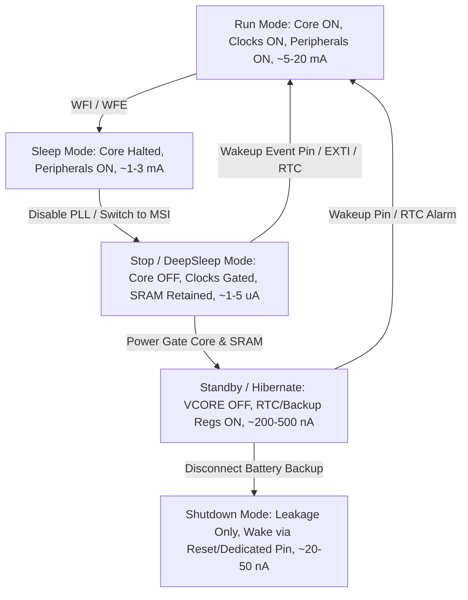

# Modul 079: Mode Daya Rendah & Efisiensi Energi (Sleep, Stop, Standby, Deep-Sleep, Anggaran Baterai Mikroampere)

**Navigasi**: [⬅️ Master Index](../../INDEX.md) | [Tingkat 5: Tingkat 5: Embedded Systems, Firmware Bare-Metal & RTOS / IoT](./README.md)
*Sebelumnya*: [078. keandalan-sistem-pengatur-waktu-watchdog](./078-keandalan-sistem-pengatur-waktu-watchdog.md) | *Berikutnya*: [080. periferal-inti-mikrokontroler](./080-periferal-inti-mikrokontroler.md)

---

## 1. Intuisi Dasar Tanpa Jargon ("Seperti Bayi Baru Lahir")
Bayangkan mikrokontroler Anda adalah sebuah kota metropolitan dengan jutaan lampu jalan dan pabrik. Jika kota tersebut beroperasi 24 jam penuh dengan kapasitas 100%, pasokan daya (baterai) akan habis dalam hitungan jam. Manajemen mode daya rendah ([Low Power Embedded Systems](https://www.ti.com/lit/an/swra478d/swra478d.pdf)) adalah seni mematikan generator utama, menghentikan detak jam kota (clock gating), memadamkan lampu jalan yang tidak dilewati orang (power domains), dan menyisakan satu penjaga gerbang yang mengantuk (ultra-low-power comparator atau low-power timer 32.768 kHz) yang hanya mengonsumsi beberapa ratus nanoampere. Ketika peristiwa eksternal terdeteksi (seperti tombol ditekan atau sensor mendeteksi guncangan), penjaga tersebut membunyikan lonceng bangun (wake-up interrupt), menghidupkan kembali osilator frekuensi tinggi, dan mengembalikan sistem ke kinerja puncak dalam hitungan mikrodetik sebelum tertidur lelap kembali.

## 2. Fondasi Teoretis & Aksiomatik / Matematis
Konsumsi daya total pada rangkaian CMOS terintegrasi dimodelkan secara matematis sebagai penjumlahan daya dinamis dan daya statis:

$$P_{total} = P_{dynamic} + P_{static} = \alpha \cdot C_{load} \cdot V_{DD}^2 \cdot f_{clk} + I_{leak} \cdot V_{DD}$$

Di mana:
- $\alpha$: Activity factor (fraksi gerbang logika yang berganti status per siklus clock).
- $C_{load}$: Kapasitansi beban total sirkuit internal dan pin output ([Capacitive Power Dissipation](https://inst.eecs.berkeley.edu/~ee141/sp04/lectures/lec11.pdf)).
- $V_{DD}$: Tegangan rel catu daya sistem (daya proporsional terhadap kuadrat tegangan!).
- $f_{clk}$: Frekuensi operasional clock sistem.
- $I_{leak}$: Arus bocor transistor (subthreshold leakage, gate oxide leakage, reverse diode leakage) yang mendominasi pada proses fabrikasi <65nm.

Untuk memperkirakan masa pakai baterai perangkat IoT, dihitung konsumsi energi rata-rata siklus berkala:
$$E_{cycle} = (P_{active} \cdot t_{active}) + (P_{sleep} \cdot t_{sleep})$$
$$I_{avg} = \frac{I_{active} \cdot t_{active} + I_{sleep} \cdot t_{sleep}}{t_{active} + t_{sleep}}$$
$$\text{Masa Pakai (Jam)} = \frac{C_{battery} \cdot \eta_{derating}}{I_{avg}}$$
Di mana $C_{battery}$ adalah kapasitas nominal dalam mAh (misal koin CR2032 dengan 220 mAh) dan $\eta_{derating}$ adalah faktor reduksi suhu/penuaan (umumnya 0.70 - 0.85).

## 3. Anatomi Teknis & Cara Kerja Internal
Hirarki mode daya rendah pada mikrokontroler modern (seperti ARM Cortex-M0+/M4/M33):



Dalam arsitektur silikon, teknik mitigasi konsumsi energi meliputi:
1. **Clock Gating**: Menonaktifkan distribusi sinyal clock ke blok fungsional yang idle menggunakan register kontrol clock (seperti register RCC AHB/APB peripheral clock enable) ([Clock Gating Design](https://www.arm.com/technologies/energy-efficiency)).
2. **Dynamic Voltage and Frequency Scaling (DVFS)**: Menurunkan tegangan inti bersamaan dengan penurunan frekuensi saat beban komputasi rendah.
3. **Power Islands / Domains**: Memutus fisik rel $V_{DD}$ ke blok periferal melalui transistor power-switch PMOS berukuran besar di atas chip silikon.

## 4. Implementasi Praktis & Kode / Simulasi Riil
```c
// Bare-metal Low Power Stop/Standby Entry on ARM Cortex-M (STM32 Low Power Architecture)
#include <stdint.h>
#include <stdbool.h>

#define SCB_SCR         (*(volatile uint32_t *)0xE000ED10)
#define SCB_SCR_SLEEPDEEP (1UL << 2)
#define PWR_CR          (*(volatile uint32_t *)0x40007000)
#define PWR_CR_LPDS     (1UL << 0)  // Low-Power Deep Sleep / Regulator Low-Power mode
#define PWR_CR_CWUF     (1UL << 2)  // Clear Wakeup Flag

void enter_low_power_stop_mode(void) {
    // 1. Matikan peripheral clock yang tidak digunakan sebelum tidur
    // Matikan PLL dan beralih ke osilator internal berdaya rendah
    
    // 2. Clear Wakeup Flag di peripheral PWR
    PWR_CR |= PWR_CR_CWUF;
    
    // 3. Set regulator utama ke mode hemat daya
    PWR_CR |= PWR_CR_LPDS;
    
    // 4. Konfigurasi ARM Cortex System Control Register untuk SLEEPDEEP
    SCB_SCR |= SCB_SCR_SLEEPDEEP;
    
    // 5. Instruction & Data Synchronization Barriers
    __asm volatile("dsb");
    __asm volatile("isb");
    
    // 6. Eksekusi instruksi WFI (Wait For Interrupt)
    // CPU terhenti seketika, konsumsi arus drop dari 15mA ke 2.5uA
    __asm volatile("wfi");
    
    // 7. Core terbangun di sini setelah ISR periferal aktif selesai dieksekusi!
    // Bersihkan bit SLEEPDEEP kembali ke operasional normal
    SCB_SCR &= ~SCB_SCR_SLEEPDEEP;
}
```

## 5. Miskonsepsi & Jebakan Industri
1. **Floating GPIO Pins**: Pin mikrokontroler yang dikonfigurasi sebagai input tanpa pull-up/pull-down resistor internal atau eksternal akan mengambang pada tegangan ambang $V_{th}$. Transistor PMOS dan NMOS pada inverter input keduanya akan konduktif parsial (shoot-through current), menarik arus bocor ratusan mikroampere hingga miliampere ([TI GPIO Leakage App Note](https://www.ti.com/lit/an/scaa046/scaa046.pdf)). Solusi: Setel seluruh pin yang tidak terpakai ke Analog Input mode atau Output Push-Pull Low.
2. **LDO Quiescent Current Ignored**: Menggunakan LDO reguler seperti AMS1117 (arus tenang $I_q \approx 5\text{ mA}$) pada perangkat baterai yang tidur dengan arus 2 $\mu\text{A}$ adalah pemborosan total. Baterai akan terkuras oleh LDO, bukan mikrokontroler. Gunakan nanopower LDO ($I_q < 1\text{ }\mu\text{A}$) seperti TPS7A02 atau MAX1726.
3. **In-Circuit Debugger Attached**: Menghitung arus daya rendah saat probe SWD/JTAG masih tersambung akan menghasilkan angka palsu karena debugger memaksa clock domain sistem tetap aktif.

## 6. Proyek Latihan & Rubrik Penilaian Mandiri
1. **Tingkat Pemula**: Hitung estimasi teoritis daya tahan baterai koin CR2032 (kapasitas 220 mAh, derating 80%) jika mikrokontroler aktif selama 10 ms mengonsumsi 12 mA, lalu tidur selama 990 ms mengonsumsi 3.5 $\mu\text{A}$ setiap 1 detik berkala. Berapa bulan perangkat dapat beroperasi?
2. **Tingkat Menengah**: Rancang skema pin I/O mikrokontroler STM32/ESP32 di mana sebuah sensor I2C eksternal diberi daya melalui transistor high-side P-MOSFET (load switch). Tuliskan fungsi C untuk memutus daya sensor, merekonfigurasi pin SDA/SCL ke mode analog sebelum masuk Stop Mode, dan memulihkan kembali setelah wakeup.
3. **Tingkat Mahir**: Implementasikan firmware event-driven berbasis Low Power Timer (LPTIM) dan DMA yang mengumpulkan 64 sampel ADC saat CPU inti ARM Cortex-M berada pada mode deep sleep (Sleep-on-Exit), kemudian hanya membangunkan CPU inti untuk analisis FFT setelah buffer DMA penuh. Verifikasi konsumsi energi dengan profil energi amperemeter shunt.

## 7. Rekomendasi Sumber Belajar Standar Emas
| Sumber Pembelajaran | Penulis / Institusi | Tautan Langsung | Fokus Materi |
| :--- | :--- | :--- | :--- |
| STM32 Low-Power Modes Application Note | STMicroelectronics | [ST AN4899](https://www.st.com/resource/en/application_note/dm00296349-stm32l4-lowpower-features-stmicroelectronics.pdf) | Analisis transisi Run, Sleep, Stop, Standby & Shutdown |
| Low Power RF & Embedded Systems Guide | Texas Instruments | [TI SWRA478](https://www.ti.com/lit/an/swra478d/swra478d.pdf) | Perhitungan budget baterai koin & profil arus transien |
| Designing Low-Power IoT Devices | Silicon Labs | [Silicon Labs UG103.14](https://www.silabs.com/documents/public/user-guides/ug103-14-fundamentals-power-management.pdf) | Energy Profiling & Power Management IC Selection |
| ARM Cortex-M Power Management Specs | ARM Developer Documentation | [ARM Core Sleep Modes](https://developer.arm.com/documentation/100166/0001/Power-Management) | WFI, WFE, SLEEPDEEP, dan Event Register Architecture |

---
*Navigasi Cepat*: [Ke Tingkat 5](./README.md) | [Ke Master Index](../../INDEX.md) | *Sebelumnya*: [078. keandalan-sistem-pengatur-waktu-watchdog](./078-keandalan-sistem-pengatur-waktu-watchdog.md) | *Berikutnya*: [080. periferal-inti-mikrokontroler](./080-periferal-inti-mikrokontroler.md)
