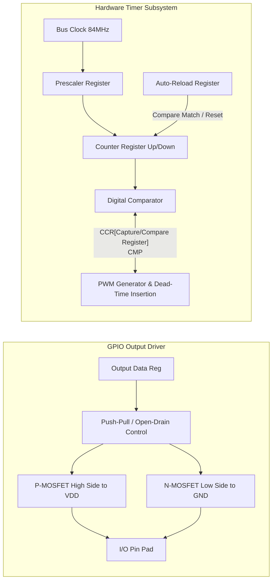

# Modul 080: Periferal Inti Mikrokontroler (GPIO Push-Pull/Open-Drain, Timers, Input Capture, Output Compare, PWM)

**Navigasi**: [⬅️ Master Index](../../INDEX.md) | [Tingkat 5: Tingkat 5: Embedded Systems, Firmware Bare-Metal & RTOS / IoT](./README.md)
*Sebelumnya*: [079. mode-daya-rendah-efisiensi-energi](./079-mode-daya-rendah-efisiensi-energi.md) | *Berikutnya*: [081. protokol-komunikasi-serial-perangkat-keras](./081-protokol-komunikasi-serial-perangkat-keras.md)

---

## 1. Intuisi Dasar Tanpa Jargon ("Seperti Bayi Baru Lahir")
### 1.1 Konsep Inti & Analogi Tanpa Jargon
Mikrokontroler tanpa periferal hanyalah kalkulator matematis yang tuli dan buta di dalam ruang hampa. Periferal inti ([Microcontroller Peripherals](https://www.embedded.com/microcontroller-peripherals-the-nuts-and-bolts/)) adalah indra dan otot silikon fisik mikrokontroler: pin GPIO (General Purpose Input/Output) adalah saklar dan sensor digital biner yang mampu merasakan tegangan tinggi/rendah atau menyalakan beban; Timer perangkat keras adalah stopwatch presisi pikosekon yang bekerja secara independen dari program CPU, mengukur interval gelombang (Input Capture) atau memotong aliran arus ribuan kali per detik untuk menghasilkan sinyal Pulse Width Modulation (PWM) yang halus guna menggerakkan motor atau meredupkan lampu.

### 1.2 Urgensi Rekayasa & Signifikansi Sistemik
Dalam rekayasa sistem modern, pemahaman mendalam tentang konsep ini membedakan arsitek sistem kelas dunia dari sekadar operator perkakas teknis.

## 2. Fondasi Teoretis & Aksiomatik / Matematis
### 2.1 Kerangka Teori Aksiomatik & Formulasi Matematis
Perancangan dan pengoperasian periferal timer dan PWM berakar pada pembagian frekuensi clock sistem (prescaling) dan modulo counter:

### 2.2 Penurunan Matematis Langkah-demi-Langkah
$$f_{timer} = \frac{f_{clk}}{(PSC + 1)}$$

$$f_{PWM} = \frac{f_{timer}}{(ARR + 1)} = \frac{f_{clk}}{(PSC + 1) \cdot (ARR + 1)}$$

Di mana:
- $f_{clk}$: Frekuensi clock bus periferal yang mencatu counter (misal 84 MHz pada APB1 timer).
- $PSC$: Nilai register Prescaler (16-bit atau 32-bit integer register).
- $ARR$: Nilai register Auto-Reload / Period (menentukan batas atas pencacahan counter sebelum reload/overflow).

Duty cycle dari sinyal PWM ditentukan oleh nilai Capture/Compare Register ($CCR$):
$$\text{Duty Cycle (\%)} = \frac{CCR}{ARR + 1} \times 100\%$$

Untuk pengukuran frekuensi sinyal luar menggunakan mode **Input Capture**, dua stempel waktu transisi tepi $t_1$ dan $t_2$ dibaca dari register CCR saat interrupt dipicu:
$$\Delta t = (t_2 - t_1) \cdot T_{timer} \quad \implies \quad f_{input} = \frac{1}{\Delta t}$$

## 3. Anatomi Teknis & Cara Kerja Internal
Struktur internal pin GPIO dan arsitektur Hardware Timer:



1. **Push-Pull vs Open-Drain**:
   - **Push-Pull**: Menggunakan kedua transistor (PMOS menarik ke $V_{DD}$, NMOS menarik ke $GND$). Memberikan transisi rise/fall yang cepat dan simetris.
   - **Open-Drain**: Transistor PMOS diputus secara permanen; hanya NMOS yang terhubung ke $GND$. Garis bus membutuhkan resistor pull-up eksternal. Wajib digunakan untuk bus multi-master seperti I2C dan protokol 1-Wire ([GPIO Configurations](https://www.ti.com/lit/an/scaa035b/scaa035b.pdf)).
2. **Dead-Time Generator**: Dalam penggerak motor inverter H-bridge, dead-time perangkat keras menyisipkan delay beberapa ratus nanodetik di antara pensaklaran PWM complementary output untuk mencegah fenomena cross-conduction (shoot-through) yang merusak transistor MOSFET.

#### Tabel Penelusuran Kontensi Arus Hubungan Singkat Pin GPIO Push-Pull Berlawanan Logika
| Pin Mikrokontroler A | Konfigurasi Output Buffer A | Pin Mikrokontroler B | Konfigurasi Output Buffer B | Jalur Kabel Sambungan Fisik | Arus Kontensi Mengalir Melintasi Pin | Status Suhu Silikon Buffer I/O |
|---|---|---|---|---|---|
| Pin PA0 (Master) | Push-Pull Output: HIGH ($3.3\text{ V}$) | Pin PB0 (Slave) | Push-Pull Output: LOW ($0.0\text{ V}$) | Kabel jumper tembaga langsung ($R \approx 0\Omega$) | PMOS A menyala; NMOS B menyala serempak! | Panas disipasi lokal melonjak tajam |
| Resistansi Silikon Internal| Transistor PMOS internal $R_{on} \approx 25\ \Omega$| Transistor NMOS internal $R_{on} \approx 25\ \Omega$| Total hambatan loop: $25 + 25 = 50\ \Omega$ | Arus korsleting: $I = \frac{3.3}{50} = 66.0\text{ mA}$! | Rating batas pin ($25\text{ mA}$) terlampaui $2.6\times$! |
| Transmisi Data Berjalan | Mengirim pulsa data bitwise | Mencoba mengirim data berlawanan | Bertabrakan pada setiap transisi bit | Lonjakan tegangan ground bounce lokal | Level tegangan logika runtuh ke $1.65\text{ V}$ |
| Kerusakan Termal Silikon| Daya disipasi pin: $218\text{ mW}$ | Daya disipasi pin: $218\text{ mW}$ | Total panas terkonsentrasi di sel I/O pad | Suhu junction melampaui $175^\circ\text{C}$ | Struktur isolasi silikon terurai |
| Kematian Pin Permanen | Transistor PMOS terbakar korsleting | Transistor NMOS terbakar putus | Jalur I/O mati permanen | Arus berhenti mengalir | Pin mikrokontroler rusak selamanya; IC cacat |

## 4. Implementasi Praktis & Kode / Simulasi Riil
```c
// Register-level GPIO & Hardware Timer PWM Initialization for ARM Cortex-M
#include <stdint.h>

#define RCC_AHB1ENR     (*(volatile uint32_t *)0x40023830)
#define RCC_APB1ENR     (*(volatile uint32_t *)0x40023840)
#define GPIOB_MODER     (*(volatile uint32_t *)0x40020400)
#define GPIOB_AFRL      (*(volatile uint32_t *)0x40020420)
#define TIM4_CR1        (*(volatile uint32_t *)0x40000800)
#define TIM4_PSC        (*(volatile uint32_t *)0x40000828)
#define TIM4_ARR        (*(volatile uint32_t *)0x4000082C)
#define TIM4_CCR1       (*(volatile uint32_t *)0x40000834)
#define TIM4_CCMR1      (*(volatile uint32_t *)0x40000818)
#define TIM4_CCER       (*(volatile uint32_t *)0x40000820)

void init_pwm_tim4_pb6(uint32_t freq_hz, uint32_t duty_percent) {
    // 1. Nyalakan clock untuk GPIOB dan TIM4
    RCC_AHB1ENR |= (1UL << 1);  // Enable GPIOB
    RCC_APB1ENR |= (1UL << 2);  // Enable TIM4

    // 2. Set PB6 ke Alternate Function Mode (MODER[13:12] = 10b)
    GPIOB_MODER &= ~(3UL << 12);
    GPIOB_MODER |=  (2UL << 12);
    // Set AF2 (TIM4_CH1) untuk PB6 pada AFRL[27:24]
    GPIOB_AFRL  &= ~(0xFUL << 24);
    GPIOB_AFRL  |=  (2UL << 24);

    // 3. Konfigurasi Timer Base: APB1 clock = 84 MHz
    // Target timer tick = 1 MHz -> PSC = 84 - 1 = 83
    TIM4_PSC = 84 - 1;
    uint32_t arr_val = (1000000 / freq_hz) - 1;
    TIM4_ARR = arr_val;

    // 4. Konfigurasi Output Compare Mode: PWM mode 1 (OC1M = 110b), Preload Enable
    TIM4_CCMR1 &= ~(0x7UL << 4);
    TIM4_CCMR1 |=  (6UL << 4) | (1UL << 3);

    // 5. Set Duty Cycle awal
    TIM4_CCR1 = ((arr_val + 1) * duty_percent) / 100;

    // 6. Enable Output Compare Channel 1 & Nyalakan Counter
    TIM4_CCER |= (1UL << 0);
    TIM4_CR1  |= (1UL << 0) | (1UL << 7); // CEN=1, ARPE=1
}
```

## 5. Miskonsepsi & Jebakan Industri
1. **Clamping Diode Destruction via 5V Tolerance Misconception**: Menghubungkan sumber 5V ke pin GPIO 3.3V yang berlabel non-FT (non-Five-Volt-Tolerant) akan memicu konduksi parasitic clamping diode ke rel $V_{DD}$, mengalirkan arus berlebih yang membakar pin silikon secara permanen.
2. **Race Condition pada Read-Modify-Write Register OD/IDR**: Mengubah pin GPIO menggunakan instruksi `PORT |= (1 << PIN)` membaca seluruh register port sebelum menulis kembali. Jika interupsi menyela di tengah siklus ini dan mengubah pin lain pada port yang sama, modifikasi interupsi akan terhapus. Solusi: Selalu gunakan register Atomic Bit Set/Reset (seperti BSRR pada STM32) ([ARM Cortex Bit-Banding & Atomic I/O](https://developer.arm.com/documentation/dui0552/a/the-cortex-m3-processor/memory-model/bit-banding)).
3. **Glitch pada PWM Saat Update Nilai ARR Tanpa Shadow Register (Preload)**: Menulis ARR baru saat counter aktif tanpa bit ARPE/Preload aktif menyebabkan counter melompat melampaui batas ARR baru jika nilainya lebih kecil, memicu counter berhitung hingga $2^{16}-1$ sebelum overflow kembali, menimbulkan lonjakan transien yang fatal pada konverter daya.

### Studi Kasus Kegagalan Nyata: Hubungan Singkat Kontensi Pin Output Push-Pull GPIO Melelehkan Transistor Buffer
- **Insiden Kegagalan Lini Perakitan Elektronik**: Pada pengujian fungsional papan sirkuit komunikasi multi-prosesor, sejumlah besar mikrokontroler mengalami kerusakan pin I/O permanen saat pertama kali dihidupkan. Pemeriksaan mikroskop elektron menunjukkan transistor buffer penggerak pada pin komunikasi antarmuka terbakar gosong dan meleleh secara mikroskopis.
- **Akar Masalah Periferal GPIO & Konfigurasi Push-Pull vs Open-Drain**: Pada tahap inisialisasi firmware, pengembang mengonfigurasi kedua pin komunikasi dua arah antara dua mikrokontroler terpisah sebagai output tipe *Push-Pull* standar. Konfigurasi push-pull memiliki sepasang transistor komplementer (PMOS ke $V_{DD}$ dan NMOS ke GND) yang dirancang untuk menarik saluran secara aktif ke atas atau ke bawah dengan impedansi rendah. Ketika Mikrokontroler A mengirimkan sinyal logika HIGH ($3,3\text{ V}$) sementara Mikrokontroler B pada saat yang sama sedang mengeluarkan logika LOW ($0,0\text{ V}$), terjadi hubungan singkat langsung (*pin contention / drive conflict*) antar-kedua rel daya melalui transistor output kedua chip. Arus puluhan miliampere mengalir tanpa beban pembatas, melampaui rating arus absolut maksimum pin ($I_{max} \approx 25\text{ mA}$), memicu pemanasan Joule lokal yang melelehkan difusi silikon dan menghancurkan buffer I/O secara ireversibel.

- **Potongan Kode / Arsitektur Cacat (Vulnerable Implementation)**:
```c
// Demonstrasi Perbedaan Konfigurasi Push-Pull vs Open-Drain Aman pada GPIO
#include <stdint.h>

typedef struct {
    volatile uint32_t MODER;   // Mode register
    volatile uint32_t OTYPER;  // Output type: 0 = Push-Pull, 1 = Open-Drain
    volatile uint32_t PUPDR;   // Pull-up/pull-down register
} GPIO_TypeDef;

#define GPIOB ((GPIO_TypeDef *)0x40020400)

void configure_safe_bidirectional_bus_pin() {
    // CACAT: GPIOB->OTYPER &= ~(1U << 6); // Push-pull: Rawan kontensi jika dua chip output berlawanan!
    
    // POLA AMAN UNTUK BUS DUA ARAH (Seperti I2C atau 1-Wire):
    // 1. Konfigurasi sebagai Open-Drain (Bit bernilai 1 pada OTYPER)
    // Transistor NMOS hanya bisa menarik saluran ke LOW; transistor PMOS tidak pernah aktif!
    GPIOB->OTYPER |= (1U << 6); // Pin 6 = Open-Drain
    
    // 2. Gunakan Resistor Pull-Up (Internal atau Eksternal) untuk menarik logika HIGH
    GPIOB->PUPDR |= (1U << (6 * 2)); // Enable Pull-Up internal
    
    // Dengan konfigurasi Open-Drain:
    // Jika dua chip mengirim logika berlawanan (satu Low, satu High),
    // saluran hanya tertarik aman ke Low tanpa ada arus hubungan singkat!
}
```

- **Prinsip Perancangan Bus Bersama (Wired-AND Logic)**: Setiap saluran sinyal yang dapat dikendalikan oleh lebih dari satu perangkat (bus dua arah multi-master) dilarang keras menggunakan driver Push-Pull. Sirkuit wajib menggunakan konfigurasi *Open-Drain* (atau *Open-Collector* pada BJT) dengan satu resistor pull-up bersama. Konfigurasi ini membentuk logika Wired-AND yang secara inheren kebal terhadap kontensi elektrik, di mana perangkat yang mengeluarkan logika 0 menang tanpa membakar transistor perangkat lain.

## 6. Proyek Latihan & Rubrik Penilaian Mandiri
1. **Tingkat Pemula**: Konfigurasi mikrokontroler untuk menghasilkan sinyal square-wave 1 kHz dengan duty-cycle 50% menggunakan timer prescaler dan register ARR. Verifikasi bentuk gelombang dengan osiloskop digital atau logic analyzer.
2. **Tingkat Menengah**: Implementasikan pembacaan encoder rotary quadrature (sinyal Fase A & B) menggunakan mode hardware timer Encoder Interface (TIM_EncoderMode_TI12). Hitung posisi putaran absolut dan deteksi arah rotasi (CW/CCW) tanpa beban CPU interrupt.
3. **Tingkat Mahir**: Rancang modul sinusoidal PWM (SPWM) 3-fase complementary dengan dead-time insertion 500 ns menggunakan Advanced-Control Timer untuk menggerakkan inverter 3-phase BLDC motor. Tuliskan mekanisme proteksi emergency break input (Break/Fault pin) yang langsung mematikan semua output gate PWM secara hardware ketika terjadi overcurrent.

### Tingkat 1: Dasar
- **Tugas**: Bangun fungsi kalkulator konfigurasi frekuensi dan resolusi modulasi lebar pulsa (Pulse Width Modulation / PWM) hardware timer mikrokontroler berdasarkan clock sumber timer ($f_{clk}$), nilai prescaler ($PSC$), dan nilai auto-reload ($ARR$).
- **Petunjuk Perancangan Arsitektur**:
  - Frekuensi PWM: $f_{pwm} = \frac{f_{clk}}{(PSC + 1) \times (ARR + 1)}$.
  - Resolusi duty cycle: $Steps = ARR + 1$.
  - Siklus kerja aktual: $Duty\% = \frac{CCR}{ARR + 1} \times 100\%$.
- **Test Vector & Kasus Uji Ekstrem**:
  - *Kontrol Motor Servo 50 Hz*: Dari clock $84\text{ MHz}$, tentukan $PSC$ dan $ARR$ untuk menghasilkan frekuensi tepat $50.0\text{ Hz}$ dengan resolusi minimal 10.000 langkah ($ARR \ge 9999$).
  - *Duty Cycle Nol & Penuh*: Validasi bahwa $CCR = 0$ menghasilkan output LOW permanen ($0\%$) dan $CCR \ge ARR + 1$ menghasilkan output HIGH kontinu ($100\%$).
- **Rubrik Penilaian Mandiri**: 40% Formula Frekuensi & Siklus Kerja Timer PWM Presisi, 30% Perhitungan Prescaler & Auto-Reload Tepat, 30% Penanganan Kondisi Ekstrem Duty Cycle 0% dan 100%.

### Tingkat 2: Menengah
- **Tugas**: Implementasikan modul debouncing tombol mekanis berbasis perangkat lunak (*Software Button Debouncer*) menggunakan Finite State Machine dan polling periodik berbasis timer $10\text{ ms}$, menolak derau bouncing fisik kontak logam tanpa menggunakan fungsi pemblokir delay.
- **Petunjuk Perancangan Arsitektur**:
  - State: `RELEASED`, `DEBOUNCE_PRESS`, `PRESSED`, `DEBOUNCE_RELEASE`.
  - Integrasikan filter pembacaan stabil: kontak harus terdeteksi bernilai sama selama 3 sampel berturut-turut ($30\text{ ms}$) sebelum state berubah.
  - Bangkitkan kejadian kejadian peristiwa: `EVENT_CLICK`, `EVENT_DOUBLE_CLICK`, dan `EVENT_LONG_PRESS`.
- **Test Vector & Kasus Uji Ekstrem**:
  - *Derau Kontak Bouncing*: Injeksi osilasi sinyal acak selama $15\text{ ms}$ saat penekanan; buktikan debouncer mengabaikan derau dan hanya melaporkan tepat 1 kejadian klik.
  - *Penekanan Panjang (Long Press)*: Tahan tombol ditekan selama 2 detik; verifikasi pemancaran event long press tanpa event klik berulang.
- **Rubrik Penilaian Mandiri**: 40% State Machine Filter Debouncing Bebas Delay Tepat, 30% Eliminasi Derau Bouncing Kontak Fisik Presisi, 30% Deteksi Multi-Event (Click, Double-Click, Long-Press).

### Tingkat 3: Mahir
- **Tugas**: Rancang generator sinyal PWM komplementer jembatan-H penuh (Full-Bridge Inverter Complementary PWM Generator) dalam C/Verilog dengan penyisipan waktu mati perangkat keras otomatis (*Hardware Dead-Time Insertion*), kemampuan pemutus darurat instan (*Emergency Break / Fault Input Shutoff* dalam hitungan nanodetik), dan modulasi Space Vector PWM (SVPWM) untuk kendali motor induksi/BLDC 3-fasa.
- **Petunjuk Perancangan Arsitektur**:
  - Hasilkan sepasang sinyal komplementer ($PWM_{high}$ dan $PWM_{low}$) dengan dead-time terjamin $\Delta t_{dead} \ge 1.5\,\mu\text{s}$.
  - Hubungkan pin Brake Input eksternal ke register proteksi darurat timer yang secara fisik menonaktifkan seluruh pin output dalam waktu $< 50\text{ ns}$ saat terjadi arus lebih.
- **Test Vector & Kasus Uji Ekstrem**:
  - *Verifikasi Dead-Time*: Pantau transisi peralihan komplementer; buktikan kedua sinyal tidak pernah aktif bersamaan dengan jeda mati terukur tepat.
  - *Uji Respon Trip Darurat*: Berikan sinyal kesalahan pada pin Brake; buktikan seluruh output langsung ditarik ke status High-Z atau level inaktif instan.
- **Rubrik Penilaian Mandiri**: 40% Arsitektur Complementary PWM & Dead-Time Insertion Tepat, 30% Integrasi Proteksi Perangkat Keras Break Fault Trip Presisi, 30% Sintesis Sektor Modulasi Vektor Ruang SVPWM.

## 7. Rekomendasi Sumber Belajar Standar Emas
| Sumber Pembelajaran | Penulis / Institusi | Tautan Langsung | Fokus Materi |
| :--- | :--- | :--- | :--- |
| STM32 Timer Cookbook | STMicroelectronics | [ST AN4013](https://www.st.com/resource/en/application_note/dm00042534-stm32-crossseries-timer-overview-stmicroelectronics.pdf) | Prinsip Hardware Counter, PWM, One-Pulse & Encoder Mode |
| Microcontroller GPIO & Pin Architectures | Embedded Systems Programming | [Embedded.com GPIO Guide](https://www.embedded.com/understanding-microcontroller-gpio-modes/) | Push-Pull, Open-Drain, Schmitt Trigger & Slew Rate |
| Motor Control PWM & Dead-Time Generation | Texas Instruments | [TI SPRUGE6](https://www.ti.com/lit/ug/spruge6b/spruge6b.pdf) | Enhanced PWM (ePWM) Architecture & Dead-Band Generator |
| Embedded C & Hardware Register Mapping | Jack Ganssle | [Ganssle Firmware Architecture](http://www.ganssle.com/articles/goodcode.htm) | Best Practices Manipulasi Register Periferal Biner |

---
*Navigasi Cepat*: [Ke Tingkat 5](./README.md) | [Ke Master Index](../../INDEX.md) | *Sebelumnya*: [079. mode-daya-rendah-efisiensi-energi](./079-mode-daya-rendah-efisiensi-energi.md) | *Berikutnya*: [081. protokol-komunikasi-serial-perangkat-keras](./081-protokol-komunikasi-serial-perangkat-keras.md)
