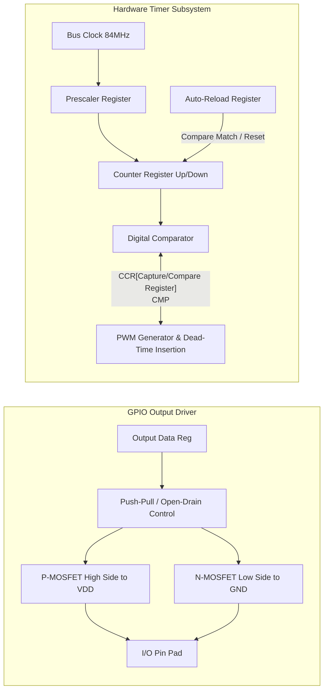

# Modul 080: Periferal Inti Mikrokontroler (GPIO Push-Pull/Open-Drain, Timers, Input Capture, Output Compare, PWM)

**Navigasi**: [⬅️ Master Index](../../INDEX.md) | [Tingkat 5: Tingkat 5: Embedded Systems, Firmware Bare-Metal & RTOS / IoT](./README.md)
*Sebelumnya*: [079. mode-daya-rendah-efisiensi-energi](./079-mode-daya-rendah-efisiensi-energi.md) | *Berikutnya*: [081. protokol-komunikasi-serial-perangkat-keras](./081-protokol-komunikasi-serial-perangkat-keras.md)

---

## 1. Intuisi Dasar Tanpa Jargon ("Seperti Bayi Baru Lahir")
Mikrokontroler tanpa periferal hanyalah kalkulator matematis yang tuli dan buta di dalam ruang hampa. Periferal inti ([Microcontroller Peripherals](https://www.embedded.com/microcontroller-peripherals-the-nuts-and-bolts/)) adalah indra dan otot silikon fisik mikrokontroler: pin GPIO (General Purpose Input/Output) adalah saklar dan sensor digital biner yang mampu merasakan tegangan tinggi/rendah atau menyalakan beban; Timer perangkat keras adalah stopwatch presisi pikosekon yang bekerja secara independen dari program CPU, mengukur interval gelombang (Input Capture) atau memotong aliran arus ribuan kali per detik untuk menghasilkan sinyal Pulse Width Modulation (PWM) yang halus guna menggerakkan motor atau meredupkan lampu.

## 2. Fondasi Teoretis & Aksiomatik / Matematis
Perancangan dan pengoperasian periferal timer dan PWM berakar pada pembagian frekuensi clock sistem (prescaling) dan modulo counter:

$$f_{timer} = \frac{f_{clk}}{(PSC + 1)}$$

$$f_{PWM} = \frac{f_{timer}}{(ARR + 1)} = \frac{f_{clk}}{(PSC + 1) \cdot (ARR + 1)}$$

Di mana:
- $f_{clk}$: Frekuensi clock bus periferal yang mencatu counter (misal 84 MHz pada APB1 timer).
- $PSC$: Nilai register Prescaler (16-bit atau 32-bit integer register).
- $ARR$: Nilai register Auto-Reload / Period (menentukan batas atas pencacahan counter sebelum reload/overflow).

Duty cycle dari sinyal PWM ditentukan oleh nilai Capture/Compare Register ($CCR$):
$$\text{Duty Cycle (\%)} = \frac{CCR}{ARR + 1} \times 100\%$$

Untuk pengukuran frekuensi sinyal luar menggunakan mode **Input Capture**, dua stempel waktu transisi tepi $t_1$ dan $t_2$ dibaca dari register CCR saat interrupt dipicu:
$$\Delta t = (t_2 - t_1) \cdot T_{timer} \quad \implies \quad f_{input} = \frac{1}{\Delta t}$$

## 3. Anatomi Teknis & Cara Kerja Internal
Struktur internal pin GPIO dan arsitektur Hardware Timer:



1. **Push-Pull vs Open-Drain**:
   - **Push-Pull**: Menggunakan kedua transistor (PMOS menarik ke $V_{DD}$, NMOS menarik ke $GND$). Memberikan transisi rise/fall yang cepat dan simetris.
   - **Open-Drain**: Transistor PMOS diputus secara permanen; hanya NMOS yang terhubung ke $GND$. Garis bus membutuhkan resistor pull-up eksternal. Wajib digunakan untuk bus multi-master seperti I2C dan protokol 1-Wire ([GPIO Configurations](https://www.ti.com/lit/an/scaa035b/scaa035b.pdf)).
2. **Dead-Time Generator**: Dalam penggerak motor inverter H-bridge, dead-time perangkat keras menyisipkan delay beberapa ratus nanodetik di antara pensaklaran PWM complementary output untuk mencegah fenomena cross-conduction (shoot-through) yang merusak transistor MOSFET.

## 4. Implementasi Praktis & Kode / Simulasi Riil
```c
// Register-level GPIO & Hardware Timer PWM Initialization for ARM Cortex-M
#include <stdint.h>

#define RCC_AHB1ENR     (*(volatile uint32_t *)0x40023830)
#define RCC_APB1ENR     (*(volatile uint32_t *)0x40023840)
#define GPIOB_MODER     (*(volatile uint32_t *)0x40020400)
#define GPIOB_AFRL      (*(volatile uint32_t *)0x40020420)
#define TIM4_CR1        (*(volatile uint32_t *)0x40000800)
#define TIM4_PSC        (*(volatile uint32_t *)0x40000828)
#define TIM4_ARR        (*(volatile uint32_t *)0x4000082C)
#define TIM4_CCR1       (*(volatile uint32_t *)0x40000834)
#define TIM4_CCMR1      (*(volatile uint32_t *)0x40000818)
#define TIM4_CCER       (*(volatile uint32_t *)0x40000820)

void init_pwm_tim4_pb6(uint32_t freq_hz, uint32_t duty_percent) {
    // 1. Nyalakan clock untuk GPIOB dan TIM4
    RCC_AHB1ENR |= (1UL << 1);  // Enable GPIOB
    RCC_APB1ENR |= (1UL << 2);  // Enable TIM4

    // 2. Set PB6 ke Alternate Function Mode (MODER[13:12] = 10b)
    GPIOB_MODER &= ~(3UL << 12);
    GPIOB_MODER |=  (2UL << 12);
    // Set AF2 (TIM4_CH1) untuk PB6 pada AFRL[27:24]
    GPIOB_AFRL  &= ~(0xFUL << 24);
    GPIOB_AFRL  |=  (2UL << 24);

    // 3. Konfigurasi Timer Base: APB1 clock = 84 MHz
    // Target timer tick = 1 MHz -> PSC = 84 - 1 = 83
    TIM4_PSC = 84 - 1;
    uint32_t arr_val = (1000000 / freq_hz) - 1;
    TIM4_ARR = arr_val;

    // 4. Konfigurasi Output Compare Mode: PWM mode 1 (OC1M = 110b), Preload Enable
    TIM4_CCMR1 &= ~(0x7UL << 4);
    TIM4_CCMR1 |=  (6UL << 4) | (1UL << 3);

    // 5. Set Duty Cycle awal
    TIM4_CCR1 = ((arr_val + 1) * duty_percent) / 100;

    // 6. Enable Output Compare Channel 1 & Nyalakan Counter
    TIM4_CCER |= (1UL << 0);
    TIM4_CR1  |= (1UL << 0) | (1UL << 7); // CEN=1, ARPE=1
}
```

## 5. Miskonsepsi & Jebakan Industri
1. **Clamping Diode Destruction via 5V Tolerance Misconception**: Menghubungkan sumber 5V ke pin GPIO 3.3V yang berlabel non-FT (non-Five-Volt-Tolerant) akan memicu konduksi parasitic clamping diode ke rel $V_{DD}$, mengalirkan arus berlebih yang membakar pin silikon secara permanen.
2. **Race Condition pada Read-Modify-Write Register OD/IDR**: Mengubah pin GPIO menggunakan instruksi `PORT |= (1 << PIN)` membaca seluruh register port sebelum menulis kembali. Jika interupsi menyela di tengah siklus ini dan mengubah pin lain pada port yang sama, modifikasi interupsi akan terhapus. Solusi: Selalu gunakan register Atomic Bit Set/Reset (seperti BSRR pada STM32) ([ARM Cortex Bit-Banding & Atomic I/O](https://developer.arm.com/documentation/dui0552/a/the-cortex-m3-processor/memory-model/bit-banding)).
3. **Glitch pada PWM Saat Update Nilai ARR Tanpa Shadow Register (Preload)**: Menulis ARR baru saat counter aktif tanpa bit ARPE/Preload aktif menyebabkan counter melompat melampaui batas ARR baru jika nilainya lebih kecil, memicu counter berhitung hingga $2^{16}-1$ sebelum overflow kembali, menimbulkan lonjakan transien yang fatal pada konverter daya.

## 6. Proyek Latihan & Rubrik Penilaian Mandiri
1. **Tingkat Pemula**: Konfigurasi mikrokontroler untuk menghasilkan sinyal square-wave 1 kHz dengan duty-cycle 50% menggunakan timer prescaler dan register ARR. Verifikasi bentuk gelombang dengan osiloskop digital atau logic analyzer.
2. **Tingkat Menengah**: Implementasikan pembacaan encoder rotary quadrature (sinyal Fase A & B) menggunakan mode hardware timer Encoder Interface (TIM_EncoderMode_TI12). Hitung posisi putaran absolut dan deteksi arah rotasi (CW/CCW) tanpa beban CPU interrupt.
3. **Tingkat Mahir**: Rancang modul sinusoidal PWM (SPWM) 3-fase complementary dengan dead-time insertion 500 ns menggunakan Advanced-Control Timer untuk menggerakkan inverter 3-phase BLDC motor. Tuliskan mekanisme proteksi emergency break input (Break/Fault pin) yang langsung mematikan semua output gate PWM secara hardware ketika terjadi overcurrent.

## 7. Rekomendasi Sumber Belajar Standar Emas
| Sumber Pembelajaran | Penulis / Institusi | Tautan Langsung | Fokus Materi |
| :--- | :--- | :--- | :--- |
| STM32 Timer Cookbook | STMicroelectronics | [ST AN4013](https://www.st.com/resource/en/application_note/dm00042534-stm32-crossseries-timer-overview-stmicroelectronics.pdf) | Prinsip Hardware Counter, PWM, One-Pulse & Encoder Mode |
| Microcontroller GPIO & Pin Architectures | Embedded Systems Programming | [Embedded.com GPIO Guide](https://www.embedded.com/understanding-microcontroller-gpio-modes/) | Push-Pull, Open-Drain, Schmitt Trigger & Slew Rate |
| Motor Control PWM & Dead-Time Generation | Texas Instruments | [TI SPRUGE6](https://www.ti.com/lit/ug/spruge6b/spruge6b.pdf) | Enhanced PWM (ePWM) Architecture & Dead-Band Generator |
| Embedded C & Hardware Register Mapping | Jack Ganssle | [Ganssle Firmware Architecture](http://www.ganssle.com/articles/goodcode.htm) | Best Practices Manipulasi Register Periferal Biner |

---
*Navigasi Cepat*: [Ke Tingkat 5](./README.md) | [Ke Master Index](../../INDEX.md) | *Sebelumnya*: [079. mode-daya-rendah-efisiensi-energi](./079-mode-daya-rendah-efisiensi-energi.md) | *Berikutnya*: [081. protokol-komunikasi-serial-perangkat-keras](./081-protokol-komunikasi-serial-perangkat-keras.md)
