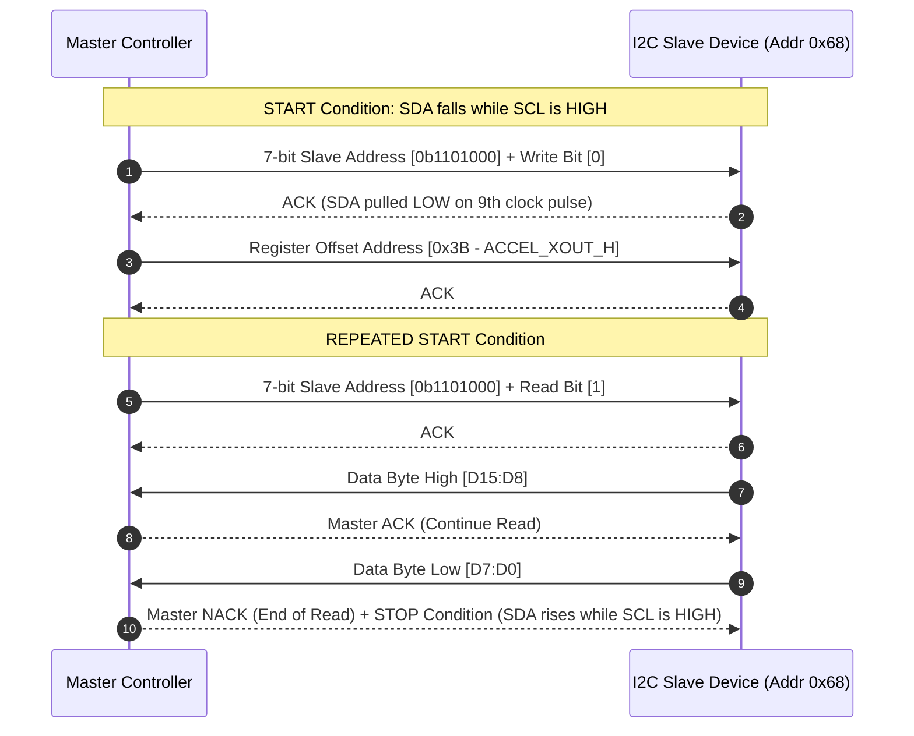

# Modul 081: Protokol Komunikasi Serial Perangkat Keras (UART, RS-232, RS-485 Diferensial, I2C, SPI, I2S, 1-Wire)

**Navigasi**: [⬅️ Master Index](../../INDEX.md) | [Tingkat 5: Tingkat 5: Embedded Systems, Firmware Bare-Metal & RTOS / IoT](./README.md)
*Sebelumnya*: [080. periferal-inti-mikrokontroler](./080-periferal-inti-mikrokontroler.md) | *Berikutnya*: [082. protokol-bus-industri-otomotif](./082-protokol-bus-industri-otomotif.md)

---

## 1. Intuisi Dasar Tanpa Jargon ("Seperti Bayi Baru Lahir")
Komunikasi serial adalah bahasa percakapan yang menghubungkan chip silikon individual menjadi sebuah orkestra elektronik. Tanpa protokol serial ([Serial Communication Protocols](https://www.sparkfun.com/serial-communication)), Anda harus menarik kabel individual untuk setiap bit data, menciptakan keruwetan kabel paralel yang rentan interferensi. UART (Universal Asynchronous Receiver/Transmitter) adalah obrolan santai antara dua sahabat tanpa jam bersama; keduanya sepakat pada tempo bicara (baud rate) dan menandai awal kata dengan teriakan 'Start!' dan akhir kata dengan helaan nafas 'Stop!'. SPI (Serial Peripheral Interface) adalah komandan militer berkecepatan tinggi dengan seorang konduktor clock (SCLK) bersama, mengalirkan data secara simultan dua arah secepat peluru tanpa jeda. Sementara I2C (Inter-Integrated Circuit) adalah rapat dewan multi-anggota yang hanya menggunakan dua kawat (SDA dan SCL); setiap chip memiliki kartu identitas alamat unik 7-bit, dan harus menunggu gilirannya dengan santun menggunakan konfirmasi 'Acknowledge' (ACK).

## 2. Fondasi Teoretis & Aksiomatik / Matematis
Perbandingan karakteristik fungsional protokol komunikasi serial periferal:

$$\begin{array}{|l|c|c|c|c|c|}
\hline
\textbf{Protokol} & \textbf{Garis Kawat} & \textbf{Sinkronisasi} & \textbf{Duplex} & \textbf{Kecepatan Khas} & \textbf{Topologi} \\
\hline
\text{UART / RS-232} & 2\text{ (TX, RX)} & \text{Asinkron (Start/Stop)} & \text{Full} & 9.6\text{ kbps} - 4\text{ Mbps} & \text{Point-to-Point} \\
\text{RS-485} & 2\text{ (D+, D- diff)} & \text{Asinkron (Baud rate)} & \text{Half} & \text{s.d. } 10\text{ Mbps / 1.2 km} & \text{Multi-drop Bus} \\
\text{SPI} & 4\text{ (MOSI, MISO, SCK, CS)} & \text{Sinkron (Clock SCLK)} & \text{Full} & 10 - 80\text{ MHz} & \text{Master-Multi-Slave} \\
\text{I2C} & 2\text{ (SDA, SCL)} & \text{Sinkron (Clock SCL)} & \text{Half} & 100\text{ kHz} - 3.4\text{ MHz} & \text{Multi-Master Bus} \\
\text{I2S} & 3\text{ (SCK, WS, SD)} & \text{Sinkron (Word Select)} & \text{Simplex/Half} & 1.4 - 12.288\text{ MHz} & \text{Audio Stream} \\
\text{1-Wire} & 1\text{ (Data + Parasitic Vcc)} & \text{Asinkron (Time slots)} & \text{Half} & 16.3\text{ kbps} & \text{Multi-drop Daisy} \\
\hline
\end{array}$$

Pada bus I2C, nilai resistor pull-up ($R_p$) dibatasi oleh waktu naik maksimum ($t_r$) dan kapasitansi bus total ($C_b$):

$$R_{p(max)} = \frac{t_{r(max)}}{0.8473 \cdot C_b} \quad \text{dan} \quad R_{p(min)} = \frac{V_{DD} - V_{OL(max)}}{I_{OL}}$$

Untuk mode standar I2C ($t_{r(max)} = 1000\text{ ns}$, $C_b = 400\text{ pF}$, $V_{DD}=3.3\text{V}$, $I_{OL}=3\text{ mA}$):
$$R_{p(min)} \approx \frac{3.3 - 0.4}{0.003} = 966\,\Omega, \quad R_{p(max)} = \frac{1000 \times 10^{-9}}{0.8473 \times 400 \times 10^{-12}} \approx 2.95\,\text{k}\Omega$$

## 3. Anatomi Teknis & Cara Kerja Internal
Diagram waktu fisik bus I2C dan SPI 4-Wire:



Transceiver RS-485 menggunakan sinyal diferensial ($V_A - V_B$). Jika $V_A - V_B > +200\text{ mV}$, receiver membaca biner 1 (Mark); jika $V_A - V_B < -200\text{ mV}$, biner 0 (Space). Interferensi elektromagnetik umum yang merambat ke kabel twisted pair akan mempengaruhi kedua kabel secara identik dan dieliminasi oleh Common-Mode Rejection Ratio (CMRR) op-amp penerima.

## 4. Implementasi Praktis & Kode / Simulasi Riil
```c
// Bit-Banging I2C Master Implementation with Clock Stretching Support in C
#include <stdint.h>
#include <stdbool.h>

// Prototipe hardware abstraction layer untuk manipulasi pin open-drain
void sda_high(void);  // Biarkan pull-up menarik garis ke 3.3V
void sda_low(void);   // Aktifkan NMOS menarik garis ke GND
void scl_high(void);
void scl_low(void);
bool read_sda(void);
bool read_scl(void);
void delay_half_clock_us(void); // ~2.5us untuk 100kHz I2C

static void i2c_scl_release(void) {
    scl_high();
    // Dukungan Clock Stretching: tunggu jika slave menahan SCL rendah
    while (!read_scl()) {
        // opsional: tambahkan timeout counter di sini
    }
}

void i2c_start(void) {
    sda_high();
    scl_high();
    delay_half_clock_us();
    sda_low();   // START: SDA transisi HIGH->LOW saat SCL HIGH
    delay_half_clock_us();
    scl_low();
}

void i2c_stop(void) {
    sda_low();
    delay_half_clock_us();
    i2c_scl_release();
    delay_half_clock_us();
    sda_high();  // STOP: SDA transisi LOW->HIGH saat SCL HIGH
    delay_half_clock_us();
}

bool i2c_write_byte(uint8_t byte) {
    for (int i = 7; i >= 0; i--) {
        if (byte & (1 << i)) sda_high();
        else                 sda_low();
        delay_half_clock_us();
        i2c_scl_release();
        delay_half_clock_us();
        scl_low();
    }
    // Baca 9th bit: ACK dari Slave
    sda_high(); // Lepas SDA agar slave bisa menarik rendah
    delay_half_clock_us();
    i2c_scl_release();
    bool ack = (read_sda() == false); // ACK jika SDA LOW
    delay_half_clock_us();
    scl_low();
    return ack;
}
```

## 5. Miskonsepsi & Jebakan Industri
1. **I2C Bus Lockup (Garis SDA Tertahan LOW oleh Slave)**: Jika mikrokontroler master di-reset di tengah transaksi baca I2C saat slave sedang mengirimkan bit '0' (SDA ditahan LOW), master baru akan memulai bus dengan mengirimkan START condition, namun slave masih menunggu siklus SCL ke-9. Bus terkunci permanen! Solusi: Jalankan bus-clearing sequence saat booting dengan memompa 9 siklus clock pada SCL secara software lalu mengirim STOP condition ([NXP I2C Bus Clearing](https://www.nxp.com/docs/en/user-guide/UM10204.pdf)).
2. **SPI CPOL/CPHA Misalignment**: Ketidakcocokan konfigurasi Clock Polarity (CPOL) dan Clock Phase (CPHA) antara master dan sensor slave mengakibatkan data dibaca pada tepi clock yang salah, menggeser seluruh bit satu posisi ke kiri atau kanan (misal nilai 0x7F terbaca sebagai 0xFE).
3. **Missing Termination Resistor pada RS-485**: Menjalankan bus diferensial RS-485 berkecepatan tinggi atau berkabel panjang (>10 meter) tanpa resistor terminasi $120\,\Omega$ di kedua ujung bus fisik memicu refleksi gelombang transmisi yang merusak frame byte UART.

## 6. Proyek Latihan & Rubrik Penilaian Mandiri
1. **Tingkat Pemula**: Hubungkan dua mikrokontroler menggunakan UART (TX-RX silang, GND bersama). Implementasikan pengiriman string teks sederhana pada baud rate 115200 8N1 dan verifikasi penerimaan menggunakan ring buffer (FIFO).
2. **Tingkat Menengah**: Hubungkan modul sensor IMU I2C (seperti MPU6050 atau BMP280) ke mikrokontroler. Rancang driver register untuk membaca chip ID (register WHO_AM_I) dan mengonfigurasi filter low-pass digital melalui register I2C. Tangani kondisi timeout jika ACK tidak diterima.
3. **Tingkat Mahir**: Rancang driver periferal SPI Master kecepatan tinggi (20 MHz) yang mentransmisikan frame data frame-buffer grafis ke layar LCD TFT menggunakan DMA channel double-buffering. Buktikan bahwa pemindahan data berjalan pada utilisasi CPU 0% selama proses transfer.

## 7. Rekomendasi Sumber Belajar Standar Emas
| Sumber Pembelajaran | Penulis / Institusi | Tautan Langsung | Fokus Materi |
| :--- | :--- | :--- | :--- |
| I2C-bus Specification and User Manual | NXP Semiconductors | [NXP UM10204](https://www.nxp.com/docs/en/user-guide/UM10204.pdf) | Standar Resmi I2C, Clock Stretching, Arbitration & Bus Timing |
| Serial Peripheral Interface (SPI) Guide | Motorola / Analog Devices | [Analog Devices SPI Guide](https://www.analog.com/en/analog-dialogue/articles/introduction-to-spi-interface.html) | Mode 0/1/2/3 CPOL/CPHA, Daisy-Chaining & Multi-Slave |
| RS-485 Design Guide & Transmission Lines | Texas Instruments | [TI SLLA272](https://www.ti.com/lit/an/slla272d/slla272d.pdf) | Sinyal Diferensial, Terminasi Jalur, Failsafe Biasing & Ground Loop |
| The Serial Port Architecture | SparkFun Electronics | [SparkFun Serial Tutorial](https://www.sparkfun.com/serial-communication) | Dasar Komunikasi Serial, Baud Rate Generator & Framing Error |

---
*Navigasi Cepat*: [Ke Tingkat 5](./README.md) | [Ke Master Index](../../INDEX.md) | *Sebelumnya*: [080. periferal-inti-mikrokontroler](./080-periferal-inti-mikrokontroler.md) | *Berikutnya*: [082. protokol-bus-industri-otomotif](./082-protokol-bus-industri-otomotif.md)
