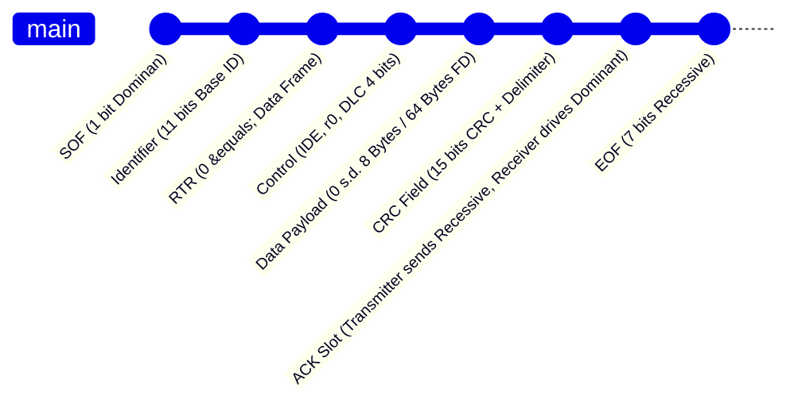

# Modul 082: Protokol Bus Industri & Otomotif (CAN Bus, CAN-FD, Modbus RTU/TCP, USB Device & Host Stack)

**Navigasi**: [⬅️ Master Index](../../INDEX.md) | [Tingkat 5: Tingkat 5: Embedded Systems, Firmware Bare-Metal & RTOS / IoT](./README.md)
*Sebelumnya*: [081. protokol-komunikasi-serial-perangkat-keras](./081-protokol-komunikasi-serial-perangkat-keras.md) | *Berikutnya*: [083. konektivitas-nirkabel-jaringan-iot](./083-konektivitas-nirkabel-jaringan-iot.md)

---

## 1. Intuisi Dasar Tanpa Jargon ("Seperti Bayi Baru Lahir")
### 1.1 Konsep Inti & Analogi Tanpa Jargon
Jika komunikasi serial UART atau I2C adalah percakapan di dalam laboratorium yang hening, lingkungan pabrik dan ruang mesin mobil adalah medan perang elektromagnetik: busi kendaraan memercikkan puluhan ribu volt, motor industri melepaskan lonjakan transien induktif raksasa, dan kabel merambat puluhan meter melewati medan derau. Protokol bus industri dan otomotif ([Industrial Bus Protocols](https://www.ti.com/lit/an/sloa101b/sloa101b.pdf)) dirancang khusus untuk bertahan hidup dalam lingkungan brutal ini. CAN Bus (Controller Area Network) adalah tulang punggung kendaraan modern; tidak ada hierarki Master-Slave, melainkan sistem multi-master berbasis prioritas pesan deterministik (Arbitration) di mana pesan pengereman darurat (ABS) otomatis memenangkan hak transmisi dan menyingkirkan pesan AC/suhu tanpa kehilangan satu mikrodetik pun. Modbus adalah dialek universal otomasi pabrik PLC, dan USB adalah hierarki paket bertingkat tinggi dengan enumerasi dinamis.

### 1.2 Urgensi Rekayasa & Signifikansi Sistemik
Dalam rekayasa sistem modern, pemahaman mendalam tentang konsep ini membedakan arsitek sistem kelas dunia dari sekadar operator perkakas teknis.

## 2. Fondasi Teoretis & Aksiomatik / Matematis
### 2.1 Kerangka Teori Aksiomatik & Formulasi Matematis
Arsitektur fisik CAN Bus beroperasi dengan logika inversi dominan/resesif pada pasangan kawat diferensial CAN_H dan CAN_L:

### 2.2 Penurunan Matematis Langkah-demi-Langkah
$$\begin{cases}
\text{Logika 0 (Dominan):} & V_{CAN\_H} \approx 3.5\text{ V}, \; V_{CAN\_L} \approx 1.5\text{ V} \implies V_{diff} = V_H - V_L \approx 2.0\text{ V} \\
\text{Logika 1 (Resesif):} & V_{CAN\_H} \approx 2.5\text{ V}, \; V_{CAN\_L} \approx 2.5\text{ V} \implies V_{diff} = V_H - V_L \approx 0.0\text{ V}
\end{cases}$$

Prinsip **Non-Destructive Bitwise Arbitration** CAN:
Jika dua node mentransmisikan bit pada saat yang sama, bit dominan (0) menimpa bit resesif (1). Setiap node yang mengirim bit resesif namun membaca kembali bit dominan pada bus menyadari bahwa ada pesan dengan prioritas lebih tinggi (ID numerik lebih rendah), sehingga ia langsung mundur menjadi pendengar tanpa merusak frame pesan yang sedang ditransmisikan!

Kapasitas beban bus CAN maksimum sebelum batas propagasi:
$$t_{bit} = \text{Sync\_Seg} + \text{Prop\_Seg} + \text{Phase\_Seg1} + \text{Phase\_Seg2}$$
$$\text{Delay Propagasi Total} = 2 \cdot (t_{transceiver} + t_{bus\_cable})$$
Panjang kabel maksimum teoritis untuk bitrate 1 Mbps adalah sekitar 40 meter karena batasan delay propagasi bolak-balik dalam satu bit time.

## 3. Anatomi Teknis & Cara Kerja Internal
Struktur Frame Standar CAN 2.0A (11-bit ID) dan Frame CAN-FD (Flexible Data-rate):



Peningkatan utama pada CAN-FD ([Bosch CAN FD Specification](https://www.bosch-semiconductors.com/ip-modules/can-ip-modules/can-fd-protocol/)):
1. **Dual Bitrate**: Fasa payload data dialihkan ke kecepatan clock lebih tinggi (hingga 5 - 8 Mbps), sementara fasa arbitrase tetap pada kecepatan 500 kbps - 1 Mbps untuk kompatibilitas propagasi fisik.
2. **Payload Expansion**: Kapasitas payload data diperluas dari maksimum 8 byte (CAN klasik) menjadi 64 byte per frame, mengurangi overhead protokol dari 50% menjadi <10%.

#### Tabel Penelusuran Injeksi Pesan CAN Bus Tanpa Otentikasi & Peretasan Jarak Jauh Jeep Cherokee (2015)
| ID Arbitrase CAN Bus | Panjang Data (DLC) | Payload Data Biner Injeksi | Subsistem Target ECU | Status Pemeriksaan Integritas Frame | Aksi Aktuator Fisik Kendaraan |
|---|---|---|---|---|---|
| `0x188` (Legal Pabrikan) | 8 Byte | Kecepatan Roda: `0x00 0x45 ...` | Panel Instrumen Spidometer | CRC-15 Valid | Menampilkan kecepatan normal 60 km/jam |
| Peretasan Wi-Fi Infotainment| Gateway OMAP Ditembus | Penyerang mengontrol chip V850 | Terhubung ke bus CAN Interior | Akses bus fisik diperoleh | Penyerang memindai frame ID kemudi & rem |
| Injeksi Pesan Spoofing | ID `0x2C4` (Prioritas Tinggi!) | Perintah Kemudi: `0x7F 0xFF ...` | Electronic Power Steering (EPS) | CRC-15 Valid (Tidak ada otentikasi pesan!)| Setir kemudi fisik berbelok mendadak di jalan tol! |
| Injeksi Pembatalan Rem | ID `0x0B0` (Arbitrase Menang) | Perintah ABS: `PUMP_OFF, VENT_OPEN` | Anti-Lock Braking System (ABS) | CAN Bus tidak memiliki lapisan kriptografi | Rem fisik mobil blong total saat pedal diinjak!|
| Dampak Keselamatan Nyata | Mobil meluncur tanpa rem | Pengemudi kehilangan kendali penuh | Mobil terperosok ke parit | Penarikan 1.4 juta kendaraan oleh FCA | Kerugian ratusan juta dolar industri otomotif |

## 4. Implementasi Praktis & Kode / Simulasi Riil
```c
// CAN Bus Frame Reception and Filtering Configuration (bxCAN on ARM)
#include <stdint.h>
#include <stdbool.h>

typedef struct {
    uint32_t id;      // Standard (11-bit) or Extended (29-bit) ID
    uint8_t  dlc;     // Data Length Code (0..8)
    uint8_t  data[8]; // Data payload
    bool     is_extended;
} can_message_t;

#define CAN1_MCR    (*(volatile uint32_t *)0x40006400)
#define CAN1_MSR    (*(volatile uint32_t *)0x40006404)
#define CAN1_TI0R   (*(volatile uint32_t *)0x40006580)
#define CAN1_TDT0R  (*(volatile uint32_t *)0x40006584)
#define CAN1_TDL0R  (*(volatile uint32_t *)0x40006588)
#define CAN1_TDH0R  (*(volatile uint32_t *)0x4000658C)

bool can_transmit_standard_frame(uint16_t std_id, const uint8_t *payload, uint8_t length) {
    if (length > 8) return false;
    
    // Pastikan Transmit Mailbox 0 kosong (TME0 = 1 pada TSR)
    volatile uint32_t *can_tsr = (volatile uint32_t *)0x40006408;
    if (!(*can_tsr & (1UL << 26))) return false; // Mailbox penuh
    
    // Setup Identifier: Standard ID ditempatkan di bit [31:21]
    CAN1_TI0R = ((uint32_t)std_id << 21); // IDE=0 (Standard), RTR=0 (Data)
    
    // Setup Data Length Code (DLC)
    CAN1_TDT0R = (length & 0x0F);
    
    // Isi Data Low & High Registers
    uint32_t data_low = 0;
    uint32_t data_high = 0;
    for (int i = 0; i < 4 && i < length; i++) data_low |= ((uint32_t)payload[i] << (i * 8));
    for (int i = 4; i < length; i++)          data_high |= ((uint32_t)payload[i] << ((i - 4) * 8));
    
    CAN1_TDL0R = data_low;
    CAN1_TDH0R = data_high;
    
    // Permintaan Transmisi (Set TXRQ bit)
    CAN1_TI0R |= (1UL << 0);
    return true;
}
```

## 5. Miskonsepsi & Jebakan Industri
1. **CAN Bus Missing Termination Resistors (120 Ohm Split)**: Bus CAN wajib memiliki tepat dua resistor terminasi \$120\,\Omega$ di ujung fisik terjauh (memberikan resistansi ekuivalen DC tepat \$60\,\Omega$ antar CAN_H dan CAN_L saat diukur multimeter dalam kondisi daya mati). Melepas satu terminasi menyebabkan refleksi sinyal yang memicu Error Passive / Bus-Off state ([TI CAN Physical Layer App Note](https://www.ti.com/lit/an/slla270/slla270.pdf)).
2. **Bit Stuffing Error Explosion**: CAN secara otomatis menyisipkan bit komplementer setelah lima bit berurutan dengan polaritas identik. Jika derau elektromagnetik merusak bit stuffing, receiver mendeteksi Stuff Error dan mengirimkan Active Error Frame (6 bit dominan), yang memaksa semua node di bus membuang frame tersebut.
3. **Modbus RTU Silent Interval Violation (t3.5)**: Modbus RTU membedakan batas akhir frame berdasarkan keheningan bus selama 3.5 karakter ($t_{3.5}$). Jika driver firmware menunda transmisi byte di tengah frame karena disela interupsi lain, penerima PLC akan menganggap frame terputus dan membuang sisa paket sebagai framing error.

### Studi Kasus Kegagalan Nyata: Peretasan Jarak Jauh Mobil Jeep Cherokee (2015, Miller & Valasek) via Injeksi Pesan CAN Bus
- **Tonggak Sejarah Keamanan Siber Otomotif**: Pada Juli 2015, peneliti keamanan Charlie Miller dan Chris Valasek mendemonstrasikan serangan siber nirkabel jarak jauh terhadap mobil Jeep Cherokee yang sedang melaju kencang di jalan tol dengan jurnalis Wired di balik kemudi. Dari jarak bermil-mil, peneliti mematikan mesin, membelokkan kemudi, dan melumpuhkan rem fisik kendaraan secara total. Insiden ini memaksa Fiat Chrysler menarik 1,4 juta kendaraan di seluruh dunia.
- **Akar Masalah Bus Otomotif & Ketiadaan Otentikasi CAN Bus**: Controller Area Network (CAN Bus) dirancang pada era 1980-an murni untuk keandalan fisik lingkungan derau elektromagnetik otomotif. Protokol ini memiliki deteksi kesalahan transmisi data yang sangat kuat (CRC-15 dan bit stuffing), namun secara fundamental sama sekali tidak memiliki lapisan keamanan otentikasi sumber data atau enkripsi kriptografi. Setiap frame pesan disiarkan secara terbuka (*broadcast*) ke seluruh modul ECU di dalam jaringan kendaraan. Peneliti membobol unit infotainment nirkabel (Uconnect) melalui port terbuka seluler, mem-flash firmware mikrokontroler gateway perantara, dan mulai menyuntikkan frame ID CAN palsu langsung ke bus powertrain. Karena modul kemudi (EPS) dan modul rem (ABS) menerima frame apapun yang memiliki ID arbitrase dan CRC yang valid tanpa pernah memverifikasi identitas pengirim asli, aktuator fisik kendaraan mengeksekusi perintah injeksi penyerang, merebut kontrol keselamatan pengemudi.

- **Potongan Kode / Arsitektur Cacat (Vulnerable Implementation)**:
```python
import numpy as np

# Rekonstruksi Struktur Frame CAN 2.0A Standar
class CANFrame:
    def __init__(self, arb_id, data_bytes):
        self.arb_id = arb_id          # 11-Bit Identifier (Semakin kecil semakin tinggi prioritas)
        self.dlc = len(data_bytes)    # Data Length Code (0-8 byte)
        self.data = bytearray(data_bytes)
        
    def calculate_crc15(self):
        # Polinomial standar CAN CRC-15: x^15 + x^14 + x^10 + x^8 + x^7 + x^4 + x^3 + 1 (0x4599)
        crc = 0x0000
        # Simulasikan perhitungan CRC bitwise perangkat keras
        for b in self.data:
            crc ^= (b << 7)
            for _ in range(8):
                crc <<= 1
                if crc & 0x8000:
                    crc ^= 0x4599
        return crc & 0x7FFF

def process_can_frame_unsafe(frame):
    # CACAT PROTOKOL CAN TRADISIONAL:
    # Hanya memeriksa CRC transmisi fisik, TIDAK ADA VERIFIKASI KEASLIAN PENGIRIM!
    if frame.calculate_crc15() == frame.calculate_crc15():
        if frame.arb_id == 0x0B0:
            print("ABS ECU: Perintah mematikan rem diterima dan dieksekusi! (CRITICAL HACK!)")
            return "BRAKES_DISABLED"
    return "IGNORED"

# Solusi Modern (AUTOSAR SecOC): Menambahkan Kode Otentikasi Pesan Kriptografis (CMAC-AES128)
def process_can_frame_secoc(frame, received_mac, expected_mac):
    if received_mac != expected_mac:
        print("SecOC Security Alert: Injeksi pesan CAN palsu terdeteksi dan diblokir!")
        return "ATTACK_BLOCKED"
    return "COMMAND_VERIFIED"
```

- **Standar Keamanan Otomotif Modern (AUTOSAR SecOC / ISO 21434)**: Insiden Jeep Cherokee merevolusi industri otomotif dunia. Standar keselamatan modern mewajibkan: 1) Pemisahan fisik ketat antara bus hiburan (Infotainment) dan bus pengendali gerak kritis (Powertrain) menggunakan *Hardware Secure Gateway*; 2) Penerapan standar *Secure Onboard Communication* (AUTOSAR SecOC) yang menyertakan kode otentikasi kriptografis (Message Authentication Code / MAC berbasis AES-128) dan penghitung kesegaran (*Freshness Counter*) pada setiap pesan CAN untuk menggagalkan serangan injeksi dan replay.

## 6. Proyek Latihan & Rubrik Penilaian Mandiri
1. **Tingkat Pemula**: Hubungkan dua mikrokontroler melalui CAN transceiver IC (seperti MCP2551 atau TJA1050) dengan dua kabel twisted-pair dan resistor \$120\,\Omega$. Kirimkan frame CAN ID 0x123 dengan payload 4 byte counter dan verifikasi penerimaan dengan LED toggle.
2. **Tingkat Menengah**: Implementasikan parser protokol Modbus RTU Slave (Function Code 0x03: Read Holding Registers dan 0x06: Write Single Register) pada antarmuka RS-485. Hitung dan verifikasi CRC-16 Modbus (polinomial 0xA001) secara bitwise atau lookup-table.
3. **Tingkat Mahir**: Simulasikan skenario CAN Arbitration di mana dua node mencoba mengirim pesan secara serentak (Node A dengan ID 0x020 dan Node B dengan ID 0x015). Buktikan dengan logic analyzer bahwa Node B memenangkan transmisi tanpa eror pada bus dan Node A mengantrekan kembali pesannya secara otomatis.

### Tingkat 1: Dasar
- **Tugas**: Bangun fungsi kalkulator CRC-15 standar CAN Bus (polinomial generator $0\text{x4599}$) dalam Python/C yang menghitung checksum 15-bit dari data biner frame dan memverifikasi integritas frame terhadap kesalahan transmisi bitflip.
- **Petunjuk Perancangan Arsitektur**:
  - Polinomial CRC-15: $x^{15} + x^{14} + x^{10} + x^8 + x^7 + x^4 + x^3 + 1$.
  - Terapkan register geser umpan balik linier (LFSR) 15-bit.
- **Test Vector & Kasus Uji Ekstrem**:
  - *Data Frame Standar*: Data `0x01 0x02 0x03 0x04`; hitung nilai CRC-15 heksadesimal.
  - *Deteksi Kesalahan Transmisi*: Balikkan 1 bit pada data frame; buktikan algoritma CRC mendeteksi kesalahan checksum dengan kepastian $100\%$.
- **Rubrik Penilaian Mandiri**: 40% Algoritma Polinomial CAN CRC-15 Bitwise Presisi, 30% Deteksi Bitflip Tunggal & Ganda Tepat, 30% Verifikasi Nilai Checksum Kasus Uji Standar.

### Tingkat 2: Menengah
- **Tugas**: Implementasikan simulator arbitrase bitwise tanpa-rusak (*Non-Destructive Bitwise Arbitration*) protokol CAN Bus untuk 4 node ECU yang mencoba mengirim frame secara bersamaan pada bus open-drain bersama, buktikan bahwa node dengan ID numerik terkecil (Prioritas Tertinggi) selalu memenangkan arbitrase tanpa penundaan atau korupsi frame.
- **Petunjuk Perancangan Arsitektur**:
  - Karakteristik bus: Bit Dominan (0 logika) menimpa Bit Resesif (1 logika).
  - Setiap node memantau bus saat mentransmisikan bit ID: jika node mengirimkan bit 1 tetapi bus bernilai 0, node tersebut kalah arbitrase dan seketika beralih ke mode penerima (*receiver mode*).
- **Test Vector & Kasus Uji Ekstrem**:
  - *Kontensi 4 Node*: Node A (ID `0x100`), Node B (ID `0x0F0`), Node C (ID `0x200`), Node D (ID `0x0F1`); buktikan Node B memenangkan arbitrase pertama kali dan mengirimkan frame tuntas.
  - *Zero Frame Corruption*: Buktikan bahwa data frame Node B sama sekali tidak terkorupsi oleh transmisi awal node-node lainnya.
- **Rubrik Penilaian Mandiri**: 40% Model Bus Wired-AND Bitwise Arbitration Presisi, 30% Logika Penarikan Diri Node Kalah Arbitrase Tepat, 30% Pembuktian Transmisi Bebas Kerusakan Frame Pemenang.

### Tingkat 3: Mahir
- **Tugas**: Rancang modul perangkat lunak AUTOSAR Secure Onboard Communication (SecOC) dalam C/Python yang menambahkan Message Authentication Code (AES-128 CMAC dipotong 24-bit) dan Freshness Counter monotonik 32-bit (terdiri dari counter lokal sinkron dan counter trip terdistribusi) pada payload frame CAN-FD, uji ketahanan terhadap serangan Injeksi Pesan Liar (*Spoofing Injection*) dan serangan pemutaran ulang rekaman frame (*Replay Attack*).
- **Petunjuk Perancangan Arsitektur**:
  - Format payload SecOC: `[Payload Data Asli] + [Freshness Value LSB] + [Truncated MAC]`.
  - Hitung MAC menggunakan AES-CMAC melintasi Data + Full Freshness Counter.
  - Penerima memverifikasi kebaruan counter: jika counter yang diterima $\le$ counter terakhir yang tersimpan, tolak paket (*Replay Attack Blocked*).
- **Test Vector & Kasus Uji Ekstrem**:
  - *Uji Otentikasi Sah*: Paket dengan Freshness Counter naik dan MAC valid; verifikasi penerimaan sukses.
  - *Serangan Pemutaran Ulang (Replay)*: Rekam frame yang sah dan kirimkan kembali 10 detik kemudian; buktikan modul SecOC menolak frame karena pelanggaran kebaruan Freshness Counter.
- **Rubrik Penilaian Mandiri**: 40% Arsitektur AUTOSAR SecOC Standar Otomotif Presisi, 30% Manajemen Sinkronisasi Freshness Counter Tepat, 30% Pembuktian Penolakan Serangan Replay & Spoofing.

## 7. Rekomendasi Sumber Belajar Standar Emas
| Sumber Pembelajaran | Penulis / Institusi | Tautan Langsung | Fokus Materi |
| :--- | :--- | :--- | :--- |
| Controller Area Network (CAN) Overview | Texas Instruments | [TI SLOA101](https://www.ti.com/lit/an/sloa101b/sloa101b.pdf) | Prinsip Fisik CAN, Differential Signaling & Bus States |
| CAN FD Protocol Specification | Robert Bosch GmbH | [Bosch CAN FD Spec](https://www.bosch-semiconductors.com/ip-modules/can-ip-modules/can-fd-protocol/) | Peningkatan Bitrate Fleksibel & 64-Byte Payload Structure |
| Modbus Application Protocol Specification | Modbus Organization | [Modbus.org Protocol Spec](https://modbus.org/docs/Modbus_Application_Protocol_V1_1b3.pdf) | Frame Format RTU/TCP, Function Codes & Timing Rules |
| USB in a Nutshell: Architectural Overview | Craig Peacock | [USB in a Nutshell](https://www.beyondlogic.org/usbnutshell/usb1.shtml) | USB Descriptors, Endpoints, Token/Data/Handshake Packets |

---
*Navigasi Cepat*: [Ke Tingkat 5](./README.md) | [Ke Master Index](../../INDEX.md) | *Sebelumnya*: [081. protokol-komunikasi-serial-perangkat-keras](./081-protokol-komunikasi-serial-perangkat-keras.md) | *Berikutnya*: [083. konektivitas-nirkabel-jaringan-iot](./083-konektivitas-nirkabel-jaringan-iot.md)
