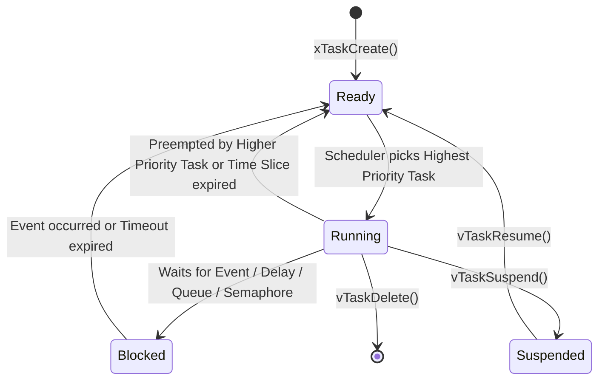

# Modul 084: Real-Time Operating Systems / RTOS Internals (FreeRTOS & Zephyr: TCB, Context Switch, Mutex, Priority Inversion)

**Navigasi**: [⬅️ Master Index](../../INDEX.md) | [Tingkat 5: Tingkat 5: Embedded Systems, Firmware Bare-Metal & RTOS / IoT](./README.md)
*Sebelumnya*: [083. konektivitas-nirkabel-jaringan-iot](./083-konektivitas-nirkabel-jaringan-iot.md) | *Berikutnya*: [085. arsitektur-firmware-kritis](./085-arsitektur-firmware-kritis.md)

---

## 1. Intuisi Dasar Tanpa Jargon ("Seperti Bayi Baru Lahir")
Pada program mikrokontroler bare-metal tanpa sistem operasi, Anda terjebak dalam 'Super Loop' (`while(1)` raksasa) yang diselingi interupsi. Jika satu fungsi sensor membutuhkan waktu 50 milidetik untuk membaca data, seluruh sistem lumpuh dan antarmuka pengguna membeku. Real-Time Operating System (RTOS) ([FreeRTOS Architecture](https://www.freertos.org/Documentation/00-Overview)) adalah konduktor orkestra multitasking sejati: ia memecah kode Anda menjadi lusinan tugas mandiri (tasks/threads), masing-masing dengan tumpukan memorinya sendiri (stack) dan tingkat prioritas tertentu. RTOS menjamin sifat 'deterministik'—bukan berarti secepat kilat, melainkan jaminan mutlak bahwa tugas berprioritas tinggi (seperti kontrol airbag mobil atau kestabilan drone) akan mengambil alih CPU tepat waktu dalam batas deadline yang telah ditentukan secara matematis.

## 2. Fondasi Teoretis & Aksiomatik / Matematis
Operasi inti RTOS berpusat pada **Preemptive Priority-Based Scheduling** dan perhitungan waktu eksekusi tugas. Kelayakan jadwal (schedulability) untuk algoritma Rate-Monotonic Scheduling (RMS) dianalisis menggunakan batas Liu & Layland:

$$U = \sum_{i=1}^{n} \frac{C_i}{T_i} \le n \left( 2^{1/n} - 1 \right)$$

Di mana:
- $C_i$: Waktu komputasi terburuk (Worst-Case Execution Time / WCET) dari task $i$.
- $T_i$: Periode pengulangan atau deadline dari task $i$.
- $n$: Jumlah total tugas independen dalam sistem.
- Untuk $n \to \infty$, batas utilisasi CPU maksimum teoretis konvergen ke $\ln(2) \approx 69.3\%$.

Mekanisme **Context Switching**: Ketika interupsi Systick timer terpicu atau sebuah task melakukan panggilan blocking (`vTaskDelay`), CPU ARM Cortex-M memicu interupsi perangkat lunak `PendSV` (Pended Servicing).
Hardware otomatis menyimpan register callee-saved ($R0-R3, R12, LR, PC, xPSR$) ke tumpukan task (Process Stack Pointer / PSP), lalu ISR PendSV menyimpan register manual ($R4-R11$), memperbarui pointer Task Control Block (TCB), dan memuat konteks task baru ke CPU register.

## 3. Anatomi Teknis & Cara Kerja Internal
Anatomi Task Control Block (TCB) dan Siklus Transisi Status Tugas di FreeRTOS:



Masalah Klasik: **Priority Inversion**
Terjadi ketika Task Prioritas Rendah ($L$) memegang Mutex yang dibutuhkan oleh Task Prioritas Tinggi ($H$). Jika tiba-tiba Task Prioritas Menengah ($M$) berjalan dan menyela $L$, maka $H$ secara tidak langsung terhalang oleh $M$!
Solusi Arsitektural: **Priority Inheritance Protocol**. Ketika $H$ memblokir pada mutex yang dipegang $L$, RTOS sementara waktu menaikkan prioritas $L$ setara dengan $H$ hingga $L$ melepas mutex tersebut, mencegah $M$ menyela di tengah jalan ([FreeRTOS Mutex & Priority Inversion](https://www.freertos.org/Real-time-computing-RTOS-concepts/FreeRTOS-RTOS-concepts-Mutaxes-and-Priority-Inversion)).

## 4. Implementasi Praktis & Kode / Simulasi Riil
```c
// FreeRTOS Task Synchronization using Binary Semaphore & Queue in C
#include "FreeRTOS.h"
#include "task.h"
#include "queue.h"
#include "semphr.h"

typedef struct {
    uint32_t sensor_val;
    uint32_t timestamp;
} telemetry_data_t;

static QueueHandle_t xSensorQueue = NULL;
static SemaphoreHandle_t xI2CMutex = NULL;

void vSensorTask(void *pvParameters) {
    telemetry_data_t data;
    for (;;) {
        // 1. Amankan akses periferal I2C menggunakan Mutex (Priority Inheritance aktif)
        if (xSemaphoreTake(xI2CMutex, pdMS_TO_TICKS(100)) == pdTRUE) {
            // Baca data sensor fisik (simulasi)
            data.sensor_val = 42;
            data.timestamp = xTaskGetTickCount();
            xSemaphoreGive(xI2CMutex);
        }
        
        // 2. Kirim data ke Queue untuk diproses task komunikasi
        xQueueSend(xSensorQueue, &data, portMAX_DELAY);
        
        // 3. Tidur periodik presisi (Delay-Until menjamin periode deterministik)
        vTaskDelay(pdMS_TO_TICKS(50)); // Eksekusi 20 Hz
    }
}

void vCommsTask(void *pvParameters) {
    telemetry_data_t received_data;
    for (;;) {
        // Menunggu data dari Queue (Blocked State: 0% utilisasi CPU saat menunggu)
        if (xQueueReceive(xSensorQueue, &received_data, portMAX_DELAY) == pdTRUE) {
            // Transmisikan paket data via UART / RF
            (void)received_data;
        }
    }
}
```

## 5. Miskonsepsi & Jebakan Industri
1. **Calling Non-ISR FreeRTOS API inside Hardware Interrupt**: Memanggil API reguler seperti `xQueueSend()` atau `xSemaphoreGive()` di dalam Interrupt Service Routine (ISR) perangkat keras akan merusak memori internal kernel scheduler! Selalu gunakan varian `xQueueSendFromISR()` dan periksa parameter `pxHigherPriorityTaskWoken` untuk memicu yield segera ([FreeRTOS Interrupt Management](https://www.freertos.org/a00110.html)).
2. **Silent Task Stack Overflow**: Jika sebuah task mendeklarasikan array buffer lokal yang besar di stack atau menggunakan rekursi tanpa ukuran `configMINIMAL_STACK_SIZE` yang memadai, tumpukan memori akan meluap (stack overflow) dan menimpa TCB task tetangga. Aktifkan hook `vApplicationStackOverflowHook` dan setel `configCHECK_FOR_STACK_OVERFLOW = 2`.
3. **Deadlock akibat Penguncian Mutex Bersilang (ABBA Deadlock)**: Task 1 mengambil Mutex A lalu menunggu Mutex B; di saat bersamaan Task 2 mengambil Mutex B lalu menunggu Mutex A. Kedua task terkunci abadi. Solusi: Selalu tetapkan urutan hierarki penguncian mutex global yang seragam di seluruh modul kode.

## 6. Proyek Latihan & Rubrik Penilaian Mandiri
1. **Tingkat Pemula**: Buat dua task independen pada FreeRTOS/Zephyr: satu task bertugas mengedipkan LED setiap 500 ms, dan task kedua mencetak pesan counter ke konsol UART setiap 1000 ms. Verifikasi multitasking preemptive berjalan mulus.
2. **Tingkat Menengah**: Implementasikan sistem producer-consumer menggunakan FreeRTOS Queue. Task Producer mengumpulkan data ADC dengan rate 100 Hz, dan Task Consumer menghitung nilai moving average. Uji ketahanan queue saat buffer hampir penuh.
3. **Tingkat Mahir**: Simulasikan skenario Priority Inversion menggunakan 3 task dengan prioritas Low, Medium, dan High. Tunjukkan bagaimana tanpa Priority Inheritance task High tertahan oleh task Medium. Aktifkan Mutex FreeRTOS dan buktikan mekanisme pengangkatan prioritas memulihkan batas latensi deterministik.

## 7. Rekomendasi Sumber Belajar Standar Emas
| Sumber Pembelajaran | Penulis / Institusi | Tautan Langsung | Fokus Materi |
| :--- | :--- | :--- | :--- |
| Mastering the FreeRTOS Real Time Kernel | Richard Barry / Amazon Web Services | [FreeRTOS Official Book](https://www.freertos.org/Documentation/RTOS_book.html) | Task Scheduling, Queue Management, Semaphores & Memory Allocation |
| Zephyr Project Documentation & Architecture | Linux Foundation | [Zephyr Project Docs](https://docs.zephyrproject.org/latest/introduction/index.html) | Device Tree Integration, Kconfig, Workqueues & Microkernel Architecture |
| Real-Time Systems and Scheduling Analysis | Jane W. S. Liu | [Rate Monotonic Scheduling Papers](https://ieeexplore.ieee.org/document/1703110) | Teori Liu & Layland, Priority Ceiling Protocol & WCET Estimation |
| ARM Cortex-M Exception & Context Switch | Joseph Yiu | [The Definitive Guide to ARM Cortex-M](https://www.elsevier.com/books/the-definitive-guide-to-arm-cortex-m3-and-cortex-m4-processors/yiu/978-0-12-408082-9) | PendSV Handler, PSP vs MSP Stack Pointers & SVC Exceptions |

---
*Navigasi Cepat*: [Ke Tingkat 5](./README.md) | [Ke Master Index](../../INDEX.md) | *Sebelumnya*: [083. konektivitas-nirkabel-jaringan-iot](./083-konektivitas-nirkabel-jaringan-iot.md) | *Berikutnya*: [085. arsitektur-firmware-kritis](./085-arsitektur-firmware-kritis.md)
