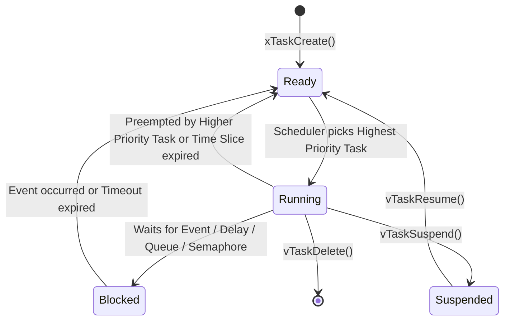

# Modul 084: Real-Time Operating Systems / RTOS Internals (FreeRTOS & Zephyr: TCB, Context Switch, Mutex, Priority Inversion)

**Navigasi**: [⬅️ Master Index](../../INDEX.md) | [Tingkat 5: Tingkat 5: Embedded Systems, Firmware Bare-Metal & RTOS / IoT](./README.md)
*Sebelumnya*: [083. konektivitas-nirkabel-jaringan-iot](./083-konektivitas-nirkabel-jaringan-iot.md) | *Berikutnya*: [085. arsitektur-firmware-kritis](./085-arsitektur-firmware-kritis.md)

---

## 1. Intuisi Dasar Tanpa Jargon ("Seperti Bayi Baru Lahir")
### 1.1 Konsep Inti & Analogi Tanpa Jargon
Pada program mikrokontroler bare-metal tanpa sistem operasi, Anda terjebak dalam 'Super Loop' (`while(1)` raksasa) yang diselingi interupsi. Jika satu fungsi sensor membutuhkan waktu 50 milidetik untuk membaca data, seluruh sistem lumpuh dan antarmuka pengguna membeku. Real-Time Operating System (RTOS) ([FreeRTOS Architecture](https://www.freertos.org/Documentation/00-Overview)) adalah konduktor orkestra multitasking sejati: ia memecah kode Anda menjadi lusinan tugas mandiri (tasks/threads), masing-masing dengan tumpukan memorinya sendiri (stack) dan tingkat prioritas tertentu. RTOS menjamin sifat 'deterministik'—bukan berarti secepat kilat, melainkan jaminan mutlak bahwa tugas berprioritas tinggi (seperti kontrol airbag mobil atau kestabilan drone) akan mengambil alih CPU tepat waktu dalam batas deadline yang telah ditentukan secara matematis.

### 1.2 Urgensi Rekayasa & Signifikansi Sistemik
Dalam rekayasa sistem modern, pemahaman mendalam tentang konsep ini membedakan arsitek sistem kelas dunia dari sekadar operator perkakas teknis.

## 2. Fondasi Teoretis & Aksiomatik / Matematis
### 2.1 Kerangka Teori Aksiomatik & Formulasi Matematis
Operasi inti RTOS berpusat pada **Preemptive Priority-Based Scheduling** dan perhitungan waktu eksekusi tugas. Kelayakan jadwal (schedulability) untuk algoritma Rate-Monotonic Scheduling (RMS) dianalisis menggunakan batas Liu & Layland:

### 2.2 Penurunan Matematis Langkah-demi-Langkah
$$U = \sum_{i=1}^{n} \frac{C_i}{T_i} \le n \left( 2^{1/n} - 1 \right)$$

Di mana:
- $C_i$: Waktu komputasi terburuk (Worst-Case Execution Time / WCET) dari task $i$.
- $T_i$: Periode pengulangan atau deadline dari task $i$.
- $n$: Jumlah total tugas independen dalam sistem.
- Untuk $n \to \infty$, batas utilisasi CPU maksimum teoretis konvergen ke $\ln(2) \approx 69.3\%$.

Mekanisme **Context Switching**: Ketika interupsi Systick timer terpicu atau sebuah task melakukan panggilan blocking (`vTaskDelay`), CPU ARM Cortex-M memicu interupsi perangkat lunak `PendSV` (Pended Servicing).
Hardware otomatis menyimpan register callee-saved ($R0-R3, R12, LR, PC, xPSR$) ke tumpukan task (Process Stack Pointer / PSP), lalu ISR PendSV menyimpan register manual ($R4-R11$), memperbarui pointer Task Control Block (TCB), dan memuat konteks task baru ke CPU register.

## 3. Anatomi Teknis & Cara Kerja Internal
Anatomi Task Control Block (TCB) dan Siklus Transisi Status Tugas di FreeRTOS:



Masalah Klasik: **Priority Inversion**
Terjadi ketika Task Prioritas Rendah ($L$) memegang Mutex yang dibutuhkan oleh Task Prioritas Tinggi ($H$). Jika tiba-tiba Task Prioritas Menengah ($M$) berjalan dan menyela $L$, maka $H$ secara tidak langsung terhalang oleh $M$!
Solusi Arsitektural: **Priority Inheritance Protocol**. Ketika $H$ memblokir pada mutex yang dipegang $L$, RTOS sementara waktu menaikkan prioritas $L$ setara dengan $H$ hingga $L$ melepas mutex tersebut, mencegah $M$ menyela di tengah jalan ([FreeRTOS Mutex & Priority Inversion](https://www.freertos.org/Real-time-computing-RTOS-concepts/FreeRTOS-RTOS-concepts-Mutaxes-and-Priority-Inversion)).

#### Tabel Penelusuran Fragmentasi Memori Heap Dinamis RTOS pada Pompa Infus Medis
| Hari Operasi Kontinu | Aksi Alokasi / Pembebasan Memori | Ukuran Blok Diminta (`malloc`) | Total Memori Bebas di SRAM | Ukuran Blok Bebas Kontinu Terbesar | Status Pemanggilan `pvPortMalloc()` |
|---|---|---|---|---|---|
| Hari 1 (Startup) | Alokasi task dan antrean awal | Variasi blok $64\text{B} - 512\text{B}$ | $48.0\text{ KB}$ bebas | $46.5\text{ KB}$ (Blok kontinu raksasa) | Sukses (Alokator cepat) |
| Hari 7 (Operasi Normal) | Paket jaringan masuk dan keluar | Alokasi & dealokasi berulang | $42.0\text{ KB}$ bebas | $28.0\text{ KB}$ | Sukses |
| Hari 20 (Fragmentasi Mulai)| Alokator Heap_2 memecah blok | Pola alokasi variabel waktu | $35.0\text{ KB}$ bebas | $4.2\text{ KB}$ (Memori mulai terpecah) | Sukses |
| Hari 45 (Fragmentasi Parah)| Ribuan pecahan kecil tersebar | Memori terfragmentasi seperti keju Swiss | $30.0\text{ KB}$ TOTAL BEBAS! | $380\text{ Byte}$ (Blok terbesar hanya 380B!)| Masih bisa melayani alokasi kecil |
| Hari 60 (Bencana Kolaps) | Task Alarm Darurat memicu `malloc(512)`| Butuh blok kontinu $512\text{ Byte}$| $28.5\text{ KB}$ BEBAS DI RAM! | Blok terbesar hanya $240\text{ Byte}$! | `pvPortMalloc` MENGEMBALIKAN `NULL`! |
| Kematian Perangkat Medis | Pengecekan pointer `NULL` terabaikan | Dereferensi pointer `0x0000_0000` | Memori bebas 28KB mubazir tak berguna!| Sistem mengalami HardFault Exception | Pompa infus mati darurat di samping pasien!|

## 4. Implementasi Praktis & Kode / Simulasi Riil
```c
// FreeRTOS Task Synchronization using Binary Semaphore & Queue in C
#include "FreeRTOS.h"
#include "task.h"
#include "queue.h"
#include "semphr.h"

typedef struct {
    uint32_t sensor_val;
    uint32_t timestamp;
} telemetry_data_t;

static QueueHandle_t xSensorQueue = NULL;
static SemaphoreHandle_t xI2CMutex = NULL;

void vSensorTask(void *pvParameters) {
    telemetry_data_t data;
    for (;;) {
        // 1. Amankan akses periferal I2C menggunakan Mutex (Priority Inheritance aktif)
        if (xSemaphoreTake(xI2CMutex, pdMS_TO_TICKS(100)) == pdTRUE) {
            // Baca data sensor fisik (simulasi)
            data.sensor_val = 42;
            data.timestamp = xTaskGetTickCount();
            xSemaphoreGive(xI2CMutex);
        }
        
        // 2. Kirim data ke Queue untuk diproses task komunikasi
        xQueueSend(xSensorQueue, &data, portMAX_DELAY);
        
        // 3. Tidur periodik presisi (Delay-Until menjamin periode deterministik)
        vTaskDelay(pdMS_TO_TICKS(50)); // Eksekusi 20 Hz
    }
}

void vCommsTask(void *pvParameters) {
    telemetry_data_t received_data;
    for (;;) {
        // Menunggu data dari Queue (Blocked State: 0% utilisasi CPU saat menunggu)
        if (xQueueReceive(xSensorQueue, &received_data, portMAX_DELAY) == pdTRUE) {
            // Transmisikan paket data via UART / RF
            (void)received_data;
        }
    }
}
```

## 5. Miskonsepsi & Jebakan Industri
1. **Calling Non-ISR FreeRTOS API inside Hardware Interrupt**: Memanggil API reguler seperti `xQueueSend()` atau `xSemaphoreGive()` di dalam Interrupt Service Routine (ISR) perangkat keras akan merusak memori internal kernel scheduler! Selalu gunakan varian `xQueueSendFromISR()` dan periksa parameter `pxHigherPriorityTaskWoken` untuk memicu yield segera ([FreeRTOS Interrupt Management](https://www.freertos.org/a00110.html)).
2. **Silent Task Stack Overflow**: Jika sebuah task mendeklarasikan array buffer lokal yang besar di stack atau menggunakan rekursi tanpa ukuran `configMINIMAL_STACK_SIZE` yang memadai, tumpukan memori akan meluap (stack overflow) dan menimpa TCB task tetangga. Aktifkan hook `vApplicationStackOverflowHook` dan setel `configCHECK_FOR_STACK_OVERFLOW = 2`.
3. **Deadlock akibat Penguncian Mutex Bersilang (ABBA Deadlock)**: Task 1 mengambil Mutex A lalu menunggu Mutex B; di saat bersamaan Task 2 mengambil Mutex B lalu menunggu Mutex A. Kedua task terkunci abadi. Solusi: Selalu tetapkan urutan hierarki penguncian mutex global yang seragam di seluruh modul kode.

### Studi Kasus Kegagalan Nyata: Kegagalan Alokasi Dinamis & Fragmentasi Memori Heap RTOS pada Perangkat Medis
- **Insiden Kegagalan Perangkat Kesehatan Kritis**: Pada sebuah pompa infus otomatis di rumah sakit terkemuka, perangkat tiba-tiba mengalami crash mati total setelah beroperasi kontinu selama 60 hari. Pemeriksaan memori pasca-insiden menunjukkan hal yang mengejutkan: sistem masih memiliki lebih dari 28 KB memori RAM yang berstatus bebas (dari total 64 KB SRAM), namun perangkat mogok karena gagal mengalokasikan satu blok memori kecil berukuran 512 byte untuk task alarm darurat.
- **Akar Masalah Sistem Operasi Waktu Nyata (RTOS) & Fragmentasi Heap**: Firmware perangkat medis tersebut dibangun di atas FreeRTOS dengan menggunakan skema alokasi memori dinamis bawaan `heap_2.c`. Algoritma `heap_2` menggunakan strategi alokasi *best-fit*, namun sama sekali tidak memiliki mekanisme penggabungan kembali blok-blok bebas yang bersebelahan (*no memory coalescence*). Selama berminggu-minggu beroperasi, modul komunikasi Wi-Fi secara dinamis membuat dan menghapus antrean pesan jaringan dengan ukuran bervariasi. Alokasi dan dealokasi yang terjadi jutaan kali memecah ruang memori bebas menjadi ribuan bongkahan kecil mikroskopis (*heap fragmentation*). Meskipun jumlah kumulatif memori bebas masih sangat besar (28 KB), tidak ada satu pun ruang memori kontinu yang berukuran cukup untuk menampung alokasi 512 byte. Fungsi `pvPortMalloc()` mengembalikan penunjuk `NULL`. Firmware yang tidak memvalidasi nilai kembalian pointer langsung mendereferensikan alamat memori nol, memicu *HardFault Null Pointer Dereference* yang mematikan alat medis.

- **Potongan Kode / Arsitektur Cacat (Vulnerable Implementation)**:
```c
// Rekonstruksi Alokasi Statis Wajib FreeRTOS (MISRA-C Compliant)
#include "FreeRTOS.h"
#include "task.h"

// POLA BERBAHAYA (Dilarang di perangkat medis):
// xTaskCreate(vTaskCode, "AlarmTask", 256, NULL, 3, NULL); // Menggunakan pvPortMalloc dinamis!

// POLA AMAN TANPA HEAP: Alokasi Statis Kompilasi (Zero Fragmentation)
#define ALARM_STACK_SIZE 256

// 1. Alokasikan buffer stack dan Task Control Block (TCB) secara statis di memori .bss
static StackType_t g_alarm_task_stack[ALARM_STACK_SIZE];
static StaticTask_t g_alarm_task_tcb;

void initialize_safe_rtos_tasks() {
    // 2. Buat task menggunakan xTaskCreateStatic:
    // 100% dialokasikan saat kompilasi link-time.
    // Tidak pernah memanggil malloc, tidak pernah mengalami kehabisan memori heap,
    // dan 100% imun terhadap fragmentasi memori selamanya!
    TaskHandle_t h_task = xTaskCreateStatic(
        vAlarmTaskCode,           // Pointer fungsi task
        "SafeAlarmTask",          // Nama teks task
        ALARM_STACK_SIZE,         // Ukuran stack dalam satuan kata (words)
        NULL,                     // Parameter masukan task
        configMAX_PRIORITIES - 1, // Prioritas task tertinggi
        g_alarm_task_stack,       // Buffer stack statis terjamin
        &g_alarm_task_tcb         // Objek TCB statis terjamin
    );
    
    configASSERT(h_task != NULL); // Dijamin selalu berhasil dibuat!
}
```

- **Standar Nol Alokasi Dinamis (Zero-Dynamic Allocation Policy)**: Pedoman rekayasa perangkat lunak keselamatan kritis (seperti FDA Class III Medical Device Guidelines, DO-178C avionik, dan ISO 26262 otomotif) melarang keras alokasi memori dinamis pasca-inisialisasi. Seluruh task, queue, semaphore, dan buffer wajib dialokasikan secara statis (*Static Allocation*) menggunakan `xTaskCreateStatic()` dan `xQueueCreateStatic()`, atau menggunakan alokator blok berukuran tetap (*Fixed-Size Block Pool Allocator / Memory Slabs*) yang menjamin waktu alokasi deterministik $\mathcal{O}(1)$ tanpa risiko fragmentasi.

## 6. Proyek Latihan & Rubrik Penilaian Mandiri
1. **Tingkat Pemula**: Buat dua task independen pada FreeRTOS/Zephyr: satu task bertugas mengedipkan LED setiap 500 ms, dan task kedua mencetak pesan counter ke konsol UART setiap 1000 ms. Verifikasi multitasking preemptive berjalan mulus.
2. **Tingkat Menengah**: Implementasikan sistem producer-consumer menggunakan FreeRTOS Queue. Task Producer mengumpulkan data ADC dengan rate 100 Hz, dan Task Consumer menghitung nilai moving average. Uji ketahanan queue saat buffer hampir penuh.
3. **Tingkat Mahir**: Simulasikan skenario Priority Inversion menggunakan 3 task dengan prioritas Low, Medium, dan High. Tunjukkan bagaimana tanpa Priority Inheritance task High tertahan oleh task Medium. Aktifkan Mutex FreeRTOS dan buktikan mekanisme pengangkatan prioritas memulihkan batas latensi deterministik.

### Tingkat 1: Dasar
- **Tugas**: Bangun implementasi alokator memori blok berukuran tetap (*Fixed-Size Block Memory Pool / Object Slab Allocator*) dalam C untuk blok memori berukuran 64 byte, buktikan determinisme waktu eksekusi alokasi dan dealokasi $\mathcal{O}(1)$ dan kekebalan mutlak terhadap fragmentasi memori eksternal.
- **Petunjuk Perancangan Arsitektur**:
  - Tautkan blok-blok bebas menggunakan pointer tertanam di dalam blok bebas (*Embedded Free-List Singly-Linked List*).
  - Alokasi: Ambil blok dari kepala list: `block = free_head; free_head = *(void**)free_head;` ($\mathcal{O}(1)$ waktu konstan).
  - Dealokasi: Masukkan kembali ke kepala list ($\mathcal{O}(1)$ waktu konstan).
- **Test Vector & Kasus Uji Ekstrem**:
  - *Alokasi dan Pembebasan 100.000 Siklus*: Lakukan alokasi dan pembebasan acak; buktikan tidak ada fragmentasi dan alokator selalu mampu melayani kapasitas maksimumnya.
  - *Kondisi Pool Habis*: Minta blok melebihi kapasitas pool; alokator mengembalikan NULL dengan aman.
- **Rubrik Penilaian Mandiri**: 40% Arsitektur Fixed-Block Memory Pool Embedded Free-List Presisi, 30% Determinisme Waktu Eksekusi $\mathcal{O}(1)$ Terbukti, 30% Ketiadaan Fragmentasi Memori Eksternal.

### Tingkat 2: Menengah
- **Tugas**: Implementasikan fungsi penggabungan blok memori bebas (*Memory Coalescence Engine*) untuk alokator heap dinamis (seperti algoritma FreeRTOS `heap_4.c`) yang secara otomatis menyatukan dua blok memori bebas yang berdampingan secara fisik menjadi satu blok memori bebas yang lebih besar saat operasi `vPortFree()` dipanggil.
- **Petunjuk Perancangan Arsitektur**:
  - Urutkan linked-list blok memori bebas berdasarkan alamat memori fisik yang meningkat.
  - Saat membebaskan blok $B$: periksa apakah $Addr(B) + Size(B) == Addr(B_{next})$; jika ya, gabungkan kedua blok menjadi satu.
  - Periksa juga apakah blok sebelumnya $B_{prev}$ berdampingan; jika ya, gabungkan kembali.
- **Test Vector & Kasus Uji Ekstrem**:
  - *Penggabungan Blok Berdampingan*: Alokasikan 3 blok (A, B, C); bebaskan blok B lalu bebaskan blok A; buktikan kedua blok menyatu menjadi 1 blok bebas berukuran $Size(A) + Size(B)$.
  - *Uji Pemulihan Blok Besar*: Buktikan alokasi baru yang berukuran lebih besar dari $Size(A)$ berhasil dilayani setelah penggabungan.
- **Rubrik Penilaian Mandiri**: 40% Algoritma Penggabungan Memori Berdampingan (Coalescence) Tepat, 30% Struktur Data Free-List Terurut Alamat Presisi, 30% Eliminasi Fragmentasi Pseudo-External.

### Tingkat 3: Mahir
- **Tugas**: Rancang simulator kernel penjadwal RTOS preemptive sederhana berbasis assembly inline dalam C/ARM Cortex-M yang mengimplementasikan peralihan konteks task (*Context Switching*) pada penangan eksepsi `PendSV_Handler`, menyimpan register perangkat lunak ($R_4 - R_{11}$) ke dalam Process Stack Pointer (PSP) task yang ditangguhkan, memuat register task baru, dan mengalihkan eksekusi secara transparan.
- **Petunjuk Perancangan Arsitektur**:
  - Simpan konteks task lama: `mrs r0, psp` ; `stmdb r0!, {r4-r11}` ; simpan penunjuk stack baru ke TCB task.
  - Muat konteks task baru: baca stack pointer dari TCB task baru; `ldmia r0!, {r4-r11}` ; `msr psp, r0`.
  - Keluar dari handler menggunakan nilai EXC_RETURN `0xFFFFFFFD` untuk kembali ke Thread Mode menggunakan PSP.
- **Test Vector & Kasus Uji Ekstrem**:
  - *Context Switch Dua Task*: Jalankan dua task yang melakukan toggle LED bergantian; verifikasi register lokal setiap task terpelihara sempurna tanpa korupsi nilai.
  - *Verifikasi Integritas Stack Pointer*: Buktikan Process Stack Pointer (PSP) bergeser tepat sebesar 32 byte ($8 \times 4\text{ byte}$ register software) pada setiap kali peralihan konteks.
- **Rubrik Penilaian Mandiri**: 40% Assembly Inline PendSV Context Switch ARM Cortex-M Presisi, 30% Manajemen Task Control Block & Process Stack Pointer Tepat, 30% Kepatuhan Konvensi Pemanggilan ABI ARM EABI.

## 7. Rekomendasi Sumber Belajar Standar Emas
| Sumber Pembelajaran | Penulis / Institusi | Tautan Langsung | Fokus Materi |
| :--- | :--- | :--- | :--- |
| Mastering the FreeRTOS Real Time Kernel | Richard Barry / Amazon Web Services | [FreeRTOS Official Book](https://www.freertos.org/Documentation/RTOS_book.html) | Task Scheduling, Queue Management, Semaphores & Memory Allocation |
| Zephyr Project Documentation & Architecture | Linux Foundation | [Zephyr Project Docs](https://docs.zephyrproject.org/latest/introduction/index.html) | Device Tree Integration, Kconfig, Workqueues & Microkernel Architecture |
| Real-Time Systems and Scheduling Analysis | Jane W. S. Liu | [Rate Monotonic Scheduling Papers](https://ieeexplore.ieee.org/document/1703110) | Teori Liu & Layland, Priority Ceiling Protocol & WCET Estimation |
| ARM Cortex-M Exception & Context Switch | Joseph Yiu | [The Definitive Guide to ARM Cortex-M](https://www.elsevier.com/books/the-definitive-guide-to-arm-cortex-m3-and-cortex-m4-processors/yiu/978-0-12-408082-9) | PendSV Handler, PSP vs MSP Stack Pointers & SVC Exceptions |

---
*Navigasi Cepat*: [Ke Tingkat 5](./README.md) | [Ke Master Index](../../INDEX.md) | *Sebelumnya*: [083. konektivitas-nirkabel-jaringan-iot](./083-konektivitas-nirkabel-jaringan-iot.md) | *Berikutnya*: [085. arsitektur-firmware-kritis](./085-arsitektur-firmware-kritis.md)
