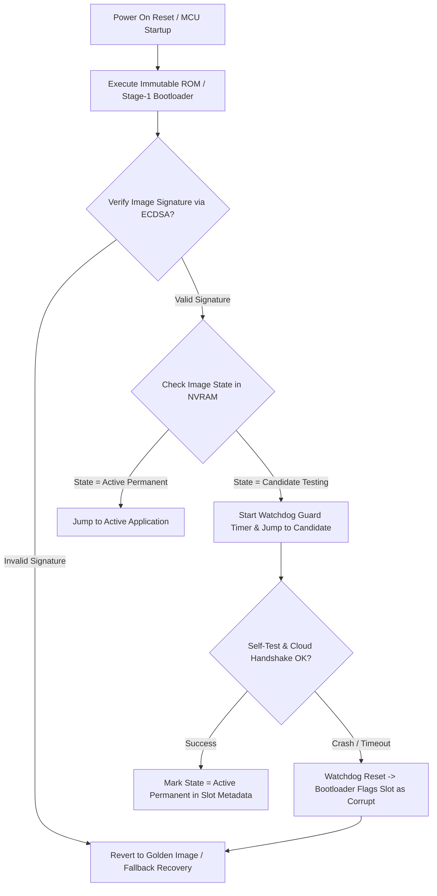

# Modul 085: Arsitektur Firmware Kritis (Hierarchical State Machines, Dual-Bank OTA Update, Secure Boot, MISRA-C)

**Navigasi**: [⬅️ Master Index](../../INDEX.md) | [Tingkat 5: Tingkat 5: Embedded Systems, Firmware Bare-Metal & RTOS / IoT](./README.md)
*Sebelumnya*: [084. real-time-operating-systems-rtos-internals](./084-real-time-operating-systems-rtos-internals.md) | *Berikutnya*: [086. embedded-linux](./086-embedded-linux.md)

---

## 1. Intuisi Dasar Tanpa Jargon ("Seperti Bayi Baru Lahir")
Ketika mikrokontroler Anda mengontrol rem ABS mobil, elevator gedung bertingkat, atau satelit di orbit rendah bumi, Anda tidak bisa menekan tombol 'Ctrl+Alt+Del' atau mengirim teknisi untuk mencabut kabel daya saat terjadi crash. Arsitektur firmware kritis ([Mission Critical Firmware](https://www.misra.org.uk/)) adalah rekayasa perangkat lunak pertahanan bertingkat di mana kegagalan diasumsikan sebagai kepastian yang harus dimitigasi. Standar industri seperti MISRA-C melarang penggunaan alokasi memori dinamis (`malloc`) karena risiko fragmentasi heap yang mematikan; arsitektur State Machine Hierarkis (HSM) memastikan sistem selalu berada dalam status deterministik yang terdefinisi; sementara arsitektur Dual-Bank OTA Update menjamin bahwa jika pembaruan firmware terputus di tengah jalan akibat badai petir, perangkat keras otomatis membatalkan pembaruan dan kembali booting ke firmware lama yang aman (golden image) tanpa pernah menjadi bata elektronik (bricked).

## 2. Fondasi Teoretis & Aksiomatik / Matematis
Prinsip **Dual-Bank Flash Architecture & Rollback Verification**:
Memori flash internal dibagi menjadi dua slot independen (Slot A dan Slot B) disertai sektor non-volatile metadata status:

$$\text{Total Flash Memory} = \text{Bootloader} + \text{Slot A (Active)} + \text{Slot B (Candidate)} + \text{Scratch/Meta}$$

Setiap image firmware baru ditandatangani secara kriptografis menggunakan pasangan kunci asimetris (misal ECDSA P-256 / Ed25519) dan hash SHA-256:
$$\text{Digest} = \text{SHA-256}(\text{Image\_Payload})$$
$$\text{Valid} = \text{Verify}_{ECDSA}(\text{Digest}, \text{Signature}, \text{Public\_Key}_{OEM})$$

Fase **Self-Test & Confirmation (Watchdog Rollback Protection)**:
Setelah bootloader melompat ke candidate firmware di Slot B, timer pengawas firmware (firmware confirmation timer) dimulai. Jika candidate firmware gagal melakukan inisialisasi periferal kritis atau mengalami crash/hard-fault sebelum menandai status `CONFIRMED`, watchdog hardware me-reset MCU dan bootloader secara otomatis membalikkan alamat boot vector kembali ke Slot A!

## 3. Anatomi Teknis & Cara Kerja Internal
Alur Bootloader Aman (Secure Boot) dengan Verifikasi Dual-Bank State Machine:



Prinsip Utama Kepatuhan **MISRA-C:2012** untuk Embedded Kritis:
1. **Rule 21.3**: Tidak boleh menggunakan alokasi memori dinamis dari pustaka standar (`malloc`, `free`, `calloc`). Semua buffer wajib dialokasikan statis pada waktu kompilasi.
2. **Rule 17.2**: Fungsi tidak boleh memanggil dirinya sendiri secara langsung maupun tidak langsung (larangan total fungsi rekursif untuk mencegah potensi stack overflow tak terhingga).
3. **Rule 14.4**: Pernyataan kontrol kondisi (`if`, `while`) harus berupa ekspresi boolean eksplisit (larangan penulisan `if (ptr)` menggantikan `if (ptr != NULL)`).

## 4. Implementasi Praktis & Kode / Simulasi Riil
```c
// Secure Bootloader Vector Jump Implementation in C (ARM Cortex-M)
#include <stdint.h>
#include <stdbool.h>

typedef void (*application_entry_t)(void);
#define SCB_VTOR (*(volatile uint32_t *)0xE000ED08)

void bootloader_jump_to_app(uint32_t app_base_address) {
    // 1. Ekstrak initial Main Stack Pointer (MSP) dari awal tabel vektor aplikasi
    uint32_t app_stack_pointer = *(volatile uint32_t *)app_base_address;
    
    // 2. Ekstrak alamat Reset Handler (Vektor kedua pada tabel vektor)
    uint32_t app_reset_handler = *(volatile uint32_t *)(app_base_address + 4);
    application_entry_t jump_to_application = (application_entry_t)app_reset_handler;
    
    // Validasi dasar MSP berada di dalam rentang SRAM valid (misal SRAM 0x20000000)
    if ((app_stack_pointer & 0x2FFE0000) != 0x20000000) {
        return; // Alamat stack tidak valid, batalkan jump!
    }
    
    // 3. Matikan semua interupsi global & periferal interrupt sebelum melompat
    __asm volatile("cpsid i");
    
    // 4. Relokasi Vector Table Offset Register (VTOR) ke basis aplikasi baru
    SCB_VTOR = app_base_address;
    
    // 5. Inisialisasi ulang MSP aplikasi
    __asm volatile("msr msp, %0" : : "r"(app_stack_pointer) : );
    
    // 6. Eksekusi lompatan ke aplikasi baru!
    jump_to_application();
}
```

## 5. Miskonsepsi & Jebakan Industri
1. **Interrupts Left Active Prior to Bootloader Jump**: Melompat ke aplikasi tanpa mematikan periferal timer atau mengosongkan register NVIC di bootloader menyebabkan interupsi periferal terpicu di aplikasi saat tabel vektor baru belum siap, menghasilkan eksekusi instruksi liar dan HardFault instan.
2. **Unchecked Integer Wraparound in Cryptographic Buffers**: Melewatkan panjang data unsigned 16-bit atau 32-bit yang meluap (overflow) pada parser paket update firmware memungkinkan serangan buffer overflow yang menimpa memori flash bootloader.
3. **Brick via Interrupted Erase/Write Operation**: Menghapus sektor flash aplikasi yang sedang aktif tanpa memastikan image baru telah utuh dan terverifikasi di partisi cadangan (in-place flashing) akan membuat sistem menjadi 'bata mati' jika catu daya terputus di tengah proses penulisan.

## 6. Proyek Latihan & Rubrik Penilaian Mandiri
1. **Tingkat Pemula**: Konfigurasi linter statis open-source (seperti `cppcheck --enable=all --addon=misra`) pada proyek C mikrokontroler sederhana. Identifikasi dan perbaiki minimal 5 pelanggaran aturan MISRA-C.
2. **Tingkat Menengah**: Buat arsitektur Hierarchical State Machine (HSM) untuk pengontrol pintu geser otomatis (State: Idle, Opening, OpenWaiting, Closing, ObstacleDetected). Implementasikan transisi status yang deterministik dan aman terhadap kegagalan sensor limit switch.
3. **Tingkat Mahir**: Bangun bootloader minimalis ARM Cortex-M yang membaca header biner aplikasi di flash address 0x08020000. Lakukan verifikasi hash SHA-256 dari seluruh payload aplikasi, periksa apakah signature cocok, lalu lakukan relokasi VTOR dan eksekusi jump jika valid. Jika korup, aktifkan mode darurat UART recovery.

## 7. Rekomendasi Sumber Belajar Standar Emas
| Sumber Pembelajaran | Penulis / Institusi | Tautan Langsung | Fokus Materi |
| :--- | :--- | :--- | :--- |
| MISRA C:2012 Guidelines for Safety-Critical Software | MISRA Consortium | [MISRA C Guidelines](https://www.misra.org.uk/) | Aturan Baku Pengembangan Firmware Aman & Kritis C |
| MCUboot: Secure Boot for 32-bit Microcontrollers | The Linux Foundation | [MCUboot Documentation](https://docs.mcuboot.com/) | Dual-Bank Flash Swapping, Image Authentication & Rollback |
| Practical Statecharts in C/C++: Event-Driven Systems | Miro Samek / Quantum Leaps | [Quantum Leaps HSM Guide](https://www.state-machine.com/psicc2) | Hierarchical State Machines, Event Queues & Active Objects |
| NASA Software Safety Guidebook | NASA Technical Standards | [NASA Safety Guidebook](https://standards.nasa.gov/standard/NASA/NASA-GB-871913) | Fault Tolerance, Hazard Elimination & Deterministic Coding Rules |

---
*Navigasi Cepat*: [Ke Tingkat 5](./README.md) | [Ke Master Index](../../INDEX.md) | *Sebelumnya*: [084. real-time-operating-systems-rtos-internals](./084-real-time-operating-systems-rtos-internals.md) | *Berikutnya*: [086. embedded-linux](./086-embedded-linux.md)
