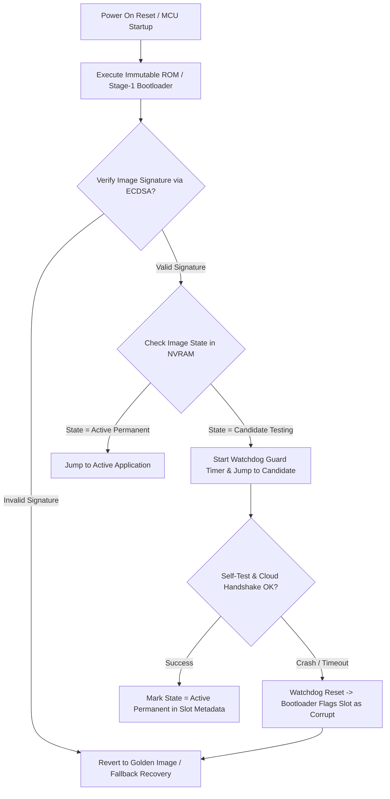

# Modul 085: Arsitektur Firmware Kritis (Hierarchical State Machines, Dual-Bank OTA Update, Secure Boot, MISRA-C)

**Navigasi**: [⬅️ Master Index](../../INDEX.md) | [Tingkat 5: Tingkat 5: Embedded Systems, Firmware Bare-Metal & RTOS / IoT](./README.md)
*Sebelumnya*: [084. real-time-operating-systems-rtos-internals](./084-real-time-operating-systems-rtos-internals.md) | *Berikutnya*: [086. embedded-linux](./086-embedded-linux.md)

---

## 1. Intuisi Dasar Tanpa Jargon ("Seperti Bayi Baru Lahir")
### 1.1 Konsep Inti & Analogi Tanpa Jargon
Ketika mikrokontroler Anda mengontrol rem ABS mobil, elevator gedung bertingkat, atau satelit di orbit rendah bumi, Anda tidak bisa menekan tombol 'Ctrl+Alt+Del' atau mengirim teknisi untuk mencabut kabel daya saat terjadi crash. Arsitektur firmware kritis ([Mission Critical Firmware](https://www.misra.org.uk/)) adalah rekayasa perangkat lunak pertahanan bertingkat di mana kegagalan diasumsikan sebagai kepastian yang harus dimitigasi. Standar industri seperti MISRA-C melarang penggunaan alokasi memori dinamis (`malloc`) karena risiko fragmentasi heap yang mematikan; arsitektur State Machine Hierarkis (HSM) memastikan sistem selalu berada dalam status deterministik yang terdefinisi; sementara arsitektur Dual-Bank OTA Update menjamin bahwa jika pembaruan firmware terputus di tengah jalan akibat badai petir, perangkat keras otomatis membatalkan pembaruan dan kembali booting ke firmware lama yang aman (golden image) tanpa pernah menjadi bata elektronik (bricked).

### 1.2 Urgensi Rekayasa & Signifikansi Sistemik
Dalam rekayasa sistem modern, pemahaman mendalam tentang konsep ini membedakan arsitek sistem kelas dunia dari sekadar operator perkakas teknis.

## 2. Fondasi Teoretis & Aksiomatik / Matematis
### 2.1 Kerangka Teori Aksiomatik & Formulasi Matematis
Prinsip **Dual-Bank Flash Architecture & Rollback Verification**:
Memori flash internal dibagi menjadi dua slot independen (Slot A dan Slot B) disertai sektor non-volatile metadata status:

### 2.2 Penurunan Matematis Langkah-demi-Langkah
$$\text{Total Flash Memory} = \text{Bootloader} + \text{Slot A (Active)} + \text{Slot B (Candidate)} + \text{Scratch/Meta}$$

Setiap image firmware baru ditandatangani secara kriptografis menggunakan pasangan kunci asimetris (misal ECDSA P-256 / Ed25519) dan hash SHA-256:
$$\text{Digest} = \text{SHA-256}(\text{Image\_Payload})$$
$$\text{Valid} = \text{Verify}_{ECDSA}(\text{Digest}, \text{Signature}, \text{Public\_Key}_{OEM})$$

Fase **Self-Test & Confirmation (Watchdog Rollback Protection)**:
Setelah bootloader melompat ke candidate firmware di Slot B, timer pengawas firmware (firmware confirmation timer) dimulai. Jika candidate firmware gagal melakukan inisialisasi periferal kritis atau mengalami crash/hard-fault sebelum menandai status `CONFIRMED`, watchdog hardware me-reset MCU dan bootloader secara otomatis membalikkan alamat boot vector kembali ke Slot A!

## 3. Anatomi Teknis & Cara Kerja Internal
Alur Bootloader Aman (Secure Boot) dengan Verifikasi Dual-Bank State Machine:



Prinsip Utama Kepatuhan **MISRA-C:2012** untuk Embedded Kritis:
1. **Rule 21.3**: Tidak boleh menggunakan alokasi memori dinamis dari pustaka standar (`malloc`, `free`, `calloc`). Semua buffer wajib dialokasikan statis pada waktu kompilasi.
2. **Rule 17.2**: Fungsi tidak boleh memanggil dirinya sendiri secara langsung maupun tidak langsung (larangan total fungsi rekursif untuk mencegah potensi stack overflow tak terhingga).
3. **Rule 14.4**: Pernyataan kontrol kondisi (`if`, `while`) harus berupa ekspresi boolean eksplisit (larangan penulisan `if (ptr)` menggantikan `if (ptr != NULL)`).

#### Tabel Penelusuran Korupsi Firmware Pembaruan OTA Single-Bank saat Pemadaman Listrik Tiba-Tiba
| Tahap Pembaruan Firmware Over-The-Air | Sektor Memori Flash ROM (`0x0800_0000`) | Status Penulisan Sektor Flash | Kondisi Sumber Daya Listrik Baterai | Status Bootloader Perangkat Keras | Integritas Mikrokontroler di Lapangan |
|---|---|---|---|---|---|
| Inisiasi Pembaruan OTA | Memuat Firmware v1.0 yang sedang berjalan | Sektor aplikasi aktif | Baterai tersisa $8\%$ | Menjalankan aplikasi v1.0 | Beroperasi normal |
| Penghapusan Sektor Flash| Mengirim perintah Flash Erase Sektor 1 | Seluruh bit berubah menjadi `0xFF`! | Baterai menipis | Firmware v1.0 telah TERHAPUS! | Sektor aplikasi kosong |
| Pemrograman Firmware v2.0| Menulis biner baru byte demi byte | Menulis sektor $50\%$ selesai | Daya listrik tiba-tiba drop! | Memori terisi setengah | Transaksi penulisan terputus |
| Pemadaman Listrik Mendadak| MATI LISTRIK TOTAL DI TENGAH FLASH! | Sektor memori korup (Separuh terisi) | Daya mati total | Biner firmware tidak lengkap | Sektor Flash menjadi sampah acak |
| Listrik Dihidupkan Kembali| Reset Handler melompat ke sektor aplikasi | Menjumpai opcode acak sampah `0xFF` | Daya pulih | Menemui instruksi ilegal | HARDFAULT EXCEPTION CRASH! |
| Kondisi Bricked Permanen | Tidak ada partisi firmware cadangan | Bootloader gagal memvalidasi aplikasi | Perangkat mati suri (*Bricked*) | Tidak bisa menerima sinyal OTA lagi | Ribuan perangkat wajib dibongkar manual di pabrik! |

## 4. Implementasi Praktis & Kode / Simulasi Riil
```c
// Secure Bootloader Vector Jump Implementation in C (ARM Cortex-M)
#include <stdint.h>
#include <stdbool.h>

typedef void (*application_entry_t)(void);
#define SCB_VTOR (*(volatile uint32_t *)0xE000ED08)

void bootloader_jump_to_app(uint32_t app_base_address) {
    // 1. Ekstrak initial Main Stack Pointer (MSP) dari awal tabel vektor aplikasi
    uint32_t app_stack_pointer = *(volatile uint32_t *)app_base_address;
    
    // 2. Ekstrak alamat Reset Handler (Vektor kedua pada tabel vektor)
    uint32_t app_reset_handler = *(volatile uint32_t *)(app_base_address + 4);
    application_entry_t jump_to_application = (application_entry_t)app_reset_handler;
    
    // Validasi dasar MSP berada di dalam rentang SRAM valid (misal SRAM 0x20000000)
    if ((app_stack_pointer & 0x2FFE0000) != 0x20000000) {
        return; // Alamat stack tidak valid, batalkan jump!
    }
    
    // 3. Matikan semua interupsi global & periferal interrupt sebelum melompat
    __asm volatile("cpsid i");
    
    // 4. Relokasi Vector Table Offset Register (VTOR) ke basis aplikasi baru
    SCB_VTOR = app_base_address;
    
    // 5. Inisialisasi ulang MSP aplikasi
    __asm volatile("msr msp, %0" : : "r"(app_stack_pointer) : );
    
    // 6. Eksekusi lompatan ke aplikasi baru!
    jump_to_application();
}
```

## 5. Miskonsepsi & Jebakan Industri
1. **Interrupts Left Active Prior to Bootloader Jump**: Melompat ke aplikasi tanpa mematikan periferal timer atau mengosongkan register NVIC di bootloader menyebabkan interupsi periferal terpicu di aplikasi saat tabel vektor baru belum siap, menghasilkan eksekusi instruksi liar dan HardFault instan.
2. **Unchecked Integer Wraparound in Cryptographic Buffers**: Melewatkan panjang data unsigned 16-bit atau 32-bit yang meluap (overflow) pada parser paket update firmware memungkinkan serangan buffer overflow yang menimpa memori flash bootloader.
3. **Brick via Interrupted Erase/Write Operation**: Menghapus sektor flash aplikasi yang sedang aktif tanpa memastikan image baru telah utuh dan terverifikasi di partisi cadangan (in-place flashing) akan membuat sistem menjadi 'bata mati' jika catu daya terputus di tengah proses penulisan.

### Studi Kasus Kegagalan Nyata: Bencana Brick-on-Update Pembaruan Firmware OTA Single-Bank saat Mati Listrik
- **Insiden Kegagalan Massal Perangkat Rumah Pintar**: Sebuah produsen perangkat termostat pintar meluncurkan pembaruan firmware Over-The-Air (OTA) nirkabel otomatis untuk 50.000 unit di rumah konsumen. Namun pada malam peluncuran, terjadi gangguan jaringan dan beberapa perangkat kehabisan daya listrik di tengah proses instalasi pembaruan. Keesokan paginya, lebih dari 12.000 perangkat mati total dengan layar hitam permanen, tidak dapat dihidupkan, dan tidak dapat menerima sinyal pembaruan lagi (*bricked devices*). Perusahaan terpaksa mengganti perangkat keras fisik dengan kerugian jutaan dolar.
- **Akar Masalah Arsitektur Firmware Kritis & Skema Flash Single-Bank**: Arsitektur firmware yang dirancang oleh pengembang menggunakan skema partisi memori Flash tunggal (*Single-Bank Flash*): firmware baru yang diunduh langsung ditulis dan ditimpa di atas sektor memori aplikasi yang sedang berjalan untuk menghemat biaya kapasitas chip Flash. Ketika pemadaman listrik terjadi tepat saat sektor Flash sedang dihapus (*erased*) atau baru terisi sebagian, firmware lama telah musnah sementara firmware baru belum selesai ditulis. Mikrokontroler tidak memiliki salinan cadangan (*backup image*). Ketika perangkat dinyalakan kembali, bootloader melompat ke alamat awal aplikasi dan mengeksekusi instruksi sampah `0xFFFF_FFFF`, memicu loop crash *HardFault* abadi. Karena modul stack Wi-Fi berada di dalam aplikasi yang telah rusak, perangkat tidak memiliki kemampuan untuk terhubung ke jaringan lagi untuk meminta pemulihan.

- **Potongan Kode / Arsitektur Cacat (Vulnerable Implementation)**:
```c
// Arsitektur Pembaruan Firmware Aman Dual-Bank A/B dengan Verifikasi Kriptografi
#include <stdint.h>
#include <stdbool.h>

typedef struct {
    uint32_t magic_word;      // 0x534F5441 (SOTA)
    uint32_t version;         // Nomor versi monotonik
    uint32_t image_size;      // Ukuran biner firmware
    uint32_t sha256_hash[8];  // Hash integritas citra
    bool is_verified;
} FirmwareHeader;

#define BANK_A_ADDR 0x08020000
#define BANK_B_ADDR 0x08080000

void execute_safe_dual_bank_bootloader() {
    // PRINSIP DUAL-BANK A/B:
    // Firmware baru selalu diunduh ke Bank cadangan (Bank B)
    // Bank yang sedang aktif berjalan (Bank A) TIDAK PERNAH DISENTUH!
    
    FirmwareHeader *hdr_b = (FirmwareHeader *)BANK_B_ADDR;
    
    // 1. Verifikasi integritas kriptografis dan kelengkapan biner di Bank B
    if (verify_sha256_signature(BANK_B_ADDR) == true) {
        // 2. Tandai Bank B sebagai kandidat uji coba (Trial Boot)
        // Jika terjadi mati listrik sekarang, sistem masih aman 100% menjalankan Bank A!
        set_active_boot_bank(BANK_B_ADDR);
        start_watchdog_trial_timer(30); // 30 detik uji stabilitas
        jump_to_application(BANK_B_ADDR);
    } else {
        // Jika Bank B korup, batalkan pembaruan dan fallback aman ke Bank A!
        printf("Bank B corrupt or incomplete! Safe Fallback to Bank A.\n");
        jump_to_application(BANK_A_ADDR);
    }
}
```

- **Arsitektur Wajib Pembaruan OTA Nir-Gagal (Fail-Safe Dual-Bank A/B)**: Dalam perancangan firmware kritis modern, arsitektur pembaruan wajib mengadopsi partisi ganda *Dual-Bank A/B Partitioning*: 1) Firmware aktif berjalan di Bank A sementara firmware baru diunduh ke Bank B; 2) Pengalihan eksekusi hanya dilakukan setelah verifikasi hash SHA-256 dan tanda tangan digital lolos 100%; 3) Menerapkan fitur *Rollback Watchdog Timer*: jika firmware baru mengalami crash atau gagal mengonfirmasi kestabilan dalam 60 detik pertama pasca booting, bootloader otomatis membatalkan pembaruan dan kembali (*rollback*) ke Bank A yang stabil.

## 6. Proyek Latihan & Rubrik Penilaian Mandiri
1. **Tingkat Pemula**: Konfigurasi linter statis open-source (seperti `cppcheck --enable=all --addon=misra`) pada proyek C mikrokontroler sederhana. Identifikasi dan perbaiki minimal 5 pelanggaran aturan MISRA-C.
2. **Tingkat Menengah**: Buat arsitektur Hierarchical State Machine (HSM) untuk pengontrol pintu geser otomatis (State: Idle, Opening, OpenWaiting, Closing, ObstacleDetected). Implementasikan transisi status yang deterministik dan aman terhadap kegagalan sensor limit switch.
3. **Tingkat Mahir**: Bangun bootloader minimalis ARM Cortex-M yang membaca header biner aplikasi di flash address 0x08020000. Lakukan verifikasi hash SHA-256 dari seluruh payload aplikasi, periksa apakah signature cocok, lalu lakukan relokasi VTOR dan eksekusi jump jika valid. Jika korup, aktifkan mode darurat UART recovery.

### Tingkat 1: Dasar
- **Tugas**: Bangun fungsi parser dan validator header firmware biner dalam C yang memeriksa Magic Number (`0x41544F53`), ukuran citra maksimum, nomor versi monotonik, dan menghitung checksum CRC-32 dari payload biner.
- **Petunjuk Perancangan Arsitektur**:
  - Validasi: `hdr->magic == 0x41544F53`.
  - Periksa ukuran: `hdr->image_size <= MAX_FLASH_APP_SIZE`.
  - Hitung CRC-32 melintasi seluruh payload data dan cocokkan dengan `hdr->crc32`.
- **Test Vector & Kasus Uji Ekstrem**:
  - *Header Valid*: Citra firmware dengan magic word dan CRC-32 yang cocok; fungsi mengembalikan status valid `BOOT_SUCCESS`.
  - *Magic Number Salah*: Berikan file sampah acak; fungsi menolak eksekusi dan mengembalikan galat `ERR_INVALID_MAGIC`.
- **Rubrik Penilaian Mandiri**: 40% Dekoder Struktur Header Firmware Biner Presisi, 30% Validasi Checksum CRC-32 Integritas Tepat, 30% Penanganan Validasi Batas Ukuran Memori.

### Tingkat 2: Menengah
- **Tugas**: Implementasikan mesin keadaan bootloader Dual-Bank A/B (State Machine: `BANK_A_ACTIVE`, `BANK_B_UPDATING`, `BANK_B_TRIAL`, `BANK_B_CONFIRMED`, `ROLLBACK_TO_BANK_A`) dalam C yang menyimpan metadata status pembaruan ke dalam memori non-volatile emulasi EEPROM Flash, mengelola proses uji coba booting (*Trial Boot*), dan mengeksekusi rollback otomatis jika aplikasi baru tidak mengonfirmasi status kestabilan melalui pemanggilan API `ota_confirm_successful_boot()`.
- **Petunjuk Perancangan Arsitektur**:
  - Simpan metadata status di sektor terdedikasi `NVRAM_METADATA_SECTOR`.
  - Jika bootloader mendeteksi status `TRIAL_BOOT` dengan counter percobaan $\ge 3$, ubah status ke `ROLLBACK` dan aktifkan kembali Bank lama.
- **Test Vector & Kasus Uji Ekstrem**:
  - *Skenario Firmware Baru Crash*: Aplikasi di Bank B mengalami HardFault saat startup; buktikan bootloader mendeteksi kegagalan pada reboot ke-3 dan mengembalikan sistem ke Bank A yang stabil.
  - *Konfirmasi Sukses*: Aplikasi di Bank B memanggil konfirmasi; status berubah permanen menjadi `CONFIRMED`.
- **Rubrik Penilaian Mandiri**: 40% State Machine Dual-Bank A/B Fail-Safe Tepat, 30% Manajemen Metadata Status Non-Volatile Presisi, 30% Logika Rollback Otomatis Berbasis Counter Percobaan.

### Tingkat 3: Mahir
- **Tugas**: Rancang protokol pembaruan firmware terenkripsi terkompresi end-to-end (Encrypted Differential Delta OTA Engine) dalam C/Python yang menghitung selisih patch delta biner menggunakan algoritma BSDiff/Courgette, mengenkripsi patch menggunakan AES-128 GCM (Galois/Counter Mode dengan otentikasi data terikat AEAD), dan merekonstruksi citra biner baru di memori Flash target dengan konsumsi buffer RAM perantara kurang dari 4 KB.
- **Petunjuk Perancangan Arsitektur**:
  - Algoritma rekonstruksi delta membaca blok instruksi tambah/salin (*Add/Copy blocks*) secara streaming.
  - Dekripsi AES-GCM streaming memverifikasi tag otentikasi 16-byte sebelum mengizinkan penulisan sektor flash permanen.
- **Test Vector & Kasus Uji Ekstrem**:
  - *Efisiensi Reduksi Patch*: Buktikan bahwa pembaruan kecil (misal perbaikan bug fungsi 50 baris) menghasilkan ukuran patch delta $< 5\%$ dari ukuran biner penuh.
  - *Deteksi Manipulasi Data Ciphertext*: Ubah 1 bit pada berkas patch terenkripsi; buktikan otentikasi tag AES-GCM gagal dan seluruh proses dibatalkan tanpa menyentuh Flash.
- **Rubrik Penilaian Mandiri**: 40% Rekonstruksi Streaming Patch Delta Biner Presisi, 30% Implementasi Kriptografi Terotentikasi AES-GCM AEAD Tepat, 30% Optimasi Batas Memori Buffer RAM Sangat Ketat (< 4 KB).

## 7. Rekomendasi Sumber Belajar Standar Emas
| Sumber Pembelajaran | Penulis / Institusi | Tautan Langsung | Fokus Materi |
| :--- | :--- | :--- | :--- |
| MISRA C:2012 Guidelines for Safety-Critical Software | MISRA Consortium | [MISRA C Guidelines](https://www.misra.org.uk/) | Aturan Baku Pengembangan Firmware Aman & Kritis C |
| MCUboot: Secure Boot for 32-bit Microcontrollers | The Linux Foundation | [MCUboot Documentation](https://docs.mcuboot.com/) | Dual-Bank Flash Swapping, Image Authentication & Rollback |
| Practical Statecharts in C/C++: Event-Driven Systems | Miro Samek / Quantum Leaps | [Quantum Leaps HSM Guide](https://www.state-machine.com/psicc2) | Hierarchical State Machines, Event Queues & Active Objects |
| NASA Software Safety Guidebook | NASA Technical Standards | [NASA Safety Guidebook](https://standards.nasa.gov/standard/NASA/NASA-GB-871913) | Fault Tolerance, Hazard Elimination & Deterministic Coding Rules |

---
*Navigasi Cepat*: [Ke Tingkat 5](./README.md) | [Ke Master Index](../../INDEX.md) | *Sebelumnya*: [084. real-time-operating-systems-rtos-internals](./084-real-time-operating-systems-rtos-internals.md) | *Berikutnya*: [086. embedded-linux](./086-embedded-linux.md)
