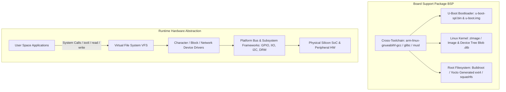

# Modul 086: Embedded Linux (Booting U-Boot, Device Tree .dts/.dtb, Buildroot, Yocto, Linux Kernel Device Drivers)

**Navigasi**: [⬅️ Master Index](../../INDEX.md) | [Tingkat 5: Tingkat 5: Embedded Systems, Firmware Bare-Metal & RTOS / IoT](./README.md)
*Sebelumnya*: [085. arsitektur-firmware-kritis](./085-arsitektur-firmware-kritis.md) | *Berikutnya*: [087. edge-ai-tinyml](./087-edge-ai-tinyml.md)

---

## 1. Intuisi Dasar Tanpa Jargon ("Seperti Bayi Baru Lahir")
### 1.1 Konsep Inti & Analogi Tanpa Jargon
Ketika perangkat pintar Anda membutuhkan antarmuka layar sentuh grafis yang kaya, stack jaringan multi-gigabit, database terenkripsi, atau server web terintegrasi, mikrokontroler bertenaga beberapa puluh kilobyte RAM tidak lagi memadai. Anda memerlukan Embedded Linux ([Embedded Linux Systems](https://elinux.org/Main_Page)). Embedded Linux adalah orkestrasi sistem operasi industri sejati pada mikroprosesor (seperti NXP i.MX, TI Sitara, atau Allwinner) yang dilengkapi Memory Management Unit (MMU) dan ratusan megabyte RAM. Perjalanan sebuah board dimulai dari chip ROM silikon pertama yang menyala, memanggil U-Boot (bootloader serbaguna), yang kemudian memuat file Device Tree (.dts)—sebuah 'peta harta karun' digital yang memberi tahu kernel Linux pin dan memori apa saja yang tertanam di board fisik tersebut—sebelum akhirnya kernel Linux memuat sistem file root (RootFS) dan mengeksekusi proses pertama: `/sbin/init`.

### 1.2 Urgensi Rekayasa & Signifikansi Sistemik
Dalam rekayasa sistem modern, pemahaman mendalam tentang konsep ini membedakan arsitek sistem kelas dunia dari sekadar operator perkakas teknis.

## 2. Fondasi Teoretis & Aksiomatik / Matematis
### 2.1 Kerangka Teori Aksiomatik & Formulasi Matematis
Urutan Booting Embedded Linux (Cold Boot Sequence):

### 2.2 Penurunan Matematis Langkah-demi-Langkah
$$\text{Silicon Mask ROM (BROM)} \xrightarrow{\text{Load SPL}} \text{Secondary Program Loader (SPL / U-Boot SPL)}$$
$$\xrightarrow{\text{Init LPDDR4}} \text{U-Boot Proper (U-Boot.bin)} \xrightarrow{\text{Load dtb + zImage}} \text{Linux Kernel} \xrightarrow{\text{Mount RootFS}} \text{Init Process (PID 1)}$$

Peran **Flattened Device Tree (FDT / DTB)**:
Pada arsitektur ARM dan RISC-V, periferal perangkat keras tidak dapat di-discover secara otomatis seperti bus PCIe pada PC x86. Device Tree Source (`.dts`) mendefinisikan topologi fisik board secara deklaratif:
- Alamat basis memori register fisik periferal (memory mapped I/O).
- Jalur interupsi (IRQ numbers) yang terhubung ke kontroler interupsi (GIC).
- Pin multiplexing (pinctrl subsystem) dan regulator catu daya (regulator framework).
Compiler Device Tree (`dtc`) mengompilasi file teks `.dts` menjadi file biner `.dtb` yang dibaca oleh kernel Linux saat booting:
$$\text{board.dts} \xrightarrow{\text{dtc}} \text{board.dtb}$$

## 3. Anatomi Teknis & Cara Kerja Internal
Arsitektur Struktur Komponen Embedded Linux dan BSP (Board Support Package):



Ekosistem Build System:
1. **Buildroot**: Pendekatan Makefile yang sederhana, cepat, dan ringan. Mengompilasi toolchain, kernel, dan RootFS monolitik dalam satu direktori kerja ([Buildroot Manual](https://buildroot.org/downloads/manual/manual.html)).
2. **Yocto Project (Poky / BitBake)**: Lingkungan distribusi industri berskala besar berbasis resep metadata bertingkat (Layers: `meta-freescale`, `meta-ti`, dll.). Menyediakan manajemen paket biner (ipk/rpm) dan kustomisasi distribusi untuk produksi massal.

#### Tabel Penelusuran Pelanggaran Konteks Atomik Kernel Linux & Kernel Panic pada Driver Sensor I2C
| Siklus CPU / Konteks Eksekusi | Jalur Kode Driver Perangkat Keras C | Aksi Subsistem I2C Kernel | Status Kunci Mutex / Spinlock Kernel | Pengecekan Penjadwal Linux (`in_atomic()`) | Reaksi Kernel Linux (Kernel Panic Crash) |
|---|---|---|---|---|---|
| Hardware Interrupt Tiba | Pin INT sensor jatuh Low | CPU masuk ke mode IRQ (Top-Half)| Interupsi lokal dinonaktifkan di core | `in_atomic() == True` (Konteks atomik!) | Menjalankan fungsi ISR driver |
| Driver Memanggil I2C Read | `i2c_smbus_read_byte()` dipanggil di ISR!| Subsistem I2C bus Linux dipanggil | Pengontrol I2C meminta transfer bus | - | Transaksi bus I2C membutuhkan waktu lama! |
| Transaksi Bus Lambat | Driver menunggu hardware I2C selesai | Subsistem I2C memanggil `wait_for_completion()`| Fungsi memanggil `schedule()` untuk tidur!| Penjadwal dipanggil di dalam konteks interupsi!| PELANGGARAN ATOMIK FATAL! |
| Pengecekan Penjadwal | `schedule()` mendeteksi konteks ilegal | Mencoba menidurkan proses yang tidak ada!| Tidak ada `task_struct` yang bisa ditidurkan!| `might_sleep()` membangkitkan assertion! | BUG: SCHEDULING WHILE ATOMIC! |
| Kernel Kolaps Seketika | Kernel mencetak stack trace diagnostik| Pengontrol memori membekukan core | Sistem operasi berhenti beroperasi | Core dump ditulis | KERNEL PANIC CRASH! Komputer embedded mati |

## 4. Implementasi Praktis & Kode / Simulasi Riil
```dts
// Minimal Device Tree Source (.dts) snippet defining an I2C Temperature Sensor on ARM SoC
/dts-v1/;
/plugin/;

&i2c1 {
    status = "okay";
    clock-frequency = <400000>; // 400 kHz Fast-Mode I2C
    pinctrl-names = "default";
    pinctrl-0 = <&pinctrl_i2c1>;

    // Deklarasi sensor LM75 pada slave address 0x48
    temp-sensor@48 {
        compatible = "national,lm75";
        reg = <0x48>;
        interrupt-parent = <&gpio1>;
        interrupts = <15 2>; // GPIO1 Pin 15, Active-Low Trigger
        status = "okay";
    };
};
```

## 5. Miskonsepsi & Jebakan Industri
1. **Unbuffered Flash Wear with Ext4 on Raw NAND**: Menggunakan file system standar berbasis block (seperti ext4 tanpa Flash Translation Layer) langsung di atas chip Raw SLC/NAND flash tanpa driver UBI/UBIFS akan merusak sektor flash dalam hitungan minggu akibat keausan tulis (write wear) pada blok metadata superblock ([Memory Technology Devices MTD Subsystem](https://linux-mtd.infradead.org/doc/ubifs.html)).
2. **Device Tree Pinmux Collision**: Mengalokasikan pin bola BGA yang sama untuk dua fungsi yang bertentangan (misal UART RX dan PWM output) pada layer Device Tree yang berbeda. Kernel akan gagal memuat driver salah satu periferal dengan kode galat misterius `-EBUSY` atau `-EINVAL`.
3. **Glibc vs Musl Incompatibility on Minimal RootFS**: Melakukan cross-compile aplikasi pengguna melawan pustaka Glibc host lalu mengeksekusinya di RootFS embedded yang menggunakan Musl C library menghasilkan pesan kesalahan Linux yang sangat membingungkan: `sh: ./app: No such file or directory` (karena dynamic linker `/lib/ld-linux.so` tidak ditemukan).

### Studi Kasus Kegagalan Nyata: Kernel Panic Crash pada Driver Sensor I2C Akibat Transaksi Berat di Dalam Top-Half ISR
- **Insiden Kegagalan Sistem Tertanam Embedded Linux**: Pada komputer industri berbasis Linux tertanam (misal arsitektur NXP i.MX6 / Allwinner), modul driver sensor akselerometer I2C kustom menyebabkan komputer mengalami crash *Kernel Panic* seketika setiap kali sensor getaran mendeteksi guncangan keras pertama. Di layar konsol serial tercetak pesan fatal: `BUG: scheduling while atomic: swapper/0/0/0x00010000`.
- **Akar Masalah Arsitektur Kernel Linux & Pelanggaran Konteks Atomik**: Dalam arsitektur sistem operasi Linux, rutinitas penanganan interupsi perangkat keras (*Top-Half Interrupt Handler*) berjalan di dalam *Atomic Context* (konteks atomik). Pada konteks ini, penjadwal proses dimatikan dan eksekusi dilarang keras untuk tertidur (*sleeping is strictly forbidden*). Transaksi bus serial I2C atau SPI bersifat lambat dan menggunakan transfer berbasis interupsi/DMA yang memanggil fungsi pemblokir seperti `wait_for_completion()`, `mutex_lock()`, atau `msleep()`. Ketika driver mencoba membaca register sensor I2C secara sinkron langsung di dalam fungsi ISR terdaftar `request_irq()`, subsistem I2C mencoba menidurkan eksekusi untuk menunggu transfer bus tuntas. Penjadwal kernel mendeteksi adanya upaya penundaan eksekusi di dalam konteks interupsi atomik, seketika membangkitkan assertion `BUG: scheduling while atomic`, mencetak pesan *Oops*, dan mematikan seluruh sistem operasi.

- **Potongan Kode / Arsitektur Cacat (Vulnerable Implementation)**:
```c
// Kode Driver Linux Kernel C yang Benar: Threaded Interrupt Handler
#include <linux/module.h>
#include <linux/interrupt.h>
#include <linux/i2c.h>

// 1. Top-Half Handler: Sangat cepat, murni mengecek apakah interupsi berasal dari chip ini
static irqreturn_t sensor_hard_irq_handler(int irq, void *dev_id) {
    // Berjalan di Atomic Context: DILARANG MEMANGGIL TRANSAKSI I2C DI SINI!
    // Cukup periksa pin status cepat, lalu delegasikan pemrosesan ke Threaded Handler
    return IRQ_WAKE_THREAD; // Membangunkan thread kernel khusus (Bottom-Half)
}

// 2. Threaded Bottom-Half Handler: Berjalan di Process Context (Boleh Tertidur / Sleep-Safe!)
static irqreturn_t sensor_threaded_irq_handler(int irq, void *dev_id) {
    struct i2c_client *client = (struct i2c_client *)dev_id;
    
    // AMAN: Di dalam thread kernel, kita sepenuhnya bebas memanggil transaksi I2C
    // yang lambat dan memblokir tanpa memicu 'scheduling while atomic'!
    s32 data = i2c_smbus_read_byte_data(client, 0x02);
    if (data >= 0) {
        pr_info("Sensor data safely read in threaded IRQ: 0x%02X\n", data);
    }
    return IRQ_HANDLED;
}

// Pendaftaran Driver Menggunakan request_threaded_irq:
int register_sensor_interrupt(struct i2c_client *client, int irq_gpio) {
    return request_threaded_irq(
        client->irq,
        sensor_hard_irq_handler,      // Top-half (atomic, fast)
        sensor_threaded_irq_handler,  // Bottom-half (thread, can sleep)
        IRQF_TRIGGER_FALLING | IRQF_ONESHOT,
        "accel_sensor_driver",
        client
    );
}
```

- **Prinsip Konteks Eksekusi Kernel Linux**: Pengembang driver kernel Linux wajib memahami dikotomi ketat antara dua konteks eksekusi: 1) *Interrupt Context / Atomic Context* (Top-half ISR, Timer callback, Tasklet) di mana eksekusi dilarang memblokir, dilarang mengunci mutex, dan dilarang tidur; 2) *Process Context* (Kernel Thread, Threaded IRQ, Workqueue) di mana fungsi-fungsi yang dapat tertidur (*sleeping calls* seperti transaksi I2C/SPI dan alokasi memori `GFP_KERNEL`) diizinkan untuk dieksekusi secara aman.

## 6. Proyek Latihan & Rubrik Penilaian Mandiri
1. **Tingkat Pemula**: Konfigurasi dan bangun sistem embedded Linux minimal menggunakan Buildroot untuk target emulator QEMU ARM VersatilePB. Boot kernel dan masuk ke shell busybox melalui antarmuka serial konsol virtual.
2. **Tingkat Menengah**: Tuliskan Linux Kernel Loadable Module (LKM) sederhana berupa driver character device (`/dev/my_sensor`) yang mengimplementasikan operasi file `open`, `read`, dan `release`. Uji interaksi pengguna dari command line Linux menggunakan `cat /dev/my_sensor`.
3. **Tingkat Mahir**: Rancang overlay Device Tree (`.dtbo`) untuk menambahkan layar display SPI dengan driver ST7789 pada platform Single Board Computer (seperti Raspberry Pi atau BeagleBone). Kompilasi overlay menggunakan `dtc`, muat secara dinamis pada saat runtime, dan tampilkan pola warna grafis menggunakan framebuffer `/dev/fb0`.

### Tingkat 1: Dasar
- **Tugas**: Bangun modul driver karakter Linux sederhana (*Linux Character Device Driver*) dalam C yang mengimplementasikan operasi file `open`, `release`, `read`, dan `write` menggunakan antarmuka buffer memori aman `copy_to_user()` dan `copy_from_user()`.
- **Petunjuk Perancangan Arsitektur**:
  - Alokasikan nomor major/minor dinamis menggunakan `alloc_chrdev_region()`.
  - Inisialisasi struktur `cdev` dan daftarkan ke sistem via `cdev_add()`.
  - Jangan pernah mendereferensikan pointer user-space secara langsung; wajib gunakan `copy_to_user()`.
- **Test Vector & Kasus Uji Ekstrem**:
  - *Operasi Tulis-Baca Normal*: Tulis string "EmbeddedLinux" dari aplikasi user-space; baca kembali dari `/dev/mychardev`; verifikasi data identik.
  - *Pointer User-Space Ilegal*: Berikan pointer NULL atau alamat memori kernel ke `read()`; buktikan `copy_to_user` mengembalikan galat `-EFAULT` secara aman tanpa memicu kernel crash.
- **Rubrik Penilaian Mandiri**: 40% Arsitektur Character Device Driver Linux Standar Tepat, 30% Penanganan Buffer User-Space via `copy_to_user` Presisi, 30% Pencegahan Undefined Behavior Dereferensi Pointer Ilegal.

### Tingkat 2: Menengah
- **Tugas**: Implementasikan simpul Device Tree Source (DTS) untuk mikrokontroler/SoC ARM yang mendeskripsikan sensor I2C terhubung (termasuk alamat bus `reg = <0x68>`, properti kompatibilitas `compatible = "invensense,mpu6050"`, pin interupsi GPIO, dan regulator daya catu), serta buat kode driver probe `i2c_driver` C yang mengekstrak konfigurasi tersebut menggunakan API Open Firmware (`of_property_read_u32`).
- **Petunjuk Perancangan Arsitektur**:
  - Tulis sintaks Device Tree valid: node bus `i2c@...` dengan child node sensor.
  - Pada driver C: cocokkan string `of_device_id` tabel kompatibilitas.
  - Ekstraksi pin interupsi menggunakan `irq_of_parse_and_map()` atau `gpiod_to_irq()`.
- **Test Vector & Kasus Uji Ekstrem**:
  - *Pencocokan Otomatis Device Tree*: Simulasikan pemanggilan `probe()`; buktikan alamat I2C dan nomor IRQ terekstraksi tepat dari pohon DTS.
  - *Penanganan Properti Hilang*: Buat DTS tanpa properti regulator; fungsi probe harus menangani nilai bawaan tanpa crash.
- **Rubrik Penilaian Mandiri**: 40% Sintaks Node Device Tree (DTS) Standar Presisi, 30% Ekstraksi Properti Open Firmware pada Fungsi Probe Driver C Tepat, 30% Manajemen Alokasi Sumber Daya Bersih pada `remove()`.

### Tingkat 3: Mahir
- **Tugas**: Rancang arsitektur Bottom-Half deferred execution lengkap dalam kernel Linux menggunakan mekanisme Workqueue terkelola (`struct workqueue_struct` dan `struct work_struct`), bandingkan kinerja throughput, latensi respons interupsi, dan penggunaan CPU terhadap mekanisme Tasklet dan Threaded IRQ di bawah beban banjir 50.000 interupsi per detik.
- **Petunjuk Perancangan Arsitektur**:
  - Daftarkan Workqueue khusus dengan flag `WQ_HIGHPRI | WQ_CPU_INTENSIVE`.
  - Pada Top-Half ISR: Simpan data ke FIFO cincin dan jadwalkan work: `queue_work(my_wq, &my_work)`.
  - Pada fungsi work: Proses data secara batch dan sinkronisasikan akses buffer menggunakan spinlock ringan `spin_lock_irqsave()`.
- **Test Vector & Kasus Uji Ekstrem**:
  - *Uji Banjir Interupsi*: Injeksi 50.000 interupsi per detik; buktikan tidak ada interupsi yang terlewat dan CPU tidak mengalami starvation.
  - *Verifikasi Bebas Deadlock*: Buktikan pemanggilan fungsi tidur di dalam fungsi workqueue berjalan 100% stabil tanpa memicu peringatan atomik.
- **Rubrik Penilaian Mandiri**: 40% Arsitektur Deferred Execution Workqueue Linux Lengkap Presisi, 30% Perlindungan Seksi Kritis Spinlock IRQ-Safe Tepat, 30% Analisis Kuantitatif Throughput Beban Tinggi.

## 7. Rekomendasi Sumber Belajar Standar Emas
| Sumber Pembelajaran | Penulis / Institusi | Tautan Langsung | Fokus Materi |
| :--- | :--- | :--- | :--- |
| Mastering Embedded Linux Programming | Chris Simmonds | [Packt Publishing Embedded Linux](https://www.packtpub.com/product/mastering-embedded-linux-programming-third-edition/9781789530384) | Toolchains, Bootloaders, Kernel Config, Buildroot & Yocto |
| Embedded Linux Wiki (eLinux) | Linux Foundation / CE Workgroup | [eLinux Official Portal](https://elinux.org/Main_Page) | Device Tree, U-Boot Guides, Real-Time PREEMPT_RT & BSP |
| Device Tree Specification | Devicetree.org | [Devicetree Specs](https://www.devicetree.org/specifications/) | Standar Sintaks Node DTS, Property Requirements & DTB Format |
| Linux Device Drivers, Third Edition (LDD3) | Jonathan Corbet, Alessandro Rubini, Greg Kroah-Hartman | [LWN LDD3 Archive](https://lwn.net/Kernel/LDD3/) | Kernel Modules, Char Devices, Memory Allocation & Interrupt Handling |

---
*Navigasi Cepat*: [Ke Tingkat 5](./README.md) | [Ke Master Index](../../INDEX.md) | *Sebelumnya*: [085. arsitektur-firmware-kritis](./085-arsitektur-firmware-kritis.md) | *Berikutnya*: [087. edge-ai-tinyml](./087-edge-ai-tinyml.md)
