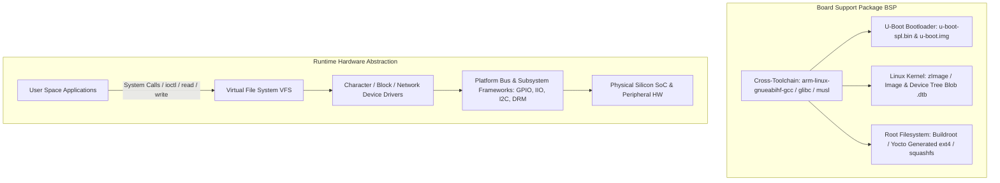

# Modul 086: Embedded Linux (Booting U-Boot, Device Tree .dts/.dtb, Buildroot, Yocto, Linux Kernel Device Drivers)

**Navigasi**: [⬅️ Master Index](../../INDEX.md) | [Tingkat 5: Tingkat 5: Embedded Systems, Firmware Bare-Metal & RTOS / IoT](./README.md)
*Sebelumnya*: [085. arsitektur-firmware-kritis](./085-arsitektur-firmware-kritis.md) | *Berikutnya*: [087. edge-ai-tinyml](./087-edge-ai-tinyml.md)

---

## 1. Intuisi Dasar Tanpa Jargon ("Seperti Bayi Baru Lahir")
Ketika perangkat pintar Anda membutuhkan antarmuka layar sentuh grafis yang kaya, stack jaringan multi-gigabit, database terenkripsi, atau server web terintegrasi, mikrokontroler bertenaga beberapa puluh kilobyte RAM tidak lagi memadai. Anda memerlukan Embedded Linux ([Embedded Linux Systems](https://elinux.org/Main_Page)). Embedded Linux adalah orkestrasi sistem operasi industri sejati pada mikroprosesor (seperti NXP i.MX, TI Sitara, atau Allwinner) yang dilengkapi Memory Management Unit (MMU) dan ratusan megabyte RAM. Perjalanan sebuah board dimulai dari chip ROM silikon pertama yang menyala, memanggil U-Boot (bootloader serbaguna), yang kemudian memuat file Device Tree (.dts)—sebuah 'peta harta karun' digital yang memberi tahu kernel Linux pin dan memori apa saja yang tertanam di board fisik tersebut—sebelum akhirnya kernel Linux memuat sistem file root (RootFS) dan mengeksekusi proses pertama: `/sbin/init`.

## 2. Fondasi Teoretis & Aksiomatik / Matematis
Urutan Booting Embedded Linux (Cold Boot Sequence):

$$\text{Silicon Mask ROM (BROM)} \xrightarrow{\text{Load SPL}} \text{Secondary Program Loader (SPL / U-Boot SPL)}$$
$$\xrightarrow{\text{Init LPDDR4}} \text{U-Boot Proper (U-Boot.bin)} \xrightarrow{\text{Load dtb + zImage}} \text{Linux Kernel} \xrightarrow{\text{Mount RootFS}} \text{Init Process (PID 1)}$$

Peran **Flattened Device Tree (FDT / DTB)**:
Pada arsitektur ARM dan RISC-V, periferal perangkat keras tidak dapat di-discover secara otomatis seperti bus PCIe pada PC x86. Device Tree Source (`.dts`) mendefinisikan topologi fisik board secara deklaratif:
- Alamat basis memori register fisik periferal (memory mapped I/O).
- Jalur interupsi (IRQ numbers) yang terhubung ke kontroler interupsi (GIC).
- Pin multiplexing (pinctrl subsystem) dan regulator catu daya (regulator framework).
Compiler Device Tree (`dtc`) mengompilasi file teks `.dts` menjadi file biner `.dtb` yang dibaca oleh kernel Linux saat booting:
$$\text{board.dts} \xrightarrow{\text{dtc}} \text{board.dtb}$$

## 3. Anatomi Teknis & Cara Kerja Internal
Arsitektur Struktur Komponen Embedded Linux dan BSP (Board Support Package):



Ekosistem Build System:
1. **Buildroot**: Pendekatan Makefile yang sederhana, cepat, dan ringan. Mengompilasi toolchain, kernel, dan RootFS monolitik dalam satu direktori kerja ([Buildroot Manual](https://buildroot.org/downloads/manual/manual.html)).
2. **Yocto Project (Poky / BitBake)**: Lingkungan distribusi industri berskala besar berbasis resep metadata bertingkat (Layers: `meta-freescale`, `meta-ti`, dll.). Menyediakan manajemen paket biner (ipk/rpm) dan kustomisasi distribusi untuk produksi massal.

## 4. Implementasi Praktis & Kode / Simulasi Riil
```dts
// Minimal Device Tree Source (.dts) snippet defining an I2C Temperature Sensor on ARM SoC
/dts-v1/;
/plugin/;

&i2c1 {
    status = "okay";
    clock-frequency = <400000>; // 400 kHz Fast-Mode I2C
    pinctrl-names = "default";
    pinctrl-0 = <&pinctrl_i2c1>;

    // Deklarasi sensor LM75 pada slave address 0x48
    temp-sensor@48 {
        compatible = "national,lm75";
        reg = <0x48>;
        interrupt-parent = <&gpio1>;
        interrupts = <15 2>; // GPIO1 Pin 15, Active-Low Trigger
        status = "okay";
    };
};
```

## 5. Miskonsepsi & Jebakan Industri
1. **Unbuffered Flash Wear with Ext4 on Raw NAND**: Menggunakan file system standar berbasis block (seperti ext4 tanpa Flash Translation Layer) langsung di atas chip Raw SLC/NAND flash tanpa driver UBI/UBIFS akan merusak sektor flash dalam hitungan minggu akibat keausan tulis (write wear) pada blok metadata superblock ([Memory Technology Devices MTD Subsystem](https://linux-mtd.infradead.org/doc/ubifs.html)).
2. **Device Tree Pinmux Collision**: Mengalokasikan pin bola BGA yang sama untuk dua fungsi yang bertentangan (misal UART RX dan PWM output) pada layer Device Tree yang berbeda. Kernel akan gagal memuat driver salah satu periferal dengan kode galat misterius `-EBUSY` atau `-EINVAL`.
3. **Glibc vs Musl Incompatibility on Minimal RootFS**: Melakukan cross-compile aplikasi pengguna melawan pustaka Glibc host lalu mengeksekusinya di RootFS embedded yang menggunakan Musl C library menghasilkan pesan kesalahan Linux yang sangat membingungkan: `sh: ./app: No such file or directory` (karena dynamic linker `/lib/ld-linux.so` tidak ditemukan).

## 6. Proyek Latihan & Rubrik Penilaian Mandiri
1. **Tingkat Pemula**: Konfigurasi dan bangun sistem embedded Linux minimal menggunakan Buildroot untuk target emulator QEMU ARM VersatilePB. Boot kernel dan masuk ke shell busybox melalui antarmuka serial konsol virtual.
2. **Tingkat Menengah**: Tuliskan Linux Kernel Loadable Module (LKM) sederhana berupa driver character device (`/dev/my_sensor`) yang mengimplementasikan operasi file `open`, `read`, dan `release`. Uji interaksi pengguna dari command line Linux menggunakan `cat /dev/my_sensor`.
3. **Tingkat Mahir**: Rancang overlay Device Tree (`.dtbo`) untuk menambahkan layar display SPI dengan driver ST7789 pada platform Single Board Computer (seperti Raspberry Pi atau BeagleBone). Kompilasi overlay menggunakan `dtc`, muat secara dinamis pada saat runtime, dan tampilkan pola warna grafis menggunakan framebuffer `/dev/fb0`.

## 7. Rekomendasi Sumber Belajar Standar Emas
| Sumber Pembelajaran | Penulis / Institusi | Tautan Langsung | Fokus Materi |
| :--- | :--- | :--- | :--- |
| Mastering Embedded Linux Programming | Chris Simmonds | [Packt Publishing Embedded Linux](https://www.packtpub.com/product/mastering-embedded-linux-programming-third-edition/9781789530384) | Toolchains, Bootloaders, Kernel Config, Buildroot & Yocto |
| Embedded Linux Wiki (eLinux) | Linux Foundation / CE Workgroup | [eLinux Official Portal](https://elinux.org/Main_Page) | Device Tree, U-Boot Guides, Real-Time PREEMPT_RT & BSP |
| Device Tree Specification | Devicetree.org | [Devicetree Specs](https://www.devicetree.org/specifications/) | Standar Sintaks Node DTS, Property Requirements & DTB Format |
| Linux Device Drivers, Third Edition (LDD3) | Jonathan Corbet, Alessandro Rubini, Greg Kroah-Hartman | [LWN LDD3 Archive](https://lwn.net/Kernel/LDD3/) | Kernel Modules, Char Devices, Memory Allocation & Interrupt Handling |

---
*Navigasi Cepat*: [Ke Tingkat 5](./README.md) | [Ke Master Index](../../INDEX.md) | *Sebelumnya*: [085. arsitektur-firmware-kritis](./085-arsitektur-firmware-kritis.md) | *Berikutnya*: [087. edge-ai-tinyml](./087-edge-ai-tinyml.md)
