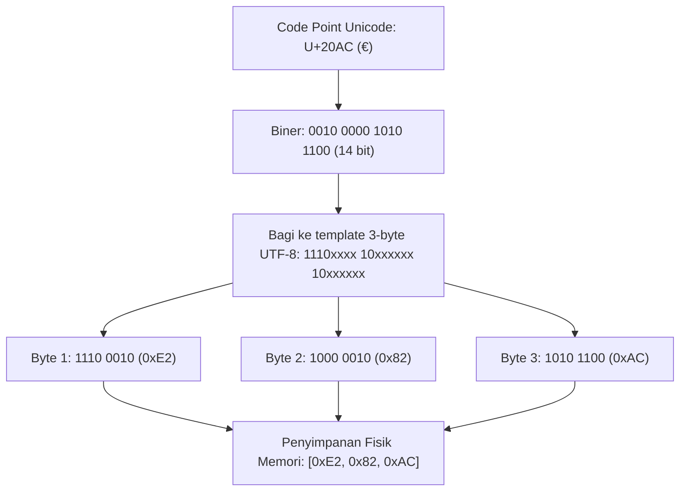

# Modul 088: Representasi & Penyandian Data (ASCII, Unicode, UTF-8/UTF-16, Masalah Endianness)

**Navigasi**: [⬅️ Master Index](../../INDEX.md) | [Tingkat 6: Tingkat 6: Computer Science Core, Struktur Data, Algoritma & Compiler](./README.md)
*Sebelumnya*: [087. edge-ai-tinyml](../05-embedded-rtos-iot/087-edge-ai-tinyml.md) | *Berikutnya*: [089. anatomi-siklus-hidup-eksekusi-program](./089-anatomi-siklus-hidup-eksekusi-program.md)

---

## 1. Intuisi Dasar Tanpa Jargon ("Seperti Bayi Baru Lahir")
### 1.1 Dunia di Bawah Karakter Teks ([Unicode Standard Overview](https://unicode.org/standard/standard.html))
Ketika Anda mengetik huruf 'A' pada keyboard, komputer tidak menyimpan goresan visual huruf tersebut. Di lapisan sirkuit silikon, komputer hanya memahami ada dan tiadanya tegangan listrik (bit 0 dan 1). Pada era 1960-an, standar ASCII (American Standard Code for Information Interchange) memetakan 128 karakter ke dalam 7-bit biner ($0000000_2$ s/d $1111111_2$). 'A' dipetakan ke integer 65 ($1000001_2$), spasi ke 32, dan baris baru (`\n`) ke 10.

### 1.2 Ledakan Global dan Jebakan UTF-8 vs Endianness ([The Absolute Minimum Every Developer Must Know About Unicode](https://www.joelonsoftware.com/2003/10/08/the-absolute-minimum-every-software-developer-absolutely-positively-must-know-about-unicode-and-character-sets-no-excuses/))
Ketika komputasi mendunia, 128 karakter tidak cukup untuk menampung aksara Arab, Hanzi, Devanagari, maupun emoji. Lahirlah Unicode sebagai katalog universal titik kode (*code points*, dinotasikan $U+0000$ s/d $U+10FFFF$). Namun, bagaimana menyimpan angka-angka besar ini ke memori fisik secara efisien? UTF-8 merancangnya secara brilian: karakter ASCII 0-127 disimpan dalam 1 byte (kompatibel penuh dengan warisan C), sedangkan karakter lain memakai 2 hingga 4 byte variabel. Di saat yang sama, arsitektur CPU membagi dunia menjadi dua: *Little-Endian* (x86, ARM default; byte terkecil disimpan di alamat memori terendah) dan *Big-Endian* (protokol jaringan TCP/IP; byte terbesar di alamat terendah). Salah memahami representasi ini menyebabkan *mojibake*, kerusakan data biner, dan kerentanan eksploitasi buffer.

## 2. Fondasi Teoretis & Aksiomatik / Matematis
### 2.1 Ruang Kode Unicode & Skema Enkoding UTF-8 ([RFC 3629 UTF-8](https://datatracker.ietf.org/doc/html/rfc3629))
Unicode membagi ruang kodenya menjadi 17 *Planes* masing-masing berkapasitas $2^{16} = 65{,}536$ *code points*, sehingga kapasitas total adalah:
$$\text{Total Code Points} = 17 \times 65{,}536 = 1{,}114{,}112 \quad (U+0000 \text{ s/d } U+10FFFF)$$

Transformasi dari Titik Kode $U$ ke Rangkaian Byte UTF-8 mengikuti aturan ortogonal:
1. Rentang $U+0000 \dots U+007F$ (7 bit):
   $$\text{Byte 1} = 0b_6 b_5 b_4 b_3 b_2 b_1 b_0$$
2. Rentang $U+0080 \dots U+07FF$ (11 bit):
   $$\text{Byte 1} = 110b_{10} b_9 b_8 b_7 b_6, \quad \text{Byte 2} = 10b_5 b_4 b_3 b_2 b_1 b_0$$
3. Rentang $U+0800 \dots U+FFFF$ (16 bit):
   $$\text{Byte 1} = 1110b_{15} b_{14} b_{13} b_{12}, \quad \text{Byte 2} = 10b_{11} b_{10} b_9 b_8 b_7 b_6, \quad \text{Byte 3} = 10b_5 b_4 b_3 b_2 b_1 b_0$$
4. Rentang $U+10000 \dots U+10FFFF$ (21 bit):
   $$\text{Byte 1} = 11110b_{20} b_{19} b_{18}, \quad \text{Byte 2} = 10b_{17} \dots b_{12}, \quad \text{Byte 3} = 10b_{11} \dots b_6, \quad \text{Byte 4} = 10b_5 \dots b_0$$

### 2.2 Penurunan Matematis Transformasi Endianness ([Intel 64 Architecture Software Developer Manual](https://www.intel.com/content/www/us/en/developer/articles/technical/intel-sdm.html))
Diberikan integer 32-bit $X = \sum_{k=0}^{3} B_k \cdot 256^k$, di mana $B_k \in [0, 255]$ adalah nilai byte ke-$k$.
Pada sistem memori byte-addressable dengan basis alamat $A$:
- **Little-Endian (LE)**: Byte $B_k$ dipetakan ke alamat $A + k$.
  $$\text{Mem}(A) = B_0, \quad \text{Mem}(A+1) = B_1, \quad \text{Mem}(A+2) = B_2, \quad \text{Mem}(A+3) = B_3$$
- **Big-Endian (BE)**: Byte $B_k$ dipetakan ke alamat $A + (3 - k)$.
  $$\text{Mem}(A) = B_3, \quad \text{Mem}(A+1) = B_2, \quad \text{Mem}(A+2) = B_1, \quad \text{Mem}(A+3) = B_0$$
Operasi konversi byte swapping bswap32($X$) diturunkan secara aljabar Boolean:
$$\text{bswap32}(X) = ((X \ll 24) \,\&\, 0\text{xFF000000}) \mid ((X \ll 8) \,\&\, 0\text{x00FF0000}) \mid ((X \gg 8) \,\&\, 0\text{x0000FF00}) \mid ((X \gg 24) \,\&\, 0\text{x000000FF})$$

## 3. Anatomi Teknis & Cara Kerja Internal


#### Tabel Walkthrough Eksekusi Dekoder UTF-8 Byte-by-Byte
| Siklus/Langkah | State Mesin | Byte Masukan | Aksi Bitwise | Status Register Buffer | Output Code Point |
|---|---|---|---|---|---|
| Step 1 | START | `0xE2` (`11100010`) | Deteksi prefix `1110` -> Multi-byte (3-byte sequence) | `val = 0x02` | Incomplete |
| Step 2 | CONT_1 | `0x82` (`10000010`) | Cek prefix `10` -> valid kontribusi 6-bit | `val = (0x02 << 6) | 0x02 = 0x82` | Incomplete |
| Step 3 | CONT_2 | `0xAC` (`10101100`) | Cek prefix `10` -> valid kontribusi 6-bit | `val = (0x82 << 6) | 0x2C = 0x20AC` | Emit $U+20AC$ (€) |
| Step 4 | START | `0x41` (`01000001`) | Deteksi prefix `0` -> ASCII tunggal 1-byte | `val = 0x41` | Emit $U+0041$ ('A') |

#### Tabel Penelusuran Validasi & Decode UTF-8 (Mitigasi Overlong Encoding Traversal)
| Langkah / Offset Byte | Stream Byte Masukan | Analisis Pola Bitwise | Status Dekoder UTF-8 | Status Buffer Output Sanitasi | Status Invarian Keamanan |
|---|---|---|---|---|---|
| Byte 0 | `0x2E` (`'.'`) | `0010_1110` (ASCII 1-byte) | Valid ASCII; Emisi langsung | `path = "."` | Sesuai batas representasi ASCII |
| Byte 1 | `0x2E` (`'.'`) | `0010_1110` (ASCII 1-byte) | Valid ASCII; Emisi langsung | `path = ".."` | Potensi traversal terdeteksi |
| Byte 2 (Eksploit) | `0xC0` | `1100_0000` (Awalan 2-byte) | Pola 2-byte: payload bit `00000` | Membaca byte kelanjutan (0x80..0xBF) | Cek Overlong: Nilai $\le$ 0x7F dilarang |
| Byte 3 (Eksploit) | `0xAF` | `1010_1111` (Kelanjutan) | Payload gabungan: `0x2F` (`'/'`) | DITOLAK! Overlong encoding 2-byte untuk ASCII | INVARIAN DITEGAKKAN: Exception `ErrOverlong` |
| Mitigasi T+1 | Sanitasi Canonical | Substitusi `U+FFFD` / Drop | Pengecekan batas rentang Unicode | `clean_path = ".."` (Aman) | Direktori traversal berhasil dicegah |

## 4. Implementasi Praktis & Kode / Simulasi Riil
```c
#include <stdio.h>
#include <stdint.h>
#include <stdbool.h>
#include <assert.h>

// Struktur representasi hasil dekode UTF-8
typedef struct {
    uint32_t codepoint;
    int bytes_consumed;
    bool is_valid;
} Utf8Result;

// Fungsi dekode 1 karakter UTF-8 dengan validasi defensif ketat
Utf8Result decode_utf8_char(const uint8_t *src, size_t max_len) {
    Utf8Result res = {0, 0, false};
    if (max_len == 0 || src == NULL) return res;

    uint8_t b0 = src[0];

    // 1-Byte ASCII: 0xxxxxxx
    if ((b0 & 0x80) == 0x00) {
        res.codepoint = b0;
        res.bytes_consumed = 1;
        res.is_valid = true;
        return res;
    }

    // 2-Byte Sequence: 110xxxxx 10xxxxxx
    if ((b0 & 0xE0) == 0xC0) {
        if (max_len < 2) return res;
        uint8_t b1 = src[1];
        if ((b1 & 0xC0) != 0x80) return res; // Verifikasi bit kelanjutan
        uint32_t cp = ((b0 & 0x1F) << 6) | (b1 & 0x3F);
        if (cp < 0x80) return res; // Tolak overlong encoding
        res.codepoint = cp;
        res.bytes_consumed = 2;
        res.is_valid = true;
        return res;
    }

    // 3-Byte Sequence: 1110xxxx 10xxxxxx 10xxxxxx
    if ((b0 & 0xF0) == 0xE0) {
        if (max_len < 3) return res;
        uint8_t b1 = src[1], b2 = src[2];
        if ((b1 & 0xC0) != 0x80 || (b2 & 0xC0) != 0x80) return res;
        uint32_t cp = ((b0 & 0x0F) << 12) | ((b1 & 0x3F) << 6) | (b2 & 0x3F);
        if (cp < 0x800) return res; // Tolak overlong encoding
        if (cp >= 0xD800 && cp <= 0xDFFF) return res; // Tolak surrogate halves
        res.codepoint = cp;
        res.bytes_consumed = 3;
        res.is_valid = true;
        return res;
    }

    // 4-Byte Sequence: 11110xxx 10xxxxxx 10xxxxxx 10xxxxxx
    if ((b0 & 0xF8) == 0xF0) {
        if (max_len < 4) return res;
        uint8_t b1 = src[1], b2 = src[2], b3 = src[3];
        if ((b1 & 0xC0) != 0x80 || (b2 & 0xC0) != 0x80 || (b3 & 0xC0) != 0x80) return res;
        uint32_t cp = ((b0 & 0x07) << 18) | ((b1 & 0x3F) << 12) | ((b2 & 0x3F) << 6) | (b3 & 0x3F);
        if (cp < 0x10000 || cp > 0x10FFFF) return res; // Batas legal Unicode
        res.codepoint = cp;
        res.bytes_consumed = 4;
        res.is_valid = true;
        return res;
    }

    return res;
}
```

## 5. Miskonsepsi & Jebakan Industri
### Studi Kasus Kegagalan Nyata: Kerentanan Overlong UTF-8 Microsoft IIS (CVE-2000-0884)
- **Kronologi & Latar Belakang**: Pada tahun 2000, Microsoft Internet Information Services (IIS) 4.0/5.0 memiliki kerentanan kritis yang memungkinkan eksekusi perintah jarak jauh tanpa otentikasi. Sistem keamanan IIS memeriksa URL untuk mencegah *directory traversal* (seperti `../..`). Filter keamanan memeriksa pola ASCII `../` (`0x2E 0x2E 0x2F`).
- **Kode Cacat**:
```c
// REKONSTRUKSI CACAT: Filter validasi sebelum normalisasi UTF-8
bool is_safe_path(const char *url) {
    if (strstr(url, "../") != NULL || strstr(url, "..\\") != NULL) {
        return false; // Ditolak
    }
    return true;
}
// Eksekusi decode dilakukan SETELAH validasi keamanan!
decode_utf8_path(url, clean_path);
```
- **Akar Masalah**: Penyerang mengirimkan karakter slash `/` (`0x2F`) yang dienkode dalam bentuk *overlong 2-byte UTF-8* (`0xC0 0xAF`). Karena filter hanya memeriksa byte literal `0x2F`, string lolos sensor. Setelah lolos filter, dekoder UTF-8 mengubah `0xC0 0xAF` menjadi `/`, memungkinkan penyerang melompat keluar direktori web root menuju `c:\winnt\system32\cmd.exe`.
- **Rekomendasi Industri**: Tolak keras setiap representasi *overlong UTF-8*. Jika sebuah titik kode dapat dinyatakan dalam $N$ byte, kemunculannya dalam $M > N$ byte harus diperlakukan sebagai serangan injeksi berbahaya.

### Studi Kasus Kegagalan Nyata: Eksploitasi Overlong UTF-8 Directory Traversal pada Microsoft IIS 4.0/5.0 (CVE-2000-0884)
- **Kronologi & Konteks Sejarah**: Pada tahun 2000, kerentanan kritis ditemukan pada server web Microsoft IIS 4.0 dan 5.0. Penyerang dapat mengeksekusi sembarang file binari eksekutabel di luar direktori web root (seperti `c:\winnt\system32\cmd.exe`) hanya dengan mengirimkan HTTP request yang dimanipulasi secara khusus.
- **Akar Masalah Dekoding Karakter**: Server melakukan pemeriksaan keamanan dan filter traversal `../` sebelum melakukan dekoding Unicode UTF-8 kanonikal. Karakter slash (`/`, kode ASCII `0x2F`) semestinya hanya dikodekan dalam 1 byte (`00101111`). Namun parser menerima format overlong 2-byte non-kanonikal `0xC0 0xAF` (`11000000 10101111`). Filter keamanan meloloskan request karena `..%c0%af` tidak cocok dengan string blacklist `../`. Setelah melewati lapisan filter, dekoder UTF-8 internal mengubah `0xC0 0xAF` menjadi `/`, sehingga penyerang berhasil menembus batasan direktori sandbox web root.

- **Potongan Kode / Arsitektur Cacat (Vulnerable Implementation)**:
```c
// Rekonstruksi Vulnerabilitas Urutan Normalisasi IIS (CVE-2000-0884)
#include <stdio.h>
#include <stdbool.h>
#include <string.h>

// CACAT: Filter traversal dieksekusi SEBELUM dekoding UTF-8 kanonikal!
bool is_path_safe_flawed(const char *raw_url) {
    if (strstr(raw_url, "../") != NULL || strstr(raw_url, "..\\") != NULL) {
        return false; // Filter hanya melihat representasi kanonikal ASCII
    }
    return true; // Lolos jika penyerang mengirim "..%c0%af"
}

// Mitigasi Defensif: Validasi Kanonikalitas UTF-8 (Strict UTF-8 Reject Overlong)
bool decode_utf8_strictly_safe(const unsigned char *src, char *dst, size_t dst_len) {
    size_t s = 0, d = 0;
    while (src[s] != '\0' && d < dst_len - 1) {
        if (src[s] <= 0x7F) {
            dst[d++] = src[s++];
        } else if ((src[s] & 0xE0) == 0xC0) {
            // Karakter 2-byte: Cek overlong form (0xC0 dan 0xC1 adalah ilegal!)
            if (src[s] == 0xC0 || src[s] == 0xC1) {
                return false; // TOLAK: Upaya eksploitasi overlong sequence!
            }
            if ((src[s+1] & 0xC0) != 0x80) return false;
            unsigned int cp = ((src[s] & 0x1F) << 6) | (src[s+1] & 0x3F);
            if (cp <= 0x7F) return false; // Overlong rejection
            dst[d++] = (char)cp;
            s += 2;
        } else {
            return false; // Format multibyte tidak valid
        }
    }
    dst[d] = '\0';
    return true;
}
```

- **Analisis Forensik & Rekayasa Modern**: Cacat IIS 2000 menjadi pelajaran fundamental dalam arsitektur keamanan: *Never validate unnormalized input*. Prinsip 'Decode First, Normalize, Validate Last' kini menjadi standar arsitektur WAF modern. Standar Unicode RFC 3629 secara eksplisit melarang pembacaan dan pemrosesan urutan byte overlong UTF-8.

## 6. Proyek Latihan & Rubrik Penilaian Mandiri
### Level 1 (Pemula)
- **Tugas**: Tulis fungsi deteksi endianness mesin runtime tanpa menggunakan header `<endian.h>`.
- **Petunjuk Arsitektur**: Alokasikan integer 16-bit dengan nilai `0x0102`. Cast alamatnya ke pointer `uint8_t*`. Jika byte pertama bernilai `0x02`, mesin adalah Little-Endian.
- **Vektor Uji**:
  - Input: Integer `uint16_t x = 0x0001`
  - Output yang diharapkan: Little-Endian (`true` pada x86-64/ARM64)
- **Rubrik Penilaian**: Kebenaran deteksi (50%), bebas undefined behavior (30%), efisiensi satu baris kode (20%).

### Level 2 (Menengah)
- **Tugas**: Buat fungsi byte swapping zero-allocation 64-bit (`bswap64`) menggunakan operator bitwise murni.
- **Petunjuk Arsitektur**: Geser 8 segmen byte dengan kelipatan 8 bit dan kombinasikan dengan operator bitwise OR.
- **Vektor Uji**:
  - Input: `0x0123456789ABCDEF`
  - Output yang diharapkan: `0xEFCDAB8967452301`
- **Rubrik Penilaian**: Ketepatan aljabar bitwise (40%), penanganan unsigned cast defensif (30%), verifikasi assertion (30%).

### Level 3 (Mahir)
- **Tugas**: Implementasikan parser streaming UTF-8 validasi berbasis Finite State Machine (FSM) yang mampu memproses input chunk-by-chunk tanpa buffer memory re-allocation.
- **Petunjuk Arsitektur**: Bangun tabel transisi status DFA 256-entri berdasarkan kelas byte UTF-8.
- **Vektor Uji**:
  - Uji chunk terputus: Byte 1 (`0xE2`) di chunk A, Byte 2-3 (`0x82, 0xAC`) di chunk B.
  - Uji invalid sequence: Injeksi byte `0xFF` harus memicu status error deterministik.
- **Rubrik Penilaian**: Ketahanan state machine (40%), performa tanpa heap allocation (30%), penanganan error komprehensif (30%).

### Tingkat 1: Dasar
- **Tugas**: Buatlah parser biner dalam Python/C yang membaca representasi bilangan floating-point IEEE 754 presisi tunggal (32-bit), lalu membedah bit sign, exponent bias 127, dan mantissa normal/denormal secara manual.
- **Petunjuk Perancangan Arsitektur**:
  - Gunakan bitwise shift `>>` dan bitmask `&` untuk mengekstrak field `sign (1 bit)`, `exponent (8 bit)`, dan `fraction (23 bit)`.
  - Tangani kasus khusus: Zero ($+0/-0$), Infinity ($+\infty/-\infty$), dan NaN (Quiet vs Signaling).
- **Test Vector & Kasus Uji Ekstrem**:
  - *Masukan Normal*: Hexadecimal `0x3F800000`.
  - *Keluaran yang Diharapkan*: Sign=0 (+), Exp=127 (pangkat $127-127=0$), Mantissa=1.0, Nilai desimal riil: `1.0`.
  - *Kasus Batas*: `0x00000001` (Denormal terkecil $\approx 1.4 \times 10^{-45}$) dan `0x7F800000` ($+\infty$).
- **Rubrik Penilaian Mandiri**: 40% Dekomposisi Bitwise Sesuai IEEE 754, 30% Penanganan Subnormal/NaN, 30% Kejelasan Logika Aritmatika Biner.

### Tingkat 2: Menengah
- **Tugas**: Kembangkan enkoder dan dekoder UTF-8 yang sepenuhnya mematuhi RFC 3629 dengan penolakan mutlak terhadap byte overlong, surrogate pairs UTF-16 (`0xD800`..`0xDFFF`), dan code point di luar `0x10FFFF`.
- **Petunjuk Perancangan Arsitektur**:
  - Terapkan state machine FSM (Finite State Machine) untuk memvalidasi urutan byte berikutnya.
  - Sediakan metode verifikasi kanonikalitas yang menolak urutan non-pendek.
- **Test Vector & Kasus Uji Ekstrem**:
  - *Uji UTF-8 Valid*: String Unicode bahasa Indonesia dan karakter multibyte aksara Jawa/Emoji `U+1F600` (`\xF0\x9F\x98\x80`).
  - *Uji Injeksi Overlong*: Masukan byte sequence `[0xC0, 0xAF]`, `[0xE0, 0x80, 0xAF]`, dan `[0xF0, 0x80, 0x80, 0xAF]`. Sistem harus mengembalikan error `ErrMalformedUTF8` tanpa men-decode karakter slash.
- **Rubrik Penilaian Mandiri**: 40% Kepatuhan RFC 3629, 30% Deteksi Cacat Overlong & Surrogate, 30% Efisiensi Buffer Parsing.

### Tingkat 3: Mahir
- **Tugas**: Bangun pustaka konversi Endianness berkemampuan SIMD (AVX-512 / ARM NEON) dengan pemanfaatan instruksi intrinsik `bswap` untuk memproses serialisasi paket jaringan terabyte per detik tanpa memory copy berlebih.
- **Petunjuk Perancangan Arsitektur**:
  - Gunakan `__builtin_bswap32` dan instruksi shuffle `_mm_shuffle_epi8` untuk membalikkan urutan byte array 64-byte sekaligus per siklus.
  - Sediakan fallback deterministik untuk arsitektur Big-Endian native.
- **Test Vector & Kasus Uji Ekstrem**:
  - *Throughput Benchmark*: Array biner acak sebesar 1 GiB. Verifikasi throughput mencapai $\ge 15\text{ GB/s}$ pada CPU modern.
  - *Kasus Batas*: Panjang buffer yang tidak sejajar 64-byte (*unaligned buffer length*) dari 1 byte hingga 63 byte residu; integritas data harus 100% konsisten.
- **Rubrik Penilaian Mandiri**: 40% Optimasi Vektorisasi Intrinsik, 30% Penanganan Unaligned Memory, 30% Verifikasi Integritas Data Bitwise.

## 7. Rekomendasi Sumber Belajar Standar Emas
| Kategori | Judul Sumber & Tautan | Penulis / Institusi | Fokus Pembahasan |
|---|---|---|---|
| Standar Resmi | [The Unicode Standard Version 15.0](https://www.unicode.org/versions/Unicode15.0.0/) | Unicode Consortium | Arsitektur lengkap code points, planes, dan normalisasi form |
| RFC Standar | [RFC 3629: UTF-8 Transformation Format](https://datatracker.ietf.org/doc/html/rfc3629) | IETF / F. Yergeau | Spesifikasi formal protokol enkoding bitwise UTF-8 |
| Paper Seminal | [UTF-8 History & Design](https://www.cl.cam.ac.uk/~mgk25/ucs/utf-8-history.txt) | Rob Pike & Ken Thompson | Catatan sejarah perancangan UTF-8 dalam semalam di restoran New Jersey |
| Hardware Manual | [Endianness Architecture Whitepaper](https://www.intel.com/content/www/us/en/docs/programmable/683134/current/byte-ordering-big-endian-and-little.html) | Intel Corporation | Perbandingan bus hardware byte ordering Big vs Little Endian |

---
*Navigasi Cepat*: [Ke Tingkat 6](./README.md) | [Ke Master Index](../../INDEX.md) | *Sebelumnya*: [087. edge-ai-tinyml](../05-embedded-rtos-iot/087-edge-ai-tinyml.md) | *Berikutnya*: [089. anatomi-siklus-hidup-eksekusi-program](./089-anatomi-siklus-hidup-eksekusi-program.md)
