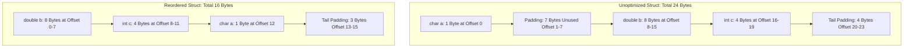

# Modul 089: Anatomi Siklus Hidup Eksekusi Program (Preprocessing, Compiling, Linking, ELF/PE, Memory Layout)

**Navigasi**: [⬅️ Master Index](../../INDEX.md) | [Tingkat 6: Tingkat 6: Computer Science Core, Struktur Data, Algoritma & Compiler](./README.md)
*Sebelumnya*: [088. representasi-penyandian-data](./088-representasi-penyandian-data.md) | *Berikutnya*: [090. ragam-mesin-eksekusi-bahasa](./090-ragam-mesin-eksekusi-bahasa.md)

---

## 1. Intuisi Dasar Tanpa Jargon ("Seperti Bayi Baru Lahir")
Dalam bahasa pemrograman tingkat tinggi seperti Python atau JavaScript, memori komputer diabstraksikan seperti kotak ajaib yang elastis: Anda membuat objek tanpa batas, dan runtime yang mengaturnya di belakang layar. Dalam C tingkat rendah ([C Memory Model & Pointers](https://en.cppreference.com/w/c/language/pointer)), tidak ada kotak ajaib. Memori hanyalah pita linier byte raksasa yang diberi nomor indeks mulai dari 0 hingga $2^{64}-1$. Pointer hanyalah sebuah integer biasa yang menyimpan nomor indeks (alamat) tersebut. Jika Anda menggeser pointer satu langkah ke depan (`ptr++`), langkah tersebut tidak selalu melompat satu byte—ia melompat sebesar ukuran tipe data yang ditunjuknya! Mengabaikan aturan penyelarasan fisik (alignment) atau mengakses indeks di luar batas akan memicu 'Undefined Behavior' (UB)—kondisi di mana compiler berasumsi situasi tersebut tidak pernah ada, menghapus pemeriksaan keamanan Anda, dan membuka gerbang bagi kebocoran data rahasia atau eksekusi eksploit hacker.

## 2. Fondasi Teoretis & Aksiomatik / Matematis
Aritmatika Pointer dan Penyelarasan Memori (Memory Alignment & Padding):

Diberikan pointer bertipe $T^*$ yang menunjuk alamat $A$. Operasi penambahan integer $k$ menghasilkan alamat fisik:
$$\text{Address}(ptr + k) = A + (k \times \text{sizeof}(T))$$

Aturan Penyelarasan Fisik Alamat (Natural Alignment Requirement):
Sebuah tipe data primitif berukuran $S$ byte wajib dialokasikan pada alamat memori yang merupakan kelipatan genap dari $S$:
$$A \pmod S = 0 \quad \iff \quad A \ \& \ (S - 1) = 0 \quad (\text{jika } S = 2^n)$$

Kompensasi Padding pada `struct` Bahasa C:
Compiler secara otomatis menyisipkan byte kosong (*padding bytes*) di antara anggota struct untuk memastikan setiap anggota berada pada batas alamat alaminya:
$$\text{Total Size} = \sum_{i=1}^M \text{sizeof}(field_i) + \sum_{i=1}^M \text{padding}_i$$
Ukuran total struct akhir selalu dibulatkan ke kelipatan terbesar dari penyelarasan anggotanya ($Alignment_{max}$).

## 3. Anatomi Teknis & Cara Kerja Internal
Anatomi Tata Letak Memori Struct C dan Efek Penataan Anggota (Padding vs Packed):



1. **Strict Aliasing Rule**: Compiler C mengasumsikan bahwa dua pointer dengan tipe berbeda (misal `int *` dan `float *`) tidak pernah menunjuk ke lokasi memori yang sama. Melakukan cast pointer untuk membaca bit float sebagai integer melanggar strict aliasing dan dapat menghasilkan optimasi liar (gunakan `memcpy` atau `union` tipe C99) ([Strict Aliasing in C/C++](https://cellperformance.beyond3d.com/articles/2006/06/understanding-strict-aliasing.html)).
2. **Undefined Behavior (UB)**: Mengakses pointer liar (*dangling pointer*), integer signed overflow ($2^{31}-1 + 1$), atau shifting bit melampaui lebar tipe data ($1 \ll 32$ pada 32-bit int) bukan sekadar menghasilkan angka salah, tetapi mengizinkan optimizer compiler menghapus seluruh blok kode cabang terkait.

## 4. Implementasi Praktis & Kode / Simulasi Riil
```c
// Demonstrating Memory Alignment, Pointer Arithmetic and Safe Type Punning
#include <stdio.h>
#include <stdint.h>
#include <string.h>
#include <stddef.h>

typedef struct {
    char   flag;    // 1 byte, offset 0
                    // 3 bytes padding!
    int32_t val;    // 4 bytes, offset 4
    int64_t large;  // 8 bytes, offset 8
} __attribute__((aligned(8))) telemetry_packet_t;

// Fungsi aman untuk membaca representasi bitwise float ke uint32_t tanpa melanggar strict aliasing
uint32_t safe_float_to_raw_bits(float f) {
    uint32_t bits;
    memcpy(&bits, &f, sizeof(float)); // Standar C menjamin optimasi zero-cost memcpy
    return bits;
}

int main(void) {
    printf("Size of telemetry_packet: %zu bytes (Alignment: %zu)\n", 
           sizeof(telemetry_packet_t), alignof(telemetry_packet_t));
    printf("Offset of flag: %zu, val: %zu, large: %zu\n",
           offsetof(telemetry_packet_t, flag),
           offsetof(telemetry_packet_t, val),
           offsetof(telemetry_packet_t, large));
           
    float test_val = -3.141592f;
    uint32_t raw_ieee754 = safe_float_to_raw_bits(test_val);
    printf("IEEE 754 raw hex of %f = 0x%08X\n", test_val, raw_ieee754);
    return 0;
}
```

## 5. Miskonsepsi & Jebakan Industri
1. **Strict Aliasing Violation via Raw Pointer Casting**: Menulis `uint32_t bits = *(uint32_t *)&my_float;`. Di bawah optimasi `-O2` atau `-O3`, GCC/Clang dapat mengeksekusi instruksi pembacaan sebelum penulisan ke float selesai karena menganggap kedua pointer independen.
2. **Misaligned Memory Access on ARM/MIPS Architectures**: Membaca integer 32-bit dari alamat ganjil (`uint32_t *p = (uint32_t *)(buffer + 1); val = *p;`). Pada beberapa prosesor embedded (seperti ARM Cortex-M0), hal ini memicu instruksi UsageFault (*Alignment Trap*) yang menghentikan sistem seketika.
3. **Use-After-Free**: Mengakses pointer setelah memanggil `free(ptr)`. Memori tersebut mungkin telah dialokasikan kembali oleh thread lain untuk data rahasia (seperti kunci privat kriptografi), memungkinkan eksploitasi pembacaan memori liar.

## 6. Proyek Latihan & Rubrik Penilaian Mandiri
1. **Tingkat Pemula**: Buat struct C yang berisi 5 field dengan berbagai tipe data (`char`, `int`, `short`, `double`, `char*`). Urutkan penulisan field dari yang tidak optimal hingga paling optimal untuk meminimalkan padding memori, dan cetak ukuran `sizeof` keduanya.
2. **Tingkat Menengah**: Implementasikan fungsi alokasi memori khusus `aligned_alloc_custom(size_t alignment, size_t size)` menggunakan `malloc` standar. Pastikan pointer yang dikembalikan terisi pada batas kelipatan alignment dan buat fungsi `aligned_free_custom` yang membebaskan memori aslinya secara bersih.
3. **Tingkat Mahir**: Tuliskan custom ring buffer biner bebas alokasi dinamis yang mem-parse header paket jaringan secara streaming. Gunakan teknik sanitasi pointer dan AddressSanitizer (`-fsanitize=address,undefined`) untuk membuktikan kode 100% bebas dari out-of-bounds read/write dan undefined behavior.

## 7. Rekomendasi Sumber Belajar Standar Emas
| Sumber Pembelajaran | Penulis / Institusi | Tautan Langsung | Fokus Materi |
| :--- | :--- | :--- | :--- |
| SEI CERT C Coding Standard | Carnegie Mellon University | [SEI CERT C Portal](https://wiki.sei.cmu.edu/confluence/display/c/) | Rules for Memory Safety, Pointer Overflow & UB Prevention |
| What Every C Programmer Should Know About Undefined Behavior | Chris Lattner (LLVM Creator) | [LLVM Blog Series](https://blog.llvm.org/2011/05/what-every-c-programmer-should-know.html) | Anatomi Optimasi Kompilator & Eksploitasi Asumsi UB |
| The Lost Art of Structure Packing | Eric S. Raymond | [Structure Packing Guide](http://www.catb.org/esr/structure-packing/) | Memory Alignment, Hardware Word Boundaries & Cache Line Optimization |
| C Reference: Memory Model & Pointers | CppReference Community | [CppReference C Memory](https://en.cppreference.com/w/c/language/memory_model) | Formal Specification of Alignment, Object Lifetimes & Types |

---
*Navigasi Cepat*: [Ke Tingkat 6](./README.md) | [Ke Master Index](../../INDEX.md) | *Sebelumnya*: [088. representasi-penyandian-data](./088-representasi-penyandian-data.md) | *Berikutnya*: [090. ragam-mesin-eksekusi-bahasa](./090-ragam-mesin-eksekusi-bahasa.md)
