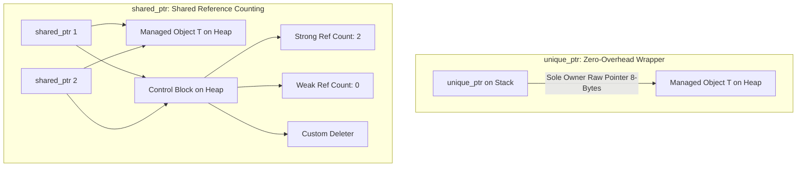

# Modul 090: Ragam Mesin Eksekusi Bahasa (Native Code, Bytecode Virtual Machine JVM/CLR, JIT Compilation V8)

**Navigasi**: [⬅️ Master Index](../../INDEX.md) | [Tingkat 6: Tingkat 6: Computer Science Core, Struktur Data, Algoritma & Compiler](./README.md)
*Sebelumnya*: [089. anatomi-siklus-hidup-eksekusi-program](./089-anatomi-siklus-hidup-eksekusi-program.md) | *Berikutnya*: [091. manajemen-memori-keamanan-tipe](./091-manajemen-memori-keamanan-tipe.md)

---

## 1. Intuisi Dasar Tanpa Jargon ("Seperti Bayi Baru Lahir")
Bahasa C murni memberi Anda kekuasaan tak terbatas atas memori, tetapi menuntut Anda mencuci piring sendiri setiap selesai makan: setiap `malloc` wajib diiringi `free`, setiap file yang dibuka wajib ditutup secara manual, dan jika sebuah fungsi gagal di tengah jalan, kebocoran memori (memory leak) hampir pasti terjadi. Rekayasa C++ Modern ([Modern C++ Design](https://isocpp.github.io/CppCoreGuidelines/CppCoreGuidelines)) memperkenalkan filosofi revolusioner: **RAII (Resource Acquisition Is Initialization)**. Dalam RAII, kepemilikan sumber daya (memori, socket jaringan, lock mutex) diikatkan secara erat pada masa hidup (lifetime) sebuah objek lokal di stack. Ketika fungsi berakhir—baik secara normal maupun akibat lemparan eksepsi—destruktor objek otomatis dipanggil oleh runtime untuk membersihkan sumber daya. Ditambah dengan semantik pemindahan (Move Semantics) yang memindahkan kepemilikan pointer tanpa menduplikasi data di heap, dan komputasi waktu-kompilasi (`constexpr`), C++ modern menghadirkan performa setara C dengan keamanan abstraksi tingkat tinggi.

## 2. Fondasi Teoretis & Aksiomatik / Matematis
Formulasi Matematis Nilai Ekspresi dan Move Semantics C++11 (Value Categories):

Sistem klasifikasi nilai ekspresi C++ modern (Value Category Taxonomy):
$$\text{glvalue (generalized lvalue)} = \text{lvalue} \cup \text{xvalue}$$
$$\text{rvalue} = \text{prvalue (pure rvalue)} \cup \text{xvalue}$$

Move Constructor mentransfer kepemilikan pointer secara instan dengan kompleksitas $O(1)$, berbeda dengan Copy Constructor yang membutuhkan alokasi mendalam $O(N)$:
$$\text{Copy Constructor:} \quad T_{\text{dest}} = \text{alloc}(N) \quad + \quad \text{memcpy}(T_{\text{dest}}, T_{\text{src}}, N)$$
$$\text{Move Constructor:} \quad T_{\text{dest}}.ptr = T_{\text{src}}.ptr; \quad T_{\text{src}}.ptr = \text{nullptr}$$

Aturan Lima Serangkai (Rule of Five / Zero):
Jika sebuah kelas mengelola sumber daya mentah dan mendefinisikan salah satu dari:
1. Destructor `~T()`
2. Copy Constructor `T(const T&)`
3. Copy Assignment Operator `T& operator=(const T&)`
4. Move Constructor `T(T&&)`
5. Move Assignment Operator `T& operator=(T&&)`
maka kelas tersebut **wajib** mendefinisikan atau secara eksplisit menghapus kelimanya untuk mencegah kebocoran atau *double-free*.

## 3. Anatomi Teknis & Cara Kerja Internal
Struktur Smart Pointer C++ Modern (`std::unique_ptr` vs `std::shared_ptr`):



1. **`std::unique_ptr`**: Memiliki ukuran yang identik dengan raw pointer biasa (8 byte pada 64-bit OS). Tidak memiliki biaya runtime tambahan (*zero-overhead abstraction*). Tidak dapat di-copy, hanya dapat di-move ([CppReference Unique Pointer](https://en.cppreference.com/w/cpp/memory/unique_ptr)).
2. **`std::shared_ptr`**: Menggunakan dua pointer (pointer objek + pointer control block). Perubahan reference counter dilakukan secara atomik menggunakan instruksi CPU `LOCK XADD`, membawa sedikit beban overhead multithreading.

## 4. Implementasi Praktis & Kode / Simulasi Riil
```cpp
// Modern C++20 Resource Management with RAII, Rule of 5 and Move Semantics
#include <iostream>
#include <memory>
#include <utility>
#include <cstring>

class DynamicBuffer {
private:
    size_t  m_size;
    uint8_t *m_data;

public:
    // Constructor Alokasi RAII
    explicit DynamicBuffer(size_t size) : m_size(size), m_data(new uint8_t[size]()) {
        std::cout << "Allocated buffer: " << m_size << " bytes\n";
    }

    // 1. Destructor
    ~DynamicBuffer() noexcept {
        delete[] m_data;
        std::cout << "Destroyed buffer: " << m_size << " bytes\n";
    }

    // 2. Copy Constructor (Deep Copy)
    DynamicBuffer(const DynamicBuffer &other) : m_size(other.m_size), m_data(new uint8_t[other.m_size]) {
        std::memcpy(m_data, other.m_data, m_size);
    }

    // 3. Copy Assignment Operator (Copy-and-Swap Idiom)
    DynamicBuffer& operator=(const DynamicBuffer &other) {
        if (this != &other) {
            DynamicBuffer temp(other);
            swap(*this, temp);
        }
        return *this;
    }

    // 4. Move Constructor (Zero-Cost Transfer)
    DynamicBuffer(DynamicBuffer &&other) noexcept : m_size(other.m_size), m_data(other.m_data) {
        other.m_size = 0;
        other.m_data = nullptr; // Kosongkan kepemilikan objek lama!
    }

    // 5. Move Assignment Operator
    DynamicBuffer& operator=(DynamicBuffer &&other) noexcept {
        if (this != &other) {
            delete[] m_data;
            m_size = other.m_size;
            m_data = other.m_data;
            other.m_size = 0;
            other.m_data = nullptr;
        }
        return *this;
    }

    friend void swap(DynamicBuffer &first, DynamicBuffer &second) noexcept {
        using std::swap;
        swap(first.m_size, second.m_size);
        swap(first.m_data, second.m_data);
    }
};
```

## 5. Miskonsepsi & Jebakan Industri
1. **Dangling Reference akibat Mengembalikan Referensi Objek Lokal**: Mengembalikan `const T&` dari fungsi yang menginstansiasi objek di stack lokal. Ketika fungsi berakhir, frame stack dihancurkan dan referensi menunjuk ke memori sampah yang terkorupsi.
2. **Circular Reference Deadlock pada `std::shared_ptr`**: Objek Node A memegang `shared_ptr` ke Node B, dan Node B memegang `shared_ptr` ke Node A. Reference counter tidak pernah menyentuh angka nol, menyebabkan kebocoran memori permanen. Solusi: Gunakan `std::weak_ptr` untuk memutus siklus referensi kepemilikan ([ISO C++ Core Guidelines](https://isocpp.github.io/CppCoreGuidelines/CppCoreGuidelines#Rr-sharedptr-cycles)).
3. **Missing `noexcept` pada Move Constructor**: Jika Move Constructor tidak ditandai `noexcept`, wadah standar seperti `std::vector` akan menolak menggunakan move semantics saat proses realokasi kapasitas (`push_back`), melainkan terdegradasi ke operasi copy constructor lambat untuk menjaga jaminan keamanan eksepsi (*Strong Exception Guarantee*).

## 6. Proyek Latihan & Rubrik Penilaian Mandiri
1. **Tingkat Pemula**: Buat kelas pembungkus file RAII (`FileDescriptor`) yang membuka file pada constructor dan otomatis menutup file descriptor pada destructor. Uji pemanggilan destructor saat terjadi exception.
2. **Tingkat Menengah**: Implementasikan template smart pointer kustom `MyUniquePtr<T>` yang mengadopsi prinsip single ownership. Nonaktifkan fungsi copy constructor dan copy assignment, dan implementasikan move semantics penuh beserta operator dereference `*` dan arrow `->`.
3. **Tingkat Mahir**: Rancang struktur thread pool multithreaded berbasis C++20 yang menggunakan `std::jthread` (cooperative cancellation token), antrian tugas `std::queue<std::move_only_function<void()>>`, dan `std::condition_variable_any`. Buktikan seluruh thread berhenti secara deterministik dan aman tanpa crash saat objek thread pool dihancurkan.

## 7. Rekomendasi Sumber Belajar Standar Emas
| Sumber Pembelajaran | Penulis / Institusi | Tautan Langsung | Fokus Materi |
| :--- | :--- | :--- | :--- |
| C++ Core Guidelines | Bjarne Stroustrup & Herb Sutter | [ISO C++ Guidelines](https://isocpp.github.io/CppCoreGuidelines/CppCoreGuidelines) | Aturan Baku RAII, Smart Pointers, Concurrency & Rule of 5/0 |
| Effective Modern C++ | Scott Meyers | [O'Reilly Meyers C++](https://www.oreilly.com/library/view/effective-modern-c/9781491908419/) | Move Semantics, Perfect Forwarding, Lambda Closures & Smart Pointers |
| Modern C++ Design: Generic Programming and Design Patterns | Andrei Alexandrescu | [Addison-Wesley Alexandrescu](https://www.informit.com/store/modern-c-plus-plus-design-generic-programming-and-9780201704310) | Policy-Based Class Design, Typelists & Compile-Time Patterns |
| CppReference C++ Standard Library Reference | CppReference Community | [CppReference C++ Portal](https://en.cppreference.com/w/cpp) | Spesifikasi Lengkap Header `<memory>`, `<utility>`, `<type_traits>` |

---
*Navigasi Cepat*: [Ke Tingkat 6](./README.md) | [Ke Master Index](../../INDEX.md) | *Sebelumnya*: [089. anatomi-siklus-hidup-eksekusi-program](./089-anatomi-siklus-hidup-eksekusi-program.md) | *Berikutnya*: [091. manajemen-memori-keamanan-tipe](./091-manajemen-memori-keamanan-tipe.md)
