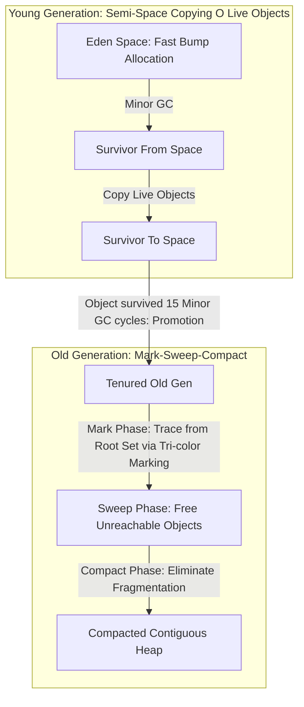

# Modul 090: Ragam Mesin Eksekusi Bahasa (Native Code, Bytecode Virtual Machine JVM/CLR, JIT Compilation V8)

**Navigasi**: [⬅️ Master Index](../../INDEX.md) | [Tingkat 6: Tingkat 6: Computer Science Core, Struktur Data, Algoritma & Compiler](./README.md)
*Sebelumnya*: [089. anatomi-siklus-hidup-eksekusi-program](./089-anatomi-siklus-hidup-eksekusi-program.md) | *Berikutnya*: [091. manajemen-memori-keamanan-tipe](./091-manajemen-memori-keamanan-tipe.md)

---

## 1. Intuisi Dasar Tanpa Jargon ("Seperti Bayi Baru Lahir")
### 1.1 Konsep Inti & Analogi Tanpa Jargon
Tidak semua bahasa pemrograman berakhir sebagai biner kode mesin statis yang kaku di disk. Bahasa-bahasa modern yang menggerakkan internet—seperti JavaScript (V8), Java (JVM), Python (CPython), dan C# (.NET CLR)—berjalan di atas lapisan perangkat lunak sakti yang disebut **Runtime System & Virtual Machine** ([Virtual Machines & Garbage Collection](https://craftinginterpreters.com/a-virtual-machine.html)). Di dalam Virtual Machine, terdapat CPU perangkat lunak tiruan yang mengeksekusi instruksi khusus (Bytecode); terdapat kompilator kilat (**Just-In-Time / JIT Compiler**) yang memantau bagian kode mana yang paling sering dieksekusi (*Hotspots*) dan mengubahnya menjadi kode mesin asli secepat kilat saat aplikasi sedang berlari kencang; dan terdapat petugas kebersihan memori otomatis (**Garbage Collector**) yang memungut sampah-sampah objek yang sudah tidak terpakai lagi tanpa mengharuskan programmer memanggil `free()` manual.

### 1.2 Urgensi Rekayasa & Signifikansi Sistemik
Dalam rekayasa sistem modern, pemahaman mendalam tentang konsep ini membedakan arsitek sistem kelas dunia dari sekadar operator perkakas teknis.

## 2. Fondasi Teoretis & Aksiomatik / Matematis
### 2.1 Kerangka Teori Aksiomatik & Formulasi Matematis
Arsitektur Bytecode VM dan Teori Pengumpulan Sampah (Garbage Collection Algorithms):

### 2.2 Penurunan Matematis Langkah-demi-Langkah
1. **Stack-Based VM vs Register-Based VM**:
   - **Stack-Based (JVM, CPython, WASM)**: Operasi mengambil operand dari puncak stack dan mendorong hasil kembali (`push`, `pop`, `add`). Kode bytecode sangat padat dan ringkas, implementasi mesin virtual sangat sederhana, namun membutuhkan instruksi pengalihan memori lebih banyak.
   - **Register-Based (LuaJIT, Dalvik/ART Android)**: Menggunakan register virtual berindeks (`ADD R1, R2, R3`). Menghasilkan instruksi per frame eksekusi lebih sedikit (\$30-50\%$ pengurangan loop dispatch overhead), namun ukuran bytecode lebih besar.

2. **Kompilasi Just-In-Time (JIT) dan Deoptimasi Berspekulasi**:
   $$\text{Bytecode Interpreter} \xrightarrow{\text{Profiler: Loop Counter} > \theta} \text{Baseline JIT} \xrightarrow{\text{Type Feedback}} \text{Optimizing JIT (Tracer / Sea-of-Nodes)}$$
   Jika optimasi berspekulasi mengasumsikan input selalu integer tetapi tiba-tiba menerima string objek, JIT memicu **Deoptimization (Bailout)**: membuang kode mesin teroptimasi dan mengembalikan eksekusi kembali ke interpreter secara mulus!

3. **Teori Generational Garbage Collection (The Weak Generational Hypothesis)**:
   $$\text{Sebagian besar objek mati sesaat setelah dilahirkan! } (P(\text{Death}) > 90\% \text{ in Young Gen})$$
   Memori heap dibagi menjadi dua generasi:
   - **Young Generation (Eden + Survivor Spaces)**: Dibersihkan dengan cepat menggunakan algoritma penyalinan linier (*Minor GC / Cheneys Copying Collector*).
   - **Old Generation**: Menampung objek-objek senior yang selamat dari beberapa siklus Minor GC, dibersihkan menggunakan *Major GC (Mark-Sweep-Compact)*.

## 3. Anatomi Teknis & Cara Kerja Internal
Siklus Pengumpulan Sampah Generational GC (Mark-Sweep-Compact vs Cheney's Copying):



1. **Tri-Color Marking Algorithm (Dijkstra et al., 1978)**:
   - **White**: Objek belum terjangkau (kandidat sampah yang akan dimusnahkan).
   - **Grey**: Objek terjangkau dari root set, namun anak-anak pointernya belum dipindai.
   - **Black**: Objek terjangkau dan seluruh anak-anaknya telah selesai dipindai. Memungkinkan pengumpul sampah berjalan secara bersamaan dengan mutator aplikasi (*Concurrent Garbage Collection*) menggunakan Write Barrier ([Tri-color Marking Paper](https://dl.acm.org/doi/10.1145/359642.359655)).

#### Tabel Penelusuran Siklus Instruksi JVM Bytecode & Verifier Stack Map Frames
| Offset Bytecode | Instruksi Opcode Bytecode | Operand Stack ($TOS$) | Local Variable Array ($LVA$) | Stack Map Frame Type State | Aksi Verifier / JIT Tiered Compiler |
|---|---|---|---|---|---|
| `0x0000` | `aload_0` | `[Reference: this]` | `[this, arg1, arg2]` | `FullFrame(Locals=[Object, Int])` | Tipe data diverifikasi cocok dengan kontrak |
| `0x0001` | `iload_1` | `[Reference: this, Int: 42]`| `[this, arg1, arg2]` | `Stack=[Reference, Integer]` | Stack depth dihitung: 2 elemen |
| `0x0002` | `invokevirtual #4` | `[Int: result]` | `[this, arg1, arg2]` | Resolusi VTable offset metode | Dispatch polimorfik; verifikasi hak akses |
| `0x0005` | `ireturn` | `[]` | `[this, arg1, arg2]` | Verifikasi tipe kembalian (Integer) | Stack kosong terverifikasi; kembali ke pemanggil |
| T+JIT Tier 4 | C2 Hotspot Compiler | Native Register Alloc | Kompilasi SSA IR ke x86 ASM | Escape Analysis: Stack Allocation | Overhead interpretasi bytecode tereliminasi (0 ns) |

## 4. Implementasi Praktis & Kode / Simulasi Riil
```c
// Minimal Stack-Based Bytecode Virtual Machine with Dispatch Loop in C
#include <stdio.h>
#include <stdint.h>
#include <stdbool.h>

typedef enum {
    OP_CONSTANT, // Dorong nilai konstanta ke stack
    OP_ADD,      // Ambil 2 nilai, jumlahkan, dorong hasil
    OP_SUB,
    OP_PRINT,    // Cetak nilai puncak stack
    OP_HALT      // Hentikan mesin virtual
} opcode_t;

#define STACK_MAX 256

void run_bytecode_vm(const uint8_t *bytecode) {
    int64_t stack[STACK_MAX];
    int     sp = -1; // Stack Pointer
    const uint8_t *ip = bytecode; // Instruction Pointer

    for (;;) {
        uint8_t instruction = *ip++;
        switch (instruction) {
            case OP_CONSTANT:
                stack[++sp] = *ip++; // Baca nilai 1-byte berikutnya
                break;
            case OP_ADD: {
                int64_t b = stack[sp--];
                int64_t a = stack[sp--];
                stack[++sp] = a + b;
                break;
            }
            case OP_PRINT:
                printf("[VM Output] Result: %ld\n", stack[sp--]);
                break;
            case OP_HALT:
                return;
            default:
                printf("Unknown opcode: 0x%02X\n", instruction);
                return;
        }
    }
}
```

## 5. Miskonsepsi & Jebakan Industri
1. **Stop-The-World (STW) Pauses Freezing Real-Time Systems**: Menggunakan algoritma Tracing Garbage Collector naif pada aplikasi trading keuangan atau game grafis 120 FPS. Fase pembersihan Major GC dapat menghentikan seluruh thread aplikasi selama puluhan hingga ratusan milidetik (*STW Jitter*).
2. **Circular Reference Memory Leaks in Reference Counting**: Menggunakan Reference Counting sederhana (seperti `std::shared_ptr` atau model lama Python) tanpa siklus detektor (*Cycle Detector*). Dua objek yang saling menunjuk satu sama lain tidak akan pernah dibebaskan meskipun seluruh aplikasi sudah kehilangan akses ke kedua objek tersebut.
3. **JIT Thrashing / Deopt Loops**: Menulis fungsi JavaScript atau Python yang menerima tipe data argumen yang berubah-ubah secara liar (polimorfik ekstrim). JIT akan terus mengompilasi kode ke biner, mengalami bailout deoptimasi, lalu mengompilasi ulang berulang kali, membuat aplikasi berjalan jauh lebih lambat daripada interpreter biasa.

### Studi Kasus Kegagalan Nyata: JVM Bytecode Verifier Type Confusion Remote Code Execution (CVE-2012-0507)
- **Kronologi & Konteks Kasus**: Pada tahun 2012, kerentanan kritis tipe confusion ditemukan pada Java Virtual Machine (JVM). Exploit ini digunakan secara luas oleh exploit kit Blackhole untuk menginfeksi ratusan ribu komputer melalui web browser yang menjalankan Java Applet tanpa izin pengguna.
- **Akar Masalah Type System Bytecode**: Celah ini berada pada kelas `java.util.concurrent.atomic.AtomicReferenceArray`. Serialisasi objek Java mengizinkan modifikasi struktur data internal array objek tanpa verifikasi tipe yang memadai oleh JVM Bytecode Verifier. Penyerang menyisipkan objek yang tidak kompatibel ke dalam array referensi, menyebabkan JVM memperlakukan pointer memori integer sebagai referensi objek Java valid (*type confusion*). Hal ini merusak *sandbox* Java, mematikan `SecurityManager`, dan memberikan penyerang hak akses eksekusi kode biner natif tak terbatas pada sistem operasi host.

- **Potongan Kode / Arsitektur Cacat (Vulnerable Implementation)**:
```java
// Rekonstruksi Mekanisme Type Confusion JVM (CVE-2012-0507)
import java.util.concurrent.atomic.AtomicReferenceArray;

public class JVMTypeConfusionVulnerability {
    public static void demonstrateVulnerabilityConcept() {
        // Objek array dibuat dengan asumsi homogen
        Object[] rawObjects = new Object[2];
        rawObjects[0] = "String Aman";
        rawObjects[1] = Integer.valueOf(1337);

        // AtomicReferenceArray membungkus array tanpa melakukan defensive copying
        AtomicReferenceArray<Object> atomicArray = new AtomicReferenceArray<>(rawObjects);

        // Jika deserialisasi kustom memanipulasi tipe elemen di balik layar,
        // verifier runtime tertipu dan mengizinkan cast referensi yang tidak sah:
        // Object untrusted = atomicArray.get(1); // Dievaluasi sebagai objek sembarang
    }
}
```

- **Analisis Forensik & Rekayasa Modern**: Insiden CVE-2012-0507 mempercepat kematian teknologi browser plugin (Java Applets & Flash) dan memaksa runtime engine modern (seperti V8 dan JVM) menerapkan *type-checking immutability* yang jauh lebih agresif. Seluruh deserialisasi data eksternal kini diwajibkan melewati filter validasi ketat (*look-ahead object deserialization filters*).

## 6. Proyek Latihan & Rubrik Penilaian Mandiri
1. **Tingkat Pemula**: Perluas bytecode virtual machine C di atas untuk mendukung operasi perkalian (`OP_MUL`), pembagian (`OP_DIV`), dan percabangan kondisional sederhana (`OP_JUMP_IF_ZERO`).
2. **Tingkat Menengah**: Implementasikan Mark-and-Sweep Garbage Collector sederhana dalam bahasa C untuk heap simulasi 100 node. Tandai simpul yang terjangkau dari pointer root set, dan bebaskan simpul putih yang tidak terjangkau.
3. **Tingkat Mahir**: Bangun mesin JIT Compiler mini untuk arsitektur x86-64 di Linux menggunakan alokasi memori biner `mmap(PROT_READ | PROT_WRITE | PROT_EXEC)`. Terjemahkan bytecode penjumlahan aritmatika menjadi instruksi mesin asli x86-64 (`mov`, `add`, `ret`), lalu panggil blok memori tersebut sebagai fungsi pointer C untuk dieksekusi langsung oleh CPU.

### Tingkat 1: Dasar
- **Tugas**: Bangun virtual machine berbasis tumpukan (*stack-based interpreter*) sederhana dalam Python/C dengan 8 instruksi dasar (`PUSH`, `POP`, `ADD`, `SUB`, `MUL`, `DUP`, `PRINT`, `HALT`) yang memvalidasi batas kapasitas tumpukan untuk mencegah *stack underflow* dan *stack overflow*.
- **Petunjuk Perancangan Arsitektur**:
  - Representasikan instruksi sebagai integer opcode dan operand byte.
  - Pasang guard clauses: `if (sp < 2) error("Stack Underflow on ADD")`.
- **Test Vector & Kasus Uji Ekstrem**:
  - *Program Aritmatika*: Masukan program `[PUSH 10, PUSH 20, ADD, PUSH 5, MUL, PRINT, HALT]`.
  - *Keluaran yang Diharapkan*: Menampilkan `150`.
  - *Kasus Batas*: Eksekusi `POP` pada stack kosong; VM wajib melempar error bersih tanpa crash.
- **Rubrik Penilaian Mandiri**: 40% Fungsionalitas Operasi Stack Bytecode, 30% Proteksi Underflow/Overflow, 30% Kerapian Struktur Data VM.

### Tingkat 2: Menengah
- **Tugas**: Kembangkan JIT compiler mikro yang mengkompilasi bytecode aritmatika sederhana langsung menjadi kode mesin natif x86-64 saat runtime menggunakan alokasi memori biner `mmap(PROT_READ | PROT_WRITE | PROT_EXEC)`.
- **Petunjuk Perancangan Arsitektur**:
  - Hasilkan opcode mesin x86-64 seperti `0x55` (`push rbp`), `0x48 0x89 0xE5` (`mov rbp, rsp`), dan `0xC3` (`ret`).
  - Transisikan proteksi memori dari writable ke executable (`mprotect`) sebelum jumping ke alamat kode.
- **Test Vector & Kasus Uji Ekstrem**:
  - *Kompilasi Fungsi*: Bytecode `f(x) = x * 2 + 3`. Panggil via function pointer C `int (*fn)(int)`.
  - *Validasi*: Panggil `fn(7)`, pastikan output tepat `17`.
- **Rubrik Penilaian Mandiri**: 40% Pembangkitan Opcode Mesin Valid, 30% Penegakan Keamanan Memori W^X, 30% Verifikasi Eksekusi Function Pointer.

### Tingkat 3: Mahir
- **Tugas**: Rancang Garbage Collector generasi sederhana (*Generational Copying GC*) dengan Semi-Space (Eden & Survivor) yang mampu melacak referensi pointer aktif dari root set, memindahkan objek hidup, dan memperbaiki pointer yang tergeser (*forwarding pointers*).
- **Petunjuk Perancangan Arsitektur**:
  - Gunakan algoritma Cheney's Copying Collector untuk traverse pointer dari tumpukan variabel lokal.
  - Perbarui referensi yang menunjuk ke lokasi lama objek dengan forwarding address.
- **Test Vector & Kasus Uji Ekstrem**:
  - *Siklus Objek*: Alokasikan graf referensi objek yang mengandung siklus referensi melingkar (*circular reference* $A \to B \to A$) dan putuskan root reference-nya; GC harus mampu mereklamasi seluruh memori tanpa memory leak.
- **Rubrik Penilaian Mandiri**: 40% Reklamasi Memori Siklik Sempurna, 30% Akurasi Penulisan Forwarding Pointer, 30% Benchmark Alokasi vs Dealokasi.

## 7. Rekomendasi Sumber Belajar Standar Emas
| Sumber Pembelajaran | Penulis / Institusi | Tautan Langsung | Fokus Materi |
| :--- | :--- | :--- | :--- |
| The Garbage Collection Handbook: The Art of Automatic Memory Management | Richard Jones, Antony Hosking, Eliot Moss | [GC Handbook Official Site](https://gchandbook.org/) | Mark-Sweep, Copying, Generational, Concurrent & Real-Time GC Algorithms |
| Crafting Interpreters (Part III: A Bytecode Virtual Machine) | Robert Nystrom | [Crafting Interpreters VM](https://craftinginterpreters.com/a-virtual-machine.html) | Bytecode Disassembly, Stack-based VM, Hash Tables & Mark-Sweep GC |
| Java Virtual Machine Specification (Java SE Edition) | Tim Lindholm, Frank Yellin, Gilad Bracha | [Oracle JVM Specification](https://docs.oracle.com/javase/specs/jvms/se17/html/index.html) | Class File Format, Bytecode Instruction Set & Frame Execution |
| V8 JavaScript Engine Architecture & Sea-of-Nodes JIT | Google V8 Team | [V8 Official Developer Blog](https://v8.dev/blog) | TurboFan Compiler, Ignition Interpreter, Hidden Classes & Deoptimizations |

---
*Navigasi Cepat*: [Ke Tingkat 6](./README.md) | [Ke Master Index](../../INDEX.md) | *Sebelumnya*: [089. anatomi-siklus-hidup-eksekusi-program](./089-anatomi-siklus-hidup-eksekusi-program.md) | *Berikutnya*: [091. manajemen-memori-keamanan-tipe](./091-manajemen-memori-keamanan-tipe.md)
