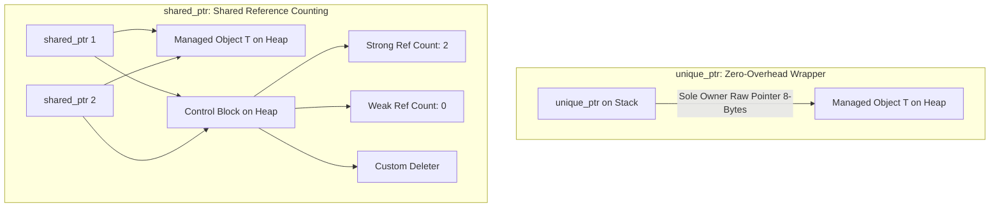

# Modul 091: Manajemen Memori & Keamanan Tipe (Pointer Manual, RAII C++, Ownership/Borrowing Rust, Garbage Collection)

**Navigasi**: [⬅️ Master Index](../../INDEX.md) | [Tingkat 6: Tingkat 6: Computer Science Core, Struktur Data, Algoritma & Compiler](./README.md)
*Sebelumnya*: [090. ragam-mesin-eksekusi-bahasa](./090-ragam-mesin-eksekusi-bahasa.md) | *Berikutnya*: [092. paradigma-pemrograman-lintas-gaya](./092-paradigma-pemrograman-lintas-gaya.md)

---

## 1. Intuisi Dasar Tanpa Jargon ("Seperti Bayi Baru Lahir")
### 1.1 Konsep Inti & Analogi Tanpa Jargon
Bahasa C murni memberi Anda kekuasaan tak terbatas atas memori, tetapi menuntut Anda mencuci piring sendiri setiap selesai makan: setiap `malloc` wajib diiringi `free`, setiap file yang dibuka wajib ditutup secara manual, dan jika sebuah fungsi gagal di tengah jalan, kebocoran memori (memory leak) hampir pasti terjadi. Rekayasa C++ Modern ([Modern C++ Design](https://isocpp.github.io/CppCoreGuidelines/CppCoreGuidelines)) memperkenalkan filosofi revolusioner: **RAII (Resource Acquisition Is Initialization)**. Dalam RAII, kepemilikan sumber daya (memori, socket jaringan, lock mutex) diikatkan secara erat pada masa hidup (lifetime) sebuah objek lokal di stack. Ketika fungsi berakhir—baik secara normal maupun akibat lemparan eksepsi—destruktor objek otomatis dipanggil oleh runtime untuk membersihkan sumber daya. Ditambah dengan semantik pemindahan (Move Semantics) yang memindahkan kepemilikan pointer tanpa menduplikasi data di heap, dan komputasi waktu-kompilasi (`constexpr`), C++ modern menghadirkan performa setara C dengan keamanan abstraksi tingkat tinggi.

### 1.2 Urgensi Rekayasa & Signifikansi Sistemik
Dalam rekayasa sistem modern, pemahaman mendalam tentang konsep ini membedakan arsitek sistem kelas dunia dari sekadar operator perkakas teknis.

## 2. Fondasi Teoretis & Aksiomatik / Matematis
### 2.1 Kerangka Teori Aksiomatik & Formulasi Matematis
Formulasi Matematis Nilai Ekspresi dan Move Semantics C++11 (Value Categories):

### 2.2 Penurunan Matematis Langkah-demi-Langkah
Sistem klasifikasi nilai ekspresi C++ modern (Value Category Taxonomy):
$$\text{glvalue (generalized lvalue)} = \text{lvalue} \cup \text{xvalue}$$
$$\text{rvalue} = \text{prvalue (pure rvalue)} \cup \text{xvalue}$$

Move Constructor mentransfer kepemilikan pointer secara instan dengan kompleksitas $O(1)$, berbeda dengan Copy Constructor yang membutuhkan alokasi mendalam $O(N)$:
$$\text{Copy Constructor:} \quad T_{\text{dest}} = \text{alloc}(N) \quad + \quad \text{memcpy}(T_{\text{dest}}, T_{\text{src}}, N)$$
$$\text{Move Constructor:} \quad T_{\text{dest}}.ptr = T_{\text{src}}.ptr; \quad T_{\text{src}}.ptr = \text{nullptr}$$

Aturan Lima Serangkai (Rule of Five / Zero):
Jika sebuah kelas mengelola sumber daya mentah dan mendefinisikan salah satu dari:
1. Destructor `~T()`
2. Copy Constructor `T(const T&)`
3. Copy Assignment Operator `T& operator=(const T&)`
4. Move Constructor `T(T&&)`
5. Move Assignment Operator `T& operator=(T&&)`
maka kelas tersebut **wajib** mendefinisikan atau secara eksplisit menghapus kelimanya untuk mencegah kebocoran atau *double-free*.

## 3. Anatomi Teknis & Cara Kerja Internal
Struktur Smart Pointer C++ Modern (`std::unique_ptr` vs `std::shared_ptr`):



1. **`std::unique_ptr`**: Memiliki ukuran yang identik dengan raw pointer biasa (8 byte pada 64-bit OS). Tidak memiliki biaya runtime tambahan (*zero-overhead abstraction*). Tidak dapat di-copy, hanya dapat di-move ([CppReference Unique Pointer](https://en.cppreference.com/w/cpp/memory/unique_ptr)).
2. **`std::shared_ptr`**: Menggunakan dua pointer (pointer objek + pointer control block). Perubahan reference counter dilakukan secara atomik menggunakan instruksi CPU `LOCK XADD`, membawa sedikit beban overhead multithreading.

#### Tabel Penelusuran Manajemen Memori & Pencegahan Heap Out-of-Bounds Read (Heartbleed Audit)
| Langkah / Offset Data | Ukuran Nyata Paket ($N_{actual}$) | Field Payload Diklaim ($N_{claimed}$) | Operasi Alokasi & `memcpy` | Status Buffer Memori Heap | Status Deteksi Pelanggaran Bounds |
|---|---|---|---|---|---|
| Langkah 1 | 19 Byte (Ping) | `0x0013` (19 Byte) | Verifikasi ukuran cocok: $19 == 19$ | Alokasi respons 19 byte aman | Permintaan normal, lolos |
| Langkah 2 (Exploit) | 1 Byte | `0xFFFF` (64 KiB) | Ketiadaan pengecekan: $1 < 65535$ | Server mengeksekusi `malloc(65535)` | **PELANGGARAN BOUNDS DIAKIBATKAN TRUST BLIND** |
| Langkah 3 (Eksfiltrasi) | 1 Byte data | 65535 Byte disalin | `memcpy(resp_buf, pl, 65535)` | 65534 byte memori privat server tersalin | Korupsi kerahasiaan: private key SSL bocor! |
| Langkah 4 (Defensif) | Sanitasi Guard | Evaluasi Batas Paket | `if (1 + 2 + payload + 16 > len)` | Eksekusi dihentikan seketika | Paket dibuang; peringatan keamanan dicatat |
| Langkah 5 (Rust/RAII) | Safe Abstraction | Slice `&[u8]` | Akses terikat `src[..claimed_len]` | Rust melempar `panic: index out of bounds` | Memory safety dijamin secara mutlak oleh bahasa |

## 4. Implementasi Praktis & Kode / Simulasi Riil
```cpp
// Modern C++20 Resource Management with RAII, Rule of 5 and Move Semantics
#include <iostream>
#include <memory>
#include <utility>
#include <cstring>

class DynamicBuffer {
private:
    size_t  m_size;
    uint8_t *m_data;

public:
    // Constructor Alokasi RAII
    explicit DynamicBuffer(size_t size) : m_size(size), m_data(new uint8_t[size]{}) {
        std::cout << "Allocated buffer: " << m_size << " bytes\n";
    }

    // 1. Destructor
    ~DynamicBuffer() noexcept {
        delete[] m_data;
        std::cout << "Destroyed buffer: " << m_size << " bytes\n";
    }

    // 2. Copy Constructor (Deep Copy)
    DynamicBuffer(const DynamicBuffer &other) : m_size(other.m_size), m_data(new uint8_t[other.m_size]) {
        std::memcpy(m_data, other.m_data, m_size);
    }

    // 3. Copy Assignment Operator (Copy-and-Swap Idiom)
    DynamicBuffer& operator=(const DynamicBuffer &other) {
        if (this != &other) {
            DynamicBuffer temp(other);
            swap(*this, temp);
        }
        return *this;
    }

    // 4. Move Constructor (Zero-Cost Transfer)
    DynamicBuffer(DynamicBuffer &&other) noexcept : m_size(other.m_size), m_data(other.m_data) {
        other.m_size = 0;
        other.m_data = nullptr; // Kosongkan kepemilikan objek lama!
    }

    // 5. Move Assignment Operator
    DynamicBuffer& operator=(DynamicBuffer &&other) noexcept {
        if (this != &other) {
            delete[] m_data;
            m_size = other.m_size;
            m_data = other.m_data;
            other.m_size = 0;
            other.m_data = nullptr;
        }
        return *this;
    }

    friend void swap(DynamicBuffer &first, DynamicBuffer &second) noexcept {
        using std::swap;
        swap(first.m_size, second.m_size);
        swap(first.m_data, second.m_data);
    }
};
```

## 5. Miskonsepsi & Jebakan Industri
1. **Dangling Reference akibat Mengembalikan Referensi Objek Lokal**: Mengembalikan `const T&` dari fungsi yang menginstansiasi objek di stack lokal. Ketika fungsi berakhir, frame stack dihancurkan dan referensi menunjuk ke memori sampah yang terkorupsi.
2. **Circular Reference Deadlock pada `std::shared_ptr`**: Objek Node A memegang `shared_ptr` ke Node B, dan Node B memegang `shared_ptr` ke Node A. Reference counter tidak pernah menyentuh angka nol, menyebabkan kebocoran memori permanen. Solusi: Gunakan `std::weak_ptr` untuk memutus siklus referensi kepemilikan ([ISO C++ Core Guidelines](https://isocpp.github.io/CppCoreGuidelines/CppCoreGuidelines#Rr-sharedptr-cycles)).
3. **Missing `noexcept` pada Move Constructor**: Jika Move Constructor tidak ditandai `noexcept`, wadah standar seperti `std::vector` akan menolak menggunakan move semantics saat proses realokasi kapasitas (`push_back`), melainkan terdegradasi ke operasi copy constructor lambat untuk menjaga jaminan keamanan eksepsi (*Strong Exception Guarantee*).

### Studi Kasus Kegagalan Nyata: Bencana Keamanan OpenSSL Heartbleed (CVE-2014-0160) Akibat Out-of-Bounds Read
- **Kronologi & Konteks Sejarah**: Pada April 2014, kerentanan Heartbleed diumumkan ke publik. Celah ini mempengaruhi sekitar 17% (setengah juta) dari seluruh server web aman ber-sertifikat SSL di internet, mengizinkan penyerang membaca kunci privat SSL, kredensial password pengguna, dan token sesi tanpa meninggalkan jejak di log server.
- **Akar Masalah Manajemen Memori C**: Dalam implementasi protokol TLS Heartbeat (`ssl/t1_lib.c`), OpenSSL membaca nilai panjang payload 16-bit yang dikirimkan oleh klien (`payload`), kemudian mengalokasikan buffer dan menyalin data memori sebanyak nilai tersebut menggunakan `memcpy`. OpenSSL sama sekali tidak memvalidasi apakah panjang paket aktual yang diterima dari soket jaringan benar-benar sebesar nilai `payload` yang diklaim oleh klien. Ketika penyerang mengirim paket berukuran 1 byte namun mengklaim panjangnya 65.535 byte (64 KB), fungsi `memcpy` membaca melampaui batas buffer paket dan menyalin memori heap server yang memuat data rahasia aplikasi lain kembali ke penyerang.

- **Potongan Kode / Arsitektur Cacat (Vulnerable Implementation)**:
```c
// OpenSSL ssl/t1_lib.c - Cacat Asli Heartbleed (CVE-2014-0160)
int tls1_process_heartbeat(SSL *s) {
    unsigned char *p = &s->s3->rrec.data[0];
    unsigned short hbtype;
    unsigned int payload;
    unsigned int padding = 16; // Standar padding

    hbtype = *p++;
    n2s(p, payload); // Membaca 16-bit panjang dari klien tanpa verifikasi!
    
    // CACAT FATAL: Tidak ada pengecekan terhadap panjang data paket aktual:
    // if (1 + 2 + payload + 16 > s->s3->rrec.length) return 0;

    unsigned char *buffer = OPENSSL_malloc(1 + 2 + payload + padding);
    unsigned char *bp = buffer;

    *bp++ = TLS1_HB_RESPONSE;
    s2n(payload, bp);
    
    // OUT-OF-BOUNDS READ: Membaca heap server hingga 64 KB data privat!
    memcpy(bp, p, payload); 

    int r = ssl3_write_bytes(s, TLS1_RT_HEARTBEAT, buffer, 3 + payload + padding);
    OPENSSL_free(buffer);
    return r;
}
```

- **Analisis Forensik & Rekayasa Modern**: Heartbleed memicu revolusi besar dalam adopsi bahasa pemrograman *memory-safe* (seperti Rust) pada komponen infrastruktur kritis. Industri menyadari bahwa ketiadaan batas ukuran otomatis pada pointer C mentah (`raw pointers`) merupakan bahaya eksistensial. Rust mencegah Heartbleed secara statis melalui tipe data `slice` (`&[u8]`) yang selalu menyertakan panjang data bersama pointer dasar.

## 6. Proyek Latihan & Rubrik Penilaian Mandiri
1. **Tingkat Pemula**: Buat kelas pembungkus file RAII (`FileDescriptor`) yang membuka file pada constructor dan otomatis menutup file descriptor pada destructor. Uji pemanggilan destructor saat terjadi exception.
2. **Tingkat Menengah**: Implementasikan template smart pointer kustom `MyUniquePtr<T>` yang mengadopsi prinsip single ownership. Nonaktifkan fungsi copy constructor dan copy assignment, dan implementasikan move semantics penuh beserta operator dereference `*` dan arrow `->`.
3. **Tingkat Mahir**: Rancang struktur thread pool multithreaded berbasis C++20 yang menggunakan `std::jthread` (cooperative cancellation token), antrian tugas `std::queue<std::move_only_function<void()>>`, dan `std::condition_variable_any`. Buktikan seluruh thread berhenti secara deterministik dan aman tanpa crash saat objek thread pool dihancurkan.

### Tingkat 1: Dasar
- **Tugas**: Rancang struktur data Smart Pointer berbasis pencacah referensi (*Reference Counting Pointer*) mirip `std::shared_ptr` dalam C++ atau Rust `Rc` yang mengalokasikan dan mendealokasikan memori heap secara otomatis saat referensi terakhir hancur (RAII).
- **Petunjuk Perancangan Arsitektur**:
  - Simpan metadata `ref_count` pada heap berdampingan dengan objek payload.
  - Kelebihan konstruktor salin (`copy constructor`) harus menaikkan `ref_count`, dan destruktor harus menurunkannya.
- **Test Vector & Kasus Uji Ekstrem**:
  - *Siklus Hidup Objek*: Buat objek pointer, salin ke 3 variabel berbeda. Pastikan `ref_count == 3`. Hancurkan scope 2 variabel; pastikan `ref_count == 1`. Hancurkan scope terakhir; pastikan memori dibebaskan (verifikasi dengan custom allocator log).
- **Rubrik Penilaian Mandiri**: 40% Kepatuhan Prinsip RAII, 30% Pencegahan Double-Free & Memory Leak, 30% Kerapian Enkapsulasi Operator Overloading.

### Tingkat 2: Menengah
- **Tugas**: Bangun Custom Heap Allocator berbasis *Segregated Free List* dalam C dengan deteksi terintegrasi terhadap *Use-After-Free* (UAF) dan *Double-Free* melalui teknik *Canary Poisoning* pada header chunk memori.
- **Petunjuk Perancangan Arsitektur**:
  - Sisipkan magic canary byte (misal `0xDEADBEEF`) sebelum dan sesudah chunk payload pengguna.
  - Saat `free()` dipanggil, isi seluruh area payload dengan nilai poison byte `0xAA` untuk menggagalkan pembacaan data basi.
- **Test Vector & Kasus Uji Ekstrem**:
  - *Uji Double Free*: Panggil `my_free(ptr)` dua kali berturut-turut pada pointer yang sama. Sistem harus melempar error dan mencatat nomor baris pemanggil tanpa mengalami korupsi linked-list free chunk.
  - *Uji Buffer Overflow*: Tulis 1 byte melebihi batas alokasi; saat `free()` dipanggil, canary yang rusak harus memicu panic seketika.
- **Rubrik Penilaian Mandiri**: 40% Integritas Segregated Free List, 30% Deteksi Cacat Double-Free & Overflow, 30% Efisiensi Fragmentasi Memori.

### Tingkat 3: Mahir
- **Tugas**: Kembangkan prototipe Borrow Checker statis mini dalam Python/Rust yang membedah Abstract Syntax Tree (AST) program sederhana untuk menegakkan aturan kepemilikan (*Aliasing XOR Mutability Rule*): sebuah data boleh memiliki tak terbatas pembacaan (`&T`) ATAU satu penulisan unik (`&mut T`), tetapi tidak keduanya secara bersamaan.
- **Petunjuk Perancangan Arsitektur**:
  - Lacak rentang *lifetime* setiap variabel menggunakan analisis aliran kontrol (*Control Flow Graph / CFG*).
  - Melempar kesalahan kompilasi jika referensi mutable dibuat saat referensi immutable masih aktif dalam scope.
- **Test Vector & Kasus Uji Ekstrem**:
  - *Kasus Valid*: Dua referensi baca independen yang digunakan bersamaan.
  - *Kasus Ilegal*: Modifikasi data melalui referensi tulis saat referensi baca sedang melakukan iterasi; borrow checker harus menolak program dengan pesan error deskriptif.
- **Rubrik Penilaian Mandiri**: 40% Penegakan Aturan Aliasing XOR Mutability, 30% Analisis Aliran Kontrol CFG Akurat, 30% Kejelasan Pesan Kesalahan Kompiler.

## 7. Rekomendasi Sumber Belajar Standar Emas
| Sumber Pembelajaran | Penulis / Institusi | Tautan Langsung | Fokus Materi |
| :--- | :--- | :--- | :--- |
| C++ Core Guidelines | Bjarne Stroustrup & Herb Sutter | [ISO C++ Guidelines](https://isocpp.github.io/CppCoreGuidelines/CppCoreGuidelines) | Aturan Baku RAII, Smart Pointers, Concurrency & Rule of 5/0 |
| Effective Modern C++ | Scott Meyers | [O'Reilly Meyers C++](https://www.oreilly.com/library/view/effective-modern-c/9781491908419/) | Move Semantics, Perfect Forwarding, Lambda Closures & Smart Pointers |
| Modern C++ Design: Generic Programming and Design Patterns | Andrei Alexandrescu | [Addison-Wesley Alexandrescu](https://www.informit.com/store/modern-c-plus-plus-design-generic-programming-and-9780201704310) | Policy-Based Class Design, Typelists & Compile-Time Patterns |
| CppReference C++ Standard Library Reference | CppReference Community | [CppReference C++ Portal](https://en.cppreference.com/w/cpp) | Spesifikasi Lengkap Header `<memory>`, `<utility>`, `<type_traits>` |

---
*Navigasi Cepat*: [Ke Tingkat 6](./README.md) | [Ke Master Index](../../INDEX.md) | *Sebelumnya*: [090. ragam-mesin-eksekusi-bahasa](./090-ragam-mesin-eksekusi-bahasa.md) | *Berikutnya*: [092. paradigma-pemrograman-lintas-gaya](./092-paradigma-pemrograman-lintas-gaya.md)
