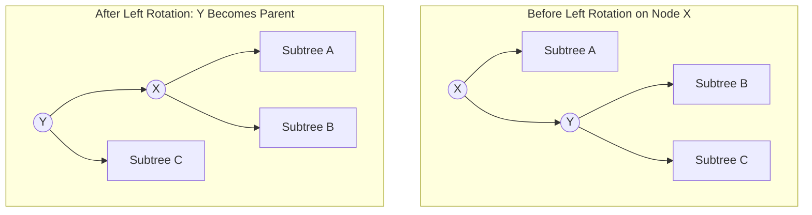

# Modul 095: Struktur Data Berbasis Hash (Hash Functions SipHash, Resolusi Tabrakan Chaining vs Open Addressing)

**Navigasi**: [⬅️ Master Index](../../INDEX.md) | [Tingkat 6: Tingkat 6: Computer Science Core, Struktur Data, Algoritma & Compiler](./README.md)
*Sebelumnya*: [094. struktur-data-linier-fundamental](./094-struktur-data-linier-fundamental.md) | *Berikutnya*: [096. struktur-data-pohon](./096-struktur-data-pohon.md)

---

## 1. Intuisi Dasar Tanpa Jargon ("Seperti Bayi Baru Lahir")
### 1.1 Konsep Inti & Analogi Tanpa Jargon
Ketika Anda mencari satu nama di antara satu miliar pengguna database, pencarian linier satu per satu akan memakan waktu bertahun-tahun. Pohon Biner Seimbang ([Balanced Search Trees](https://en.wikipedia.org/wiki/Self-balancing_binary_search_tree)) adalah mahakarya efisiensi algoritma: setiap simpul bertindak sebagai hakim pemilah yang membelah dunia menjadi dua: semua nilai yang lebih kecil pergi ke cabang kiri, dan semua nilai yang lebih besar pergi ke cabang kanan. Namun pohon biner biasa memiliki kelemahan mematikan: jika data dimasukkan dalam keadaan terurut, ia merosot menjadi linked list ramping dengan waktu pencarian $O(N)$ yang lambat. Pohon penyeimbang otomatis—seperti **AVL Tree** yang mengawasi perbedaan tinggi cabang secara ketat, **Red-Black Tree** yang menggunakan metafora pewarnaan simpul untuk menjamin rotasi penyeimbang cepat di kernel sistem operasi, dan **B-Tree** yang memiliki cabang lebar multi-anak untuk mengoptimalkan pembacaan hard disk—menjamin bahwa tidak peduli seberapa liar data dimasukkan, tinggi pohon tidak akan pernah melebihi $O(\log N)$.

### 1.2 Urgensi Rekayasa & Signifikansi Sistemik
Dalam rekayasa sistem modern, pemahaman mendalam tentang konsep ini membedakan arsitek sistem kelas dunia dari sekadar operator perkakas teknis.

## 2. Fondasi Teoretis & Aksiomatik / Matematis
### 2.1 Kerangka Teori Aksiomatik & Formulasi Matematis
Aksioma Keseimbangan dan Batas Ketinggian Logaritmik:

### 2.2 Penurunan Matematis Langkah-demi-Langkah
1. **Pohon AVL (Georgy Adelson-Velsky & Evgenii Landis, 1962)**:
   Faktor Keseimbangan (Balance Factor) untuk setiap simpul $N$ didefinisikan sebagai:
   $$BF(N) = \text{Height}(\text{LeftChild}) - \text{Height}(\text{RightChild}) \in \{-1, 0, +1\}$$
   Jika $|BF(N)| > 1$, keseimbangan dipulihkan menggunakan 4 kasus rotasi: Single Left (L), Single Right (R), Left-Right (LR), atau Right-Left (RL).
   Tinggi maksimum pohon AVL dengan $n$ simpul dibatasi ketat oleh:
   $$H_{\text{AVL}} < 1.44 \log_2(n + 2) - 0.328$$

2. **Pohon Merah-Hitam (Red-Black Tree)**:
   Menegakkan 5 invarian warna struktural:
   - Setiap simpul berwarna Merah atau Hitam.
   - Akar pohon selalu Hitam.
   - Semua simpul daun kosong (NIL) berwarna Hitam.
   - Simpul Merah tidak boleh memiliki anak Merah (*No Red-Red Conflict*).
   - Setiap jalur dari simpul akar ke sembarang daun NIL memiliki jumlah simpul Hitam yang identik (*Black-Height Balance*).
   $$H_{\text{RB}} \le 2 \log_2(n + 1)$$

3. **B-Tree Orde $M$ (Database Indexing)**:
   Setiap simpul dalam menampung hingga $M - 1$ kunci pencarian dan memiliki hingga $M$ cabang anak, meminimalkan operasi I/O blok disk:$$H_{\text{B-Tree}} \le \left\lceil \log_{\lceil M/2 \rceil} \left( \frac{n + 1}{2} \right) \right\rceil$$

## 3. Anatomi Teknis & Cara Kerja Internal
Mekanisme Operasi Rotasi Cabang Tunggal (Left Rotation) pada Pohon Biner:



1. **Perbandingan AVL vs Red-Black Tree**:
   - **AVL**: Jauh lebih seimbang secara ketat ($BF \le 1$). Pencarian (*lookup*) sedikit lebih cepat, namun membutuhkan lebih banyak rotasi saat penyisipan dan penghapusan. Ideal untuk database read-heavy.
   - **Red-Black Tree**: Lebih longgar (tinggi hingga $2\log N$). Penyisipan hanya membutuhkan maksimal 2 rotasi, penghapusan maksimal 3 rotasi. Dipilih sebagai fondasi implementasi `std::map` C++ dan CFS (Completely Fair Scheduler) Linux Kernel ([Linux rbtree Documentation](https://www.kernel.org/doc/Documentation/rbtree.txt)).
2. **B-Tree Node Page Alignment**: Simpul B-Tree sengaja dirancang berukuran tepat satu halaman virtual memori (biasanya 4 KB), sehingga satu pembacaan simpul disk mengisi penuh satu blok sektor memori tanpa pemborosan I/O.

#### Tabel Penelusuran Resolusi Kolisi Hash: Linear Probing vs Robin Hood Hashing
| Langkah / Masukan Kunci | Indeks Hash Awal ($h$) | Jarak Probe ($D$) | State Slot Tabel Hash | Aksi Pertukaran (Robin Hood Steal) | Status Distribusi Probe Length |
|---|---|---|---|---|---|
| Kunci `"Alpha"` | Slot 3 | $D = 0$ | Slot 3 Kosong; Isi `"Alpha"` | Tidak ada kontensi | $\text{Variance}(D) = 0$ |
| Kunci `"Beta"` | Slot 3 | $D = 0 \to 1$ | Slot 3 Terisi; Geser ke Slot 4 | Slot 4 Kosong; Isi `"Beta"` ($D=1$) | Rata-rata probe rendah |
| Kunci `"Gamma"` | Slot 3 | $D = 0 \to 2$ | Slot 3 & 4 Terisi; Cek Slot 5 | Slot 5 Kosong; Isi `"Gamma"` ($D=2$) | Probe meningkat pada linear biasa |
| Kunci `"Delta"` (Robin Hood)| Slot 4 | $D = 1$ | Slot 4 ditempati `"Beta"` ($D=1$) | Jarak sama ($1 \le 1$), lanjut ke Slot 5 | Mencari slot dengan $D$ lebih kecil |
| Evaluasi Robin Hood | Slot 5 | $D = 2$ | Slot 5 berisi `"Gamma"` ($D=2$)| Lanjut ke Slot 6 ($D=3 > 0$) | **ROBIN HOOD RULE**: Kaya mengalah ke miskin! |
| Hasil Penataan | Stabil | Merata | Variansi panjang probe minim | Batas maksimum probe terkompresi | Pencarian worst-case terjamin cepat |

## 4. Implementasi Praktis & Kode / Simulasi Riil
```c
// AVL Tree Node Insertion and Balancing Rotations in C
#include <stdio.h>
#include <stdlib.h>

typedef struct avl_node {
    int key;
    int height;
    struct avl_node *left;
    struct avl_node *right;
} avl_node_t;

static int max(int a, int b) { return (a > b) ? a : b; }
static int height(avl_node_t *n) { return n ? n->height : 0; }
static int get_balance(avl_node_t *n) { return n ? height(n->left) - height(n->right) : 0; }

static avl_node_t* rotate_right(avl_node_t *y) {
    avl_node_t *x = y->left;
    avl_node_t *T2 = x->right;
    x->right = y;
    y->left = T2;
    y->height = max(height(y->left), height(y->right)) + 1;
    x->height = max(height(x->left), height(x->right)) + 1;
    return x;
}

static avl_node_t* rotate_left(avl_node_t *x) {
    avl_node_t *y = x->right;
    avl_node_t *T2 = y->left;
    y->left = x;
    x->right = T2;
    x->height = max(height(x->left), height(x->right)) + 1;
    y->height = max(height(y->left), height(y->right)) + 1;
    return y;
}

avl_node_t* avl_insert(avl_node_t *node, int key) {
    if (!node) {
        avl_node_t *new_node = (avl_node_t *)malloc(sizeof(avl_node_t));
        new_node->key = key; new_node->height = 1;
        new_node->left = new_node->right = NULL;
        return new_node;
    }
    if (key < node->key)      node->left = avl_insert(node->left, key);
    else if (key > node->key) node->right = avl_insert(node->right, key);
    else return node; // Kunci duplikat tidak diizinkan

    node->height = 1 + max(height(node->left), height(node->right));
    int balance = get_balance(node);

    // 4 Kasus Keseimbangan
    if (balance > 1 && key < node->left->key)   return rotate_right(node);             // Kasus Left-Left
    if (balance < -1 && key > node->right->key) return rotate_left(node);              // Kasus Right-Right
    if (balance > 1 && key > node->left->key) {                                       // Kasus Left-Right
        node->left = rotate_left(node->left);
        return rotate_right(node);
    }
    if (balance < -1 && key < node->right->key) {                                      // Kasus Right-Left
        node->right = rotate_right(node->right);
        return rotate_left(node);
    }
    return node;
}
```

## 5. Miskonsepsi & Jebakan Industri
1. **Degeneration to Linked List in Unbalanced BST**: Menggunakan Binary Search Tree naif untuk data time-series (stempel waktu yang selalu meningkat). Setiap simpul baru masuk ke cabang kanan, membuat kedalaman pohon menjadi $N$ dan memicu *Stack Overflow* saat traversal rekursif.
2. **Parent Pointer Corruption in Custom Red-Black Tree Implementation**: Lupa memperbarui pointer induk (`parent`) saat melakukan rotasi pohon. Cabang pohon terputus di tengah jalan, merusak keutuhan struktur pohon dan memicu looping tak terhingga saat backtracking.
3. **Inappropriate Node Size for Disk B-Trees**: Merancang simpul B-Tree database terlalu kecil (misal 64 byte). Satu operasi pencarian akan memicu puluhan operasi *Disk I/O Seek* terpisah alih-alih memanfaatkan pembacaan multi-kilobyte block transfer perangkat penyimpanan SSD/NVMe.

### Studi Kasus Kegagalan Nyata: Kerentanan Hash Collision Python & Adopsi Kriptografis SipHash (PEP 456 / CVE-2012-1150)
- **Kronologi & Konteks Sejarah**: Sebelum Python 3.3, fungsi bawaan `hash()` pada tipe data string dan objek menggunakan algoritma hash FNV deterministik sederhana tanpa seed acak. Pada awal 2012, ditemukan bahwa implementasi kamus (`dict`) Python sangat rentan terhadap serangan manipulasi input eksternal yang mematikan server aplikasi web (Django, Flask, Pyramid).
- **Akar Masalah Struktur Hash & Hash Randomization**: Karena algoritma hash sepenuhnya deterministik, penyerang dapat menghitung kunci kolisi secara offline dan mengirimkannya sebagai payload JSON atau formulir web. Kamus Python yang menggunakan open addressing linear probing mengalami fenomena *primary clustering* yang parah, di mana seluruh slot terkonsentrasi pada satu rantai panjang. Guido van Rossum dan tim pengembang inti Python meluncurkan PEP 456, menggantikan algoritma lama dengan SipHash-2-4 yang menggunakan kunci rahasia acak 128-bit yang dibangkitkan secara independen pada setiap proses baru Python (`PYTHONHASHSEED`), mematahkan kemampuan penyerang memprediksi nilai hash.

- **Potongan Kode / Arsitektur Cacat (Vulnerable Implementation)**:
```python
# Evaluasi Mekanisme Ketahanan Hash Pasca-PEP 456
import os
import sys

def verify_siphash_randomization():
    # Mengamati bagaimana string yang sama menghasilkan hash berbeda di interpreter berbeda:
    test_key = "kunci_keamanan_sistem_kritis"
    computed_hash = hash(test_key)
    
    print(f"Versi Python: {sys.version.split()[0]}")
    print(f"Hash Terhitung: {hex(computed_hash)}")
    
    # Nilai ini tidak dapat diprediksi oleh penyerang dari luar,
    # karena kunci privat SipHash dibangkitkan dari CSPRNG kernel saat startup!
    if os.environ.get("PYTHONHASHSEED") == "0":
        print("PERINGATAN: Hash randomization dimatikan (rentan Hash DoS)!")
    else:
        print("STATUS: SipHash-2-4 aktif dengan entropy acak per-proses.")

verify_siphash_randomization()
```

- **Analisis Forensik & Rekayasa Modern**: Adopsi SipHash oleh Python, Rust, Ruby, dan sistem operasi Linux membuktikan bahwa fungsi hash serbaguna untuk struktur data in-memory memerlukan resistensi terhadap manipulasi lawan (*adversarial robustness*). Rekayasa tabel hash modern tidak lagi hanya mengoptimalkan throughput murni, melainkan juga menyeimbangkan keamanan kriptografis dan batas latensi *worst-case*.

## 6. Proyek Latihan & Rubrik Penilaian Mandiri
1. **Tingkat Pemula**: Gambarkan langkah demi langkah perubahan pohon AVL saat kunci-kunci berikut dimasukkan secara berurutan: `[10, 20, 30, 40, 50, 25]`. Tunjukkan jenis rotasi yang terjadi pada setiap langkah.
2. **Tingkat Menengah**: Implementasikan fungsi `avl_delete(avl_node_t *root, int key)` lengkap dengan pemulihan faktor keseimbangan dan rotasi penyeimbang. Uji integritas pohon dengan menghapus akar utama.
3. **Tingkat Mahir**: Bangun implementasi B-Tree berkemampuan penulisan blok disk sederhana (orde $M=4$) dalam C. Tuliskan fungsi pemisahan simpul (*node splitting*) saat kapasitas melebihi 3 kunci dan buktikan seluruh simpul daun selalu berada pada tingkat kedalaman yang sama.

### Tingkat 1: Dasar
- **Tugas**: Bangun implementasi Tabel Hash mandiri dalam C/Python menggunakan teknik resolusi kolisi *Chaining* (Linked List per bucket) dengan rasio beban (*load factor*) dinamis yang memicu alokasi ulang dan *re-hashing* saat $\alpha = N / M > 0.75$.
- **Petunjuk Perancangan Arsitektur**:
  - Ukuran tabel $M$ digandakan menjadi bilangan prima terdekat saat ekspansi.
  - Sediakan fungsi `put(key, value)`, `get(key)`, dan `delete(key)`.
- **Test Vector & Kasus Uji Ekstrem**:
  - *Operasi Standar*: Masukkan 100 pasangan kunci-nilai string. Verifikasi seluruh nilai dapat dibaca kembali dengan akurasi 100%.
  - *Uji Ekspansi*: Pastikan saat elemen ke-76 dimasukkan pada tabel awal ukuran 100, kapasitas tabel melonjak dan semua elemen berhasil di-rehash ke lokasi baru.
- **Rubrik Penilaian Mandiri**: 40% Mekanisme Chaining Bebas Bug, 30% Penanganan Dynamic Resizing & Rehash, 30% Kerapian Struktur Data.

### Tingkat 2: Menengah
- **Tugas**: Kembangkan implementasi Tabel Hash berkinerja tinggi menggunakan teknik *Robin Hood Hashing* dengan *Open Addressing* dan *Backward Shift Deletion* (menghindari penggunaan penanda nisan *tombstone* yang boros memori).
- **Petunjuk Perancangan Arsitektur**:
  - Setiap slot mencatat panjang probe distance ($D$).
  - Saat penyisipan, jika elemen yang ingin dimasukkan memiliki $D$ lebih besar dari elemen di slot target, lakukan pertukaran (*steal from the rich, give to the poor*).
- **Test Vector & Kasus Uji Ekstrem**:
  - *Distribusi Probe*: Masukkan 5.000 elemen acak dengan load factor 90%. Ukur variansi panjang probe; buktikan Robin Hood hashing menghasilkan variansi probe mendekati 0 dibandingkan Linear Probing standar.
- **Rubrik Penilaian Mandiri**: 40% Logika Pertukaran Robin Hood yang Benar, 30% Penghapusan Bersih Tanpa Tombstone, 30% Analisis Statistik Probe Length.

### Tingkat 3: Mahir
- **Tugas**: Rancang implementasi *Cuckoo Hashing* dengan dua fungsi hash independen ($h_1, h_2$) yang menjamin pencarian *worst-case* dalam waktu konstan mutlak $\mathcal{O}(1)$ (maksimal 2 pembacaan memori), lengkap dengan deteksi siklus tendang (*kick-out cycle detection*) yang memicu rehash otomatis.
- **Petunjuk Perancangan Arsitektur**:
  - Batasi jumlah pengusiran berantai maksimum sebelum menyimpulkan terjadi siklus tertutup ($MaxKicks = 50$).
  - Gunakan fungsi hash MurmurHash3 atau xxHash dengan seed berbeda untuk $h_1$ dan $h_2$.
- **Test Vector & Kasus Uji Ekstrem**:
  - *Worst-Case Lookup*: Buktikan bahwa setiap operasi `get(key)` memerlukan tepat 1 atau 2 perbandingan memori, bahkan saat tabel terisi 80% kapasitas.
- **Rubrik Penilaian Mandiri**: 40% Jaminan Worst-Case O(1) Lookup, 30% Deteksi Siklus Tendang & Rehash Otomatis, 30% Efisiensi Penggunaan Cache.

## 7. Rekomendasi Sumber Belajar Standar Emas
| Sumber Pembelajaran | Penulis / Institusi | Tautan Langsung | Fokus Materi |
| :--- | :--- | :--- | :--- |
| Introduction to Algorithms (CLRS) - Red-Black Trees | MIT Press | [MIT Press CLRS](https://mitpress.mit.edu/9780262046305/introduction-to-algorithms/) | Bab 13: Red-Black Trees & Bab 18: B-Trees Theoretical Proofs |
| Linux Kernel Red-Black Trees Implementation | Linux Kernel Organization | [Linux Kernel rbtree.h](https://github.com/torvalds/linux/blob/master/include/linux/rbtree.h) | Intrusive rbtree API, Color Encoding in Pointer LSB & O(log N) Sched |
| Georgy Adelson-Velsky & Evgenii Landis AVL Original Paper | Soviet Mathematics Doklady | [AVL Tree Paper 1962](https://dl.acm.org/doi/10.1145/321105.321108) | Penemuan Struktur Self-Balancing Pertama & Analisis Deret Fibonacci |
| Database Internals: A Deep Dive into Distributed Systems | Alex Petrov | [O'Reilly Database Internals](https://www.databass.dev/) | Arsitektur B-Tree, B+Tree, Disk Page Layout & Concurrency Latching |

---
*Navigasi Cepat*: [Ke Tingkat 6](./README.md) | [Ke Master Index](../../INDEX.md) | *Sebelumnya*: [094. struktur-data-linier-fundamental](./094-struktur-data-linier-fundamental.md) | *Berikutnya*: [096. struktur-data-pohon](./096-struktur-data-pohon.md)
