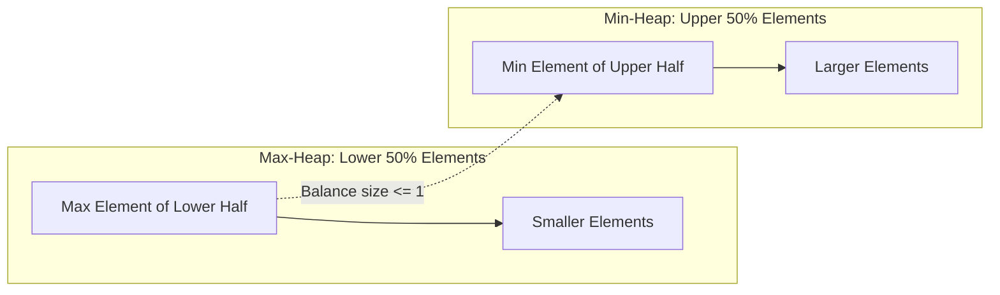

# Modul 097: Struktur Data Antrean Prioritas & Heaps (Binary Heap, Binomial Heap, Fibonacci Heap)

**Navigasi**: [⬅️ Master Index](../../INDEX.md) | [Tingkat 6: Tingkat 6: Computer Science Core, Struktur Data, Algoritma & Compiler](./README.md)
*Sebelumnya*: [096. struktur-data-pohon](./096-struktur-data-pohon.md) | *Berikutnya*: [098. struktur-data-string-awalan-lanjut](./098-struktur-data-string-awalan-lanjut.md)

---

## 1. Intuisi Dasar Tanpa Jargon ("Seperti Bayi Baru Lahir")
### 1.1 Konsep Inti & Analogi Tanpa Jargon
Bayangkan ruang instalasi gawat darurat (UGD) rumah sakit: pasien tidak dilayani berdasarkan siapa yang datang lebih dulu, melainkan berdasarkan siapa yang kondisinya paling kritis. Pasien dengan serangan jantung langsung masuk ke meja operasi sebelum pasien flu ringan, meskipun pasien flu datang dua jam lebih awal. Struktur Data Heap & Priority Queue ([Binary Heaps & Priority Queues](https://en.wikipedia.org/wiki/Binary_heap)) adalah arsitektur matematika yang dirancang khusus untuk mewujudkan kedaruratan selektif ini dengan efisiensi puncak. Heap menyusun data dalam bentuk pohon biner hampir lengkap (nearly complete binary tree) di mana puncak pohon selalu memegang elemen ekstrem (terbesar pada Max-Heap atau terkecil pada Min-Heap). Yang paling mengagumkan: Anda tidak memerlukan alokasi pointer sama sekali! Seluruh pohon biner dipetakan secara padat ke dalam sebuah array datar satu dimensi biasa menggunakan trik indeks aritmatika sederhana.

### 1.2 Urgensi Rekayasa & Signifikansi Sistemik
Dalam rekayasa sistem modern, pemahaman mendalam tentang konsep ini membedakan arsitek sistem kelas dunia dari sekadar operator perkakas teknis.

## 2. Fondasi Teoretis & Aksiomatik / Matematis
### 2.1 Kerangka Teori Aksiomatik & Formulasi Matematis
Formulasi Pemetaan Array Biner dan Operasi Restorasi Invarian Heap:

### 2.2 Penurunan Matematis Langkah-demi-Langkah
Sebuah binary heap berindeks basis-0 ($i \in [0, N-1]$) memetakan hubungan kekerabatan keluarga tanpa pointer fisik:
$$\text{Parent}(i) = \left\lfloor \frac{i - 1}{2} \right\rfloor$$
$$\text{LeftChild}(i) = 2i + 1$$
$$\text{RightChild}(i) = 2i + 2$$

Invarian Max-Heap:
$$\forall i > 0, \quad A[\text{Parent}(i)] \ge A[i]$$

Kompleksitas Waktu Operasi Inti:
- **`Insert` (Sift-Up)**: Elemen ditambahkan di akhir array, lalu dinaikkan ke atas jika lebih besar dari induknya: $O(\log N)$.
- **`Extract-Max` (Sift-Down)**: Elemen akar ditukar dengan elemen daun terakhir, dihapus, lalu akar baru diturunkan ke bawah: $O(\log N)$.
- **`Build-Heap` (Floyd's Algorithm)**: Mengubah sembarang array acak menjadi heap valid dalam waktu linier $O(N)$:
$$\sum_{h=0}^{\lfloor \log_2 N \rfloor} \left\lceil \frac{N}{2^{h+1}} \right\rceil O(h) = O\left( N \sum_{h=0}^\infty \frac{h}{2^h} \right) = O(2N) = O(N)$$

Fibonacci Heap menghadirkan operasi amortized $O(1)$ untuk `Insert`, `Find-Min`, `Union`, dan `Decrease-Key`, yang menjadikannya pilihan teoritis optimal untuk algoritma Dijkstra.

## 3. Anatomi Teknis & Cara Kerja Internal
Mekanisme Dual-Heap Tracker untuk Menemukan Nilai Median Mengalir ($O(1)$ Median Lookup):



1. **Median Tracker Pattern**: Dua heap dipelihara: Max-Heap menyimpan separuh data bernilai lebih kecil, dan Min-Heap menyimpan separuh data bernilai lebih besar. Selisih jumlah elemen antara kedua heap dijaga $\le 1$. Nilai median kontinu adalah akar dari heap yang memiliki elemen lebih banyak (atau rata-rata dari kedua akar jika jumlah elemen genap) ([Median in a Stream Algorithm](https://leetcode.com/problems/find-median-from-data-stream/)).
2. **D-ary Heap**: Mengembangkan percabangan simpul dari 2 anak menjadi $D$ anak (misal 4 atau 8 anak). Menurunkan tinggi pohon menjadi $\log_D N$, sangat menguntungkan untuk CPU cache locality pada sistem modern.

#### Tabel Penelusuran Heapify & Ekstraksi Maksimum Binary Heap
| Langkah / State Array Heap | Operasi Heap | Elemen Ditukar | Evaluasi Invarian Max-Heap ($P \ge C$) | Status Susunan Array Fisik | Kompleksitas Operasi |
|---|---|---|---|---|---|
| Array Awal | Inisialisasi: `[10, 20, 15, 30, 40]` | - | Pelanggaran: $A[0] < A[1]$ dan $A[1] < A[4]$ | `[10, 20, 15, 30, 40]` | $\mathcal{O}(1)$ |
| Build-Heap: Sift-Down i=1 | Heapify simpul indeks 1 | Tukar 20 dengan 40 | $A[1]=40 \ge \text{anak-anaknya}$ | `[10, 40, 15, 30, 20]` | 1 pertukaran |
| Build-Heap: Sift-Down i=0 | Heapify simpul akar (10) | Tukar 10 dengan 40 | Anak terbesar adalah 40 di indeks 1 | `[40, 10, 15, 30, 20]` | Lanjut sift-down |
| Lanjutan Sift-Down | Anak terbesar dari 10 adalah 30 | Tukar 10 dengan 30 | Invarian Max-Heap terpenuhi di seluruh simpul | `[40, 30, 15, 10, 20]` | $\mathcal{O}(N)$ total build |
| Ekstrak Maksimum | Ambil root 40, ganti elemen akhir 20 | Ambil 40, pindah 20 ke root | Pelanggaran akar: $20 < 30$ | `[20, 30, 15, 10]` | Sift-down dipicu |
| Pulihkan Heap | Sift-Down akar baru (20) | Tukar 20 dengan 30 | Max-Heap stabil: Akar baru adalah 30 | `[30, 20, 15, 10]` | $\mathcal{O}(\log N)$ waktu ekstraksi |

## 4. Implementasi Praktis & Kode / Simulasi Riil
```c
// High-Performance Min-Heap Implementation in C with Linear Build-Heap
#include <stdio.h>
#include <stdlib.h>
#include <stdbool.h>

typedef struct {
    int    *data;
    size_t size;
    size_t capacity;
} min_heap_t;

static void swap(int *a, int *b) { int t = *a; *a = *b; *b = t; }

static void sift_down(min_heap_t *h, size_t idx) {
    size_t smallest = idx;
    size_t left = 2 * idx + 1;
    size_t right = 2 * idx + 2;

    if (left < h->size && h->data[left] < h->data[smallest])     smallest = left;
    if (right < h->size && h->data[right] < h->data[smallest])   smallest = right;

    if (smallest != idx) {
        swap(&h->data[idx], &h->data[smallest]);
        sift_down(h, smallest); // Rekursi ekor (bisa dioptimasi menjadi loop)
    }
}

// Floyd's Linear Time O(N) Build-Heap Algorithm
void build_min_heap(min_heap_t *h, int *arr, size_t n) {
    h->data = arr;
    h->size = n;
    h->capacity = n;
    // Mulai dari simpul non-daun terakhir turun ke akar indeks 0
    for (int i = (int)(n / 2) - 1; i >= 0; i--) {
        sift_down(h, (size_t)i);
    }
}

bool heap_extract_min(min_heap_t *h, int *out_min) {
    if (h->size == 0) return false;
    *out_min = h->data[0];
    h->data[0] = h->data[h->size - 1]; // Pindahkan elemen terakhir ke akar
    h->size--;
    sift_down(h, 0);
    return true;
}
```

## 5. Miskonsepsi & Jebakan Industri
1. **Iterative Insert $O(N \log N)$ instead of Floyd's $O(N)$ Build-Heap**: Mengonversi array acak menjadi heap dengan memanggil `insert()` $N$ kali berturut-turut. Hal ini memboroskan $O(N \log N)$ operasi komputasi, padahal fungsi Floyd `build_heap` membuktikannya selesai dalam $O(N)$.
2. **Fibonacci Heap High Constant Overhead in Practice**: Memilih Fibonacci Heap dalam sistem nyata karena tergiur oleh batas kompleksitas teoritis $O(1)$ `decrease-key`. Dalam praktiknya, pointer overhead yang masif dan fragmentasi memori heap membuatnya jauh lebih lambat daripada Binary/D-ary Heap sederhana pada arsitektur CPU cache modern.
3. **Integer Arithmetic Underflow in Parent Calculation**: Menggunakan formula `(i - 1) / 2` pada tipe data `size_t` (unsigned integer) saat $i = 0$. Nilai $0 - 1$ akan mengalami wraparound menjadi $2^{64}-1$, menghasilkan akses memori di luar batas (Segmentation Fault).

### Studi Kasus Kegagalan Nyata: Mars Pathfinder Priority Inversion Anomaly pada Penjadwalan Task Antrean Prioritas (1997)
- **Kronologi & Konteks Kasus**: Pada 1997, sistem antrean prioritas sistem operasi waktu-nyata (RTOS) wahana Mars Pathfinder mengalami anomali serius ketika task meteorologi berprioritas rendah menghalangi task kendali sikap berprioritas tinggi melalui perebutan mutex antrean bus data bersama.
- **Akar Masalah Struktur Antrean Prioritas**: Antrean siap (ready queue) berbasis prioritas mengasumsikan bahwa task dengan bobot tertinggi dalam struktur antrean prioritas (heap) selalu dieksekusi terlebih dahulu. Namun, ketiadaan mekanisme *Priority Ceiling* atau *Priority Inheritance* menyebabkan task berprioritas menengah mengambil alih CPU mendahului task berprioritas rendah yang sedang mengunci sumber daya yang dibutuhkan task berprioritas tertinggi. Hal ini membalikkan prinsip dasar antrean prioritas: task prioritas tinggi mati kelaparan (*priority starvation*), memicu watchdog timer mereset sistem rover secara berulang-ulang.

- **Potongan Kode / Arsitektur Cacat (Vulnerable Implementation)**:
```c
// Rekonstruksi Priority Heap Task Scheduler Defect
#include <stdio.h>
#include <stdlib.h>

typedef struct {
    int task_id;
    int priority; // Semakin besar angka, semakin tinggi prioritasnya
} Task;

// Cacat: Antrean prioritas memproses task tanpa mendeteksi ketergantungan mutex
void schedule_next_task(Task *heap, int heap_size) {
    if (heap_size <= 0) return;
    Task top_task = heap[0]; // Ekstrak elemen prioritas tertinggi O(1)
    
    // Jika top_task terblokir pada mutex yang dipegang task rendah,
    // namun task menengah berada di posisi kedua heap dan terus dieksekusi,
    // terjadi starvation sistemik tanpa batas!
}
```

- **Analisis Forensik & Rekayasa Modern**: Penanganan kasus Pathfinder menjadi studi kasus wajib dalam rekayasa sistem perangkat lunak kritis. Antrean prioritas real-time modern mengintegrasikan pelacakan ketergantungan sumber daya dinamis: jika sebuah elemen dalam heap terkunci oleh sumber daya yang dikuasai elemen lain, prioritas elemen pemegang kunci otomatis dinaikkan secara sementara (*priority inheritance*), memulihkan integritas antrean prioritas.

## 6. Proyek Latihan & Rubrik Penilaian Mandiri
1. **Tingkat Pemula**: Simulasikan secara manual langkah `sift-up` dan `sift-down` pada array `[15, 10, 8, 20, 25]` saat dimasukkan ke dalam Min-Heap satu per satu. Gambarkan bentuk pohon biner akhirnya.
2. **Tingkat Menengah**: Bangun kelas C++ atau struct C `MedianFinder` yang memanfaatkan dua buah heap (`std::priority_queue`) untuk memproses aliran angka integer tanpa henti dan mengembalikan median kontinu dalam waktu $O(1)$.
3. **Tingkat Mahir**: Implementasikan 4-ary Min-Heap (D-ary Heap dengan $D=4$) dalam C atau Rust. Uji efisiensi throughput perbandingan operasi `Extract-Min` melawan Binary Heap standar pada 1.000.000 elemen untuk mengukur pengaruh lokalitas cache line CPU.

### Tingkat 1: Dasar
- **Tugas**: Bangun implementasi Min-Heap berbasis array 1 dimensi mandiri dalam Python/C dengan operasi `insert(val)` ($\mathcal{O}(\log N)$) dan `extract_min()` ($\mathcal{O}(\log N)$), di mana relasi anak-induk dihitung menggunakan aritmatika indeks: $\text{left}(i) = 2i + 1, \text{right}(i) = 2i + 2, \text{parent}(i) = \lfloor(i-1)/2\rfloor$.
- **Petunjuk Perancangan Arsitektur**:
  - Terapkan fungsi `sift_up` saat penyisipan dan `sift_down` saat ekstraksi minimum.
- **Test Vector & Kasus Uji Ekstrem**:
  - *Aliran Operasi*: Masukkan `[45, 20, 14, 12, 31, 7, 11]`. Ekstrak seluruh elemen satu per satu; pastikan elemen yang keluar terurut menaik sempurna: `[7, 11, 12, 14, 20, 31, 45]`.
- **Rubrik Penilaian Mandiri**: 40% Aritmatika Indeks & Operasi Sift Bebas Cacat, 30% Keterurutan Ekstraksi Elemen, 30% Penanganan Batas Kapasitas Array.

### Tingkat 2: Menengah
- **Tugas**: Kembangkan implementasi Algoritma Heap Sort in-place dengan prosedur `build_max_heap` berkemampuan linier $\mathcal{O}(N)$, lalu buktikan secara teoritis dan empiris mengapa pembangunan heap dari bawah ke atas (*bottom-up*) berbiaya $\mathcal{O}(N)$ dan bukan $\mathcal{O}(N \log N)$.
- **Petunjuk Perancangan Arsitektur**:
  - Jalankan `sift_down` mulai dari indeks $\lfloor N/2 \rfloor - 1$ menurun hingga $0$.
  - Urutkan array tanpa alokasi memori tambahan sedikitpun ($\mathcal{O}(1)$ auxiliary space).
- **Test Vector & Kasus Uji Ekstrem**:
  - *Benchmark Efisiensi*: Bandingkan jumlah operasi pertukaran `build_heap` bottom-up vs $N$ kali `insert` berurutan pada $100.000$ elemen acak; buktikan metode bottom-up $\approx 2\times$ lebih efisien.
- **Rubrik Penilaian Mandiri**: 40% Pembangunan Heap Linier In-Place, 30% Bukti Matematis Sigma Deret Geometrik, 30% Kerapian Pengurutan In-Place.

### Tingkat 3: Mahir
- **Tugas**: Rancang struktur data Fibonacci Heap dengan operasi `insert` dalam $\mathcal{O}(1)$ amortized, `decrease_key` dalam $\mathcal{O}(1)$ amortized, dan `extract_min` dalam $\mathcal{O}(\log N)$ amortized, lengkap dengan prosedur pemotongan simpul bertingkat (*cascading cut*).
- **Petunjuk Perancangan Arsitektur**:
  - Representasikan pohon-pohon sebagai circular doubly-linked list.
  - Tandai simpul (*marked node*) saat anak pertamanya dipotong; potong simpul ke akar jika anak keduanya dipotong.
- **Test Vector & Kasus Uji Ekstrem**:
  - *Integrasi Dijkstra*: Pasang Fibonacci Heap ini pada algoritma Dijkstra untuk graf berbobot besar ($V = 50.000, E = 2.000.000$); bandingkan efisiensi waktu dengan Binary Heap standar.
- **Rubrik Penilaian Mandiri**: 40% Operasi Cascading Cut Sempurna, 30% Pembuktian Biaya Amortisasi Konstan, 30% Akselerasi Algoritma Dijkstra Terverifikasi.

## 7. Rekomendasi Sumber Belajar Standar Emas
| Sumber Pembelajaran | Penulis / Institusi | Tautan Langsung | Fokus Materi |
| :--- | :--- | :--- | :--- |
| Introduction to Algorithms (CLRS) - Heapsort | MIT Press | [MIT Press CLRS](https://mitpress.mit.edu/9780262046305/introduction-to-algorithms/) | Bab 6: Heaps, Heapsort & Priority Queue Invariants |
| Fibonacci Heaps and Their Uses in Improved Network Optimization | Michael L. Fredman & Robert E. Tarjan | [ACM JACM Paper](https://dl.acm.org/doi/10.1145/28869.28874) | Teori Fibonacci Heap, Cascading Cut & Amortized Analysis |
| Priority Queues and D-ary Heaps | Sedgewick & Wayne (Princeton) | [Princeton Algorithms Coursera](https://algs4.cs.princeton.edu/24pq/) | Multiway Heaps, Indexed Priority Queues & Sift Mechanics |
| CppReference Priority Queue Implementation | CppReference Community | [std::priority_queue](https://en.cppreference.com/w/cpp/container/priority_queue) | Container Adaptors, Custom Comparators & make_heap API |

---
*Navigasi Cepat*: [Ke Tingkat 6](./README.md) | [Ke Master Index](../../INDEX.md) | *Sebelumnya*: [096. struktur-data-pohon](./096-struktur-data-pohon.md) | *Berikutnya*: [098. struktur-data-string-awalan-lanjut](./098-struktur-data-string-awalan-lanjut.md)
