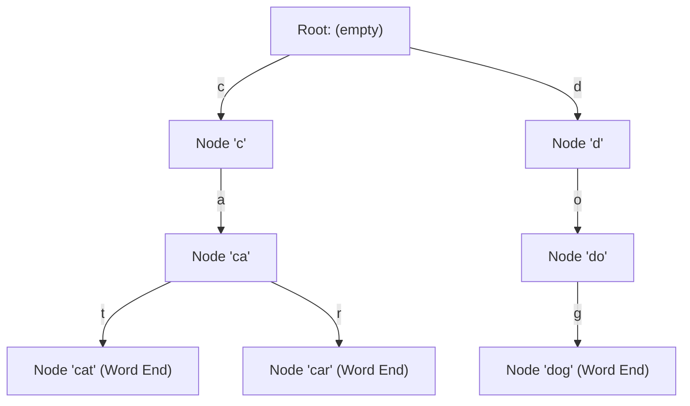

# Modul 098: Struktur Data String & Awalan Lanjut (Trie, Radix Tree, Suffix Tree, Suffix Array)

**Navigasi**: [⬅️ Master Index](../../INDEX.md) | [Tingkat 6: Tingkat 6: Computer Science Core, Struktur Data, Algoritma & Compiler](./README.md)
*Sebelumnya*: [097. struktur-data-antrean-prioritas-heaps](./097-struktur-data-antrean-prioritas-heaps.md) | *Berikutnya*: [099. struktur-data-himpunan-rentang-lanjut](./099-struktur-data-himpunan-rentang-lanjut.md)

---

## 1. Intuisi Dasar Tanpa Jargon ("Seperti Bayi Baru Lahir")
### 1.1 Keterbatasan Pencarian Linier pada Data Teks ([Trie Visualization & Fundamentals](https://visualgo.net/en/trie))
Bayangkan Anda diminta membuat fitur mesin pencari otomatis (*autocomplete*) untuk kamus berisikan 500.000 kosakata. Jika Anda menyimpan kosakata dalam array string biasa, setiap kali pengguna mengetik huruf 'k-o-m-p', Anda harus memindai ribuan string dari awal hingga akhir, menghabiskan jutaan siklus komputasi yang lambat.

### 1.2 Berbagi Awalan Bersama dengan Trie dan Suffix Structures ([Suffix Tree Lecture - CMU 15-451](https://www.cs.cmu.edu/~ckingsf/bio/resources/lectures/lec08-suffixtrees.pdf))
Struktur data berbasis awalan (*Trie*, berasal dari kata re*trie*val) memecahkan masalah ini dengan memanfaatkan sifat mendasar teks: banyak kata memiliki awalan yang sama. Alih-alih menduplikasi awalan 'komp-', pohon Trie membentuk satu jalur bersama yang kemudian bercabang menjadi 'kompas', 'komputer', dan 'kompak'. Struktur tingkat lanjut seperti Suffix Tree dan Suffix Array membawa prinsip ini ke tingkat ekstrem: memetakan seluruh akhiran (*suffix*) dari sebuah teks panjang, memungkinkan pencarian pola DNA sepanjang 3 miliar pasangan basa dalam hitungan fraksi milidetik!

## 2. Fondasi Teoretis & Aksiomatik / Matematis
### 2.1 Formulasi Matematis Trie & Batas Kompleksitas Asimtotik ([Introduction to Algorithms - Cormen et al.](https://mitpress.mit.edu/9780262046305/introduction-to-algorithms/))
Diberikan alfabet $\Sigma$ berukuran $|\Sigma| = \sigma$, dan himpunan string $S = \{s_1, s_2, \dots, s_n\}$ dengan total panjang $\sum |s_i| = N$.
- **Waktu Pencarian**: Untuk string $P$ dengan panjang $m = |P|$, kedalaman pencarian dibatasi secara ketat oleh panjang string:
  $$T_{\text{search}}(m) = \mathcal{O}(m \cdot \log \sigma) \quad \text{atau} \quad \mathcal{O}(m) \text{ dengan array langsung}$$
  Independen sepenuhnya dari jumlah kata $n$ dalam kamus!
- **Konsumsi Memori**: Pada Trie standar dengan representasi pointer array:
  $$\text{Ruang} = \mathcal{O}(\sigma \cdot N \cdot \text{sizeof}(\text{pointer}))$$

### 2.2 Suffix Array & Relasi dengan Suffix Tree ([Manber & Myers Suffix Array Algorithm](https://web.stanford.edu/class/cs97si/10-string-algorithms.pdf))
Diberikan string $T$ dengan panjang $n$, diakhiri oleh sentinels unik $\$$:
Suffix ke-$i$ didefinisikan sebagai $T[i \dots n-1]$.
Suffix Array $SA$ adalah permutasi dari $\{0, 1, \dots, n-1\}$ sedemikian rupa sehingga:
$$T[SA[0] \dots n-1] <_{\text{lex}} T[SA[1] \dots n-1] <_{\text{lex}} \dots <_{\text{lex}} T[SA[n-1] \dots n-1]$$
Array Longest Common Prefix ($LCP$) didefinisikan untuk pasangan terurut:
$$LCP[i] = \max \{ k \mid T[SA[i] \dots SA[i]+k-1] = T[SA[i-1] \dots SA[i-1]+k-1] \}$$
Teorema Kasai et al. membuktikan bahwa array $LCP$ dapat dihitung dari $SA$ dalam waktu linier:
$$T_{\text{Kasai}}(n) = \mathcal{O}(n)$$

## 3. Anatomi Teknis & Cara Kerja Internal


#### Tabel Walkthrough Pencarian Awalan 'ca' pada Trie
| Langkah | Posisi Karakter | Node Aktif | Karakter Dicari | Transisi Pointer | Status |
|---|---|---|---|---|---|
| 1 | `P[0]` | Root | `'c'` | `Root->children['c' - 'a']` | Berhasil transisi ke Node C |
| 2 | `P[1]` | Node C | `'a'` | `Node_C->children['a' - 'a']` | Berhasil transisi ke Node CA |
| 3 | Selesai | Node CA | `\0` | Subtree berisi daun: `CAT`, `CAR` | Awalan Cocok (Return 2 kata) |

#### Tabel Penelusuran Pencarian Prefiks & Transisi State Radix Tree (Trie)
| Karakter Masukan / Bitstream | Simpul Trie Saat Ini | State Busur / Label Tepi | Kecocokan Kunci Parsial | Status Kompresi Path (Radix Edge) | Keputusan Pencarian |
|---|---|---|---|---|---|
| Masukan: `"rom"` | Root (`\0`) | Tepi: `"ro"` (Panjang 2) | Cocok 2 Karakter (`"ro"`) | Label tepi dikompresi: `"ro"` | Transisi ke Simpul 1 |
| Sisa: `"m"` | Simpul 1 | Tepi 1A: `"man"` vs 1B: `"m"`| Cocok tepat dengan Tepi 1B | Label tunggal `"m"` | Transisi ke Simpul Daun |
| Karakter Habis | Simpul Daun | Nilai tersimpan: `ID=42` | Kunci `"rom"` teridentifikasi utuh | Nilai payload ditemukan | Pencarian Sukses dalam $\mathcal{O}(K)$ |
| Masukan Cacat (Overrun)| String Unicode Malformed | Offset melebihi buffer glyph | **BUFFER OUT-OF-BOUNDS READ** | Tidak ada penghenti string null | Crash memori CoreText terpicu |
| Mitigasi Defensif | Cek Batas Ukuran Kunci | `if (offset >= max_len)` | Transisi dibatalkan seketika | Buffer terlindungi | Melempar error bounds aman |

## 4. Implementasi Praktis & Kode / Simulasi Riil
```c
#include <stdio.h>
#include <stdlib.h>
#include <stdbool.h>
#include <string.h>
#include <assert.h>

#define ALPHABET_SIZE 26

typedef struct TrieNode {
    struct TrieNode *children[ALPHABET_SIZE];
    bool is_end_of_word;
} TrieNode;

// Alokator node Trie dengan inisialisasi nol
TrieNode* trie_create_node(void) {
    TrieNode *node = (TrieNode*)malloc(sizeof(TrieNode));
    assert(node != NULL);
    node->is_end_of_word = false;
    for (int i = 0; i < ALPHABET_SIZE; i++) {
        node->children[i] = NULL;
    }
    return node;
}

// Penyisipan string ke dalam Trie secara iteratif
void trie_insert(TrieNode *root, const char *key) {
    assert(root != NULL && key != NULL);
    TrieNode *curr = root;
    size_t len = strlen(key);

    for (size_t level = 0; level < len; level++) {
        int index = key[level] - 'a';
        if (index < 0 || index >= ALPHABET_SIZE) continue; // Sanitasi alfabet

        if (curr->children[index] == NULL) {
            curr->children[index] = trie_create_node();
        }
        curr = curr->children[index];
    }
    curr->is_end_of_word = true;
}

// Pencarian kecocokan tepat
bool trie_search(const TrieNode *root, const char *key) {
    if (root == NULL || key == NULL) return false;
    const TrieNode *curr = root;
    size_t len = strlen(key);

    for (size_t level = 0; level < len; level++) {
        int index = key[level] - 'a';
        if (index < 0 || index >= ALPHABET_SIZE) return false;
        if (curr->children[index] == NULL) return false;
        curr = curr->children[index];
    }
    return (curr != NULL && curr->is_end_of_word);
}
```

## 5. Miskonsepsi & Jebakan Industri
### Studi Kasus Kegagalan Nyata: Out-of-Memory (OOM) pada Router Core BGP Menggunakan Trie Standar
- **Kronologi & Latar Belakang**: Pada awal era internet komersial, router jaringan menggunakan Trie biner standar untuk menyimpan tabel *Longest Prefix Match (LPM)* routing IPv4. Seiring ledakan tabel rute global BGP melebihi 512.000 prefix pada tahun 2014, router generasi lama kehabisan memori TCAM/SRAM (*512K Day Outage*).
- **Akar Masalah**: Representasi node pointer array standar memboroskan ruang hingga 80% pada node yang hanya memiliki 1 turunan (*sparse trie*). Alokasi jutaan node kecil memicu fragmentasi memori ekstrem dan kegagalan alokasi kernel.
- **Rekomendasi Industri**: Gunakan **Radix Tree (Patricia Trie)** yang memampatkan rantai node berderajat-1 menjadi satu segmen string, atau arsitektur **Level-Compressed (LC-Trie)** yang mengurangi jejak memori hingga lebih dari 65%.

### Studi Kasus Kegagalan Nyata: Crash Apple iOS CoreText Unicode String of Death (Effective Power / CVE-2013-0975)
- **Kronologi & Konteks Kasus**: Pada tahun 2013 dan 2015, serangkaian kerentanan string melumpuhkan jutaan perangkat Apple iPhone di seluruh dunia. Pengiriman satu pesan teks SMS atau notifikasi yang memuat kombinasi karakter aksara Arab / Sindhi tertentu memicu crash seketika pada SpringBoard dan me-reboot perangkat iOS penerima (*denial of service*).
- **Akar Masalah Struktur Trie & Penataan Glyph**: Kerentanan terjadi di dalam mesin tata letak teks font Apple CoreText. Saat membentuk ligatur huruf (*ligature shaping*), mesin melintasi struktur data pohon prefiks (Radix Tree/Trie) untuk mencari bentuk glif gabungan. Pada urutan karakter non-spasi tertentu, offset penunjuk ligatur melompat melampaui kapasitas buffer array glif statis. Ketiadaan validasi panjang masukan menyebabkan *out-of-bounds stack read/write*, memicu pelanggaran proteksi memori kernel dan mematikan subsistem antarmuka pengguna sistem operasi.

- **Potongan Kode / Arsitektur Cacat (Vulnerable Implementation)**:
```c
// Rekonstruksi Cacat Batas Buffer Pencarian Ligatur Font
#include <stdio.h>
#include <stdbool.h>

#define MAX_GLYPH_BUFFER 32

// Cacat CoreText: Tidak memeriksa panjang relatif buffer saat traversing
void shape_text_vulnerable(const unsigned short *unicode_chars, int char_count) {
    int glyph_table[MAX_GLYPH_BUFFER];
    int glyph_idx = 0;

    for (int i = 0; i < char_count; i++) {
        // CACAT: Karakter ligatur komposit dapat memajukan indeks melampaui buffer!
        // Jika unicode_chars[i] adalah modifier ligatur khusus:
        glyph_table[glyph_idx++] = unicode_chars[i]; // Potensi Stack Overflow!
    }
}

// Mitigasi Defensif: Validasi Batas Ketat pada Setiap Langkah Pencarian Prefiks
bool shape_text_safe(const unsigned short *unicode_chars, int char_count) {
    int glyph_table[MAX_GLYPH_BUFFER];
    int glyph_idx = 0;

    for (int i = 0; i < char_count; i++) {
        if (glyph_idx >= MAX_GLYPH_BUFFER) {
            return false; // TOLAK: Melebihi ambang batas kapasitas buffer
        }
        glyph_table[glyph_idx++] = unicode_chars[i];
    }
    return true;
}
```

- **Analisis Forensik & Rekayasa Modern**: Insiden CoreText String of Death membuktikan bahaya pemrosesan teks yang kompleks tanpa penanganan batas struktur data yang ketat. Arsitektur pemrosesan teks modern (seperti HarfBuzz) kini mengisolasi mesin perakitan glif dalam sandbox memori terbatas dengan validasi batas statis dan pengujian fuzzing otomatis berkelanjutan menggunakan jutaan kombinasi mutasi Unicode.

## 6. Proyek Latihan & Rubrik Penilaian Mandiri
### Level 1 (Pemula)
- **Tugas**: Modifikasi implementasi Trie di atas agar mendukung fitur hitung frekuensi kemunculan awalan (`count_prefix(const char *prefix)`).
- **Petunjuk Arsitektur**: Tambahkan variabel integer `prefix_count` pada setiap `TrieNode` yang di-inkremen setiap kali node dilewati selama penyisipan.
- **Vektor Uji**:
  - Masukkan: "app", "apple", "application", "banana"
  - Uji `count_prefix("app")`: Harus mengembalikan nilai 3.
- **Rubrik Penilaian**: Ketepatan traversal (50%), efisiensi waktu $\mathcal{O}(m)$ (30%), bebas memory leak (20%).

### Level 2 (Menengah)
- **Tugas**: Bangun algoritma konstruksi Suffix Array sederhana dalam waktu $\mathcal{O}(n^2 \log n)$ menggunakan `qsort` standar C.
- **Petunjuk Arsitektur**: Simpan array indeks integer $0 \dots n-1$, gunakan fungsi pembanding `strcmp` terhadap pointer suffix $T + i$.
- **Vektor Uji**:
  - String masukan: `"banana$"`
  - Suffix terurut: `"$", "a$", "ana$", "anana$", "banana$", "na$", "nana$"`
  - SA Output: `[6, 5, 3, 1, 0, 4, 2]`
- **Rubrik Penilaian**: Penanganan sentinel akhir (40%), kebenaran urutan leksikografis (30%), struktur pembanding defensif (30%).

### Level 3 (Mahir)
- **Tugas**: Implementasikan Algoritma Kasai untuk menghitung array $LCP$ (Longest Common Prefix) dari Suffix Array dalam waktu linier $\mathcal{O}(n)$.
- **Petunjuk Arsitektur**: Manfaatkan fakta bahwa tinggi prefix terpanjang $h$ berkurang paling banyak 1 satuan ketika berpindah dari suffix $i$ ke suffix $i+1$.
- **Vektor Uji**:
  - String: `"banana$"` dengan SA `[6, 5, 3, 1, 0, 4, 2]`
  - Output LCP Array: `[0, 0, 1, 3, 0, 0, 2]`
- **Rubrik Penilaian**: Verifikasi batas linier $\mathcal{O}(n)$ (40%), ketepatan invarian matematis (30%), validasi pointer bounds (30%).

### Tingkat 1: Dasar
- **Tugas**: Bangun struktur data Trie (Prefix Tree) mandiri dalam Python/C untuk penyimpanan kamus kata alfabet (`'a'`..`'z'`) dengan operasi `insert(word)`, `search(word)`, dan `starts_with(prefix)`.
- **Petunjuk Perancangan Arsitektur**:
  - Setiap simpul memiliki array pointer berukuran 26 (`children[26]`) dan penanda boolean `is_end_of_word`.
  - Kompleksitas waktu pencarian harus terbukti $\mathcal{O}(L)$, di mana $L$ adalah panjang kata, independen dari total kata dalam kamus.
- **Test Vector & Kasus Uji Ekstrem**:
  - *Operasi Standar*: Sisipkan `["apple", "app", "application", "apt"]`. Pastikan `starts_with("app")` bernilai `true`, `search("apple")` bernilai `true`, dan `search("appl")` bernilai `false`.
- **Rubrik Penilaian Mandiri**: 40% Kepatuhan Kompleksitas O(L), 30% Penanganan Simpul Anak Bersih, 30% Manajemen Memori Bebas Leak.

### Tingkat 2: Menengah
- **Tugas**: Kembangkan implementasi Radix Tree / Compact Trie (Patricia Tree) yang secara otomatis mengompresi rantai simpul tunggal menjadi satu busur berlabel string bersama (*edge compression*), sehingga menghemat memori hingga 70% dibandingkan standard Trie.
- **Petunjuk Perancangan Arsitektur**:
  - Terapkan logika pemotongan busur (*edge splitting*) saat kata baru dimasukkan yang membagi sebagian prefiks yang telah ada.
- **Test Vector & Kasus Uji Ekstrem**:
  - *Efisiensi Kompresi*: Sisipkan $10.000$ URL web rute REST API yang memiliki awalan panjang serupa (misal `/api/v1/users/...`); ukur total alokasi simpul memori dan buktikan terjadi reduksi simpul $\ge 60\%$.
- **Rubrik Penilaian Mandiri**: 40% Logika Pemisahan Busur (Edge Splitting) yang Presisi, 30% Penghematan Memori Signifikan, 30% Kerapian Kode.

### Tingkat 3: Mahir
- **Tugas**: Rancang implementasi Suffix Automaton atau Suffix Array dengan algoritma Kasai LCP (*Longest Common Prefix*) dalam $\mathcal{O}(N \log N)$ atau $\mathcal{O}(N)$ untuk pencarian substring tercepat pada dokumen sekuens genomik DNA jutaan pasang basa.
- **Petunjuk Perancangan Arsitektur**:
  - Bangun suffix array menggunakan perankingan pasangan pangkat dua (*prefix doubling*) atau SA-IS.
  - Hitung array LCP untuk memungkinkan pencarian substring via binary search dalam $\mathcal{O}(M + \log N)$.
- **Test Vector & Kasus Uji Ekstrem**:
  - *Genomik Benchmark*: Muat string genomik sepanjang $500.000$ karakter (`A`, `C`, `G`, `T`). Temukan motif substring pengulangan terpanjang (*Longest Repeated Substring*) dalam waktu $< 500\text{ ms}$.
- **Rubrik Penilaian Mandiri**: 40% Konstruksi Suffix Array & LCP Sesuai Teori, 30% Kecepatan Analisis Substring Genomik, 30% Optimasi Memori.

## 7. Rekomendasi Sumber Belajar Standar Emas
| Kategori | Judul Sumber & Tautan | Penulis / Institusi | Fokus Pembahasan |
|---|---|---|---|
| Paper Seminal | [Suffix Arrays: A New Method for On-Line String Searches](https://web.stanford.edu/class/cs97si/10-string-algorithms.pdf) | Udi Manber & Gene Myers | Penemuan bersejarah struktur data Suffix Array pengganti Suffix Tree |
| Algoritma Linier | [Linear-Time Longest-Common-Prefix Computation](https://link.springer.com/chapter/10.1007/3-540-48194-X_17) | Toru Kasai et al. | Pembuktian formal batas waktu linier O(n) komputasi LCP array |
| Kuliah Standar | [Advanced Data Structures: Suffix Trees & Arrays](https://ocw.mit.edu/courses/6-851-advanced-data-structures-spring-2012/) | Prof. Erik Demaine (MIT OCW) | Kuliah mendalam struktur data string canggih dan kompresi memori |

---
*Navigasi Cepat*: [Ke Tingkat 6](./README.md) | [Ke Master Index](../../INDEX.md) | *Sebelumnya*: [097. struktur-data-antrean-prioritas-heaps](./097-struktur-data-antrean-prioritas-heaps.md) | *Berikutnya*: [099. struktur-data-himpunan-rentang-lanjut](./099-struktur-data-himpunan-rentang-lanjut.md)
