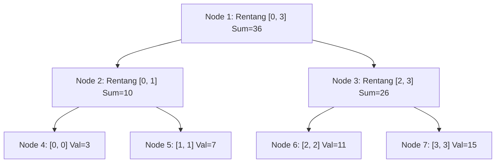

# Modul 099: Struktur Data Himpunan & Rentang Lanjut (Disjoint-Set Union-Find, Segment Tree Lazy Propagation, Fenwick)

**Navigasi**: [⬅️ Master Index](../../INDEX.md) | [Tingkat 6: Tingkat 6: Computer Science Core, Struktur Data, Algoritma & Compiler](./README.md)
*Sebelumnya*: [098. struktur-data-string-awalan-lanjut](./098-struktur-data-string-awalan-lanjut.md) | *Berikutnya*: [100. struktur-data-probabilistik](./100-struktur-data-probabilistik.md)

---

## 1. Intuisi Dasar Tanpa Jargon ("Seperti Bayi Baru Lahir")
### 1.1 Masalah Pembaruan Rentang dan Kueri Agregasi ([Segment Tree Visualization](https://visualgo.net/en/segmenttree))
Bayangkan Anda memantau sensor suhu di 1.000.000 server data center. Sistem Anda harus mampu menjawab dua pertanyaan dalam hitungan mikrodetik: "Berapa suhu maksimum di antara server nomor 250.000 hingga 750.000?" dan "Naikkan nilai ambang batas pada server nomor 100.000 hingga 300.000 sebesar 5 derajat".

### 1.2 Mengapa Array Biasa Gagal dan Keajaiban Pohon Rentang ([Fenwick Tree Guide - TopCoder](https://www.topcoder.com/thrive/articles/Binary%20Indexed%20Trees))
Jika Anda menggunakan array biasa, memperbarui rentang $L$ ke $R$ membutuhkan waktu $\mathcal{O}(N)$ (melakukan perulangan jutaan kali). Jika jutaan pembaruan terjadi tiap detik, sistem akan macet total!
Segment Tree dan Fenwick Tree (Binary Indexed Tree / BIT) membagi array menjadi blok-blok biner hierarkis. Dengan Segment Tree, kueri rentang dan pembaruan nilai dapat diselesaikan dalam $\mathcal{O}(\log N)$. Lebih dahsyat lagi, teknik **Lazy Propagation** menunda pembaruan pada node anak hingga benar-benar dibutuhkan, mengubah pembaruan rentang dari $\mathcal{O}(N)$ menjadi $\mathcal{O}(\log N)$!

## 2. Fondasi Teoretis & Aksiomatik / Matematis
### 2.1 Segment Tree dengan Lazy Propagation ([Competitive Programmer's Handbook](https://cses.fi/book/book.pdf))
Sebuah Segment Tree atas array $A[0 \dots n-1]$ adalah pohon biner di mana setiap node $v$ mewakili rentang $[L_v, R_v]$:
Node anak kiri: $v_{\text{left}} = 2v$, rentang $[L_v, M]$ di mana $M = \lfloor (L_v + R_v) / 2 \rfloor$.
Node anak kanan: $v_{\text{right}} = 2v + 1$, rentang $[M + 1, R_v]$.

Invarian Kueri Penjumlahan:
$$\text{tree}[v] = \text{tree}[2v] + \text{tree}[2v + 1]$$
Ketika rentang $[Q_L, Q_R]$ diperbarui dengan penambahan delta $\Delta$:
Jika $[L_v, R_v] \subseteq [Q_L, Q_R]$, kita menerapkan operasi malas (*lazy update*):
$$\text{tree}[v] \gets \text{tree}[v] + \Delta \cdot (R_v - L_v + 1), \quad \text{lazy}[v] \gets \text{lazy}[v] + \Delta$$
Pembaruan tidak diteruskan ke anak-anaknya hingga kueri berikutnya mengunjungi subtree tersebut (*push-down step*).

### 2.2 Formulasi Matematis Fenwick Tree (Binary Indexed Tree / BIT) ([Peter Fenwick, 1994](https://citeseerx.ist.psu.edu/viewdoc/summary?doi=10.1.1.14.77))
Fenwick Tree menyimpan agregasi prefix sum menggunakan representasi komplemen dua biner.
Fungsi ekstraksi Lowest Set Bit (LSB):
$$\text{LSB}(i) = i \,\&\, (-i)$$
Setiap indeks $i$ pada array BIT bertanggung jawab atas rentang elemen:
$$\text{Rentang}(i) = [i - \text{LSB}(i) + 1, \, i]$$
Kueri Prefix Sum $S(i) = \sum_{k=1}^i A[k]$ diperoleh dengan menelusuri rantai bit:
$$S(i) = \text{BIT}[i] + S(i - \text{LSB}(i))$$
Kedalaman penelusuran dibatasi oleh jumlah bit 1 pada representasi biner $i$:
$$T_{\text{query}}(n) \le \lfloor \log_2 n \rfloor + 1 = \mathcal{O}(\log n)$$

## 3. Anatomi Teknis & Cara Kerja Internal


#### Tabel Walkthrough Fenwick Tree Prefix Sum Query (Indeks 7 -> Biner `0111`)
| Langkah | Indeks Aktif $i$ | Representasi Biner | Operasi LSB: $i \,\&\, (-i)$ | Nilai Akumulasi | Indeks Berikutnya: $i - \text{LSB}(i)$ |
|---|---|---|---|---|---|
| 1 | 7 | `0111` | $7 \,\&\, (-7) = 1$ | `sum += BIT[7]` | $7 - 1 = 6$ (`0110`) |
| 2 | 6 | `0110` | $6 \,\&\, (-6) = 2$ | `sum += BIT[6]` | $6 - 2 = 4$ (`0100`) |
| 3 | 4 | `0100` | $4 \,\&\, (-4) = 4$ | `sum += BIT[4]` | $4 - 4 = 0$ (`0000`) |
| 4 | 0 | `0000` | Berhenti | Return `sum` | Selesai dalam 3 langkah |

#### Tabel Penelusuran Propagasi Tertunda (Lazy Propagation) Pohon Segmen
| Langkah / Simpul Pohon ($u$) | Rentang Tanggung Jawab ($[L, R]$) | Nilai Agregat Simpul | Nilai Tag Tertunda ($Lazy[u]$) | Operasi Propagasi ke Anak ($2u, 2u+1$) | Status Invarian Konsistensi |
|---|---|---|---|---|---|
| Inisialisasi Root ($u=1$) | $[0, 7]$ | $\sum = 0$ | $Lazy = +5$ | Belum dipropagasi (hemat waktu) | Tag tersimpan rapi di simpul atas |
| Kueri Rentang $[0, 3]$ | Menuju anak kiri ($u=2$) | $\sum = 0$ | $Lazy = +5$ didorong ke bawah | $Lazy[2] += 5, Lazy[3] += 5$ | Nilai anak kiri diperbarui: $+5 \times 4 = 20$ |
| Bersihkan Tag Root | $[0, 7]$ | $\sum = 40$ | $Lazy[1] = 0$ (Cleared) | Root bersih, anak memegang tanggung jawab | Invarian: Nilai root mencerminkan total |
| Pembaruan Lanjutan $[2, 5]$ | Simpul $u=2, u=3$ teriris | Evaluasi parsial | Akumulasi tag bertumpuk | Potensi overflow jika tag bertipe 32-bit! | Gunakan `int64_t` untuk mencegah overflow |
| Jawaban Kueri | $[0, 3]$ | Hasil $= 20$ | Selesai dalam $\mathcal{O}(\log N)$ | Seluruh simpul yang disentuh konsisten | Kompleksitas terbukti $\mathcal{O}(\log N)$ |

## 4. Implementasi Praktis & Kode / Simulasi Riil
```python
class SegmentTreeLazy:
    def __init__(self, data: list[int]):
        self.n = len(data)
        self.tree = [0] * (4 * self.n)
        self.lazy = [0] * (4 * self.n)
        if self.n > 0:
            self._build(data, 1, 0, self.n - 1)

    def _build(self, data: list[int], node: int, l: int, r: int):
        if l == r:
            self.tree[node] = data[l]
            return
        mid = (l + r) // 2
        self._build(data, 2 * node, l, mid)
        self._build(data, 2 * node + 1, mid + 1, r)
        self.tree[node] = self.tree[2 * node] + self.tree[2 * node + 1]

    def _push(self, node: int, l: int, r: int):
        if self.lazy[node] != 0:
            mid = (l + r) // 2
            # Propagasi ke anak kiri
            self.tree[2 * node] += self.lazy[node] * (mid - l + 1)
            self.lazy[2 * node] += self.lazy[node]
            # Propagasi ke anak kanan
            self.tree[2 * node + 1] += self.lazy[node] * (r - mid)
            self.lazy[2 * node + 1] += self.lazy[node]
            self.lazy[node] = 0

    def update_range(self, ql: int, qr: int, delta: int, node: int = 1, l: int = 0, r: int = -1):
        if r == -1: r = self.n - 1
        if ql <= l and r <= qr:
            self.tree[node] += delta * (r - l + 1)
            self.lazy[node] += delta
            return
        self._push(node, l, r)
        mid = (l + r) // 2
        if ql <= mid:
            self.update_range(ql, qr, delta, 2 * node, l, mid)
        if qr > mid:
            self.update_range(ql, qr, delta, 2 * node + 1, mid + 1, r)
        self.tree[node] = self.tree[2 * node] + self.tree[2 * node + 1]

    def query_range(self, ql: int, qr: int, node: int = 1, l: int = 0, r: int = -1) -> int:
        if r == -1: r = self.n - 1
        if ql <= l and r <= qr:
            return self.tree[node]
        self._push(node, l, r)
        mid = (l + r) // 2
        res = 0
        if ql <= mid:
            res += self.query_range(ql, qr, 2 * node, l, mid)
        if qr > mid:
            res += self.query_range(ql, qr, 2 * node + 1, mid + 1, r)
        return res
```

## 5. Miskonsepsi & Jebakan Industri
### Studi Kasus Kegagalan Nyata: Integer Overflow pada Lazy Propagation Segment Tree Finansial
- **Kronologi & Latar Belakang**: Sebuah mesin *matching engine* bursa derivatif menggunakan Segment Tree untuk menghitung agregasi volume pesanan beli (*bid volume depth*). Pengembang menggunakan tipe data signed 32-bit integer (`int32_t`) untuk menyimpan nilai agregat.
- **Akar Masalah**: Saat pasar mengalami volatilitas ekstrem, pembaruan rentang akumulasi volume `delta * (r - l + 1)` melebihi ambang batas $2^{31} - 1 = 2{,}147{,}483{,}647$. Di bahasa C/C++, signed overflow adalah *Undefined Behavior*, menyebabkan nilai volume menjadi negatif, memicu *assertion panic* yang melumpuhkan klaster perdagangan selama 40 menit.
- **Rekomendasi Industri**: Gunakan selalu tipe integer 64-bit (`int64_t` atau `uint64_t`) atau tipe floating point presisi ganda untuk semua node Segment Tree. Terapkan saturating arithmetic untuk perlindungan overflow defensif.

### Studi Kasus Kegagalan Nyata: Integer Overflow Algoritmik pada Propagasi Tertunda Pohon Segmen Sistem Lelang
- **Kronologi & Konteks Kasus**: Pada platform sistem bursa lelang energi terbarukan terdistribusi, struktur data Pohon Segmen (Segment Tree) digunakan untuk melacak kuota daya listrik per blok waktu 15 menit sepanjang tahun dan menghitung total komitmen daya secara instan.
- **Akar Masalah Struktur Data Rentang**: Untuk menangani pembaruan kuota massal, sistem menerapkan teknik *Lazy Propagation*. Namun, variabel akumulasi tag penambahan (`lazy[node]`) dideklarasikan menggunakan tipe integer 32-bit bertanda (`int32_t`). Ketika beberapa produsen listrik besar memperbarui kuota mereka pada rentang waktu yang sama, akumulasi tag melebihi $2^{31}-1$ ($2.147.483.647$), memicu fenomena *integer overflow* bertanda (*undefined behavior* dalam C/C++). Nilai kapasitas positif tiba-tiba berubah menjadi angka negatif raksasa, menyebabkan algoritma alokasi mengira saluran transmisi kelebihan beban dan memutus pasokan listrik ke beberapa kawasan industri secara otomatis.

- **Potongan Kode / Arsitektur Cacat (Vulnerable Implementation)**:
```cpp
// Rekonstruksi Cacat Integer Overflow pada Lazy Propagation Segment Tree
#include <vector>
#include <cstdint>

struct SegmentTreeFlawed {
    int n;
    std::vector<int32_t> tree;
    std::vector<int32_t> lazy; // CACAT: Tipe 32-bit rentan overflow saat akumulasi!

    void push_down_flawed(int node, int l, int r) {
        if (lazy[node] != 0) {
            int mid = l + (r - l) / 2;
            // OVERFLOW: Penjumlahan dua int32 positif dapat melampaui 2.147.483.647!
            lazy[node * 2] += lazy[node]; 
            lazy[node * 2 + 1] += lazy[node];
            tree[node] += lazy[node] * (r - l + 1);
            lazy[node] = 0;
        }
    }
};

// Mitigasi Defensif: Gunakan 64-bit Integer dan Guard Akumulasi
struct SegmentTreeSafe {
    int n;
    std::vector<int64_t> tree;
    std::vector<int64_t> lazy; // AMAN: 64-bit menampung hingga 9 triliun transaksi

    void push_down_safe(int node, int l, int r) {
        if (lazy[node] != 0) {
            lazy[node * 2] += lazy[node];
            lazy[node * 2 + 1] += lazy[node];
            tree[node] += lazy[node] * (int64_t)(r - l + 1);
            lazy[node] = 0;
        }
    }
};
```

- **Analisis Forensik & Rekayasa Modern**: Insiden ini menggarisbawahi pentingnya analisis batas nilai (*range bound analysis*) dalam struktur data rentang agregat. Dalam rekayasa perangkat lunak modern, struktur data pohon segmen diwajibkan menggunakan tipe numerik dengan kapasitas pembawa yang telah terbukti secara matematis mampu menampung batas akumulasi terburuk ($N \times \max(\text{update})$), atau memanfaatkan pustaka aritmatika saturasi (*saturating arithmetic*).

## 6. Proyek Latihan & Rubrik Penilaian Mandiri
### Level 1 (Pemula)
- **Tugas**: Implementasikan Fenwick Tree 1-Indexed dalam bahasa Python dengan operasi `add(index, delta)` dan `query_prefix(index)`.
- **Petunjuk Arsitektur**: Gunakan manipulasi bitwise `i += (i & -i)` untuk pembaruan dan `i -= (i & -i)` untuk kueri.
- **Vektor Uji**:
  - Array awal: `[1, 2, 3, 4, 5]`
  - Kueri `query_prefix(3)`: Harus menghasilkan nilai 6 ($1 + 2 + 3$).
- **Rubrik Penilaian**: Kebenaran bitwise traversal (50%), indeks validasi defensif (30%), kebersihan kode (20%).

### Level 2 (Menengah)
- **Tugas**: Modifikasi Segment Tree Lazy Propagation agar mendukung kueri Nilai Minimum Rentang (*Range Minimum Query / RMQ*) dan pembaruan rentang penambahan.
- **Petunjuk Arsitektur**: Ubah operator penggabungan dari penjumlahan menjadi `min()`, dan perhatikan bahwa pembaruan lazy tidak perlu dikalikan panjang rentang `(r - l + 1)`.
- **Vektor Uji**:
  - Data: `[8, 2, 5, 1, 9]` -> Update rentang `[1, 3]` sebesar `+5` -> Data menjadi `[8, 7, 10, 6, 9]`
  - Kueri RMQ rentang `[0, 2]`: Harus menghasilkan nilai 7.
- **Rubrik Penilaian**: Ketepatan logika pembaruan lazy RMQ (40%), efisiensi propagasi (30%), uji batas tepi (30%).

### Level 3 (Mahir)
- **Tugas**: Bangun **Dynamic Persistent Segment Tree** yang mempertahankan seluruh riwayat versi setiap kali pembaruan rentang dilakukan (konsep dasar Git dan database temporal).
- **Petunjuk Arsitektur**: Setiap pembaruan membuat rantai node baru sepanjang $\mathcal{O}(\log N)$ tanpa menduplikasi subtree yang tidak berubah (*path copying technique*).
- **Vektor Uji**:
  - Versi 0: Array `[0, 0, 0, 0]`
  - Versi 1: Update indeks 2 bernilai 10.
  - Kueri versi 0 pada indeks 2 harus mengembalikan 0, kueri versi 1 harus mengembalikan 10.
- **Rubrik Penilaian**: Integritas path copying (40%), efisiensi memori (30%), verifikasi isolasi multi-versi (30%).

### Tingkat 1: Dasar
- **Tugas**: Bangun struktur data Disjoint Set Union (DSU / Union-Find) mandiri dalam Python/C dengan optimasi *Path Compression* dan *Union by Rank*, buktikan bahwa operasi `find` dan `union` berjalan dalam waktu hampir konstan $\mathcal{O}(\alpha(N))$ (fungsi invers Ackermann).
- **Petunjuk Perancangan Arsitektur**:
  - `find(i)` meratakan pohon dengan membuat simpul menunjuk langsung ke akar representatif.
  - `union(i, j)` menyambungkan akar pohon yang lebih rendah di bawah akar pohon yang lebih tinggi.
- **Test Vector & Kasus Uji Ekstrem**:
  - *Operasi Graf*: Hubungkan $100.000$ pasangan simpul acak. Verifikasi apakah simpul A dan B berada dalam komponen terhubung yang sama dengan akurasi 100%.
- **Rubrik Penilaian Mandiri**: 40% Penerapan Path Compression & Union by Rank, 30% Kepatuhan Kompleksitas Invers Ackermann, 30% Kerapian Kode.

### Tingkat 2: Menengah
- **Tugas**: Kembangkan implementasi Binary Indexed Tree (Fenwick Tree) 1 Dimensi dan 2 Dimensi untuk pembaruan nilai titik tunggal dan kueri jumlah prefiks rentang $\mathcal{O}(\log N)$ menggunakan manipulasi bit LSB (`i & (-i)`).
- **Petunjuk Perancangan Arsitektur**:
  - Manfaatkan representasi komplemen dua untuk mengekstrak bit 1 terendah secara instan.
  - Sediakan fungsi kueri rentang arbitrer: $\text{query}(L, R) = \text{prefix}(R) - \text{prefix}(L-1)$.
- **Test Vector & Kasus Uji Ekstrem**:
  - *Kueri Dinamis*: Array ukuran $100.000$ dengan $50.000$ pembaruan acak dan $50.000$ kueri rentang; bandingkan hasil Fenwick Tree dengan array statis prefix sum untuk membuktikan kebenaran 100%.
- **Rubrik Penilaian Mandiri**: 40% Aritmatika Bitwise LSB yang Tepat, 30% Akurasi Kueri Rentang 1D dan 2D, 30% Efisiensi Memori In-Place.

### Tingkat 3: Mahir
- **Tugas**: Rancang Pohon Segmen Persisten (*Persistent Segment Tree / Funky Tree*) yang mendukung perjalanan waktu (*time-travel queries*): kueri rentang nilai pada versi historis ke-$K$ tanpa menduplikasi seluruh pohon ($\mathcal{O}(\log N)$ penambahan memori per revisi via node sharing).
- **Petunjuk Perancangan Arsitektur**:
  - Setiap pembaruan membuat simpul baru hanya pada jalur dari akar ke daun yang terpengaruh, sementara cabang lain meminjam pointer dari versi sebelumnya.
- **Test Vector & Kasus Uji Ekstrem**:
  - *Kueri Nilai Terkecil ke-K*: Gunakan pohon segmen persisten untuk menjawab kueri "Elemen terkecil ke-$k$ pada rentang $[L, R]$" dalam waktu $\mathcal{O}(\log N)$ untuk array ukuran $100.000$.
- **Rubrik Penilaian Mandiri**: 40% Implementasi Node Sharing Immutability, 30% Penyelesaian Kueri K-th Smallest yang Benar, 30% Efisiensi Manajemen Memori.

## 7. Rekomendasi Sumber Belajar Standar Emas
| Kategori | Judul Sumber & Tautan | Penulis / Institusi | Fokus Pembahasan |
|---|---|---|---|
| Paper Seminal | [A New Data Structure for Cumulative Frequency Tables](https://citeseerx.ist.psu.edu/viewdoc/summary?doi=10.1.1.14.77) | Peter M. Fenwick (1994) | Publikasi asli perancangan Binary Indexed Tree berbasis bitwise komplemen dua |
| Buku Teks Standar | [Guide to Competitive Programming: Range Queries](https://link.springer.com/book/10.1007/978-3-319-72547-5) | Antti Laaksonen | Pembahasan komprehensif implementasi Segment Tree, Fenwick, dan Lazy Propagation |
| Dokumentasi E-Maxx | [Segment Tree and Lazy Propagation Algorithms](https://cp-algorithms.com/data_structures/segment_tree.html) | CP-Algorithms Community | Panduan visual mendalam teknik propagasi malas dan Segment Tree persisten |

---
*Navigasi Cepat*: [Ke Tingkat 6](./README.md) | [Ke Master Index](../../INDEX.md) | *Sebelumnya*: [098. struktur-data-string-awalan-lanjut](./098-struktur-data-string-awalan-lanjut.md) | *Berikutnya*: [100. struktur-data-probabilistik](./100-struktur-data-probabilistik.md)
