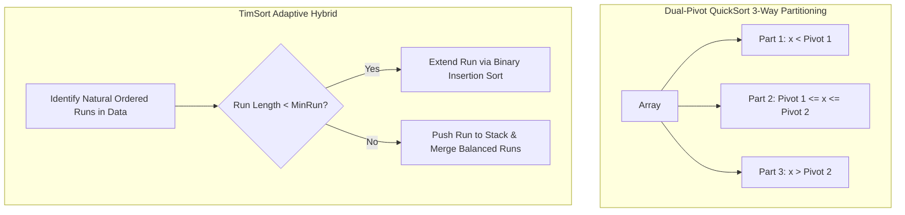

# Modul 099: Struktur Data Himpunan & Rentang Lanjut (Disjoint-Set Union-Find, Segment Tree Lazy Propagation, Fenwick)

**Navigasi**: [⬅️ Master Index](../../INDEX.md) | [Tingkat 6: Tingkat 6: Computer Science Core, Struktur Data, Algoritma & Compiler](./README.md)
*Sebelumnya*: [098. struktur-data-string-awalan-lanjut](./098-struktur-data-string-awalan-lanjut.md) | *Berikutnya*: [100. struktur-data-probabilistik](./100-struktur-data-probabilistik.md)

---

## 1. Intuisi Dasar Tanpa Jargon ("Seperti Bayi Baru Lahir")
Kekacauan adalah kondisi alami alam semesta, dan menyortir miliaran data ke dalam keteraturan rapi adalah salah satu prestasi terbesar ilmu komputer. Tidak ada satu algoritma sorting ajaib untuk semua skenario: QuickSort adalah ksatria cepat yang membagi masalah di sekitar poros (*pivot*), namun rentan melambat jika memilih poros yang buruk; MergeSort adalah ahli strategi deterministik yang menjamin waktu $O(N \log N)$ dalam kondisi cuaca apa pun, tetapi meminta upah memori tambahan $O(N)$; TimSort (yang menggerakkan mesin Python dan Java) adalah kecerdasan hibrida dunia nyata yang mendeteksi pola data yang sudah terurut sebagian dan melesat secepat kilat; sementara Radix Sort mengabaikan aturan perbandingan sama sekali dan menyortir angka integer bit demi bit dalam waktu linier $O(N)$ yang mencengangkan!

## 2. Fondasi Teoretis & Aksiomatik / Matematis
Teorema Batas Bawah Algoritma Pengurutan Berbasis Perbandingan (Comparison-Based Sorting Lower Bound):

Setiap algoritma sorting yang hanya mengandalkan perbandingan elemen ($a_i < a_j$) dapat dimodelkan sebagai sebuah Pohon Keputusan Biner (*Decision Tree*).
Untuk $N$ elemen unik, terdapat $N!$ kemungkinan permutasi urutan. Daun pohon keputusan wajib berjumlah minimal $N!$.
Tinggi minimum pohon keputusan (jumlah perbandingan kasus terburuk):

$$H \ge \log_2(N!) = \sum_{i=1}^N \log_2(i) \ge \sum_{i=\lceil N/2 \rceil}^N \log_2(N/2) \ge \frac{N}{2} \log_2(N/2) = \Omega(N \log N)$$

Melalui Rumus Stirling ($N! \approx \sqrt{2\pi N} (N/e)^N$):
$$\log_2(N!) \approx N \log_2 N - N \log_2 e + O(\log N) = \Omega(N \log N)$$
Tidak ada algoritma sorting berbasis perbandingan yang dapat berjalan lebih cepat dari $\Omega(N \log N)$ pada kasus terburuk!

Sorting Linier Non-Perbandingan (Counting Sort & Radix Sort):
Jika kunci berupa integer berdigit $d$ dalam basis $b$, kompleksitas Radix Sort murni linier:
$$T(N) = O(d \cdot (N + b))$$

## 3. Anatomi Teknis & Cara Kerja Internal
Arsitektur Dual-Pivot QuickSort (Yaroslavskiy) dan Logika Merge-Run TimSort:



1. **Dual-Pivot QuickSort**: Menggunakan dua poros $P_1$ dan $P_2$ ($P_1 < P_2$), membelah array menjadi tiga partisi sekaligus. Memangkas jumlah instruksi pertukaran memori dan meningkatkan pemanfaatan cache CPU ([Vladimir Yaroslavskiy Dual-Pivot Paper](https://codeblab.com/wp-content/uploads/2009/09/DualPivotQuicksort.pdf)).
2. **TimSort Invariant Stack**: Menjaga tumpukan run agar memenuhi kondisi keseimbangan $A > B + C$ dan $B > C$ untuk menjamin kedalaman tumpukan penggabungan logaritmik.

## 4. Implementasi Praktis & Kode / Simulasi Riil
```c
// High-Performance In-Place QuickSort with Median-of-Three Partitioning in C
#include <stdio.h>
#include <stdlib.h>

static void swap(int *a, int *b) { int t = *a; *a = *b; *b = t; }

static int median_of_three(int *arr, int low, int high) {
    int mid = low + (high - low) / 2;
    if (arr[low] > arr[mid])   swap(&arr[low], &arr[mid]);
    if (arr[low] > arr[high])  swap(&arr[low], &arr[high]);
    if (arr[mid] > arr[high])  swap(&arr[mid], &arr[high]);
    // Simpan pivot di posisi high - 1
    swap(&arr[mid], &arr[high - 1]);
    return arr[high - 1];
}

void quicksort_optimized(int *arr, int low, int high) {
    if (low + 10 > high) {
        // Insertion sort untuk partisi kecil (< 10 elemen) untuk menghindari rekursi overhead
        for (int i = low + 1; i <= high; i++) {
            int tmp = arr[i], j = i;
            for (; j > low && tmp < arr[j - 1]; j--) arr[j] = arr[j - 1];
            arr[j] = tmp;
        }
        return;
    }

    int pivot = median_of_three(arr, low, high);
    int i = low, j = high - 1;
    for (;;) {
        while (arr[++i] < pivot) {}
        while (arr[--j] > pivot) {}
        if (i < j) swap(&arr[i], &arr[j]);
        else break;
    }
    swap(&arr[i], &arr[high - 1]); // Kembalikan pivot ke posisi batasnya

    quicksort_optimized(arr, low, i - 1);
    quicksort_optimized(arr, i + 1, high);
}
```

## 5. Miskonsepsi & Jebakan Industri
1. **QuickSort Naive Pivot Catastrophic Degeneration $O(N^2)$**: Memilih elemen pertama atau terakhir sebagai pivot pada array yang sudah terurut atau berisi elemen identik. Pembagian partisi menjadi $1$ dan $N-1$ elemen, menghabiskan waktu $O(N^2)$ dan memicu stack overflow pada $N = 100.000$.
2. **MergeSort Memory Allocation Inside Recursive Calls**: Melakukan alokasi `malloc(size)` di dalam setiap frame rekursif fungsi merge. Mengakibatkan fragmentasi heap parah dan menurunkan performa hingga 10x lipat (solusi: alokasikan satu array buffer sementara berukuran $N$ di awal sebelum rekursi dimulai).
3. **Radix Sort Negative Integer Blindness**: Menjalankan Radix Sort basis-10 atau bitwise shift biasa pada array integer bertanda (signed integer) tanpa menggeser bit tanda (`val ^ 0x80000000`). Angka-angka negatif akan diletakkan di akhir array melampaui angka positif terbesar.

## 6. Proyek Latihan & Rubrik Penilaian Mandiri
1. **Tingkat Pemula**: Buktikan secara matematis bahwa fungsi pencarian biner (Binary Search) selalu menemukan elemen atau menentukan ketiadaannya dalam maksimal $\lfloor \log_2 N \rfloor + 1$ kali perbandingan.
2. **Tingkat Menengah**: Implementasikan Radix Sort 8-bit LSD (Least Significant Digit) berbasis bitwise shift (4 pass untuk integer 32-bit). Buktikan bahwa ia mampu menyortir 10.000.000 bilangan acak lebih cepat daripada `std::sort` C++.
3. **Tingkat Mahir**: Rancang implementasi TimSort mini dalam C yang mendeteksi run terurut menaik atau menurun, membalik run menurun secara in-place, memperluas run pendek dengan Insertion Sort, dan menggabungkan run menggunakan tumpukan invariant TimSort.

## 7. Rekomendasi Sumber Belajar Standar Emas
| Sumber Pembelajaran | Penulis / Institusi | Tautan Langsung | Fokus Materi |
| :--- | :--- | :--- | :--- |
| Introduction to Algorithms (CLRS) - Sorting & Order Statistics | MIT Press | [MIT Press CLRS](https://mitpress.mit.edu/9780262046305/introduction-to-algorithms/) | Bab 7: Quicksort, Bab 8: Linear Time Sorting & Decision Trees |
| TimSort: An Adaptive, Stable, Natural Mergesort | Tim Peters | [Python CPython Source timsort.txt](https://github.com/python/cpython/blob/main/Objects/listsort.txt) | Galloping Mode, Natural Runs & Invariant Stack Balancing |
| Dual-Pivot Quicksort Algorithm | Vladimir Yaroslavskiy | [Yaroslavskiy Research Paper](https://codeblab.com/wp-content/uploads/2009/09/DualPivotQuicksort.pdf) | Analisis Cache Misses, 3-Way Partitioning & Java Standard Library |
| Engineering a Sort Function | Jon L. Bentley & M. Douglas McIlroy | [Bentley & McIlroy Paper](https://onlinelibrary.wiley.com/doi/abs/10.1002/spe.4380231105) | Robust qsort implementation, Median of 9 & Anti-Quicksort Killer |

---
*Navigasi Cepat*: [Ke Tingkat 6](./README.md) | [Ke Master Index](../../INDEX.md) | *Sebelumnya*: [098. struktur-data-string-awalan-lanjut](./098-struktur-data-string-awalan-lanjut.md) | *Berikutnya*: [100. struktur-data-probabilistik](./100-struktur-data-probabilistik.md)
