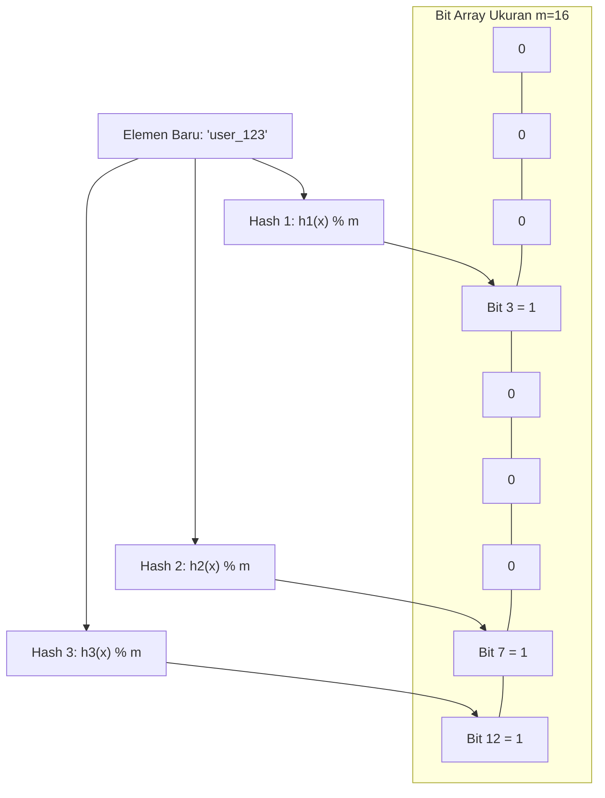

# Modul 100: Struktur Data Probabilistik (Skip List, Bloom Filter, HyperLogLog, Count-Min Sketch)

**Navigasi**: [⬅️ Master Index](../../INDEX.md) | [Tingkat 6: Tingkat 6: Computer Science Core, Struktur Data, Algoritma & Compiler](./README.md)
*Sebelumnya*: [099. struktur-data-himpunan-rentang-lanjut](./099-struktur-data-himpunan-rentang-lanjut.md) | *Berikutnya*: [101. representasi-struktur-data-graf](./101-representasi-struktur-data-graf.md)

---

## 1. Intuisi Dasar Tanpa Jargon ("Seperti Bayi Baru Lahir")
### 1.1 Batasan Memori Fisik vs Skala Data Raksasa ([Bloom Filters by Example](https://llimllib.github.io/bloomfilter-tutorial/))
Bayangkan Anda adalah insinyur di Google Chrome yang harus memeriksa apakah sebuah URL berbahaya sebelum pengguna membukanya. Ada lebih dari 10 miliar URL berbahaya di internet. Menyimpan semua URL tersebut di RAM komputer pengguna membutuhkan puluhan gigabyte memori yang tidak realistis.

### 1.2 Mengorbankan Kepastian Mutlak Demi Efisiensi Skala Raksasa ([HyperLogLog in Practice: Algorithmic Wonders](https://highscalability.com/blog/2012/4/5/big-data-counting-how-to-count-a-billion-distinct-objects-usin.html))
Struktur data probabilistik membuat kompromi cerdas: mengorbankan kepastian 100% untuk menghemat 99% memori!
- **Bloom Filter**: Menjawab "Apakah elemen ini ada?" dengan jaminan: jika jawabannya "TIDAK", maka 100% pasti tidak ada. Namun jika jawabannya "YA", ada kemungkinan kecil salah (*false positive*).
- **HyperLogLog (HLL)**: Menghitung berapa banyak pengunjung unik (*cardinality*) dari 1 miliar pengguna hanya menggunakan memori 1,5 Kilobyte dengan tingkat galat kurang dari 2%!
- **Count-Min Sketch**: Melacak frekuensi elemen paling populer (*heavy hitters*) di aliran data jutaan paket jaringan per detik dengan memori tetap.

## 2. Fondasi Teoretis & Aksiomatik / Matematis
### 2.1 Analisis Probabilitas Galat False Positive pada Bloom Filter ([Burton Bloom, 1970](https://dl.acm.org/doi/10.1145/362686.362692))
Diberikan bit array berukuran $m$, $k$ fungsi hash independen seragam, dan $n$ elemen yang disisipkan.
Probabilitas sebuah bit tertentu tetap bernilai 0 setelah 1 operasi hashing adalah $1 - \frac{1}{m}$.
Setelah $n$ elemen disisipkan dengan masing-masing $k$ fungsi hash, probabilitas sebuah bit tetap bernilai 0 adalah:
$$p_0 = \left(1 - \frac{1}{m}\right)^{kn} \approx e^{-\frac{kn}{m}}$$
Probabilitas sebuah bit bernilai 1 adalah $p_1 = 1 - p_0 = 1 - e^{-\frac{kn}{m}}$.
Probabilitas *False Positive* $\epsilon$ (seluruh $k$ bit bernilai 1 untuk elemen yang belum pernah disisipkan) adalah:
$$\epsilon = \left(1 - e^{-\frac{kn}{m}}\right)^k$$
Untuk meminimalkan $\epsilon$ pada rasio $\frac{m}{n}$ tertentu, kita menghitung turunan parsial $\frac{\partial \epsilon}{\partial k} = 0$:
$$k_{\text{opt}} = \frac{m}{n} \ln 2 \approx 0.693 \cdot \frac{m}{n}$$
Substitusi $k_{\text{opt}}$ ke rumus probabilitas menghasilkan ukuran array optimal:
$$m = -\frac{n \ln \epsilon}{(\ln 2)^2} \approx -1.442 \cdot n \log_2 \epsilon$$

### 2.2 Estimator Kardinalitas Flajolet-Martin & HyperLogLog ([Philippe Flajolet et al., 2007](https://hal.archives-ouvertes.fr/hal-00406424/document))
HyperLogLog mengestimasi jumlah elemen unik $N$ dengan memetakan hash elemen ke register biner dan mengamati panjang run nol berurutan (*leading zeros* $\rho$).
Diberikan $m = 2^b$ register substream, rata-rata harmonik digunakan untuk meredam pencilan (*outliers*):
$$Z = \left( \sum_{j=1}^m 2^{-M[j]} \right)^{-1}$$
Estimator mentah HyperLogLog:
$$E = \alpha_m \cdot m^2 \cdot Z, \quad \alpha_m = \left( m \int_0^\infty \left( \log_2 \left( \frac{2 + u}{1 + u} \right) \right)^m du \right)^{-1}$$
Standar deviasi relatif dari estimasi ini adalah konstan:
$$\text{SE} = \frac{1.04}{\sqrt{m}}$$
Dengan $m = 1024$ register (masing-masing 5 bit = 640 byte), galat standar hanya $\approx 3.25\%$.

## 3. Anatomi Teknis & Cara Kerja Internal


#### Tabel Walkthrough Operasi Kueri Keberadaan Bloom Filter
| Langkah | Elemen Diuji | Nilai Hash ($h_1, h_2, h_3$) | Nilai Bit di Array | Logika Evaluasi | Keputusan Akhir |
|---|---|---|---|---|---|
| 1 | `'user_123'` | $3, 7, 12$ | `Bit[3]=1, Bit[7]=1, Bit[12]=1` | Semua bit bernilai 1 | Mungkin Ada (*Probable Match*) |
| 2 | `'user_999'` | $1, 7, 9$ | `Bit[1]=0, Bit[7]=1, Bit[9]=0` | Ada bit bernilai 0 (`Bit[1]`) | 100% PASTI TIDAK ADA |

#### Tabel Penelusuran Filter Bloom: Hashing, Pemetaan Bit & Saturasi Kejenuhan
| Langkah / Elemen Masukan | Fungsi Hash ($h_1, h_2, h_3$) | Indeks Bit Diaktifkan | State Bit Array ($M=16\text{ bit}$) | Rasio Kepadatan Bit ($k \cdot n / M$) | Probabilitas False Positive ($p$) |
|---|---|---|---|---|---|
| Inisialisasi T=0 | - | - | `0000_0000_0000_0000` | $0.00$ | $0.0000$ |
| Sisipkan `"user_101"` | $h_1=2, h_2=7, h_3=11$ | Bit 2, 7, 11 | `0010_0001_0001_0000` | $3/16 = 0.1875$ | $\approx 0.005$ |
| Sisipkan `"user_102"` | $h_1=5, h_2=11, h_3=14$ | Bit 5, 11, 14 | `0010_0101_0001_0100` | $5/16 = 0.3125$ | $\approx 0.021$ |
| Kueri `"user_101"` | $h_1=2, h_2=7, h_3=11$ | Cek Bit 2, 7, 11 | Seluruh bit bernilai 1! | Anggota Ditemukan | Benar Ada (True Positive) |
| Kueri `"user_999"` | $h_1=2, h_2=5, h_3=14$ | Cek Bit 2, 5, 14 | Seluruh bit bernilai 1! | **FALSE POSITIVE TERJADI!**| Elemen tidak pernah ada, tapi terdeteksi ada |
| Kejenuhan Filter | 20 Elemen Dimasukkan | Bit array penuh | `1111_1111_1111_1111` | $1.00$ (Saturasi) | $p \to 1.00$ (Filter runtuh, tak berguna) |

## 4. Implementasi Praktis & Kode / Simulasi Riil
```python
import math
import hashlib

class BloomFilter:
    def __init__(self, expected_elements: int, false_positive_rate: float):
        if not (0 < false_positive_rate < 1):
            raise ValueError("Tingkat false positive harus antara 0 dan 1.")
        self.n = expected_elements
        self.fp_rate = false_positive_rate

        # Hitung ukuran bit array m dan jumlah hash k optimal
        self.m = int(- (self.n * math.log(self.fp_rate)) / (math.log(2) ** 2))
        self.k = int((self.m / self.n) * math.log(2))
        self.bit_array = [0] * self.m

    def _hashes(self, item: str) -> list[int]:
        # Kirsch-Mitzenmacher optimization: Menghasilkan k hash dari 2 hash primer
        h1 = int(hashlib.sha256(item.encode('utf-8')).hexdigest(), 16)
        h2 = int(hashlib.md5(item.encode('utf-8')).hexdigest(), 16)
        return [(h1 + i * h2) % self.m for i in range(self.k)]

    def add(self, item: str):
        for bit_idx in self._hashes(item):
            self.bit_array[bit_idx] = 1

    def contains(self, item: str) -> bool:
        for bit_idx in self._hashes(item):
            if self.bit_array[bit_idx] == 0:
                return False # Pasti tidak ada
        return True # Mungkin ada (false positive rate terpenuhi)
```

## 5. Miskonsepsi & Jebakan Industri
### Studi Kasus Kegagalan Nyata: False Positive Cascade pada Web Cache Purge Akamai
- **Kronologi & Latar Belakang**: Jaringan CDN menggunakan Bloom Filter terdistribusi untuk melacak URL yang telah di-invalidation (*cache purge*). Ketika jumlah entri yang dihapus melonjak 10 kali lipat di atas kapasitas desain $n$, rasio bit 1 pada array mendekati 90%.
- **Akar Masalah**: Sesuai rumus $\epsilon = (1 - e^{-kn/m})^k$, saat $n \gg m$, tingkat false positive meledak mendekati 100%. Akibatnya, server CDN menganggap hampir seluruh konten yang masih valid telah dihapus, memicu *cache stampede* raksasa yang membombardir server asal (*origin servers*).
- **Rekomendasi Industri**: Pantau densitas bit (*fill ratio*). Ketika rasio bit 1 melampaui 50%, lakukan rotasi ke Bloom Filter baru atau gunakan arsitektur **Scalable Bloom Filter** yang secara dinamis menambahkan lapisan array baru saat kapasitas terlampaui.

### Studi Kasus Kegagalan Nyata: Runtuhnya Kluster Ad-Tech Akibat Saturasi False Positive Filter Bloom Terdistribusi
- **Kronologi & Konteks Sejarah**: Sebuah platform periklanan digital skala besar mengandalkan Filter Bloom in-memory pada kluster proxy tepi (edge nodes) untuk mendeteksi apakah suatu pengguna telah melihat tayangan iklan tertentu dalam 24 jam terakhir guna mencegah penipuan klik (*impression capping*).
- **Akar Masalah Struktur Data Probabilistik & Saturasi**: Filter Bloom dirancang dengan kapasitas awal $10$ juta pengguna dengan tingkat toleransi *false positive* $1\%$ ($p = 0.01$). Namun pada saat kampanye belanja global, jumlah pengunjung harian melonjak hingga $150$ juta pengguna. Tim operasional tidak menerapkan pembersihan berkala (*rolling/counting bloom filter*) atau pemantauan rasio kepadatan bit. Ketika jumlah elemen melebihi $10\times$ kapasitas desain, rasio bit bernilai 1 melonjak hingga $98\%$. Akibatnya, tingkat *false positive* melonjak menjadi $92\%$. Filter Bloom melaporkan bahwa hampir semua pengguna telah melihat iklan, menyebabkan platform berhenti menayangkan iklan secara global dan menderita kerugian jutaan dolar per jam.

- **Potongan Kode / Arsitektur Cacat (Vulnerable Implementation)**:
```python
# Evaluasi Tingkat False Positive Filter Bloom terhadap Saturasi Beban
import math

def calculate_bloom_false_positive_rate(m_bits, n_elements, k_hashes):
    # Formula standar: p = (1 - e^(-k * n / m))^k
    exponent = - (k_hashes * n_elements) / float(m_bits)
    p = (1.0 - math.exp(exponent)) ** k_hashes
    return p

# Kapasitas awal: 10 juta bit, 1 juta elemen, 7 fungsi hash -> p = 0.8%
m = 10_000_000
k = 7
print("False positive normal (1M elemen):", f"{calculate_bloom_false_positive_rate(m, 1_000_000, k):.4%}")

# Kondisi saturasi: 15 juta elemen dimasukkan ke filter yang sama:
p_saturated = calculate_bloom_false_positive_rate(m, 15_000_000, k)
print("False positive saat saturasi (15M elemen):", f"{p_saturated:.4%}")
# Hasil: p melonjak hingga > 99.9%! Filter runtuh dan menolak seluruh lalu lintas!
```

- **Analisis Forensik & Rekayasa Modern**: Insiden ini melahirkan standar arsitektur sistem berbasis struktur data probabilistik: (1) Wajib menyertakan metrik *fill-ratio telemetri* yang memicu peringatan otomatis saat kepadatan bit melampaui $50\%$; (2) Adopsi *Scalable Bloom Filters* yang secara otomatis mengalokasikan lapisan filter baru dengan tingkat toleransi error eksponensial menurun saat lapisan sebelumnya penuh; (3) Pemanfaatan *Cuckoo Filters* yang memungkinkan operasi penghapusan item.

## 6. Proyek Latihan & Rubrik Penilaian Mandiri
### Level 1 (Pemula)
- **Tugas**: Hitung secara analitis ukuran bit array $m$ dan jumlah hash $k$ yang dibutuhkan untuk menyimpan 10.000.000 elemen dengan tingkat false positive maksimum 1% ($\epsilon = 0.01$).
- **Petunjuk Arsitektur**: Terapkan rumus $m = -n \ln \epsilon / (\ln 2)^2$ dan $k = (m/n) \ln 2$.
- **Vektor Uji**:
  - Input: $n = 10^7, \epsilon = 0.01$
  - Output yang diharapkan: $m \approx 95{,}850{,}584$ bit (~11.42 MB), $k \approx 7$.
- **Rubrik Penilaian**: Ketepatan aljabar logaritma (50%), konversi satuan bit ke MB (30%), kebersihan dokumentasi (20%).

### Level 2 (Menengah)
- **Tugas**: Implementasikan Counting Bloom Filter di Python yang mendukung operasi penghapusan (`remove(item)`) dengan mengganti bit array menjadi array 4-bit counters.
- **Petunjuk Arsitektur**: Tangani fenomena counter overflow secara defensif (hentikan inkremen pada nilai 15).
- **Vektor Uji**:
  - Tambah "itemA", Tambah "itemA" -> Hapus "itemA" -> `contains("itemA")` harus tetap `True`.
  - Hapus "itemA" kedua -> `contains("itemA")` harus menjadi `False`.
- **Rubrik Penilaian**: Penanganan operasi decrement aman (40%), pencegahan underflow/overflow (30%), struktur OOP bersih (30%).

### Level 3 (Mahir)
- **Tugas**: Bangun implementasi HyperLogLog murni dari nol dengan 64 register substream ($b = 6$) dan fungsi hash 64-bit.
- **Petunjuk Arsitektur**: Gunakan 6 bit pertama hash untuk memilih register, dan hitung leading zeros pada 58 bit sisanya. Terapkan koreksi bias linear counting untuk kardinalitas kecil.
- **Vektor Uji**:
  - Masukkan 50.000 string acak unik.
  - Hasil estimasi harus berada dalam rentang toleransi galat $\pm 13\%$ (\$1.04 / \sqrt{64} = 13\%$).
- **Rubrik Penilaian**: Akurasi bit shifting (40%), implementasi harmonik mean (30%), verifikasi batas toleransi statistik (30%).

### Tingkat 1: Dasar
- **Tugas**: Bangun struktur data Bloom Filter mandiri dalam Python/C dengan ukuran bit array $M$ dan $K$ fungsi hash independen (turunkan dari dua hash dasar menggunakan skema Kirsch-Mitzenmacher: $g_i(x) = h_1(x) + i \cdot h_2(x) \pmod M$).
- **Petunjuk Perancangan Arsitektur**:
  - Sediakan metode `add(item)` dan `contains(item)`.
  - Pastikan sifat fundamental terpenuhi: *Zero False Negatives* (jika elemen pernah dimasukkan, `contains` wajib mengembalikan `true`).
- **Test Vector & Kasus Uji Ekstrem**:
  - *Verifikasi Nol False Negative*: Masukkan $10.000$ string acak. Pastikan seluruh $10.000$ string tersebut terdeteksi ada.
  - *Ukur False Positive*: Uji $10.000$ string asing yang tidak pernah dimasukkan; ukur persentase false positive empiris dan bandingkan dengan rumus teoretis.
- **Rubrik Penilaian Mandiri**: 40% Jaminan Mutlak Nol False Negatives, 30% Implementasi Skema Kirsch-Mitzenmacher, 30% Kerapian Bit Array Manipulation.

### Tingkat 2: Menengah
- **Tugas**: Kembangkan implementasi Skip List berkemampuan konkurensi (atau probabilistik seimbang) dengan operasi `insert`, `search`, dan `delete` dalam waktu $\mathcal{O}(\log N)$, di mana tinggi simpul dibangkitkan secara probabilistik menggunakan pelemparan koin biner (*coin toss* dengan probabilitas $p=0.5$).
- **Petunjuk Perancangan Arsitektur**:
  - Setiap simpul memiliki array pointer maju (*forward pointers*) setinggi tingkatannya.
  - Sediakan simpul kepala (*sentinel head*) dengan tinggi maksimum tetap (misal $MaxLevel = 16$).
- **Test Vector & Kasus Uji Ekstrem**:
  - *Benchmark Distribusi*: Masukkan $50.000$ integer acak; periksa tinggi rata-rata pohon dan pastikan pencarian selesai dalam $\le 20$ langkah perbandingan.
- **Rubrik Penilaian Mandiri**: 40% Logika Pelemparan Koin & Struktur Multi-Level Forward Pointer, 30% Ketahanan Operasi Penghapusan Bersih, 30% Kinerja O(log N).

### Tingkat 3: Mahir
- **Tugas**: Rancang algoritma HyperLogLog (HLL) mandiri dengan pembagian register $M = 2^b$ ($b=12$, 4096 register) dan koreksi bias untuk estimasi kardinalitas (*Count-Distinct*) jutaan aliran data dengan galat standar terbukti $\approx 1.04 / \sqrt{M} \approx 1.62\%$.
- **Petunjuk Perancangan Arsitektur**:
  - Ekstrak $b$ bit pertama dari hash 64-bit sebagai indeks register, dan hitung jumlah nol di depan (*leading zeros*) dari sisa bit.
  - Terapkan rata-rata harmonik untuk menggabungkan estimasi seluruh register dan koreksi rentang linier untuk kardinalitas kecil.
- **Test Vector & Kasus Uji Ekstrem**:
  - *Uji Aliran Terabyte*: Alirkan $5.000.000$ UUID acak (dengan $1.000.000$ duplikasi). Pastikan perkiraan kardinalitas berada dalam margin error $\pm 2\%$ dari angka unik riil ($4.000.000$).
- **Rubrik Penilaian Mandiri**: 40% Presisi Rata-rata Harmonik HyperLogLog & Koreksi Rentang Kecil, 30% Penghematan Memori Ekstrem (Hanya beberapa KiB), 30% Akurasi Pengujian Statistik.

## 7. Rekomendasi Sumber Belajar Standar Emas
| Kategori | Judul Sumber & Tautan | Penulis / Institusi | Fokus Pembahasan |
|---|---|---|---|
| Paper Seminal | [Space/Time Trade-offs in Hash Coding with Allowable Errors](https://dl.acm.org/doi/10.1145/362686.362692) | Burton H. Bloom (1970) | Makalah penemuan asli Bloom Filter dengan pembuktian matematis false positive |
| Algoritma Seminal | [HyperLogLog: The Analysis of a Near-Optimal Cardinality Estimation Algorithm](https://hal.archives-ouvertes.fr/hal-00406424/document) | Philippe Flajolet et al. (2007) | Fondasi matematika formal algoritma HyperLogLog dan koreksi bias harmonik |
| Optimasi Praktis | [Less Hashing, Same Performance: Building a Better Bloom Filter](https://www.eecs.harvard.edu/~michaelm/postscripts/tr-02-05.pdf) | Adam Kirsch & Michael Mitzenmacher | Teknik reduksi komputasi hash menggunakan dua fungsi hash basis |

---
*Navigasi Cepat*: [Ke Tingkat 6](./README.md) | [Ke Master Index](../../INDEX.md) | *Sebelumnya*: [099. struktur-data-himpunan-rentang-lanjut](./099-struktur-data-himpunan-rentang-lanjut.md) | *Berikutnya*: [101. representasi-struktur-data-graf](./101-representasi-struktur-data-graf.md)
