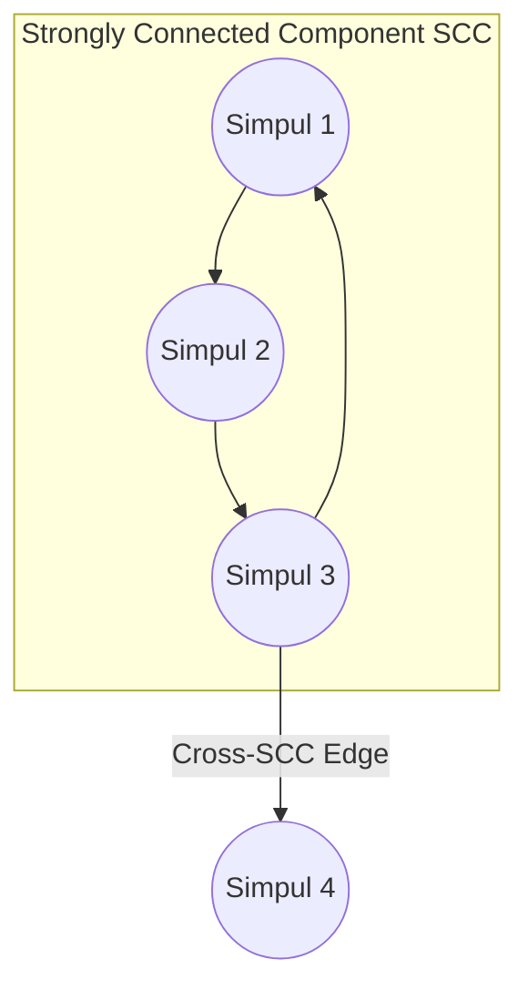

# Modul 100: Struktur Data Probabilistik (Skip List, Bloom Filter, HyperLogLog, Count-Min Sketch)

**Navigasi**: [⬅️ Master Index](../../INDEX.md) | [Tingkat 6: Tingkat 6: Computer Science Core, Struktur Data, Algoritma & Compiler](./README.md)
*Sebelumnya*: [099. struktur-data-himpunan-rentang-lanjut](./099-struktur-data-himpunan-rentang-lanjut.md) | *Berikutnya*: [101. representasi-struktur-data-graf](./101-representasi-struktur-data-graf.md)

---

## 1. Intuisi Dasar Tanpa Jargon ("Seperti Bayi Baru Lahir")
Dunia nyata tidak tersusun dalam garis lurus atau hierarki pohon yang rapi. Hubungan antarkota dalam peta penerbangan dunia, jejaring sosial miliaran pertemanan, urutan ketergantungan paket perangkat lunak Linux, hingga sirkuit jalur pipa air kota—semuanya adalah **Graf (Graph)** ([Graph Theory & Algorithms](https://en.wikipedia.org/wiki/Graph_theory)). Graf terdiri dari simpul-simpul (Vertices) yang dihubungkan oleh jembatan-jembatan (Edges). Menelusuri graf membutuhkan dua paradigma utama: Breadth-First Search (BFS) yang merambat seperti riak air di danau yang tenang (memeriksa semua tetangga terdekat lapis demi lapis, menjamin penemuan rute terpendek tanpa bobot); dan Depth-First Search (DFS) yang melangkah seperti penjelajah labirin bawah tanah yang pemberani (menyelam ke kedalaman terdalam sebelum mundur ke belakang), membuka jalan bagi pengurutan dependensi (Topological Sort) dan identifikasi pulau-pulau komunitas yang saling terhubung erat (Strongly Connected Components).

## 2. Fondasi Teoretis & Aksiomatik / Matematis
Formulasi Graf dan Teorema Klasifikasi Sisi DFS:

Diberikan graf berarah $G = (V, E)$ dengan $|V|$ simpul dan $|E|$ sisi.

Representasi Memori:
- **Adjacency Matrix**: Matriks biner $A_{|V| \times |V|}$ ($O(|V|^2)$ memori, $O(1)$ edge query).
- **Adjacency List**: Array linked-list/vektor tetangga ($O(|V| + |E|)$ memori, optimal untuk sparse graph).

Stempel Waktu DFS (Discovery and Finishing Time Invariant):
Setiap simpul $u$ diberi stempel waktu penemuan $d[u]$ dan waktu selesai $f[u]$.
$$\forall u, v \in V, \quad [d[u], f[u]] \cap [d[v], f[v]] = \emptyset \quad \lor \quad [d[u], f[u]] \subset [d[v], f[v]] \quad (\text{Parenthesis Theorem})$$

Klasifikasi Sisi pada Graf Berarah:
1. **Tree Edge**: Sisi menuju simpul yang belum dikunjungi ($v$ status `WHITE`).
2. **Back Edge**: Sisi menuju simpul leluhur yang masih aktif di recursion stack ($v$ status `GRAY`). **Graf memiliki siklus $\iff$ ditemukan minimal 1 Back Edge!**
3. **Forward Edge**: Sisi menuju keturunan non-anak yang sudah selesai ($v$ status `BLACK`, $d[u] < d[v]$).
4. **Cross Edge**: Sisi antarcabang independen ($v$ status `BLACK`, $d[u] > d[v]$).

Topological Sort pada Directed Acyclic Graph (DAG):
Urutan simpul sedemikian rupa sehingga $\forall (u, v) \in E$, $u$ mendahului $v$. Dihasilkan dari pembalikan urutan finishing time $f[u]$ DFS atau algoritma eliminasi indegree Kahn ($O(|V| + |E|)$).

## 3. Anatomi Teknis & Cara Kerja Internal
Algoritma Tarjan dan Kosaraju untuk Menemukan Strongly Connected Components (SCC):



1. **Algoritma Tarjan SCC**: Memanfaatkan stempel waktu `discovery[u]` dan nilai `lowlink[u]` (indeks simpul terendah yang dapat dicapai melalui jalur keturunan dan paling banyak satu back-edge). Simpul disimpan di stack eksplisit. Ketika `lowlink[u] == discovery[u]`, simpul $u$ adalah akar SCC, dan seluruh anggota komponen di-pop dari stack dalam tepat satu kali traversal DFS ($O(|V| + |E|)$) ([Tarjan SCC Original 1972 Paper](https://epubs.siam.org/doi/10.1137/0201010)).
2. **Algoritma Kosaraju-Sharir SCC**: Menjalankan DFS pertama pada $G$ untuk mencatat urutan waktu selesai simpul, membalik arah seluruh panah graf ($G^T$ - Transpose Graph), lalu menjalankan DFS kedua berdasarkan urutan penyelesaian terbalik.

## 4. Implementasi Praktis & Kode / Simulasi Riil
```python
# Kahn's Algorithm for Topological Sort & Cycle Detection on Directed Graphs
from collections import deque
from typing import List, Optional

def topological_sort_kahn(num_nodes: int, edges: List[tuple]) -> Optional[List[int]]:
    adj = [[] for _ in range(num_nodes)]
    indegree = [0] * num_nodes

    for u, v in edges:
        adj[u].append(v)
        indegree[v] += 1

    # Masukkan semua simpul tanpa ketergantungan (indegree == 0) ke dalam queue
    queue = deque([node for node in range(num_nodes) if indegree[node] == 0])
    topo_order = []

    while queue:
        u = queue.popleft()
        topo_order.append(u)

        for v in adj[u]:
            indegree[v] -= 1
            if indegree[v] == 0:
                queue.append(v)

    # Jika jumlah simpul terurut != total simpul, berarti terdapat siklus dependensi (Deadlock!)
    if len(topo_order) != num_nodes:
        return None # Cycle detected
    return topo_order
```

## 5. Miskonsepsi & Jebakan Industri
1. **Recursive DFS Stack Overflow on Deep Graphs**: Menggunakan implementasi rekursif naif untuk graf seperti linked-chain sepanjang 50.000 simpul. Python atau C runtime akan crash seketika karena batas call stack frame terlampaui. Gunakan loop iteratif dengan objek Stack manual di heap.
2. **BFS Queue Exponential Memory Explosion**: Menjalankan BFS pada graf berderajat cabang tinggi ($b = 50$) tanpa pruning atau hashing state kunjungan (`visited` set). Jumlah elemen di antrian memori bertumbuh secara eksponensial $O(b^d)$, menghabiskan seluruh RAM dalam beberapa tingkat kedalaman.
3. **Topological Sort on Cyclic Graph**: Mencoba menjalankan algoritma kompilasi dependensi paket pada graf yang memiliki siklus ketergantungan melingkar ($A \to B \to C \to A$) tanpa mekanisme deteksi siklus Kahn/DFS, menghasilkan urutan parsial yang terkorupsi.

## 6. Proyek Latihan & Rubrik Penilaian Mandiri
1. **Tingkat Pemula**: Diberikan peta labirin 2D berukuran $M \times N$ (berisi dinding dan jalan kosong), tulis fungsi BFS untuk menemukan panjang rute terpendek dari titik awal ke titik akhir.
2. **Tingkat Menengah**: Bangun sistem resolusi dependensi paket instalasi (Package Manager Resolver) menggunakan algoritma Topological Sort Kahn. Deteksi jika terdapat dependensi melingkar (*circular dependency error*) dan cetak daftar paket yang bermasalah.
3. **Tingkat Mahir**: Implementasikan Algoritma Tarjan untuk menemukan seluruh Strongly Connected Components (SCC) pada graf berarah dengan 100.000 simpul dan 500.000 sisi. Buktikan waktu eksekusi linear $O(|V| + |E|)$ dan verifikasi kebenaran komponen graf terkompresi (DAG Condensation Graph).

## 7. Rekomendasi Sumber Belajar Standar Emas
| Sumber Pembelajaran | Penulis / Institusi | Tautan Langsung | Fokus Materi |
| :--- | :--- | :--- | :--- |
| Introduction to Algorithms (CLRS) - Graph Algorithms | MIT Press | [MIT Press CLRS](https://mitpress.mit.edu/9780262046305/introduction-to-algorithms/) | Bab 22: Elementary Graph Algorithms (BFS, DFS, TopoSort, SCC) |
| Depth-First Search and Linear Graph Algorithms | Robert E. Tarjan | [SIAM Journal on Computing](https://epubs.siam.org/doi/10.1137/0201010) | Makalah Orisinal Tarjan SCC, Low-Link Values & Biconnectivity |
| Algorithms, Part II: Graph Traversal & Directed Graphs | Princeton University | [Princeton Algorithms Coursera](https://www.coursera.org/learn/algorithms-part2) | Directed Graphs, Cycle Detection, Kosaraju-Sharir & Kahn's Algorithm |
| CP-Algorithms: Graph Theory Fundamentals | CP-Algorithms Community | [CP-Algorithms Graph Portal](https://cp-algorithms.com/graph/breadth-first-search.html) | Implementasi Kompetitif BFS, DFS, Jembatan & Titik Artikulasi |

---
*Navigasi Cepat*: [Ke Tingkat 6](./README.md) | [Ke Master Index](../../INDEX.md) | *Sebelumnya*: [099. struktur-data-himpunan-rentang-lanjut](./099-struktur-data-himpunan-rentang-lanjut.md) | *Berikutnya*: [101. representasi-struktur-data-graf](./101-representasi-struktur-data-graf.md)
