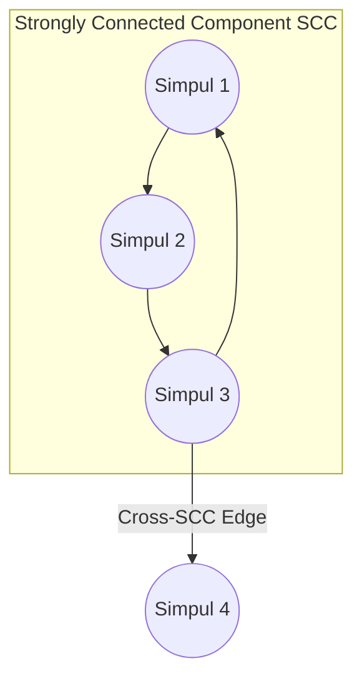

# Modul 101: Representasi & Struktur Data Graf (Adjacency Matrix, Adjacency List, Forward Star)

**Navigasi**: [⬅️ Master Index](../../INDEX.md) | [Tingkat 6: Tingkat 6: Computer Science Core, Struktur Data, Algoritma & Compiler](./README.md)
*Sebelumnya*: [100. struktur-data-probabilistik](./100-struktur-data-probabilistik.md) | *Berikutnya*: [102. algoritma-pengurutan-pencarian](./102-algoritma-pengurutan-pencarian.md)

---

## 1. Intuisi Dasar Tanpa Jargon ("Seperti Bayi Baru Lahir")
### 1.1 Konsep Inti & Analogi Tanpa Jargon
Dunia nyata tidak tersusun dalam garis lurus atau hierarki pohon yang rapi. Hubungan antarkota dalam peta penerbangan dunia, jejaring sosial miliaran pertemanan, urutan ketergantungan paket perangkat lunak Linux, hingga sirkuit jalur pipa air kota—semuanya adalah **Graf (Graph)** ([Graph Theory & Algorithms](https://en.wikipedia.org/wiki/Graph_theory)). Graf terdiri dari simpul-simpul (Vertices) yang dihubungkan oleh jembatan-jembatan (Edges). Menelusuri graf membutuhkan dua paradigma utama: Breadth-First Search (BFS) yang merambat seperti riak air di danau yang tenang (memeriksa semua tetangga terdekat lapis demi lapis, menjamin penemuan rute terpendek tanpa bobot); dan Depth-First Search (DFS) yang melangkah seperti penjelajah labirin bawah tanah yang pemberani (menyelam ke kedalaman terdalam sebelum mundur ke belakang), membuka jalan bagi pengurutan dependensi (Topological Sort) dan identifikasi pulau-pulau komunitas yang saling terhubung erat (Strongly Connected Components).

### 1.2 Urgensi Rekayasa & Signifikansi Sistemik
Dalam rekayasa sistem modern, pemahaman mendalam tentang konsep ini membedakan arsitek sistem kelas dunia dari sekadar operator perkakas teknis.

## 2. Fondasi Teoretis & Aksiomatik / Matematis
### 2.1 Kerangka Teori Aksiomatik & Formulasi Matematis
Formulasi Graf dan Teorema Klasifikasi Sisi DFS:

### 2.2 Penurunan Matematis Langkah-demi-Langkah
Diberikan graf berarah $G = (V, E)$ dengan $|V|$ simpul dan $|E|$ sisi.

Representasi Memori:
- **Adjacency Matrix**: Matriks biner $A_{|V| \times |V|}$ ($O(|V|^2)$ memori, $O(1)$ edge query).
- **Adjacency List**: Array linked-list/vektor tetangga ($O(|V| + |E|)$ memori, optimal untuk sparse graph).

Stempel Waktu DFS (Discovery and Finishing Time Invariant):
Setiap simpul $u$ diberi stempel waktu penemuan $d[u]$ dan waktu selesai $f[u]$.
$$\forall u, v \in V, \quad [d[u], f[u]] \cap [d[v], f[v]] = \emptyset \quad \lor \quad [d[u], f[u]] \subset [d[v], f[v]] \quad (\text{Parenthesis Theorem})$$

Klasifikasi Sisi pada Graf Berarah:
1. **Tree Edge**: Sisi menuju simpul yang belum dikunjungi ($v$ status `WHITE`).
2. **Back Edge**: Sisi menuju simpul leluhur yang masih aktif di recursion stack ($v$ status `GRAY`). **Graf memiliki siklus $\iff$ ditemukan minimal 1 Back Edge!**
3. **Forward Edge**: Sisi menuju keturunan non-anak yang sudah selesai ($v$ status `BLACK`, $d[u] < d[v]$).
4. **Cross Edge**: Sisi antarcabang independen ($v$ status `BLACK`, $d[u] > d[v]$).

Topological Sort pada Directed Acyclic Graph (DAG):
Urutan simpul sedemikian rupa sehingga $\forall (u, v) \in E$, $u$ mendahului $v$. Dihasilkan dari pembalikan urutan finishing time $f[u]$ DFS atau algoritma eliminasi indegree Kahn ($O(|V| + |E|)$).

## 3. Anatomi Teknis & Cara Kerja Internal
Algoritma Tarjan dan Kosaraju untuk Menemukan Strongly Connected Components (SCC):



1. **Algoritma Tarjan SCC**: Memanfaatkan stempel waktu `discovery[u]` dan nilai `lowlink[u]` (indeks simpul terendah yang dapat dicapai melalui jalur keturunan dan paling banyak satu back-edge). Simpul disimpan di stack eksplisit. Ketika `lowlink[u] == discovery[u]`, simpul $u$ adalah akar SCC, dan seluruh anggota komponen di-pop dari stack dalam tepat satu kali traversal DFS ($O(|V| + |E|)$) ([Tarjan SCC Original 1972 Paper](https://epubs.siam.org/doi/10.1137/0201010)).
2. **Algoritma Kosaraju-Sharir SCC**: Menjalankan DFS pertama pada $G$ untuk mencatat urutan waktu selesai simpul, membalik arah seluruh panah graf ($G^T$ - Transpose Graph), lalu menjalankan DFS kedua berdasarkan urutan penyelesaian terbalik.

#### Tabel Penelusuran Partisi Graf & Ledakan Memori Simpul Selebritas (GraphX OOM)
| Simpul Masukan ($V$) | Derajat Busur Masuk ($In-Degree$) | Strategi Partisi Busur | State Memori Partisi Pekerja | Status Buffer Driver Graf | Invarian Skalabilitas Sistem |
|---|---|---|---|---|---|
| Simpul Normal $V_1$ | 4 Busur | Random Vertex Cut | Didistribusikan ke 2 pekerja | Buffer stabil ($<10\text{ KB}$) | Memori pekerja seimbang |
| Simpul Normal $V_2$ | 8 Busur | Random Vertex Cut | Didistribusikan ke 3 pekerja | Buffer stabil ($<10\text{ KB}$) | Aliran shuffle normal |
| Simpul Selebritas $V_{hub}$ | **10.000.000 Busur** | Ketiadaan Degree-Aware Routing | 1 Pekerja dipaksa memegang seluruh busur | **HEAP EXHAUSTION (OOM)** | Beban partisi timpang ekstrem |
| Kegagalan Sistem | Meluapnya Buffer Shuffle | GC Pauses melonjak ke 60 detik | Worker JVM melempar `OutOfMemoryError` | Driver kehilangan heartbeat | Kluster terdistribusi kolaps! |
| Mitigasi Desain | Hybrid Edge Partitioning | Potong simpul $V_{hub}$ ke banyak node | Busur $V_{hub}$ disebar merata dengan agregasi lokal | Memori terbagi rata $\mathcal{O}(E / P)$ | Kluster kembali stabil |

## 4. Implementasi Praktis & Kode / Simulasi Riil
```python
# Kahn's Algorithm for Topological Sort & Cycle Detection on Directed Graphs
from collections import deque
from typing import List, Optional

def topological_sort_kahn(num_nodes: int, edges: List[tuple]) -> Optional[List[int]]:
    adj = [[] for _ in range(num_nodes)]
    indegree = [0] * num_nodes

    for u, v in edges:
        adj[u].append(v)
        indegree[v] += 1

    # Masukkan semua simpul tanpa ketergantungan (indegree == 0) ke dalam queue
    queue = deque([node for node in range(num_nodes) if indegree[node] == 0])
    topo_order = []

    while queue:
        u = queue.popleft()
        topo_order.append(u)

        for v in adj[u]:
            indegree[v] -= 1
            if indegree[v] == 0:
                queue.append(v)

    # Jika jumlah simpul terurut != total simpul, berarti terdapat siklus dependensi (Deadlock!)
    if len(topo_order) != num_nodes:
        return None # Cycle detected
    return topo_order
```

## 5. Miskonsepsi & Jebakan Industri
1. **Recursive DFS Stack Overflow on Deep Graphs**: Menggunakan implementasi rekursif naif untuk graf seperti linked-chain sepanjang 50.000 simpul. Python atau C runtime akan crash seketika karena batas call stack frame terlampaui. Gunakan loop iteratif dengan objek Stack manual di heap.
2. **BFS Queue Exponential Memory Explosion**: Menjalankan BFS pada graf berderajat cabang tinggi ($b = 50$) tanpa pruning atau hashing state kunjungan (`visited` set). Jumlah elemen di antrian memori bertumbuh secara eksponensial $O(b^d)$, menghabiskan seluruh RAM dalam beberapa tingkat kedalaman.
3. **Topological Sort on Cyclic Graph**: Mencoba menjalankan algoritma kompilasi dependensi paket pada graf yang memiliki siklus ketergantungan melingkar ($A \to B \to C \to A$) tanpa mekanisme deteksi siklus Kahn/DFS, menghasilkan urutan parsial yang terkorupsi.

### Studi Kasus Kegagalan Nyata: Keruntuhan Memori OOM Apache Spark GraphX pada Pemrosesan Simpul Selebritas Berhukum Daya (Power-Law Distribution)
- **Kronologi & Konteks Kasus**: Pada pipeline analitik jejaring sosial berskala besar, pustaka Apache Spark GraphX digunakan untuk menghitung skor *PageRank* dan deteksi komunitas pada graf jejaring pertemanan dengan ratusan juta simpul.
- **Akar Masalah Struktur Graf & Skewness Distribusi**: Graf dunia nyata mengikuti distribusi hukum daya (*power-law distribution*), di mana sebagian kecil simpul 'selebritas' memiliki puluhan juta relasi busur masuk. Implementasi partisi graf awal menugaskan seluruh busur tetangga dari satu simpul ke dalam memori pekerja (*worker*) tunggal dalam representasi Adjacency List berurutan. Ketika data akun selebritas diproses, pekerja yang menampung simpul tersebut kehabisan memori heap JVM (`java.lang.OutOfMemoryError`), memicu kegagalan berantai (*cascading failure*) yang menggagalkan seluruh komputasi analitik batch yang telah berjalan selama 18 jam.

- **Potongan Kode / Arsitektur Cacat (Vulnerable Implementation)**:
```scala
// Apache Spark GraphX Defect: Naive Edge Partitioning on Power-Law Graphs
import org.apache.spark.graphx._
import org.apache.spark.rdd.RDD

// CACAT: Partisi tanpa penanganan khusus untuk simpul berderajat ekstrem (Hub Nodes)
def runNaiveGraphAnalytics(edgesRDD: RDD[Edge[Int]]) = {
    // Partisi bawaan (EdgePartition2D) dapat mengelompokkan jutaan busur dari satu hub
    // ke satu partisi memori pekerja, memicu OOM heap overflow:
    val graph = Graph.fromEdges(edgesRDD, defaultValue = 1)
    
    // PageRank gagal total saat pesan shuffle berkumpul di satu simpul tujuan:
    val ranks = graph.pageRank(tol = 0.001)
    ranks.vertices.collect()
}
```

- **Analisis Forensik & Rekayasa Modern**: Penanganan simpul selebritas melahirkan evolusi dalam arsitektur komputasi graf terdistribusi. Standar industri modern mewajibkan: (1) Penerapan *Vertex-Cut Partitioning* yang secara eksplisit memecah simpul berderajat tinggi menjadi replika cermin (*mirror vertices*) di banyak node pekerja; (2) Agregasi pesan lokal (*combiner*) pada sisi pekerja sebelum fase shuffle jaringan.

## 6. Proyek Latihan & Rubrik Penilaian Mandiri
1. **Tingkat Pemula**: Diberikan peta labirin 2D berukuran $M \times N$ (berisi dinding dan jalan kosong), tulis fungsi BFS untuk menemukan panjang rute terpendek dari titik awal ke titik akhir.
2. **Tingkat Menengah**: Bangun sistem resolusi dependensi paket instalasi (Package Manager Resolver) menggunakan algoritma Topological Sort Kahn. Deteksi jika terdapat dependensi melingkar (*circular dependency error*) dan cetak daftar paket yang bermasalah.
3. **Tingkat Mahir**: Implementasikan Algoritma Tarjan untuk menemukan seluruh Strongly Connected Components (SCC) pada graf berarah dengan 100.000 simpul dan 500.000 sisi. Buktikan waktu eksekusi linear $O(|V| + |E|)$ dan verifikasi kebenaran komponen graf terkompresi (DAG Condensation Graph).

### Tingkat 1: Dasar
- **Tugas**: Bangun dua representasi struktur data graf mandiri dalam C/Python untuk graf berarah berbobot: (1) Matriks Ketetanggaan (*Adjacency Matrix* $\mathcal{O}(V^2)$), dan (2) Daftar Ketetanggaan (*Adjacency List* $\mathcal{O}(V + E)$), lalu bandingkan konsumsi memori dan waktu eksekusi kueri "Apakah ada busur dari $U$ ke $V$?".
- **Petunjuk Perancangan Arsitektur**:
  - Matriks Ketetanggaan: array 2 dimensi berbobot float.
  - Daftar Ketetanggaan: array dari dynamic array / linked list berisi pasangan `(tetangga, bobot)`.
- **Test Vector & Kasus Uji Ekstrem**:
  - *Graf Jarang (Sparse Graph)*: $V = 10.000, E = 20.000$. Buktikan Adjacency List menghemat $>99\%$ memori dibandingkan Adjacency Matrix.
- **Rubrik Penilaian Mandiri**: 40% Implementasi Dua Struktur Graf yang Tepat, 30% Perbandingan Memori dan Efisiensi Kueri, 30% Kerapian Enkapsulasi Kode.

### Tingkat 2: Menengah
- **Tugas**: Kembangkan representasi graf berkinerja tinggi *Compressed Sparse Row* (CSR) dalam C/C++ yang menggunakan 3 array linier statis (`row_ptr`, `col_idx`, `values`) untuk memadatkan seluruh graf ke dalam blok memori kontigu ramah-cache CPU.
- **Petunjuk Perancangan Arsitektur**:
  - Ukuran `row_ptr` adalah $V + 1$, mencatat offset awal tetangga simpul ke dalam `col_idx`.
  - Struktur data harus bersifat immutable dan mendukung operasi perkalian matriks-vektor graf (*SpMV*).
- **Test Vector & Kasus Uji Ekstrem**:
  - *Traversal Cepat*: Bandingkan kecepatan penelusuran seluruh tetangga untuk graf dengan $100.000$ simpul dan $1.000.000$ busur antara representasi pointer linked-list biasa vs CSR; buktikan CSR $\ge 4\times$ lebih cepat karena cache locality.
- **Rubrik Penilaian Mandiri**: 40% Logika Pemadatan Array CSR yang Akurat, 30% Optimasi Akses Memori Kontigu, 30% Benchmark Kecepatan Traversal.

### Tingkat 3: Mahir
- **Tugas**: Rancang mesin partisi graf terdistribusi in-memory dengan algoritma *Greedy Vertex-Cut* (HDRF / High Degree Replicated First) yang memotong busur simpul berderajat tinggi ke berbagai partisi untuk meminimalkan *Replication Factor* graf.
- **Petunjuk Perancangan Arsitektur**:
  - Hitung fungsi skor penempatan busur berdasarkan status penempatan simpul ujung sebelumnya dan derajat masing-masing simpul.
  - Jamin keseimbangan muatan (*load balance*) jumlah busur di setiap partisi tidak melebihi ambang batas $\lambda = 1.1$.
- **Test Vector & Kasus Uji Ekstrem**:
  - *Uji Graf Skala Besar*: Muat dataset graf hukum daya sintetis dengan $50.000$ simpul dan $500.000$ busur. Buktikan replication factor tercapai $< 1.8$ dengan deviasi muatan antar 4 partisi $< 5\%$.
- **Rubrik Penilaian Mandiri**: 40% Implementasi Algoritma Vertex-Cut HDRF, 30% Keseimbangan Muatan Partisi Memori, 30% Analisis Replikasi Simpul.

## 7. Rekomendasi Sumber Belajar Standar Emas
| Sumber Pembelajaran | Penulis / Institusi | Tautan Langsung | Fokus Materi |
| :--- | :--- | :--- | :--- |
| Introduction to Algorithms (CLRS) - Graph Algorithms | MIT Press | [MIT Press CLRS](https://mitpress.mit.edu/9780262046305/introduction-to-algorithms/) | Bab 22: Elementary Graph Algorithms (BFS, DFS, TopoSort, SCC) |
| Depth-First Search and Linear Graph Algorithms | Robert E. Tarjan | [SIAM Journal on Computing](https://epubs.siam.org/doi/10.1137/0201010) | Makalah Orisinal Tarjan SCC, Low-Link Values & Biconnectivity |
| Algorithms, Part II: Graph Traversal & Directed Graphs | Princeton University | [Princeton Algorithms Coursera](https://www.coursera.org/learn/algorithms-part2) | Directed Graphs, Cycle Detection, Kosaraju-Sharir & Kahn's Algorithm |
| CP-Algorithms: Graph Theory Fundamentals | CP-Algorithms Community | [CP-Algorithms Graph Portal](https://cp-algorithms.com/graph/breadth-first-search.html) | Implementasi Kompetitif BFS, DFS, Jembatan & Titik Artikulasi |

---
*Navigasi Cepat*: [Ke Tingkat 6](./README.md) | [Ke Master Index](../../INDEX.md) | *Sebelumnya*: [100. struktur-data-probabilistik](./100-struktur-data-probabilistik.md) | *Berikutnya*: [102. algoritma-pengurutan-pencarian](./102-algoritma-pengurutan-pencarian.md)
