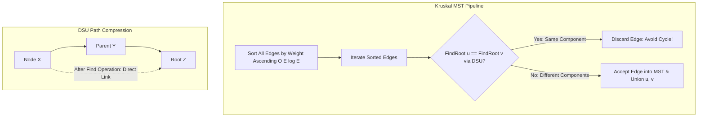

# Modul 101: Representasi & Struktur Data Graf (Adjacency Matrix, Adjacency List, Forward Star)

**Navigasi**: [⬅️ Master Index](../../INDEX.md) | [Tingkat 6: Tingkat 6: Computer Science Core, Struktur Data, Algoritma & Compiler](./README.md)
*Sebelumnya*: [100. struktur-data-probabilistik](./100-struktur-data-probabilistik.md) | *Berikutnya*: [102. algoritma-pengurutan-pencarian](./102-algoritma-pengurutan-pencarian.md)

---

## 1. Intuisi Dasar Tanpa Jargon ("Seperti Bayi Baru Lahir")
Jika Google Maps ingin memberi tahu Anda rute tercepat dari Jakarta ke Surabaya melewati ribuan persimpangan jalan tol dan pegunungan, atau jika perusahaan listrik negara ingin memasang kabel transmisi berdaya tinggi yang menghubungkan seluruh kota dengan biaya kawat tembaga termurah, mereka menggunakan **Algoritma Graf Lanjut: Shortest Path & Minimum Spanning Tree** ([Shortest Path & MST](https://en.wikipedia.org/wiki/Shortest_path_problem)). Algoritma Dijkstra bertindak seperti gelombang radar yang merambat rakus ke segala arah, selalu memperluas persimpangan jalan yang memiliki jarak total terkecil; Bellman-Ford adalah penjelajah tangguh yang sanggup menghadapi jalanan dengan bobot negatif dan mendeteksi fenomena siklus inflasi uang tak terhingga; sementara Kruskal dan Prim menyambung jembatan-jembatan pulau secara hemat menggunakan struktur hutan pohon sakti **Disjoint Set Union (DSU)**.

## 2. Fondasi Teoretis & Aksiomatik / Matematis
Formulasi Jalur Terpendek dan Pohon Rentang Minimum:

1. **Algoritma Dijkstra (Non-Negative Edge Weights)**:
   Memelihara estimasi jarak terpendek $d[u]$. Pada setiap langkah, simpul $u$ dengan $d[u]$ minimum diekstraksi dari Priority Queue, lalu sisi keluar $(u, v)$ di-*relax*:
   $$\text{Relax}(u, v, w): \quad \text{if } d[v] > d[u] + w(u, v) \implies d[v] = d[u] + w(u, v)$$
   Kompleksitas dengan Min-Heap biner: $O((|V| + |E|) \log |V|)$.

2. **Algoritma Bellman-Ford (Arbitrary Weights & Negative Cycle Detection)**:
   Melakukan relaksasi pada seluruh $|E|$ sisi sebanyak $|V| - 1$ iterasi penuh:
   $$T(|V|, |E|) = O(|V| \cdot |E|)$$
   Jika pada iterasi ke-$|V|$ masih terdapat sisi yang dapat di-*relax*, graf terbukti mengandung **Siklus Bobot Negatif** (*Negative Weight Cycle*).

3. **Algoritma Floyd-Warshall (All-Pairs Shortest Paths)**:
   Pemrograman dinamis matriks jarak menggunakan simpul perantara $k \in [1, |V|]$:
   $$D_{i, j}^{(k)} = \min\left( D_{i, j}^{(k-1)}, \ D_{i, k}^{(k-1)} + D_{k, j}^{(k-1)} \right) \quad \implies O(|V|^3)$$

4. **Disjoint Set Union (DSU / Union-Find) dengan Path Compression & Union by Rank**:
   Kompleksitas amortized per operasi dibatasi oleh fungsi inversi Ackermann $\alpha(N)$ yang tumbuh sangat lambat ($"\le 4$ untuk sembarang $N$ di alam semesta):
   $$T(M \text{ operations on } N \text{ elements}) = O(M \cdot \alpha(N)) \approx O(M)$$

## 3. Anatomi Teknis & Cara Kerja Internal
Struktur Disjoint Set Union (DSU) dengan Path Compression dan Algoritma Kruskal MST:



1. **Prim vs Kruskal**:
   - **Prim**: Membangun MST dari satu simpul benih, memperluas cabang tetangga termurah menggunakan Priority Queue ($O(|E| \log |V|)$). Lebih cepat untuk *Dense Graphs* ($|E| \approx |V|^2$).
   - **Kruskal**: Mengurutkan seluruh sisi di awal, menggabungkan komponen independen menggunakan DSU ($O(|E| \log |E|)$). Lebih cepat untuk *Sparse Graphs*.

## 4. Implementasi Praktis & Kode / Simulasi Riil
```python
# Dijkstra's Single-Source Shortest Path using Min-Heap in Python
import heapq
from typing import List, Tuple, Dict

def dijkstra_shortest_path(num_nodes: int, adj: List[List[Tuple[int, int]]], start_node: int) -> List[float]:
    distances = [float('inf')] * num_nodes
    distances[start_node] = 0.0

    # Priority queue menyimpan tuple: (jarak_kumulatif, simpul)
    pq = [(0.0, start_node)]

    while pq:
        cur_dist, u = heapq.heappop(pq)

        # Optimasi Pruning: Abaikan entri usang jika sudah ditemukan jalur yang lebih pendek
        if cur_dist > distances[u]:
            continue

        for v, weight in adj[u]:
            new_dist = cur_dist + weight
            if new_dist < distances[v]:
                distances[v] = new_dist
                heapq.heappush(pq, (new_dist, v))

    return distances
```

## 5. Miskonsepsi & Jebakan Industri
1. **Running Dijkstra on Graphs with Negative Weight Edges**: Menggunakan Dijkstra pada graf dengan bobot sisi negatif. Dijkstra berasumsi serakah bahwa jarak simpul yang telah di-pop dari Priority Queue sudah final; jika ada sisi negatif di depan, asumsi ini runtuh dan menghasilkan jalur yang salah (wajib gunakan Bellman-Ford).
2. **Omitting Stale Distance Pruning in Dijkstra Priority Queue**: Lupa memeriksa `if (cur_dist > distances[u]) continue;`. Pada graf padat, simpul yang sama dapat dimasukkan ke Priority Queue puluhan kali dengan jarak berbeda, memperlambat performa secara drastis.
3. **DSU without Path Compression**: Mengimplementasikan Union-Find naif tanpa kompresi jalur (`parent[x] = find(parent[x])`). Struktur pohon DSU dapat merosot menjadi linked-list memanjang, membuat operasi `Find` melambat dari $O(\alpha(N))$ menjadi $O(N)$.

## 6. Proyek Latihan & Rubrik Penilaian Mandiri
1. **Tingkat Pemula**: Simulasikan Algoritma Dijkstra secara manual pada graf 5 simpul berbobot positif. Catat perubahan tabel jarak dan urutan simpul yang dikunjungi.
2. **Tingkat Menengah**: Bangun sistem deteksi arbitrase mata uang asing (Foreign Exchange Arbitrage) menggunakan Algoritma Bellman-Ford. Ubah nilai kurs tukar mata uang $R$ menjadi $-\ln(R)$ dan deteksi apakah terdapat siklus bobot negatif yang menghasilkan keuntungan bebas risiko.
3. **Tingkat Mahir**: Implementasikan struktur data Disjoint Set Union (DSU) lengkap dengan Path Compression dan Union by Rank dalam C. Gunakan DSU tersebut untuk merealisasikan Algoritma Kruskal yang menghitung Minimum Spanning Tree pada graf jaringan jalan raya dengan 500.000 simpul dan 2.000.000 sisi.

## 7. Rekomendasi Sumber Belajar Standar Emas
| Sumber Pembelajaran | Penulis / Institusi | Tautan Langsung | Fokus Materi |
| :--- | :--- | :--- | :--- |
| Introduction to Algorithms (CLRS) - Shortest Paths & MST | MIT Press | [MIT Press CLRS](https://mitpress.mit.edu/9780262046305/introduction-to-algorithms/) | Bab 23: Minimum Spanning Trees, Bab 24 & 25: Shortest Paths |
| A Note on Two Problems in Connexion with Graphs | Edsger W. Dijkstra | [Numerische Mathematik 1959](https://link.springer.com/article/10.1007/BF01386390) | Makalah Orisinal Algoritma Jalur Terpendek Dijkstra |
| Efficiency of a Good But Not Linear Set Union Algorithm | Robert E. Tarjan | [ACM JACM 1975](https://dl.acm.org/doi/10.1145/321879.321884) | Pembuktian Matematis Batas Fungsi Inversi Ackermann alpha(N) |
| Stanford CS161: Design and Analysis of Algorithms | Stanford University | [Stanford CS161 Course](https://web.stanford.edu/class/cs161/) | Kuliah Dijkstra, Bellman-Ford, Prim, Kruskal & Teori Potensial |

---
*Navigasi Cepat*: [Ke Tingkat 6](./README.md) | [Ke Master Index](../../INDEX.md) | *Sebelumnya*: [100. struktur-data-probabilistik](./100-struktur-data-probabilistik.md) | *Berikutnya*: [102. algoritma-pengurutan-pencarian](./102-algoritma-pengurutan-pencarian.md)
