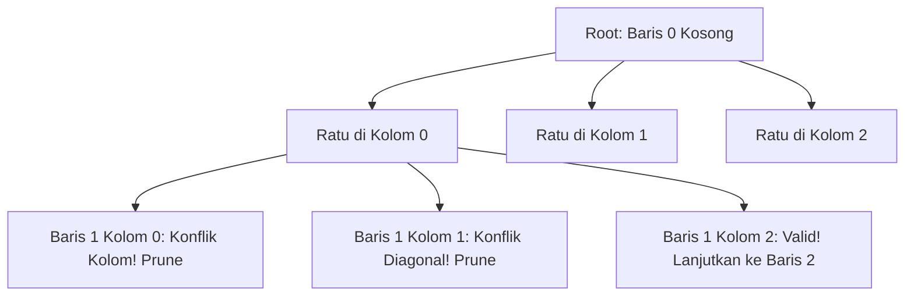

# Modul 102: Algoritma Pengurutan & Pencarian (QuickSort, MergeSort, TimSort, Radix Sort, Binary Search)

**Navigasi**: [⬅️ Master Index](../../INDEX.md) | [Tingkat 6: Tingkat 6: Computer Science Core, Struktur Data, Algoritma & Compiler](./README.md)
*Sebelumnya*: [101. representasi-struktur-data-graf](./101-representasi-struktur-data-graf.md) | *Berikutnya*: [103. paradigma-algoritma-klasik](./103-paradigma-algoritma-klasik.md)

---

## 1. Intuisi Dasar Tanpa Jargon ("Seperti Bayi Baru Lahir")
Ketika menghadapi masalah komputasi yang rumit dengan triliunan kemungkinan solusi, Anda tidak bisa menebak secara buta. Anda memerlukan paradigma strategi pemecahan masalah: **Greedy (Metode Serakah)** adalah pengambil keputusan instan yang berpandangan sempit namun sangat efisien: pada setiap langkah, ia selalu memilih opsi terbaik yang ada di depan mata saat itu juga (seperti kompresi teks kode Huffman atau pemilihan pecahan uang koin kembalian), dengan keyakinan matematis bahwa pilihan optimal lokal akan mengantar ke solusi optimal global. **Divide and Conquer (Pecah dan Taklukkan)** adalah jenderal perang yang membelah pasukan musuh raksasa menjadi potongan-potongan kecil yang mudah dihancurkan (seperti MergeSort atau perkalian bilangan raksasa Karatsuba), lalu menyatukan kembali kemenangannya. Dan **Backtracking** adalah penjelajah labirin sistematis yang mencoba satu lorong jalan; jika menabrak jalan buntu, ia memutar balik langkah kakinya secara cerdas untuk mencoba alternatif lain tanpa pernah tersesat.

## 2. Fondasi Teoretis & Aksiomatik / Matematis
Formulasi Matematis Tiga Paradigma Desain Algoritma:

1. **Karakteristik Pilihan Greedy (Greedy Choice Property)**:
   Masalah optimasi memiliki sifat greedy jika solusi optimal global dapat dicapai melalui serangkaian pilihan lokal yang optimal secara independen tanpa perlu meninjau ulang pilihan masa lalu.
   Teorema Kompresi Awalan Huffman (Huffman Prefix Code):
   Untuk alfabet berbobot probabilitas $p_i$ dengan panjang kode biner $l_i$, pohon Huffman meminimalkan panjang rata-rata bit tertimbang:
   $$L_{\text{avg}} = \sum_{i=1}^n p_i l_i \quad \text{dengan batas Shannon Entropy: } H(X) \le L_{\text{avg}} < H(X) + 1$$

2. **Teorema Master untuk Divide and Conquer**:
   Relasi rekurensi pembagian masalah: $T(N) = a \, T(N/b) + f(N)$, dengan $a \ge 1, b > 1$:
   $$T(N) = \begin{cases}
   \Theta(N^{\log_b a}) & f(N) = O(N^{\log_b a - \epsilon}) \\
   \Theta(N^{\log_b a} \log^{k+1} N) & f(N) = \Theta(N^{\log_b a} \log^k N) \\
   \Theta(f(N)) & f(N) = \Omega(N^{\log_b a + \epsilon}) \land a f(N/b) \le c f(N)
   \end{cases}$$

3. **Ruang Keadaan Backtracking (State Space Tree Pruning)**:
   Eksplorasi DFS pohon ruang keadaan dengan fungsi pembatas (*bounding function / pruning*):
   Jika status parsial $S$ tidak memenuhi predikat kelayakan $\text{Valid}(S)$, seluruh sub-pohon di bawah $S$ dipangkas (*pruned*), mereduksi kompleksitas dari $O(N!)$ menjadi jauh lebih kecil.

## 3. Anatomi Teknis & Cara Kerja Internal
Pohon Ruang Keadaan Backtracking Masalah N-Queens dan Pemangkasan Cabang Konflik:



1. **Representasi Bitmask pada N-Queens**: Memeriksa konflik diagonal dan kolom dapat dioptimasi menjadi operasi bitwise satu instruksi register CPU:
   - `cols`: Mask bit kolom yang telah ditempati ratu.
   - `diag1`: Mask bit diagonal kiri (`diag1 << 1`).
   - `diag2`: Mask bit diagonal kanan (`diag2 >> 1`).
   Posisi aman yang tersedia: `available = ~(cols | diag1 | diag2) & ((1 << N) - 1)`.

## 4. Implementasi Praktis & Kode / Simulasi Riil
```python
# Ultra-Fast N-Queens Solver using Bitwise Backtracking
class NQueensSolver:
    def __init__(self, n: int):
        self.n = n
        self.solutions_count = 0
        self.full_mask = (1 << n) - 1 # Mask bit untuk n kolom

    def solve(self) -> int:
        self.solutions_count = 0
        self._backtrack(0, 0, 0)
        return self.solutions_count

    def _backtrack(self, cols: int, diag1: int, diag2: int):
        if cols == self.full_mask:
            self.solutions_count += 1
            return

        # Posisi aman: bit 1 menandakan kolom yang tidak terancam
        available_positions = self.full_mask & (~(cols | diag1 | diag2))

        while available_positions:
            # Ekstrak bit 1 paling kanan (Low Bit isolation: x & -x)
            bit = available_positions & (-available_positions)
            available_positions ^= bit # Hapus posisi yang dipilih

            # Rekursi ke baris berikutnya dengan pergeseran diagonal
            self._backtrack(
                cols | bit,
                (diag1 | bit) << 1,
                (diag2 | bit) >> 1
            )
```

## 5. Miskonsepsi & Jebakan Industri
1. **Applying Greedy to Non-Matroid Problems (0/1 Knapsack)**: Mencoba memecahkan masalah 0/1 Knapsack (di mana barang tidak bisa dipecah) dengan memilih rasio nilai/bobot tertinggi secara serakah. Strategi ini sering menghasilkan solusi suboptimal fatal (wajib diselesaikan dengan Dynamic Programming).
2. **Divide and Conquer Deep Recursion without Small-N Cutoff**: Membagi masalah hingga ukuran $N = 1$ pada MergeSort atau QuickSort. Biaya frame fungsi rekursif mendominasi waktu eksekusi; beralih ke Insertion Sort saat partisi $\le 16$ elemen mempercepat eksekusi hingga $20\%$.
3. **State Mutation Leaks in Backtracking**: Mengubah struktur data global atau array saat menuruni cabang rekursi, namun lupa mengembalikan nilai aslinya (*undo mutation*) saat backtracking kembali ke atas, mencemari status eksplorasi cabang tetangga.

## 6. Proyek Latihan & Rubrik Penilaian Mandiri
1. **Tingkat Pemula**: Bangun pohon kompresi Huffman untuk teks string `"ABRACADABRA"`. Hitung tabel kode biner setiap karakter dan buktikan ketiadaan ambigu awalan (*prefix-free property*).
2. **Tingkat Menengah**: Tulis algoritma Divide and Conquer untuk menyelesaikan masalah *Closest Pair of Points* (menemukan sepasang titik dengan jarak Euclidean terdekat di antara $N$ titik 2D) dalam waktu $O(N \log N)$.
3. **Tingkat Mahir**: Implementasikan Sudoku 9x9 Solver menggunakan Backtracking dengan optimasi heuristik MRV (*Minimum Remaining Values*: pilih sel dengan kandidat angka paling sedikit terlebih dahulu) dan validasi bitmask. Buktikan dapat menyelesaikan papan Sudoku terberat di dunia dalam waktu kurang dari 5 milidetik.

## 7. Rekomendasi Sumber Belajar Standar Emas
| Sumber Pembelajaran | Penulis / Institusi | Tautan Langsung | Fokus Materi |
| :--- | :--- | :--- | :--- |
| Introduction to Algorithms (CLRS) - Algorithm Design | MIT Press | [MIT Press CLRS](https://mitpress.mit.edu/9780262046305/introduction-to-algorithms/) | Bab 4: Divide-and-Conquer, Bab 16: Greedy Algorithms (Huffman Codes) |
| A Method for the Construction of Minimum-Redundancy Codes | David A. Huffman | [IRE Proceedings 1952](https://ieeexplore.ieee.org/document/4051119) | Makalah Orisinal Penemuan Algoritma Kompresi Kode Awalan Huffman |
| Bitwise N-Queens Solution Analysis | Martin Richards (Univ. of Cambridge) | [Cambridge Richards Paper](https://www.cl.cam.ac.uk/~mr10/backtrk.pdf) | Fast Bit-Parallel State Space Exploration & Pruning Strategies |
| Algorithm Design Manual | Steven S. Skiena | [Skiena Design Manual](https://www.algorist.com/) | Bab 7: Combinatorial Search, Backtracking, Pruning Heuristics |

---
*Navigasi Cepat*: [Ke Tingkat 6](./README.md) | [Ke Master Index](../../INDEX.md) | *Sebelumnya*: [101. representasi-struktur-data-graf](./101-representasi-struktur-data-graf.md) | *Berikutnya*: [103. paradigma-algoritma-klasik](./103-paradigma-algoritma-klasik.md)
