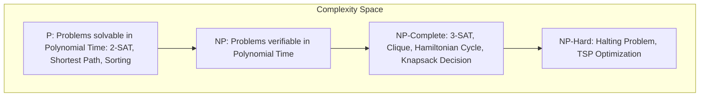

# Modul 104: Algoritma Graf Lanjut (BFS, DFS, Tarjan SCC, Dijkstra, Bellman-Ford, A*, Kruskal, Dinic Max-Flow)

**Navigasi**: [⬅️ Master Index](../../INDEX.md) | [Tingkat 6: Tingkat 6: Computer Science Core, Struktur Data, Algoritma & Compiler](./README.md)
*Sebelumnya*: [103. paradigma-algoritma-klasik](./103-paradigma-algoritma-klasik.md) | *Berikutnya*: [105. algoritma-string-geometri-komputasional](./105-algoritma-string-geometri-komputasional.md)

---

## 1. Intuisi Dasar Tanpa Jargon ("Seperti Bayi Baru Lahir")
Apakah ada batas mutlak bagi apa yang dapat dihitung oleh komputer? Jika kita memiliki superkomputer tercepat di galaksi yang ditenagai oleh energi seluruh bintang, apakah ia sanggup memecahkan semua teka-teki logika yang ada? Analisis Kompleksitas & Teori Komputabilitas ([Computational Complexity & Turing Machines](https://plato.stanford.edu/entries/computability/)) adalah puncak filosofis dan matematis dari seluruh ilmu komputer. Di sinilah kita belajar mengukur efisiensi algoritma secara objektif tanpa terpengaruh oleh merek prosesor (Notasi Asimtotik $O, \Omega, \Theta$), dan di sinilah Alan Turing membuktikan pada tahun 1936 bahwa ada masalah yang **tidak akan pernah bisa diselesaikan** oleh program komputer apa pun (Halting Problem). Di sinilah pula berdiri teka-teki terbesar matematika modern bernilai satu juta dolar: apakah memverifikasi kebenaran solusi sama mudahnya dengan menemukan solusi itu dari nol? ($P \stackrel{?}{=} NP$).

## 2. Fondasi Teoretis & Aksiomatik / Matematis
Notasi Asimtotik Formal dan Teori Kompleksitas Komputasi:

1. **Definisi Formal Notasi Asimtotik**:
   $$f(N) = O(g(N)) \iff \exists c > 0, N_0 > 0 \text{ s.t. } \forall N \ge N_0, \ 0 \le f(N) \le c \cdot g(N) \quad (\text{Batas Atas})$$
   $$f(N) = \Omega(g(N)) \iff \exists c > 0, N_0 > 0 \text{ s.t. } \forall N \ge N_0, \ 0 \le c \cdot g(N) \le f(N) \quad (\text{Batas Bawah})$$
   $$f(N) = \Theta(g(N)) \iff f(N) = O(g(N)) \land f(N) = \Omega(g(N)) \quad (\text{Batas Ketat})$$

2. **Taksonomi Kelas Kompleksitas (P, NP, NP-Complete, NP-Hard)**:
   - **Kelas P**: Masalah keputusan yang dapat diselesaikan oleh Mesin Turing Deterministik dalam waktu polinomial $O(N^k)$.
   - **Kelas NP**: Masalah keputusan di mana solusi kandidat dapat diverifikasi kebenarannya dalam waktu polinomial oleh Mesin Turing Deterministik.
   - **NP-Complete**: Masalah dalam NP sedemikian rupa sehingga setiap masalah lain di NP dapat direduksi kepadanya dalam waktu polinomial ($A \le_p B$). Jika satu masalah NP-Complete dapat diselesaikan dalam $P$, maka $P = NP$!
   - **Teorema Cook-Levin (1971)**: Masalah Boolean Satisfiability (SAT) terbukti sebagai masalah NP-Complete pertama di dunia.

3. **Teorema Ketakputusan Alan Turing (The Halting Problem)**:
   Tidak ada algoritma umum $H(P, I)$ yang dapat menentukan apakah program sembarang $P$ akan berhenti (*halt*) atau terjebak dalam infinite loop saat diberi input $I$:
   Bukti kontradiksi: Rancang program pembalik $K(P)$ yang masuk ke infinite loop jika $H(P, P) == \text{HALT}$, dan berhenti jika $H(P, P) == \text{LOOP}$.
   Jika $K(K)$ dievaluasi: $K$ berhenti jika dan hanya jika $K$ tidak berhenti. Kontradiksi mutlak!

## 3. Anatomi Teknis & Cara Kerja Internal
Peta Hubungan Lanskap Kelas Kompleksitas Komputasi (Asumsi $P \ne NP$):



1. **Karp's 21 NP-Complete Problems**: Pada tahun 1972, Richard Karp membuktikan 21 masalah klasik (termasuk 3-SAT, Independent Set, Vertex Cover, Hamiltonian Path, dan Subset Sum) adalah NP-Complete melalui teknik rantai reduksi polinomial berantai ([Richard Karp 1972 Paper](https://link.springer.com/chapter/10.1007/978-1-4684-2001-2_9)).
2. **Mesin Turing Universal (UTM)**: Abstraksi matematis komputasi yang terdiri dari pita memori tak hingga, kepala baca-tulis, dan tabel transisi status. Fondasi arsitektur komputer digital modern.

## 4. Implementasi Praktis & Kode / Simulasi Riil
```python
# Polynomial-Time Reduction of 3-SAT to Independent Set (Cook-Karp Framework)
from typing import List, Tuple

class ThreeSatToIndependentSetReducer:
    @staticmethod
    def reduce(clauses: List[Tuple[str, str, str]]) -> Tuple[List[str], List[Tuple[str, str]], int]:
        """
        Mereduksi instans 3-SAT dengan k klausa menjadi graf Independent Set.
        Target ukuran independen k = jumlah klausa.
        """
        nodes = []
        edges = []
        k = len(clauses)

        # 1. Buat 3 simpul berbentuk segitiga untuk setiap klausa (saling terhubung)
        for c_idx, clause in enumerate(clauses):
            clause_nodes = [f"{lit}_c{c_idx}_{v_idx}" for v_idx, lit in enumerate(clause)]
            nodes.extend(clause_nodes)
            # Hubungkan ketiga literal dalam satu klausa menjadi segitiga clique
            edges.append((clause_nodes[0], clause_nodes[1]))
            edges.append((clause_nodes[1], clause_nodes[2]))
            edges.append((clause_nodes[0], clause_nodes[2]))

        # 2. Hubungkan sisi konflik antara literal yang saling menegasikan (misal x dan ~x)
        for i in range(len(nodes)):
            for j in range(i + 1, len(nodes)):
                u_lit = nodes[i].split('_')[0]
                v_lit = nodes[j].split('_')[0]
                if (u_lit == f"~{v_lit}") or (v_lit == f"~{u_lit}"):
                    edges.append((nodes[i], nodes[j]))

        return nodes, edges, k
```

## 5. Miskonsepsi & Jebakan Industri
1. **Confusing NP-Complete with Exponential Complexity**: Mengira masalah NP-Complete berarti 'terbukti membutuhkan waktu eksponensial'. Status aslinya adalah: kita *belum menemukan* algoritma waktu polinomial, namun belum ada yang berhasil membuktikan secara matematis bahwa algoritma polinomial tersebut mustahil ada ($P \ne NP$ masih berupa hipotesis tak terbukti!).
2. **Incorrect Direction in Polynomial Reduction**: Ingin membuktikan masalah baru $X$ adalah NP-Complete, namun melakukan reduksi dari $X$ ke 3-SAT ($X \le_p \text{3-SAT}$). Reduksi yang benar wajib berarah sebaliknya: dari masalah NP-Complete yang sudah diketahui ke masalah baru Anda ($\text{3-SAT} \le_p X$)!
3. **Claiming Halting Solution via Heuristics**: Berasumsi bahwa menganalisis kode selama beberapa menit dapat menyelesaikan Halting Problem. Sesuai Teorema Rice, sembarang sifat non-trivial dari perilaku runtime sebuah program tidak dapat diputuskan (*undecidable*) secara umum.

## 6. Proyek Latihan & Rubrik Penilaian Mandiri
1. **Tingkat Pemula**: Buktikan menggunakan definisi formal $\epsilon-N_0$ bahwa fungsi $f(N) = 3N^2 + 5N + 12$ adalah $\Theta(N^2)$. Tentukan konstanta $c_1, c_2,$ dan $N_0$ yang memenuhi.
2. **Tingkat Menengah**: Gunakan Master Theorem untuk menyelesaikan relasi rekurensi berikut dan tentukan bound asimtotiknya: (a) $T(N) = 4T(N/2) + N$, (b) $T(N) = 2T(N/2) + N \log N$, (c) $T(N) = 3T(N/4) + N^2$.
3. **Tingkat Mahir**: Buktikan secara matematis bahwa masalah *Subset Sum* adalah NP-Complete dengan mereduksinya dari masalah *3-SAT* atau *Vertex Cover*. Tuliskan konstruksi reduksi formal dan buktikan validitas reduksi dua arah (Jika dan hanya jika).

## 7. Rekomendasi Sumber Belajar Standar Emas
| Sumber Pembelajaran | Penulis / Institusi | Tautan Langsung | Fokus Materi |
| :--- | :--- | :--- | :--- |
| Computational Complexity: A Modern Approach | Sanjeev Arora & Boaz Barak (Princeton) | [Arora-Barak Book Draft](https://theory.cs.princeton.edu/complexity/book.pdf) | Turing Machines, P vs NP, Space Complexity, BPP & PCP Theorem |
| Reducibility Among Combinatorial Problems | Richard M. Karp (UC Berkeley) | [Karp 21 NP-Complete Paper](https://link.springer.com/chapter/10.1007/978-1-4684-2001-2_9) | 21 Masalah NP-Complete Pertama & Teknik Reduksi Polinomial |
| On Computable Numbers, with an Application to the Entscheidungsproblem | Alan M. Turing | [Turing 1936 Classic Paper](https://www.cs.virginia.edu/~robins/Turing_Paper_1936.pdf) | Penemuan Mesin Turing, Universal Turing Machine & Halting Problem |
| MIT 6.045J: Automata, Computability, and Complexity | Scott Aaronson (MIT OCW) | [MIT OCW 6.045J Portal](https://ocw.mit.edu/courses/6-045j-automata-computability-and-complexity-spring-2011/) | Turing Degrees, Oracles, P vs NP Philosophy & Quantum Complexity |

---
*Navigasi Cepat*: [Ke Tingkat 6](./README.md) | [Ke Master Index](../../INDEX.md) | *Sebelumnya*: [103. paradigma-algoritma-klasik](./103-paradigma-algoritma-klasik.md) | *Berikutnya*: [105. algoritma-string-geometri-komputasional](./105-algoritma-string-geometri-komputasional.md)
