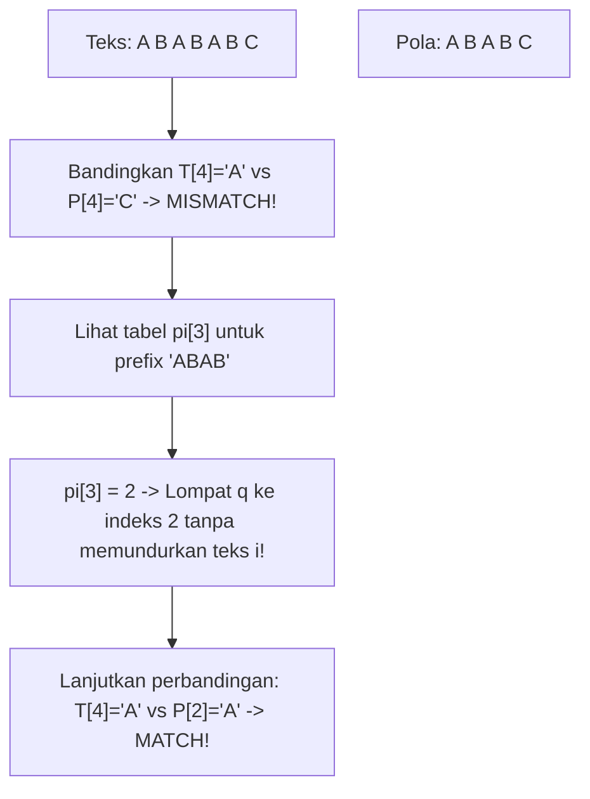

# Modul 105: Algoritma String & Geometri Komputasional (KMP, Aho-Corasick, Convex Hull, Voronoi, KD-Tree)

**Navigasi**: [⬅️ Master Index](../../INDEX.md) | [Tingkat 6: Tingkat 6: Computer Science Core, Struktur Data, Algoritma & Compiler](./README.md)
*Sebelumnya*: [104. algoritma-graf-lanjut](./104-algoritma-graf-lanjut.md) | *Berikutnya*: [106. teori-bahasa-formal-otomata](./106-teori-bahasa-formal-otomata.md)

---

## 1. Intuisi Dasar Tanpa Jargon ("Seperti Bayi Baru Lahir")
### 1.1 Masalah Pencarian Substring & Geometri Komputasi ([KMP Algorithm Visualizer](https://visualgo.net/en/kmp))
Bayangkan Anda memiliki file genom DNA manusia sepanjang 3 miliar karakter ('A', 'C', 'G', 'T') dan Anda ingin mencari apakah mutasi genetik tertentu sepanjang 20 karakter terdapat di dalamnya. Pendekatan naif menggeser pola satu per satu: jika karakter ke-19 tidak cocok, pencarian mundur kembali ke awal. Pada skala data modern, pencocokan mundur (*backtracking*) ini adalah pemborosan waktu yang tidak dapat ditoleransi.

### 1.2 Melompati Komparasi Redundan dan Memetakan Ruang Spasial ([Convex Hull Graham Scan - MIT 6.046J](https://ocw.mit.edu/courses/6-046j-design-and-analysis-of-algorithms-spring-2015/))
Algoritma Knuth-Morris-Pratt (KMP) memecahkan masalah ini dengan menganalisis pola itu sendiri terlebih dahulu. KMP membangun tabel *failure function* (prefix-suffix terpanjang), sehingga ketika terjadi ketidakcocokan, mesin pencari tahu persis ke indeks mana ia harus melompat tanpa pernah memundurkan pointer teks utama.
Di dunia dua dimensi, geometri komputasional menghadapi tantangan serupa: bagaimana menemukan batas terluar (*Convex Hull*) dari sekumpulan titik koordinat GPS atau mencari fasilitas terdekat menggunakan KD-Tree dalam waktu logaritmik alih-alih memeriksa setiap titik satu demi satu.

## 2. Fondasi Teoretis & Aksiomatik / Matematis
### 2.1 Formulasi Matematis Algoritma KMP & Bukti Kompleksitas Linier ([Knuth, Morris, Pratt, 1977](https://epubs.siam.org/doi/10.1137/0206024))
Diberikan pola $P[0 \dots m-1]$. Tabel $\pi[q]$ (Prefix Function) didefinisikan sebagai panjang prefix terpanjang dari $P$ yang juga merupakan proper suffix dari $P[0 \dots q]$:
$$\pi[q] = \max \{ k < q + 1 \mid P[0 \dots k-1] = P[q-k+1 \dots q] \}$$
Invarian Algoritma Pencarian KMP:
Pointer teks $i$ bergerak monoton dari $0$ hingga $n-1$ tanpa pernah berkurang ($i \gets i + 1$).
Pointer pola $q$ bergerak maju saat $T[i] = P[q]$, dan mundur melompat saat mismatch:
$$q \gets \pi[q - 1]$$
Karena jumlah penurunan $q$ dibatasi oleh jumlah kenaikan $q$ yang tidak lebih dari $n$:
$$T_{\text{KMP}}(n, m) = \mathcal{O}(n + m)$$

### 2.2 Geometri Komputasi: Determinan Perkalian Silang & Convex Hull Graham Scan ([Computational Geometry - de Berg et al.](https://link.springer.com/book/10.1007/978-3-540-77974-2))
Orientasi 3 titik berurutan $p_1(x_1, y_1), p_2(x_2, y_2), p_3(x_3, y_3)$ dihitung menggunakan determinan matriks 2D (Cross Product 2D):
$$\Delta(p_1, p_2, p_3) = (x_2 - x_1)(y_3 - y_1) - (y_2 - y_1)(x_3 - x_1)$$
- Jika $\Delta > 0$: Belokan ke kiri (*Counter-Clockwise / CCW*).
- Jika $\Delta < 0$: Belokan ke kanan (*Clockwise / CW*).
- Jika $\Delta = 0$: Ketiga titik kolinier.

Pada algoritma Graham Scan:
1. Temukan titik dasar $p_0$ dengan koordinat $y$ terkecil.
2. Urutkan titik-titik sisanya berdasarkan sudut polar relatif terhadap $p_0$ dalam $\mathcal{O}(n \log n)$.
3. Iterasi titik menggunakan stack: singkirkan titik yang menghasilkan belokan ke kanan ($\Delta \le 0$).
Total waktu eksekusi: $\mathcal{O}(n \log n)$ didominasi oleh fase pengurutan sudut polar.

## 3. Anatomi Teknis & Cara Kerja Internal


#### Tabel Walkthrough Komputasi Prefix Function KMP Pola `'ABABC'`
| Indeks $q$ | Karakter $P[q]$ | Substring $P[0 \dots q]$ | Prefix Sejati yang Cocok dengan Suffix | Nilai $\pi[q]$ |
|---|---|---|---|---|
| 0 | `'A'` | `"A"` | Tidak ada | 0 |
| 1 | `'B'` | `"AB"` | Tidak ada | 0 |
| 2 | `'A'` | `"ABA"` | `"A"` | 1 |
| 3 | `'B'` | `"ABAB"` | `"AB"` | 2 |
| 4 | `'C'` | `"ABABC"` | Tidak ada | 0 |

#### Tabel Penelusuran Pencocokan String KMP (Knuth-Morris-Pratt) & Transisi Array $\pi$ (LPS)
| Indeks Teks ($i$) | Karakter Teks ($T[i]$) | Indeks Pola ($j$) | Karakter Pola ($P[j]$) | Evaluasi Kecocokan | Aksi Pergeseran KMP via Array $\pi$ |
|---|---|---|---|---|---|
| Teks: `"ABABDAB"` | - | Pola: `"ABABC"` | - | Array $\pi = [0, 0, 1, 2, 0]$ | - |
| $i=0$ s/d $3$ | `"ABAB"` | $j=0$ s/d $3$ | `"ABAB"` | Cocok 4 Karakter berturut-turut | $i++, j++$ maju bersama |
| $i=4$ | `'D'` | $j=4$ | `'C'` | **MISMATCH!** `'D' \ne 'C'` | Lompat: $j = \pi[j-1] = \pi[3] = 2$ |
| $i=4$ (Lanjutan) | `'D'` | $j=2$ | `'A'` | **MISMATCH!** `'D' \ne 'A'` | Lompat: $j = \pi[1] = 0$ |
| $i=4$ (Lanjutan) | `'D'` | $j=0$ | `'A'` | Mismatch di awal pola | Geser teks: $i++$ (ke indeks 5) |
| Efisiensi KMP | - | - | - | Teks tidak pernah di-backtrack! | Kompleksitas pencarian terbukti $\mathcal{O}(N)$ linier! |

## 4. Implementasi Praktis & Kode / Simulasi Riil
```python
def compute_kmp_pi(pattern: str) -> list[int]:
    m = len(pattern)
    pi = [0] * m
    k = 0
    for q in range(1, m):
        while k > 0 and pattern[k] != pattern[q]:
            k = pi[k - 1]
        if pattern[k] == pattern[q]:
            k += 1
        pi[q] = k
    return pi

def kmp_search(text: str, pattern: str) -> list[int]:
    """
    Mencari seluruh kemunculan pattern dalam text dengan waktu O(n + m).
    Mengembalikan daftar indeks kemunculan awal.
    """
    n, m = len(text), len(pattern)
    if m == 0 or n < m:
        return []

    pi = compute_kmp_pi(pattern)
    matches = []
    q = 0  # Jumlah karakter yang cocok

    for i in range(n):
        while q > 0 and pattern[q] != text[i]:
            q = pi[q - 1]
        if pattern[q] == text[i]:
            q += 1
        if q == m:
            matches.append(i - m + 1)
            q = pi[q - 1]  # Lanjutkan pencarian kecocokan berikutnya

    return matches
```

## 5. Miskonsepsi & Jebakan Industri
### Studi Kasus Kegagalan Nyata: Outage Cloudflare Global Akibat Regular Expression Catastrophic Backtracking (2019)
- **Kronologi & Latar Belakang**: Pada 2 Juli 2019, layanan Cloudflare di seluruh dunia tumbang selama 27 menit. Penggunaan CPU pada ribuan server proxy melonjak hingga 100%, menjatuhkan jutaan situs web global.
- **Kode Cacat**:
```regex
# Aturan WAF Cloudflare yang menyebabkan bencana:
(?:(?:"|'|]|}|\/[\w]+|>[\w]+)[\s]*[\s|*])*.*(?:[\s|=]style[\s]*=)
```
- **Akar Masalah**: Mesin regex NFA standar menggunakan evaluasi *backtracking* eksponensial $\mathcal{O}(2^N)$ pada sub-ekspresi `.*(?:...)`. Ketika input teks panjang tidak cocok di akhir, mesin melakukan miliaran kombinasi mundur.
- **Rekomendasi Industri**: Hindari mesin pencarian berbasis backtracking untuk lalu lintas produksi publik. Gunakan algoritma pencocokan linier berbasis DFA seperti KMP, Aho-Corasick, atau mesin regex linier Google RE2 yang menjamin waktu eksekusi $\mathcal{O}(N)$.

### Studi Kasus Kegagalan Nyata: Eksploitasi Buffer Overflow Pencocokan Pola Snort IDS (CVE-2006-5276)
- **Kronologi & Konteks Kasus**: Pada tahun 2006, kerentanan eksekusi kode biner jarak jauh ditemukan di dalam Snort, sistem deteksi intrusi jaringan (*Intrusion Detection System / IDS*) paling populer di dunia.
- **Akar Masalah Algoritma Pencocokan String & Validasi Offset**: Untuk mendeteksi serangan siber dalam paket jaringan, Snort menggunakan algoritma pencocokan multi-string Boyer-Moore dan Aho-Corasick. Ketika aturan deteksi protokol SMB/NetBIOS dieksekusi, fungsi penghitung offset panjang string tidak memvalidasi integer bertanda (*signed integer comparison*). Penyerang dapat mengirimkan paket SMB yang dirancang khusus dengan nilai offset negatif atau nilai offset yang sangat besar. Kesalahan dalam manipulasi pointer kalkulasi substring menyebabkan *stack buffer overflow*, mengizinkan penyerang mengeksekusi shellcode arbitrer dengan hak akses root pada mesin sensor IDS itu sendiri.

- **Potongan Kode / Arsitektur Cacat (Vulnerable Implementation)**:
```c
// Rekonstruksi Vulnerabilitas Offset String Matching Snort (CVE-2006-5276)
#include <string.h>

void process_snort_rule_flawed(const char *packet_payload, int payload_len) {
    char rule_match_buffer[256];
    
    // Asumsi: Menemukan token awal pola
    int match_offset = find_pattern_offset(packet_payload, payload_len);
    
    // CACAT: Tidak ada validasi batas atas dan pemeriksaan signedness
    // Jika match_offset dimanipulasi sehingga (payload_len - match_offset) > 256:
    if (match_offset >= 0) {
        // STACK BUFFER OVERFLOW: Menimpa saved return address stack frame!
        memcpy(rule_match_buffer, packet_payload + match_offset, payload_len - match_offset);
    }
}
```

- **Analisis Forensik & Rekayasa Modern**: Cacat CVE-2006-5276 memberikan pelajaran kritis: perangkat lunak keamanan jaringan adalah target utama eksploitasi. Kesalahan algoritma string dan penanganan pointer memori mentah pada engine inspeksi paket dapat mengubah dinding pertahanan menjadi pintu masuk penyerang. Engine IDS modern (seperti Suricata) kini ditulis ulang menggunakan bahasa pemrograman *memory-safe* (Rust) atau diisolasi penuh di dalam *unprivileged seccomp sandbox*.

## 6. Proyek Latihan & Rubrik Penilaian Mandiri
### Level 1 (Pemula)
- **Tugas**: Hitung tabel prefix function $\pi$ secara manual untuk pola string `"AABAACAABAA"` dan verifikasi menggunakan fungsi Python di atas.
- **Petunjuk Arsitektur**: Tuliskan seluruh prefix dan suffix sejati untuk setiap langkah $q = 0 \dots 10$.
- **Vektor Uji**:
  - Pola: `"AABAACAABAA"`
  - Output yang diharapkan: `[0, 1, 0, 1, 2, 0, 1, 2, 3, 4, 5]`
- **Rubrik Penilaian**: Kebenaran nilai tabel $\pi$ (50%), penjelasan langkah pergeseran (30%), verifikasi kode (20%).

### Level 2 (Menengah)
- **Tugas**: Implementasikan fungsi penentu orientasi 2D Cross Product dan fungsi Convex Hull Graham Scan lengkap di Python.
- **Petunjuk Arsitektur**: Urutkan koordinat menggunakan `math.atan2(y - y0, x - x0)`. Gunakan stack untuk mengeliminasi belokan kanan (Cross Product $\le 0$).
- **Vektor Uji**:
  - Titik masukan: `[(0, 0), (1, 1), (2, 2), (0, 2), (2, 0), (1, 0.5)]`
  - Titik Convex Hull: `[(0, 0), (2, 0), (2, 2), (0, 2)]` (titik `(1, 0.5)` dan `(1, 1)` tereliminasi).
- **Rubrik Penilaian**: Ketepatan aljabar determinan (40%), penanganan titik kolinier (30%), output stack valid (30%).

### Level 3 (Mahir)
- **Tugas**: Bangun algoritma **Aho-Corasick Automaton** yang mengintegrasikan Trie dan KMP failure links untuk mencari kamus 1.000 kata sekaligus dalam teks streaming secara simultan.
- **Petunjuk Arsitektur**: Gunakan antrean BFS untuk membangun failure links antar node Trie berdasarkan transisi suffix terpanjang yang ada.
- **Vektor Uji**:
  - Kamus: `["he", "she", "his", "hers"]`
  - Teks: `"ushers"` -> Harus mendeteksi `"she"` di indeks 1, `"he"` di indeks 2, dan `"hers"` di indeks 2.
- **Rubrik Penilaian**: Kebenaran BFS failure transition (40%), deteksi multi-pattern simultan (30%), efisiensi linier $\mathcal{O}(N + M + K)$ (30%).

### Tingkat 1: Dasar
- **Tugas**: Bangun implementasi Algoritma Knuth-Morris-Pratt (KMP) mandiri dalam Python/C yang menghitung tabel prefiks terpanjang yang juga sufiks (*Longest Prefix Suffix / $\pi$ array*) dalam waktu $\mathcal{O}(M)$ dan melakukan pencarian string dalam teks dalam waktu $\mathcal{O}(N)$ tanpa backtracking teks.
- **Petunjuk Perancangan Arsitektur**:
  - Bangun array $\pi$ menggunakan pointer perbandingan dua arah.
  - Saat terjadi ketidakcocokan karakter pada indeks $j$, geser pola ke $\pi[j-1]$.
- **Test Vector & Kasus Uji Ekstrem**:
  - *Teks Patologis*: Teks `T = "AAAAAAAAAAAAAAAAAB"`, Pola `P = "AAAAB"`. Algoritma naif membutuhkan ratusan komparasi; buktikan KMP selesai dalam $\le 20$ langkah komparasi.
- **Rubrik Penilaian Mandiri**: 40% Pembangunan Array LPS yang Akurat, 30% Ketiadaan Backtracking Pointer Teks, 30% Kerapian Enkapsulasi Kode.

### Tingkat 2: Menengah
- **Tugas**: Kembangkan implementasi Algoritma Aho-Corasick Multi-Pattern String Matching berbasis Otomata Trie dengan busur kegagalan (*failure links*) dan busur keluaran (*output dictionary links*) untuk mencari $1.000$ kata kunci secara serentak dalam satu kali penelusuran aliran teks linear $\mathcal{O}(N + M + Z)$.
- **Petunjuk Perancangan Arsitektur**:
  - Bangun Trie dari kumpulan kata kunci.
  - Gunakan penelusuran BFS untuk menginisialisasi failure link simpul mirip transisi KMP.
- **Test Vector & Kasus Uji Ekstrem**:
  - *Penyaringan Konten*: Cari daftar $500$ kata terlarang dalam dokumen artikel sepanjang $100.000$ karakter; buktikan pencarian serentak selesai dalam waktu $< 50\text{ ms}$.
- **Rubrik Penilaian Mandiri**: 40% Konstruksi Failure Link Aho-Corasick BFS yang Benar, 30% Kinerja Linear Terhadap Panjang Teks, 30% Penanganan Substring Bertumpuk.

### Tingkat 3: Mahir
- **Tugas**: Rancang algoritma Geometri Komputasional *Monotone Chain* (Andrew's Convex Hull) untuk membangun lambung cembung (*Convex Hull*) dari $N$ titik 2 dimensi dalam waktu $\mathcal{O}(N \log N)$ menggunakan produk silang vektor 2D (*cross product orientation test*), dan tangani kasus kolinearitas titik secara presisi.
- **Petunjuk Perancangan Arsitektur**:
  - Urutkan titik berdasarkan $X$ (lalu $Y$).
  - Bangun lambung bawah (*lower hull*) dan lambung atas (*upper hull*) secara terpisah menggunakan tumpukan titik.
  - Produk silang $(B_x - A_x)(C_y - A_y) - (B_y - A_y)(C_x - A_x) \le 0$ menentukan belokan non-kiri.
- **Test Vector & Kasus Uji Ekstrem**:
  - *Himpunan Titik Kolinear*: Masukkan 10 titik yang terletak persis pada satu garis lurus diagonal; buktikan algoritma mengembalikan dua titik ujung garis sebagai batas lambung cembung tanpa mengalami loop tak berujung.
- **Rubrik Penilaian Mandiri**: 40% Logika Produk Silang dan Monotone Chain Akurat, 30% Penanganan Titik Kolinear dan Titik Identik, 30% Presisi Numerik.

## 7. Rekomendasi Sumber Belajar Standar Emas
| Kategori | Judul Sumber & Tautan | Penulis / Institusi | Fokus Pembahasan |
|---|---|---|---|
| Paper Seminal | [Fast Pattern Matching in Strings](https://epubs.siam.org/doi/10.1137/0206024) | D. Knuth, J. Morris, V. Pratt (1977) | Publikasi sejarah algoritma pencocokan pola linier KMP |
| Multi-Pattern Paper | [Efficient String Matching: An Aid to Bibliographic Search](https://dl.acm.org/doi/10.1145/360825.360855) | Alfred Aho & Margaret Corasick (1975) | Algoritma Aho-Corasick untuk pencarian multi-pattern simultan berbasis FSM |
| Buku Teks Standar | [Computational Geometry: Algorithms and Applications](https://link.springer.com/book/10.1007/978-3-540-77974-2) | Mark de Berg et al. | Buku referensi standar dunia untuk Convex Hull, Voronoi, dan Triangulasi Delaunay |

---
*Navigasi Cepat*: [Ke Tingkat 6](./README.md) | [Ke Master Index](../../INDEX.md) | *Sebelumnya*: [104. algoritma-graf-lanjut](./104-algoritma-graf-lanjut.md) | *Berikutnya*: [106. teori-bahasa-formal-otomata](./106-teori-bahasa-formal-otomata.md)
