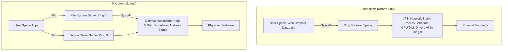

# Modul 105: Algoritma String & Geometri Komputasional (KMP, Aho-Corasick, Convex Hull, Voronoi, KD-Tree)

**Navigasi**: [⬅️ Master Index](../../INDEX.md) | [Tingkat 6: Tingkat 6: Computer Science Core, Struktur Data, Algoritma & Compiler](./README.md)
*Sebelumnya*: [104. algoritma-graf-lanjut](./104-algoritma-graf-lanjut.md) | *Berikutnya*: [106. teori-bahasa-formal-otomata](./106-teori-bahasa-formal-otomata.md)

---

## 1. Intuisi Dasar Tanpa Jargon ("Seperti Bayi Baru Lahir")
Bayangkan sebuah negara berdaulat: ada jutaan warga sipil (aplikasi user space) yang tinggal dan berbisnis sehari-hari, dan ada aparat pemerintah serta militer (kernel OS) yang mengontrol perbatasan, mencetak uang, dan menegakkan hukum. Warga sipil tidak diizinkan memiliki senjata artileri berat atau mencetak paspor sendiri; jika mereka membutuhkan jalan tol baru atau ingin berkomunikasi ke luar negeri, mereka wajib mengajukan permohonan resmi melalui loket birokrasi negara (System Call). Arsitektur Kernel Sistem Operasi ([Operating System Architecture](https://www.kernel.org/doc/html/latest/)) adalah benteng pertahanan perangkat keras: cincin hak istimewa silikon CPU (Ring 0 untuk Kernel, Ring 3 untuk User Space) menjamin bahwa jika sebuah program aplikasi nakal mengalami crash atau mencoba mengakses memori terlarang, prosesor silikon seketika menghentikan program tersebut tanpa menggoyahkan stabilitas seluruh komputer.

## 2. Fondasi Teoretis & Aksiomatik / Matematis
Model Keamanan Tingkat Hak Istimewa CPU x86-64 (Privilege Rings & Page Table Isolation):

CPU x86-64 menyediakan 4 tingkat privilege (Ring 0 s.d. Ring 3):
$$\text{Ring 0 (Supervisor / Kernel)} \supset \text{Ring 1} \supset \text{Ring 2} \supset \text{Ring 3 (User Applications)}$$
Sistem operasi modern (Linux, Windows, macOS) hanya menggunakan Ring 0 (CPL = 0) dan Ring 3 (CPL = 3).

Mekanisme Transisi Mode Hak Istimewa:
1. **Instruksi `SYSCALL` / `SYSRET`**:
   Aplikasi Ring 3 memuat nomor syscall ke register `%rax`, parameter ke `%rdi, %rsi, %rdx, %r10, %r8, %r9`, lalu mengeksekusi instruksi CPU `syscall`.
   CPU silikon secara otomatis:
   - Menyimpan `%rip` ke `%rcx` dan `%rflags` ke `%r11`.
   - Memuat `%rip` baru dari Model Specific Register `MSR_LSTAR` (alamat handler kernel `entry_SYSCALL_64`).
   - Mengubah Current Privilege Level (CPL) dari 3 ke 0 dan beralih ke Kernel Stack Pointer (`RSP0` pada TSS).

2. **Taksonomi Desain Kernel**:
   - **Monolithic Kernel (Linux)**: Seluruh subsistem (VFS, IPC, Scheduler, Driver, Network Stack) berjalan di dalam Ring 0 dengan ruang alamat bersama. Performa sangat tinggi karena pemanggilan fungsi in-kernel tanpa context switch, namun satu bug driver dapat meruntuhkan seluruh OS (Kernel Panic).
   - **Microkernel (seL4, Minix)**: Hanya primitive minimal (IPC, Virtual Memory, Threading) di Ring 0; driver dan file system berjalan sebagai proses terisolasi di Ring 3. Keamanan sangat tinggi, dibuktikan secara formal matematis (formally verified), namun membutuhkan overhead context-switch IPC yang lebih besar.

## 3. Anatomi Teknis & Cara Kerja Internal
Perbandingan Arsitektur Monolithic Kernel Linux vs Microkernel (seL4):



1. **Page Table Isolation (KPTI)**: Mitigasi kerentanan hardware *Meltdown* (CVE-2017-5754). Kernel memisahkan tabel halaman Ring 3 secara ketat sehingga memori kernel Ring 0 sama sekali tidak terpetakan saat kode aplikasi berjalan di Ring 3 ([Linux Kernel KPTI Documentation](https://www.kernel.org/doc/html/latest/x86/pti.html)).
2. **Task State Segment (TSS)**: Struktur hardware x86-64 yang memegang nilai pointer stack kernel `RSP0` dan Interrupt Stack Table (IST) untuk menangani Double Faults (#DF) dan NMI.

## 4. Implementasi Praktis & Kode / Simulasi Riil
```c
// Pure Assembly System Call invoking sys_write directly without libc in Linux x86-64
#include <stdint.h>

// Nomor syscall Linux x86-64:
// __NR_write = 1
// __NR_exit  = 60

static inline int64_t raw_syscall3(int64_t nr, int64_t arg1, int64_t arg2, int64_t arg3) {
    int64_t ret;
    __asm__ volatile(
        "movq %1, %%rax\n\t"
        "movq %2, %%rdi\n\t"
        "movq %3, %%rsi\n\t"
        "movq %4, %%rdx\n\t"
        "syscall\n\t"
        "movq %%rax, %0\n\t"
        : "=r"(ret)
        : "r"(nr), "r"(arg1), "r"(arg2), "r"(arg3)
        : "rax", "rdi", "rsi", "rdx", "rcx", "r11", "memory"
    );
    return ret;
}

void _start(void) {
    const char msg[] = "Executing directly from Linux Ring 3 via raw SYSCALL!\n";
    raw_syscall3(1, 1, (int64_t)msg, sizeof(msg) - 1); // sys_write(stdout, msg, len)
    
    // sys_exit(0)
    __asm__ volatile(
        "movq $60, %%rax\n\t"
        "xorq %%rdi, %%rdi\n\t"
        "syscall\n\t"
        : : : "rax", "rdi"
    );
}
```

## 5. Miskonsepsi & Jebakan Industri
1. **Meltdown Vulnerability via Speculative Execution**: Prosesor berspekulasi membaca data memori kernel dari Ring 3 sebelum pemeriksaan hak akses privilege CPL selesai, meninggalkan jejak data rahasia di cache L1 CPU yang dapat diekstraksi via timing attacks.
2. **Dereferencing User-Space Pointer Directly Inside Kernel Drivers**: Driver Ring 0 langsung melakukan dereference pointer dari aplikasi (`*user_ptr = val`) tanpa menggunakan `copy_to_user()` atau `copy_from_user()`. Jika aplikasi mengoper alamat memori kernel yang tidak valid, kernel akan mengalami panic atau membuka eksploitasi eskalasi privilege.
3. **Blocking Inside Interrupt Context (Top Half)**: Memanggil fungsi yang dapat tertidur (*sleepable functions* seperti `msleep()` atau alokasi `kmalloc(GFP_KERNEL)`) di dalam Interrupt Service Routine hardware. Karena konteks interupsi tidak memiliki proses peminjam untuk di-schedule ulang, kernel akan langsung melempar BUG: scheduling while atomic.

## 6. Proyek Latihan & Rubrik Penilaian Mandiri
1. **Tingkat Pemula**: Kompilasi biner C tanpa pustaka standar (`gcc -nostdlib -static minimal.c -o minimal`) yang mencetak teks ke layar dan keluar bersih hanya menggunakan inline assembly `syscall`.
2. **Tingkat Menengah**: Gunakan utilitas Linux `strace` untuk merekam dan menganalisis seluruh system calls yang dipanggil oleh perintah `ls -la`. Klasifikasikan syscall berdasarkan fungsinya (File I/O, Memori, Identitas Proses).
3. **Tingkat Mahir**: Bangun modul kernel Linux sederhana (`hello_lkm.ko`) yang mendaftarkan karakter perangkat khusus di `/dev/kernel_priv`. Lakukan pengalihan konteks memori aman antara ruang pengguna dan ruang kernel menggunakan fungsi `copy_to_user` dan `access_ok`.

## 7. Rekomendasi Sumber Belajar Standar Emas
| Sumber Pembelajaran | Penulis / Institusi | Tautan Langsung | Fokus Materi |
| :--- | :--- | :--- | :--- |
| Operating Systems: Three Easy Pieces (OSTEP) | Remzi & Andrea Arpaci-Dusseau (Univ. of Wisconsin) | [OSTEP Free Book](https://pages.cs.wisc.edu/~remzi/OSTEP/) | Virtualization, Concurrency, Persistence & Syscall Architecture |
| Linux Kernel Documentation | The Kernel Development Community | [The Linux Kernel Docs](https://www.kernel.org/doc/html/latest/) | Subsystem Architecture, Process Scheduling & Memory Management |
| seL4 Microkernel: Formal Verification & Architecture | Gernot Heiser et al. | [seL4 Project Research](https://sel4.systems/About/seL4-whitepaper.pdf) | Mathematical Proof of Kernel Correctness, Capabilities & Zero-Buffer IPC |
| Understanding the Linux Kernel, 3rd Edition | Daniel P. Bovet & Marco Cesati | [O'Reilly ULK3](https://www.oreilly.com/library/view/understanding-the-linux/0596005652/) | Hardware Segmentation, Paging, System Calls & Interrupt Handling |

---
*Navigasi Cepat*: [Ke Tingkat 6](./README.md) | [Ke Master Index](../../INDEX.md) | *Sebelumnya*: [104. algoritma-graf-lanjut](./104-algoritma-graf-lanjut.md) | *Berikutnya*: [106. teori-bahasa-formal-otomata](./106-teori-bahasa-formal-otomata.md)
