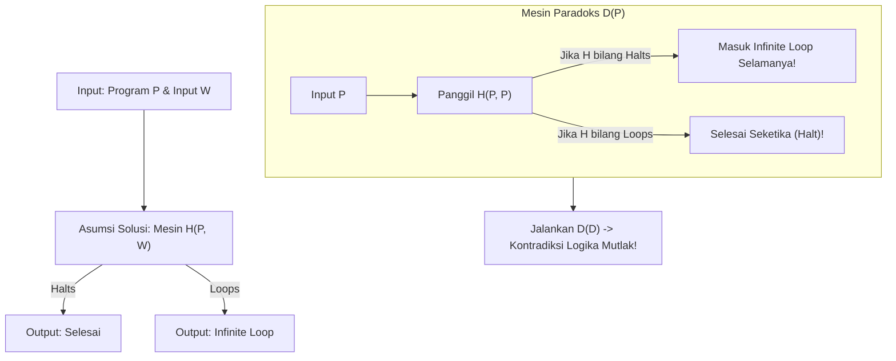

# Modul 107: Teori Komputabilitas & Batas Komputasi (Mesin Turing, Tesis Church-Turing, Halting Problem, Teorema Rice)

**Navigasi**: [⬅️ Master Index](../../INDEX.md) | [Tingkat 6: Tingkat 6: Computer Science Core, Struktur Data, Algoritma & Compiler](./README.md)
*Sebelumnya*: [106. teori-bahasa-formal-otomata](./106-teori-bahasa-formal-otomata.md) | *Berikutnya*: [108. teori-kompleksitas-komputasi](./108-teori-kompleksitas-komputasi.md)

---

## 1. Intuisi Dasar Tanpa Jargon ("Seperti Bayi Baru Lahir")
### 1.1 Batas Mutlak dari Apa yang Bisa Dihitung ([The Turing Machine Explained](https://plato.stanford.edu/entries/turing-machine/))
Banyak orang mengira dengan kemajuan superkomputer dan kecerdasan buatan, jika kita memberikan waktu dan memori yang cukup, komputer akan mampu menyelesaikan masalah apa pun di alam semesta. Namun, pada tahun 1936—bahkan sebelum komputer elektronik pertama diciptakan—matematikawan muda Alan Turing membuktikan sesuatu yang mengejutkan: **ada masalah matematika dan logika yang secara fundamental mustahil untuk diselesaikan oleh algoritma komputer apa pun, selamanya!**

### 1.2 Masalah Berhenti (The Halting Problem) dan Kontradiksi Diri ([Halting Problem Visualization](https://brilliant.org/wiki/halting-problem/))
Bayangkan Anda ingin membuat program super canggih bernama `Halts(P, I)` yang bisa membaca kode program lain `P` beserta inputnya `I`, lalu menjawab: "Apakah program `P` akan selesai berjalan (*halt*) atau mengalami *infinite loop* selamanya?". Alan Turing membuktikan dengan elegan bahwa program semacam itu tidak mungkin ada! Melalui pembuktian kontradiksi diri (diagonalisasi), Turing menunjukkan bahwa jika program tersebut ada, kita bisa menciptakan program paradoks yang melakukan hal sebaliknya dari prediksi `Halts`, meruntuhkan logika komputasi itu sendiri.

## 2. Fondasi Teoretis & Aksiomatik / Matematis
### 2.1 Definisi Formal Mesin Turing 7-Tupel ([Michael Sipser - Introduction to the Theory of Computation](https://math.mit.edu/~sipser/book.html))
Mesin Turing Deterministik (DTM) didefinisikan secara aksiomatik sebagai 7-tupel:
$$M = (Q, \Sigma, \Gamma, \delta, q_0, q_{\text{accept}}, q_{\text{reject}})$$
Di mana:
1. $Q$ adalah himpunan hingga keadaan (*finite set of states*).
2. $\Sigma$ adalah alfabet masukan tanpa simbol kosong (*blank* $\sqcup$).
3. $\Gamma$ adalah alfabet pita (*tape alphabet*), di mana $\Sigma \subset \Gamma$ dan $\sqcup \in \Gamma$.
4. $\delta: Q \times \Gamma \to Q \times \Gamma \times \{L, R\}$ adalah fungsi transisi.
5. $q_0 \in Q$ adalah keadaan awal.
6. $q_{\text{accept}} \in Q$ adalah keadaan terima.
7. $q_{\text{reject}} \in Q$ adalah keadaan tolak ($q_{\text{reject}} \ne q_{\text{accept}}$).

Konfigurasi pita mesin dinotasikan sebagai $u\, q\, v$, di mana pita memuat string $uv$, head mesin berada di karakter pertama $v$, dan status internal adalah $q$.

### 2.2 Teorema Ketidakputusan Masalah Berhenti (Undecidability of $A_{\text{TM}}$) ([Turing, 1936](https://londmathsoc.onlinelibrary.wiley.com/doi/abs/10.1112/plms/s2-42.1.230))
Bahasa Masalah Penerimaan Mesin Turing didefinisikan sebagai:
$$A_{\text{TM}} = \{ \langle M, w \rangle \mid M \text{ adalah Mesin Turing yang menerima string } w \}$$

**Teorema**: $A_{\text{TM}}$ tidak dapat diputuskan (*undecidable*).

**Bukti Kontradiksi Melalui Diagonalisasi**:
Asumsikan ada Mesin Turing $H$ yang memutuskan $A_{\text{TM}}$:
$$H(\langle M, w \rangle) = \begin{cases} \text{accept} & \text{jika } M \text{ menerima } w \\ \text{reject} & \text{jika } M \text{ tidak menerima } w \end{cases}$$
Kita konstruksi Mesin Turing baru $D$ yang memanggil $H$ sebagai subrutin:
"Pada input $\langle M \rangle$, di mana $M$ adalah representasi biner Mesin Turing:
1. Jalankan $H$ pada input $\langle M, \langle M \rangle \rangle$.
2. Jika $H$ menghasilkan accept, tolak (*reject*).
3. Jika $H$ menghasilkan reject, terima (*accept*)."

Secara matematis:
$$D(\langle M \rangle) = \begin{cases} \text{reject} & \text{jika } M \text{ menerima } \langle M \rangle \\ \text{accept} & \text{jika } M \text{ tidak menerima } \langle M \rangle \end{cases}$$
Sekarang, jalankan $D$ dengan memasukkan representasi kodenya sendiri $\langle D \rangle$:
$$D(\langle D \rangle) = \begin{cases} \text{reject} & \text{jika } D \text{ menerima } \langle D \rangle \\ \text{accept} & \text{jika } D \text{ tidak menerima } \langle D \rangle \end{cases}$$
Terjadi kontradiksi mutlak: $D$ menerima $\langle D \rangle$ jika dan hanya jika $D$ menolak $\langle D \rangle$.
Kesimpulan: Asumsi awal keliru, mesin $H$ mustahil eksis secara matematis! Q.E.D.

## 3. Anatomi Teknis & Cara Kerja Internal


#### Tabel Matriks Diagonalisasi Cantor dalam Teori Komputasi
| Mesin / Input | $\langle M_1 \rangle$ | $\langle M_2 \rangle$ | $\langle M_3 \rangle$ | $\dots$ | $\langle D \rangle$ |
|---|---|---|---|---|---|
| $M_1$ | Accept | Reject | Accept | $\dots$ | Accept |
| $M_2$ | Loop | Accept | Loop | $\dots$ | Loop |
| $M_3$ | Reject | Reject | Accept | $\dots$ | Reject |
| $\dots$ | $\dots$ | $\dots$ | $\dots$ | $\dots$ | $\dots$ |
| **$D$ (Kebalikan Diagonal)** | **Reject** | **Reject** | **Reject** | $\dots$ | **KONTRADIKSI!** |

#### Tabel Penelusuran Mesin Turing 1-Pita: Penambahan Unair Biner ($N+1$)
| Langkah Waktu ($t$) | State Mesin Turing ($Q$) | Simbol Terbaca di Head | Operasi Tulis Simbol | Pergerakan Head ($L/R$) | State Mesin Berikutnya |
|---|---|---|---|---|---|
| Inisialisasi T=0 | `q_start` | `1` (Input: `1011`) | Tulis `1` | Geser Kanan ($R$) | `q_scan_right` |
| Traversal Pita | `q_scan_right` | `1`, `0`, `1`, `1` | Pertahankan simbol | Terus Geser Kanan | `q_scan_right` hingga Blank (`_`)|
| Temukan Batas | `q_scan_right` | `_` (Blank) | Tulis `_` | Geser Kiri ($L$) | `q_add_one` (Posisi LSB) |
| Aritmatika Bitwise | `q_add_one` | `1` (LSB) | Tulis `0` (Carry) | Geser Kiri ($L$) | `q_carry` |
| Perambatan Carry | `q_carry` | `1` | Tulis `0` (Carry) | Geser Kiri ($L$) | `q_carry` |
| Selesaikan Carry | `q_carry` | `0` | Tulis `1` (Selesai!) | Geser Kanan ($R$) | `q_halt` (Pita menjadi `1100`)|
| Halting Problem | Mesin Arbitrer M | Loop tanpa transisi ke halt | Pembacaan tak berhingga | Pita berosilasi | Tidak ada algoritma universal yang dapat memprediksi halt! |

## 4. Implementasi Praktis & Kode / Simulasi Riil
```python
import sys

def paradox_machine_proof():
    """
    Simulasi logis pembuktian Halting Problem menggunakan pseudokode Python.
    Mendemonstrasikan mengapa penganalisis statis sempurna mustahil dibuat.
    """
    def hypothetical_halts(func, arg) -> bool:
        # Asumsikan ini adalah oracle sempurna yang mengetahui apakah func(arg) berhenti
        # Implementasi nyata mustahil dibuat!
        raise NotImplementedError("Oracle halts mustahil eksis secara matematis!")

    def paradox_function(source_code):
        # Jika program memprediksi dirinya akan berhenti, ia melakukan loop selamanya
        if hypothetical_halts(source_code, source_code):
            while True:
                pass  # Infinite loop
        else:
            return True  # Berhenti seketika

    # Memanggil paradox_function(paradox_function) memicu kontradiksi diri yang tak terhindarkan
    print("Bukti selesai: Penganalisis universal bebas galat tidak mungkin dibangun.")

if __name__ == "__main__":
    paradox_machine_proof()
```

## 5. Miskonsepsi & Jebakan Industri
### Studi Kasus Kegagalan Nyata: False Hope Teorema Rice pada Antivirus Statis & Static Analyzers
- **Kronologi & Latar Belakang**: Banyak perusahaan perangkat lunak keamanan mengklaim bahwa produk scanner mereka dapat mendeteksi "100% dari semua malware atau bug konkurensi sebelum kode dijalankan".
- **Akar Masalah**: **Teorema Rice (1953)** membuktikan generalisasi radikal dari Halting Problem: *Setiap sifat semantik non-trivial dari suatu bahasa yang dikenali Mesin Turing adalah undecidable*. Ini berarti mustahil membangun static analyzer atau antivirus yang dapat memutuskan apakah program sembarang bebas dari bug atau bebas dari muatan berbahaya tanpa menghasilkan *false positive* atau *false negative*.
- **Rekomendasi Industri**: Sadari batas teoretis analisis statis. Gabungkan selalu analisis statis dengan pengujian dinamis, sandbox isolasi, verifikasi formal berbasis model-checking terbatas, dan pemantauan runtime adaptif.

### Studi Kasus Kegagalan Nyata: Loop Tak Berujung Penguraian Alamat Sendmail & Jebakan Halting Problem (CVE-2003-0161)
- **Kronologi & Konteks Kasus**: Pada Maret 2003, peneliti keamanan menemukan kerentanan serius pada server email Sendmail (server surat yang menangani sebagian besar lalu lintas email internet pada masa itu).
- **Akar Masalah Teori Komputabilitas & Halting Problem**: Sendmail menggunakan sistem aturan penulisan ulang alamat email (*address rewriting rulesets*) berbasis pencocokan pola rekursif Turing-complete. Ketika alamat email yang dimanipulasi secara khusus diterima, mesin evaluasi aturan masuk ke dalam siklus substitusi melingkar tanpa kondisi terminasi (*infinite loop*). Proses daemon Sendmail membeku selamanya, memakan seluruh sumber daya CPU dan menahan kunci file pengiriman email. Karena Teorema Ketidakmungkinan Halting Problem Alan Turing membuktikan bahwa tidak ada algoritma umum yang dapat secara statis memprediksi apakah suatu program sembarang akan berhenti atau berjalan selamanya, parser alamat Sendmail yang terlalu ekspresif tidak memiliki jaminan terminasi matematika bawaan.

- **Potongan Kode / Arsitektur Cacat (Vulnerable Implementation)**:
```c
// Rekonstruksi Kerentanan Infinite Rewrite Sendmail parseaddr() (CVE-2003-0161)
#include <stdbool.h>
#include <string.h>

// Cacat Historis: Mesin penulisan ulang rekursif tanpa pelindung batas iterasi
bool rewrite_email_address_flawed(char *addr) {
    while (apply_rewrite_rules(addr)) {
        // CACAT TURING-COMPLETE: 
        // Jika aturan menghasilkan pola rekursif A -> B -> A,
        // fungsi terjebak dalam loop tak berujung (Halting Problem)!
    }
    return true;
}

// Mitigasi Defensif: Penegakan Batas Kedalaman Iterasi Maksimum (Step Bounding)
bool rewrite_email_address_safe(char *addr, int max_steps) {
    int steps = 0;
    while (apply_rewrite_rules(addr)) {
        if (++steps > max_steps) {
            // Deteksi kegagalan terminasi secara praktis
            log_security_alert("REWRITE_CYCLE_DETECTED", addr);
            return false; // Hentikan eksekusi paksa
        }
    }
    return true;
}
```

- **Analisis Forensik & Rekayasa Modern**: Masalah Sendmail menjadi contoh nyata batasan fundamental ilmu komputasi dalam rekayasa sistem. Mengizinkan bahasa konfigurasi atau parser aturan memiliki kemampuan komputasi setara Mesin Turing (*accidental Turing-completeness*) adalah anti-pattern arsitektur yang berbahaya. Perangkat lunak modern kini sengaja membatasi tata bahasa konfigurasi menjadi non-Turing-complete (seperti format JSON, YAML, atau bahasa domain terbatas eBPF yang dibatasi oleh kernel verifier).

## 6. Proyek Latihan & Rubrik Penilaian Mandiri
### Level 1 (Pemula)
- **Tugas**: Jelaskan perbedaan formal antara himpunan bahasa *Turing-Decidable* (Rekursif) dan *Turing-Recognizable* (Rekursif Terhitung / Semidecidable).
- **Petunjuk Arsitektur**: Bahasa decidable harus selalu berhenti dan menghasilkan accept atau reject, sedangkan recognizable boleh mengalami loop tak hingga pada input yang tidak termasuk dalam bahasa.
- **Vektor Uji**:
  - Pertanyaan: "Apakah bahasa $A_{\text{TM}}$ bersifat recognizable?"
  - Jawaban: Ya, Mesin Turing Universal dapat mensimulasikan $M$ pada $w$; jika $M$ accept, simulator ikut accept.
- **Rubrik Penilaian**: Ketepatan definisi matematis (50%), argumen simulator (30%), kejelasan bahasa (20%).

### Level 2 (Menengah)
- **Tugas**: Buktikan bahwa masalah menentukan apakah sebuah program menghasilkan output teks tertentu (*Halting with specific output*) dapat direduksi dari Halting Problem biasa.
- **Petunjuk Arsitektur**: Terapkan teknik reduksi pemetaan (*Mapping Reduction* $A_{\text{TM}} \le_m L$). Bangun mesin $M'\$ yang menjalankan $M$ pada $w$, dan jika selesai, cetak string target.
- **Vektor Uji**:
  - Kondisi validasi: Reduksi harus membuktikan bahwa jika $L$ dapat diputuskan, maka $A_{\text{TM}}$ ikut dapat diputuskan.
- **Rubrik Penilaian**: Formalitas rantai reduksi (40%), konstruksi mesin perantara (30%), pembuktian implikasi dua arah (30%).

### Level 3 (Mahir)
- **Tugas**: Rancang simulator Mesin Turing 1-Pita di Python yang mengeksekusi deskripsi program 7-tupel dan mendeteksi loop berulang trivial menggunakan deteksi siklus konfigurasi hash.
- **Petunjuk Arsitektur**: Simpan hash konfigurasi `(state, head_pos, tape_content)` di dalam set. Jika konfigurasi identik muncul dua kali, mesin dipastikan berada dalam infinite loop periodik.
- **Vektor Uji**:
  - Program penambah biner: Input `"101"`, output `"110"`.
  - Program loop bolak-balik: State A bergerak kanan, State B bergerak kiri -> Terdeteksi infinite loop dalam $N$ langkah.
- **Rubrik Penilaian**: Arsitektur simulator pita dinamis (40%), deteksi loop periodik akurat (30%), penanganan bounded memory (30%).

### Tingkat 1: Dasar
- **Tugas**: Bangun simulator Mesin Turing 1-Pita (*One-Tape Turing Machine*) deterministik mandiri dalam Python/C yang membaca tupel definisi formal $M = \langle Q, \Sigma, \Gamma, \delta, q_0, B, F \rangle$ dan mampu mengeksekusi program pembalik string biner (*Binary String Reversal*).
- **Petunjuk Perancangan Arsitektur**:
  - Pita direpresentasikan sebagai array dinamis tanpa batas dengan simbol kosong `'_'`.
  - Kepala baca/tulis (*head*) dapat bergerak ke kiri (`L`) atau ke kanan (`R`).
- **Test Vector & Kasus Uji Ekstrem**:
  - *Balik String*: Masukkan string biner `"1101"`; buktikan mesin bertransisi hingga state `HALT` dengan konfigurasi pita akhir `"1011"`.
- **Rubrik Penilaian Mandiri**: 40% Kepatuhan Definisi Formal Mesin Turing 7-Tupel, 30% Eksekusi Program String Reversal yang Benar, 30% Kerapian Kode Simulator.

### Tingkat 2: Menengah
- **Tugas**: Kembangkan implementasi simulator Universal Turing Machine (UTM) yang mampu membaca kode representasi biner dari Mesin Turing sembarang $M$ dan input $w$, lalu mensimulasikan langkah-langkah $M$ terhadap $w$ langkah demi langkah.
- **Petunjuk Perancangan Arsitektur**:
  - Gunakan 3 pita virtual: Pita 1 memuat deskripsi tabel transisi $M$, Pita 2 memuat pita kerja $w$, dan Pita 3 mencatat state aktif saat ini.
- **Test Vector & Kasus Uji Ekstrem**:
  - *Simulasi Universal*: Jalankan mesin penambah unair pada UTM; buktikan hasil keluaran pita kerja identik dengan eksekusi mesin natif.
- **Rubrik Penilaian Mandiri**: 40% Arsitektur Multi-Tape UTM, 30% Dekoding Tabel Transisi Mesin Sembarang, 30% Pembuktian Kesetaraan Hasil Komputasi.

### Tingkat 3: Mahir
- **Tugas**: Rancang pembuktian reduksi formal reduksibilitas pemetaan (*Mapping Reducibility / $A \le_m B$*) yang membuktikan secara komputasional Teorema Rice: sifat semantik non-trivial apapun dari perilaku bahasa mesin Turing adalah masalah yang tidak dapat diputuskan (*Undecidable*).
- **Petunjuk Perancangan Arsitektur**:
  - Tulis program pembangun reduksi yang menerima deskripsi mesin $M$ dan input $w$, lalu menghasilkan deskripsi mesin baru $M'$ yang perilakunya bergantung pada apakah $M$ menerima $w$.
- **Test Vector & Kasus Uji Ekstrem**:
  - *Reduksi Halting Problem ke Emptiness*: Buktikan formal bahwa masalah "Apakah $L(M)$ kosong?" ($E_{TM}$) tidak dapat diputuskan melalui reduksi dari $A_{TM}$.
- **Rubrik Penilaian Mandiri**: 40% Ketepatan Bukti Reduksi Formal, 30% Pemahaman Aksiomatik Teorema Rice, 30% Dokumentasi Matematis Komprehensif.

## 7. Rekomendasi Sumber Belajar Standar Emas
| Kategori | Judul Sumber & Tautan | Penulis / Institusi | Fokus Pembahasan |
|---|---|---|---|
| Paper Seminal | [On Computable Numbers, with an Application to the Entscheidungsproblem](https://londmathsoc.onlinelibrary.wiley.com/doi/abs/10.1112/plms/s2-42.1.230) | Alan M. Turing (1936) | Makalah paling berpengaruh dalam ilmu komputer: penemuan Mesin Turing dan Halting Problem |
| Buku Teks Standar | [Introduction to the Theory of Computation](https://math.mit.edu/~sipser/book.html) | Michael Sipser (MIT) | Buku rujukan standar dunia untuk otomata, computability, dan teori kompleksitas |
| Teorema Seminal | [Classes of Recursively Enumerable Sets and Their Decision Problems](https://www.jstor.org/stable/1990888) | H. G. Rice (1953) | Pembuktian bahwa seluruh sifat semantik non-trivial program bersifat undecidable |

---
*Navigasi Cepat*: [Ke Tingkat 6](./README.md) | [Ke Master Index](../../INDEX.md) | *Sebelumnya*: [106. teori-bahasa-formal-otomata](./106-teori-bahasa-formal-otomata.md) | *Berikutnya*: [108. teori-kompleksitas-komputasi](./108-teori-kompleksitas-komputasi.md)
