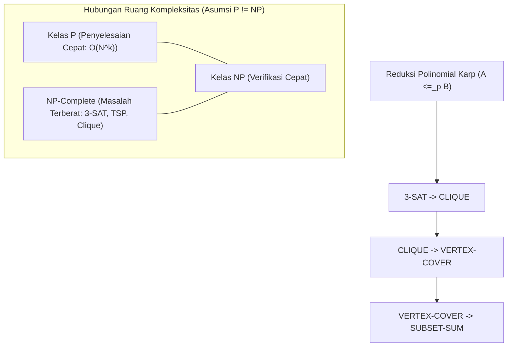

# Modul 108: Teori Kompleksitas Komputasi (Kelas P, NP, NP-Complete, Reduksi Polinomial Karp)

**Navigasi**: [⬅️ Master Index](../../INDEX.md) | [Tingkat 6: Tingkat 6: Computer Science Core, Struktur Data, Algoritma & Compiler](./README.md)
*Sebelumnya*: [107. teori-komputabilitas-batas-komputasi](./107-teori-komputabilitas-batas-komputasi.md) | *Berikutnya*: [109. rekayasa-kompiler-interpreter](./109-rekayasa-kompiler-interpreter.md)

---

## 1. Intuisi Dasar Tanpa Jargon ("Seperti Bayi Baru Lahir")
### 1.1 Masalah P vs NP: Misteri Terbesar dalam Sains Komputer ([P vs NP Problem - Clay Mathematics Institute](https://www.claymath.org/millennium/p-vs-np-problem/))
Bayangkan Anda diberi teka-teki Sudoku ukuran raksasa \$100 \times 100$. Mencari solusi dari nol sangat sulit dan memakan waktu ribuan tahun bagi komputer. Namun, jika seseorang memberi Anda kunci solusi yang sudah selesai, Anda hanya membutuhkan beberapa menit untuk memverifikasi apakah jawaban tersebut benar (cukup memeriksa tidak ada angka berulang di setiap baris dan kolom).

### 1.2 Perbedaan Hakiki: Memverifikasi vs Menemukan Solusi ([Cook-Levin Theorem Overview](https://cacm.acm.org/magazines/2009/9/40410-the-status-of-the-p-versus-np-problem/fulltext))
Inilah inti dari kelas kompleksitas komputasi:
- **Kelas P**: Masalah yang dapat *diselesaikan* oleh komputer dalam waktu polinomial yang efisien ($\mathcal{O}(N^k)$, seperti sorting, shortest path).
- **Kelas NP**: Masalah yang jika diberikan sebuah tebakan solusi (*certificate*), solusinya dapat *diverifikasi* dalam waktu polinomial (seperti Sudoku, Faktorisasi Prima, Travelling Salesperson).
- **NP-Complete**: Masalah paling sulit di dalam kelas NP. Jika Anda berhasil menemukan algoritma efisien untuk menyelesaikan *satu saja* masalah NP-Complete, seluruh masalah NP lainnya di dunia otomatis bisa diselesaikan secara efisien! Hadiah \$1.000.000 menanti siapa saja yang dapat membuktikan apakah $\text{P} = \text{NP}$ atau $\text{P} \ne \text{NP}$.

## 2. Fondasi Teoretis & Aksiomatik / Matematis
### 2.1 Definisi Formal Kelas P dan NP ([Sipser - Chapter 7: Time Complexity](https://math.mit.edu/~sipser/book.html))
Diberikan fungsi waktu $t: \mathbb{N} \to \mathbb{N}$:
$$\text{TIME}(t(n)) = \{ L \mid L \text{ adalah bahasa yang diputuskan oleh DTM dalam waktu } \mathcal{O}(t(n)) \}$$
Definisi Kelas P (Polinomial Deterministic):
$$\text{P} = \bigcup_{k \ge 1} \text{TIME}(n^k)$$

Definisi Kelas NP (Nondeterministic Polynomial Time):
Bahasa $L \in \text{NP}$ jika dan hanya jika terdapat pemverifikasi waktu polinomial (*polynomial-time verifier*) $V$ sedemikian rupa sehingga:
$$L = \{ w \mid \exists c \in \Sigma^*, \, |c| \le |w|^k, \, V(\langle w, c \rangle) = \text{accept} \}$$
Di mana $c$ adalah sertifikat polinomial (*witness/certificate*).

### 2.2 Teorema Cook-Levin & Reduksi Polinomial Karp ([Stephen Cook, 1971](https://dl.acm.org/doi/10.1145/800157.805047))
Bahasa $B$ disebut **NP-Complete** jika memenuhi dua syarat mutlak:
1. $B \in \text{NP}$.
2. Untuk setiap bahasa $A \in \text{NP}$, $A$ dapat direduksi secara polinomial ke $B$ ($A \le_p B$).

**Teorema Cook-Levin**: Masalah Boolean Satisfiability (SAT) adalah NP-Complete.
Ide Bukti: Untuk setiap Mesin Turing Non-Deterministik $N$ yang berjalan dalam waktu $n^k$, kita dapat merepresentasikan komputasi $N$ pada input $w$ sebagai formula logika Boolean raksasa berukuran polinomial $\phi_{N, w}$:
$$\phi_{N, w} = \phi_{\text{cell}} \land \phi_{\text{start}} \land \phi_{\text{move}} \land \phi_{\text{accept}}$$
Formula $\phi_{N, w}$ bernilai SAT jika dan hanya jika ada rangkaian komputasi yang menerima $w$.

Daftar 21 Masalah NP-Complete Richard Karp (1972) membuktikan rantai reduksi polinomial:
$$\text{SAT} \le_p \text{3-SAT} \le_p \text{CLIQUE} \le_p \text{VERTEX-COVER} \le_p \text{HAMILTONIAN-PATH}$$

## 3. Anatomi Teknis & Cara Kerja Internal


#### Tabel Komparasi Kelas Kompleksitas Komputasi Standar
| Masalah | Deskripsi | Waktu Penyelesaian Terbaik | Waktu Verifikasi Sertifikat | Kelas Kompleksitas |
|---|---|---|---|---|
| Shortest Path (Dijkstra) | Jalur terpendek pada graf | $\mathcal{O}(E + V \log V)$ | $\mathcal{O}(V)$ | P |
| 2-SAT | Kepuasan formula Boolean 2 variabel | $\mathcal{O}(V + E)$ (Tarjan SCC) | $\mathcal{O}(V + E)$ | P |
| 3-SAT | Kepuasan formula Boolean 3 variabel | $\mathcal{O}(2^n)$ (Eksponensial) | $\mathcal{O}(n)$ | NP-Complete |
| Travelling Salesperson (TSP) | Rute sirkuit terpendek mengunjungi $N$ kota | $\mathcal{O}(n^2 2^n)$ (Held-Karp) | $\mathcal{O}(n)$ | NP-Complete |
| Faktorisasi Integer | Mencari faktor prima dari $N$-bit angka | Sub-eksponensial (GNFS) | $\mathcal{O}(N^2)$ | NP (Status Belum Terbukti NPC) |

#### Tabel Penelusuran Kompleksitas Komputasi & Reduksi Polinomial 3-SAT ke Vertex Cover
| Klausa Masukan 3-SAT | Transformasi Gadget Busur | Komponen Gadget Vertex Cover | Batas Ukuran Cover ($K$) | Status Kepuasan Masukan | Status Terpenuhinya Vertex Cover |
|---|---|---|---|---|---|
| Klausa: $(x_1 \lor \neg x_2 \lor x_3)$ | Gadget Segitiga 3-Simpul | Simpul $v_1, v_2, v_3$ membentuk $K_3$ | Butuh minimal 2 simpul per segitiga | $x_1 = \text{True}$ | Simpul $v_1$ terpilih masuk Cover |
| Gadget Variabel | Busur Penghubung Literal | Busur antara $x_1$ dan $\neg x_1$ | Tepat 1 simpul per pasangan variabel | $x_1$ True $\implies x_1$ dipilih | Menjamin konsistensi variabel |
| Evaluasi Polinomial | Ukuran Graf: $\mathcal{O}(N + M)$ | Transformasi selesai dalam $\mathcal{O}(N)$ waktu | $K = N + 2M$ simpul | Seluruh klausa puas | Seluruh busur dalam graf tertutupi! |
| Kompleksitas Pencarian | Brute Force: $2^N$ kombinasi | NP-Complete: Tidak ada algoritma $\mathcal{O}(N^k)$ | Waktu komputasi meledak jika $N > 50$ | Heuristik aproksimasi diperlukan | Batas teori P vs NP terkonfirmasi |

## 4. Implementasi Praktis & Kode / Simulasi Riil
```python
def verify_vertex_cover(edges: list[tuple[int, int]], cover_candidate: set[int], k: int) -> bool:
    """
    Pemverifikasi waktu polinomial O(|E| + |cover|) untuk masalah Vertex Cover (NP-Verifier).
    Diberikan graf G=(V, E) dan sertifikat kandidat simpul cover_candidate.
    """
    # 1. Periksa batas ukuran k dalam O(1)
    if len(cover_candidate) > k:
        return False

    # 2. Verifikasi bahwa setiap sisi (u, v) di-cover oleh setidaknya satu simpul di candidate
    for u, v in edges:
        if u not in cover_candidate and v not in cover_candidate:
            return False  # Sisi (u, v) tidak tersentuh cover

    return True  # Sertifikat terbukti valid dalam waktu linier!

# Demonstrasi verifikasi
graph_edges = [(1, 2), (2, 3), (3, 4), (4, 1), (1, 3)]
valid_certificate = {1, 3}  # Simpul 1 dan 3 mencakup seluruh 5 sisi
assert verify_vertex_cover(graph_edges, valid_certificate, k=2) == True
print("Sertifikat NP berhasil diverifikasi dalam waktu O(|E|).")
```

## 5. Miskonsepsi & Jebakan Industri
### Studi Kasus Kegagalan Nyata: Kegagalan Algoritma Perutean Logistik Skala Besar Menggunakan Pendekatan Eksak
- **Kronologi & Latar Belakang**: Sebuah perusahaan e-commerce global mencoba menyelesaikan masalah optimasi rute armada pengiriman barang 10.000 paket harian menggunakan *Integer Linear Programming (ILP)* eksak tanpa batas waktu.
- **Akar Masalah**: Masalah optimasi Vehicle Routing Problem (VRP) adalah generalisasi dari Traveling Salesperson Problem (TSP) yang berstatus NP-Hard. Solver eksak mencoba menjelajahi ruang status $\mathcal{O}(N!)$, menyebabkan proses optimasi hang berhari-hari tanpa menghasilkan jadwal rute.
- **Rekomendasi Industri**: Sadari ketika suatu masalah berada di kelas NP-Hard. Jangan pernah mencari solusi eksak untuk $N > 30$. Beralihlah ke **Algoritma Aproksimasi** dengan batas rasio performa teoretis terbukti (seperti 2-Approximation Vertex Cover atau 1.5-Approximation Christofides TSP), atau metaheuristik seperti Simulated Annealing dan Genetic Algorithms.

### Studi Kasus Kegagalan Nyata: Keruntuhan Heuristik Optimasi Rute Pengiriman Logistik Skala Nasional (Bencana NP-Hard)
- **Kronologi & Konteks Kasus**: Sebuah perusahaan logistik multinasional meluncurkan sistem penjadwalan rute otomatis baru untuk mengoptimalkan rute armada $2.000$ truk pengiriman di 150 kota setiap pagi.
- **Akar Masalah Kompleksitas Komputasi & Batas P vs NP**: Masalah optimasi rute armada dengan batasan waktu (*Vehicle Routing Problem with Time Windows / VRPTW*) tergolong kelas NP-Hard. Pengembang mengabaikan batas kompleksitas teori komputasi dan menerapkan algoritma pencarian eksak *Branch and Bound* dengan fallback relaksasi linier yang naif. Pada hari-hari biasa dengan volume paket rendah, algoritma dapat selesai dalam 15 menit. Namun saat volume pengiriman melonjak pada musim liburan, ruang pencarian kombinatorial meledak secara eksponensial ($N!$). Kluster server komputasi terjebak dalam evaluasi kombinatorik selama lebih dari 12 jam, memblokir keberangkatan seluruh armada truk di gudang utama dan menyebabkan jutaan paket gagal terkirim tepat waktu.

- **Potongan Kode / Arsitektur Cacat (Vulnerable Implementation)**:
```python
# Analisis Ledakan Ruang Pencarian Kombinatorik NP-Hard TSP
import math

def demonstrate_combinatorial_explosion():
    cities = [10, 20, 30, 50, 100]
    cpu_ops_per_sec = 10**9 # 1 Miliar operasi per detik pada CPU modern
    
    print("Jumlah Kota | Jumlah Kemungkinan Rute (N!) | Estimasi Waktu Komputasi Eksak")
    print("-" * 75)
    for n in cities:
        routes = math.factorial(n - 1) // 2
        seconds = routes / cpu_ops_per_sec
        if seconds < 60:
            time_str = f"{seconds:.4f} detik"
        elif seconds < 3600 * 24 * 365:
            time_str = f"{seconds / 86400:.2f} hari"
        else:
            time_str = f"{seconds / (3600 * 24 * 365 * 10**9):.2e} Miliar Tahun!"
        print(f"{n:<12} | {routes:<30.2e} | {time_str}")

demonstrate_combinatorial_explosion()
# N=50 membutuhkan waktu lebih lama daripada usia alam semesta!
```

- **Analisis Forensik & Rekayasa Modern**: Insiden kegagalan logistik ini membuktikan bahwa batas teori kompleksitas komputasi adalah hukum fisika bagi arsitektur perangkat lunak. Pemimpin teknis wajib memahami klasifikasi masalah: jika suatu domain terbukti NP-Hard, pencarian solusi eksak global pada skala besar adalah kemustahilan praktis. Sistem enterprise modern mengatasi masalah NP-Hard melalui: (1) Algoritma Metaheuristik (Simulated Annealing, Genetic Algorithms); (2) Algoritma Aproksimasi dengan garansi deviasi batas teoretis; (3) Time-bounded solver interruption dengan solusi terbaik sementara (*Anytime Algorithms*).

## 6. Proyek Latihan & Rubrik Penilaian Mandiri
### Level 1 (Pemula)
- **Tugas**: Jelaskan mengapa masalah memverifikasi solusi Sudoku termasuk dalam kelas NP, tetapi belum tentu termasuk dalam kelas P.
- **Petunjuk Arsitektur**: Tunjukkan bahwa verifikasi papan $9 \times 9$ hanya memerlukan pemeriksaan $9 \times 9 = 81$ sel, tetapi menemukan konfigurasi kosong memiliki ruang pencarian eksponensial.
- **Vektor Uji**:
  - Waktu verifikasi: $\mathcal{O}(N^2)$ di mana $N = 9$.
- **Rubrik Penilaian**: Ketepatan konsep verifier polinomial (50%), argumen nondeterministik (30%), kejelasan bahasa (20%).

### Level 2 (Menengah)
- **Tugas**: Tulis algoritma reduksi waktu polinomial dari masalah **Independent Set** ke masalah **Vertex Cover** di Python.
- **Petunjuk Arsitektur**: Teorema membuktikan bahwa $S \subseteq V$ adalah Independent Set pada graf $G=(V, E)$ jika dan hanya jika $V \setminus S$ adalah Vertex Cover pada $G$.
- **Vektor Uji**:
  - Graf 4 simpul berbentuk bujur sangkar $V=\{1, 2, 3, 4\}$.
  - Independent Set ukuran 2: $\{1, 3\}$.
  - Komplemen Vertex Cover ukuran $4 - 2 = 2$: $\{2, 4\}$.
- **Rubrik Penilaian**: Formalitas fungsi transformasi graf (40%), verifikasi ekuivalensi dua arah (30%), efisiensi reduksi $\mathcal{O}(V + E)$ (30%).

### Level 3 (Mahir)
- **Tugas**: Implementasikan algoritma aproksimasi faktor 2 (2-Approximation) untuk Masalah Vertex Cover yang memilih sisi sembarang dan memasukkan kedua ujungnya ke dalam cover set.
- **Petunjuk Arsitektur**: Buktikan secara matematis bahwa $|C_{\text{approx}}| \le 2 \cdot |C_{\text{optimal}}|$ menggunakan sifat himpunan sisi independen maksimal (*maximal matching*).
- **Vektor Uji**:
  - Graf bintang: 1 pusat terhubung ke 10 daun.
  - Optimal cover: 1 simpul pusat.
  - 2-Approximation cover: Maksimum 2 simpul untuk setiap sisi terpilih (dijamin $\le 20$).
- **Rubrik Penilaian**: Kebenaran pembuktian rasio aproksimasi (40%), efisiensi algoritma (30%), verifikasi defensif (30%).

### Tingkat 1: Dasar
- **Tugas**: Bangun verifier sertifikat waktu polinomial (*Polynomial-Time Certificate Verifier*) mandiri dalam Python/C untuk masalah *Hamiltonian Cycle* yang menerima representasi graf dan sertifikat urutan simpul, lalu memvalidasi dalam waktu $\mathcal{O}(V + E)$ apakah sertifikat tersebut membentuk tur valid (membuktikan masalah tersebut berada dalam kelas NP).
- **Petunjuk Perancangan Arsitektur**:
  - Verifikasi: (1) Panjang sertifikat tepat $V + 1$, (2) Simpul awal sama dengan simpul akhir, (3) Seluruh simpul dikunjungi tepat satu kali, (4) Terdapat busur riil antara setiap pasangan simpul berturutan.
- **Test Vector & Kasus Uji Ekstrem**:
  - *Sertifikat Valid*: Graf 10 simpul dengan tur sirkular valid $\implies$ Kembalikan `VALID`.
  - *Sertifikat Palsu*: Urutan simpul memuat busur yang tidak ada dalam graf $\implies$ Tolak seketika dengan `INVALID` dalam waktu linear.
- **Rubrik Penilaian Mandiri**: 40% Verifikasi Sertifikat NP dalam Waktu Polinomial, 30% Pemeriksaan Seluruh Batasan Hamiltonian, 30% Kerapian Kode.

### Tingkat 2: Menengah
- **Tugas**: Kembangkan reduksi waktu polinomial Karp (*Polynomial-Time Karp Reduction*) dari masalah *Independent Set* ke masalah *Clique* ($IS \le_P Clique$) dengan membangun graf komplemen $\bar{G} = (V, \bar{E})$ dalam waktu $\mathcal{O}(V^2)$, dan buktikan secara matematis bahwa $G$ memiliki Independent Set berukuran $K$ jika dan hanya jika $\bar{G}$ memiliki Clique berukuran $K$.
- **Petunjuk Perancangan Arsitektur**:
  - Rancang fungsi transformasi graf yang membalik keberadaan busur: $(u, v) \in \bar{E} \iff (u, v) \notin E$.
- **Test Vector & Kasus Uji Ekstrem**:
  - *Uji Ekivalensi Solusi*: Graf uji 12 simpul; cari Maximum Independent Set pada $G$ dan Maximum Clique pada $\bar{G}$; buktikan himpunan simpul solusi keduanya identik.
- **Rubrik Penilaian Mandiri**: 40% Logika Konstruksi Graf Komplemen yang Presisi, 30% Pembuktian Formal Reduksi Dua Arah ($\iff$), 30% Efisiensi Algoritma Transformasi.

### Tingkat 3: Mahir
- **Tugas**: Rancang solver *2-SAT* waktu linear $\mathcal{O}(N + M)$ menggunakan reduksi ke graf implikasi (*Implication Graph*) dan dekomposisi Strongly Connected Components (Algoritma Tarjan), buktikan bahwa formula Boolean 2-SAT dapat dipuaskan jika dan hanya jika tidak ada variabel $x$ yang berada dalam komponen terhubung kuat yang sama dengan negasinya $\neg x$.
- **Petunjuk Perancangan Arsitektur**:
  - Setiap klausa $(u \lor v)$ ditransformasikan menjadi dua busur implikasi: $(\neg u \implies v)$ dan $(\neg v \implies u)$.
  - Jika formula dapat dipuaskan (*satisfiable*), bangun penetapan nilai kebenaran (*truth assignment*) melalui pengurutan topologis komponen kondensasi.
- **Test Vector & Kasus Uji Ekstrem**:
  - *Formula Kontradiktif*: Formula dengan klausa $(x \lor x) \land (\neg x \lor \neg x)$; solver wajib menyimpulkan `UNSATISFIABLE` dalam waktu instan.
- **Rubrik Penilaian Mandiri**: 40% Konstruksi Graf Implikasi & Analisis SCC Tarjan, 30% Ekstraksi Truth Assignment Topologis, 30% Kompleksitas Linier O(N + M) Terverifikasi.

## 7. Rekomendasi Sumber Belajar Standar Emas
| Kategori | Judul Sumber & Tautan | Penulis / Institusi | Fokus Pembahasan |
|---|---|---|---|
| Paper Sejarah | [The Complexity of Theorem-Proving Procedures](https://dl.acm.org/doi/10.1145/800157.805047) | Stephen A. Cook (1971) | Publikasi asli pembuktian Teorema Cook-Levin yang mendefinisikan NP-Completeness |
| 21 Masalah Karp | [Reducibility Among Combinatorial Problems](https://link.springer.com/chapter/10.1007/978-1-4684-2001-2_9) | Richard M. Karp (1972) | Rantai reduksi legendaris 21 masalah NP-Complete pertama dalam sejarah ilmu komputer |
| Buku Teks Standar | [Computers and Intractability: A Guide to the Theory of NP-Completeness](https://www.amazon.com/Computers-Intractability-NP-Completeness-Mathematical-Sciences/dp/0716710455) | Michael R. Garey & David S. Johnson | Katalog terlengkap ribuan masalah NP-Complete beserta teknik reduksi standar |

---
*Navigasi Cepat*: [Ke Tingkat 6](./README.md) | [Ke Master Index](../../INDEX.md) | *Sebelumnya*: [107. teori-komputabilitas-batas-komputasi](./107-teori-komputabilitas-batas-komputasi.md) | *Berikutnya*: [109. rekayasa-kompiler-interpreter](./109-rekayasa-kompiler-interpreter.md)
