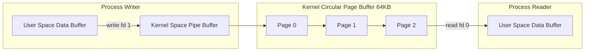

# Modul 108: Teori Kompleksitas Komputasi (Kelas P, NP, NP-Complete, Reduksi Polinomial Karp)

**Navigasi**: [⬅️ Master Index](../../INDEX.md) | [Tingkat 6: Tingkat 6: Computer Science Core, Struktur Data, Algoritma & Compiler](./README.md)
*Sebelumnya*: [107. teori-komputabilitas-batas-komputasi](./107-teori-komputabilitas-batas-komputasi.md) | *Berikutnya*: [109. rekayasa-kompiler-interpreter](./109-rekayasa-kompiler-interpreter.md)

---

## 1. Intuisi Dasar Tanpa Jargon ("Seperti Bayi Baru Lahir")
Karena sistem operasi memagari setiap proses di dalam ruang alamat memori virtualnya sendiri demi keamanan, dua proses yang berjalan berdampingan pada komputer yang sama awalnya benar-benar tuli dan bisu satu sama lain: Proses A tidak bisa membaca variabel milik Proses B. Komunikasi Antar-Proses (Inter-Process Communication / IPC) ([Linux IPC Architecture](https://www.man7.org/linux/man-pages/man7/pipe.7.html)) adalah saluran diplomasi resmi yang disediakan oleh kernel agar proses-proses dapat bekerja sama secara harmonis. Ada saluran pipa sederhana satu arah (**Pipes & FIFOs**) yang mengalirkan data streaming seperti perintah shell `ps | grep`; ada saluran surat cepat (**UNIX Domain Sockets**) yang meluncurkan paket data berkecepatan tinggi antar container lokal; dan ada jalan pintas pamungkas (**Shared Memory**) yang memetakan blok memori fisik yang persis sama ke dalam ruang alamat kedua proses, memungkinkan pertukaran gigabyte data per detik pada kecepatan hardware RAM tanpa perantara satu pun syscall!

## 2. Fondasi Teoretis & Aksiomatik / Matematis
Taksonomi dan Karakteristik Kinerja Saluran IPC Linux:

$$\begin{array}{|l|c|c|c|c|}
\hline
\textbf{Mekanisme IPC} & \textbf{Model Aliran} & \textbf{Salinan Memori} & \textbf{Throughput} & \textbf{Sinkronisasi} \\
\hline
\text{Anonymous Pipe} & \text{Byte Stream (Unidirectional)} & 2\times (\text{User} \leftrightarrow \text{Kernel}) & \text{Tinggi} & \text{Built-in Blocking} \\
\text{Named Pipe (FIFO)} & \text{Byte Stream (Filesystem)} & 2\times & \text{Tinggi} & \text{Built-in Blocking} \\
\text{UNIX Domain Socket} & \text{Stream / Datagram (Bidirectional)} & 2\times & \text{Sangat Tinggi} & \text{Built-in Socket API} \\
\text{POSIX Message Queue} & \text{Message-Oriented (Priority)} & 2\times & \text{Sedang} & \text{Built-in Priority} \\
\text{POSIX Shared Memory} & \text{Direct Memory Access} & \mathbf{0\times (Zero-Copy!)} & \mathbf{Maksimal (RAM)} & \text{Wajib Mutex/Sem Eksternal} \\
\hline
\end{array}$$

Formulasi Matematis POSIX Shared Memory (`shm_open` + `mmap`):
Dua proses independen memetakan memori bersama berukuran $S$ byte ke alamat virtual masing-masing ($V_A$ dan $V_B$):
$$V_A \ne V_B, \quad \text{namun } \text{PTE}_A(V_A) \equiv \text{PTE}_B(V_B) \equiv \text{Frame Fisik RAM } \Phi$$
Penulisan data ke alamat $V_A$ langsung terbaca pada alamat $V_B$ dalam hitungan nanodetik tanpa intervensi CPU context switch!

## 3. Anatomi Teknis & Cara Kerja Internal
Arsitektur Pipa Kernel Anonymous Pipe (`pipe()`) dan Ring Buffer Internal:



1. **Kapasitas Kapal Pipa Kernel**: Sejak Linux 2.6.11, ukuran default buffer pipe adalah 65.536 byte (64 KB / 16 halaman memori). Operasi penulisan hingga `PIPE_BUF` (4096 byte) dijamin bersifat **Atomik** (tidak akan terpecah atau tercampur dengan penulisan dari proses lain) ([Linux pipe(7) Manual](https://www.man7.org/linux/man-pages/man7/pipe.7.html)).
2. **UNIX Domain Socket Credential Passing**: Fitur khusus UNIX Domain Socket (`SCM_RIGHTS`) yang memungkinkan satu proses mentransfer kepemilikan file descriptor fisik (seperti socket koneksi yang telah terbuka) ke proses lain secara aman melalui kontrol pesan kernel.

## 4. Implementasi Praktis & Kode / Simulasi Riil
```c
// POSIX Shared Memory and Process-Shared Named Semaphore Demonstration in C
#include <stdio.h>
#include <stdlib.h>
#include <string.h>
#include <unistd.h>
#include <fcntl.h>
#include <sys/mman.h>
#include <sys/stat.h>
#include <semaphore.h>

#define SHM_NAME "/telemetry_shm"
#define SEM_NAME "/telemetry_sem"
#define SHM_SIZE 4096

typedef struct {
    uint32_t sequence;
    char     message[256];
} shared_data_t;

void producer_process(void) {
    // 1. Buat blok Shared Memory di bawah /dev/shm
    int shm_fd = shm_open(SHM_NAME, O_CREAT | O_RDWR, 0666);
    ftruncate(shm_fd, SHM_SIZE);
    shared_data_t *data = (shared_data_t *)mmap(NULL, SHM_SIZE, PROT_READ | PROT_WRITE, MAP_SHARED, shm_fd, 0);

    // 2. Buat Named Semaphore untuk sinkronisasi antar proses
    sem_t *sem = sem_open(SEM_NAME, O_CREAT, 0666, 1);

    // 3. Tulis data aman di bawah perlindungan semaphore
    sem_wait(sem); // Lock
    data->sequence = 1001;
    snprintf(data->message, sizeof(data->message), "Zero-copy telemetry packet transmitted via SHM!");
    sem_post(sem); // Unlock

    printf("[Producer] Wrote to SHM: %s\n", data->message);
    munmap(data, SHM_SIZE);
    close(shm_fd);
    sem_close(sem);
}
```

## 5. Miskonsepsi & Jebakan Industri
1. **Broken Pipe Signal (`SIGPIPE`) Crash**: Menulis data ke pipe atau socket yang ujung pembacanya telah ditutup oleh proses lawan. Kernel Linux secara default mengirimkan sinyal `SIGPIPE` yang mematikan proses Anda seketika tanpa pesan peringatan. Solusi: Abaikan sinyal dengan `signal(SIGPIPE, SIG_IGN)` atau gunakan flag `MSG_NOSIGNAL`.
2. **Shared Memory Persistent Leaks in `/dev/shm`**: Mengalokasikan POSIX Shared Memory menggunakan `shm_open` namun tidak pernah memanggil `shm_unlink` saat proses dimatikan. File memori bersama akan tetap menghuni RAM fisik di bawah `/dev/shm` hingga komputer di-reboot!
3. **Race Conditions on Unsynchronized Shared Memory**: Dua proses membaca dan menulis ke buffer memori bersama tanpa menggunakan mutex bersama (`pthread_mutexattr_setpshared`) atau semaphore. Data akan terkorupsi secara acak saat kedua proses mengakses memori di saat bersamaan.

## 6. Proyek Latihan & Rubrik Penilaian Mandiri
1. **Tingkat Pemula**: Hubungkan dua proses (induk dan anak) menggunakan Anonymous Pipe (`pipe()`). Anak mengirimkan string teks rahasia, dan induk membaca serta membalik huruf teks tersebut.
2. **Tingkat Menengah**: Buat program interaksi client-server lokal menggunakan UNIX Domain Socket tipe Datagram (`AF_UNIX`, `SOCK_DGRAM`). Uji pengiriman ribuan pesan per detik dan bandingkan performanya dengan TCP loopback (`127.0.0.1`).
3. **Tingkat Mahir**: Rancang antrian pesan multi-proses ring buffer lockless di dalam POSIX Shared Memory menggunakan instruksi atomik C11 (`stdatomic.h`). Buktikan bahwa satu proses producer dan satu proses consumer dapat mentransfer 10.000.000 pesan per detik pada utilisasi latency sub-mikrodetik.

## 7. Rekomendasi Sumber Belajar Standar Emas
| Sumber Pembelajaran | Penulis / Institusi | Tautan Langsung | Fokus Materi |
| :--- | :--- | :--- | :--- |
| The Linux Programming Interface (TLPI) - IPC | Michael Kerrisk | [TLPI IPC Chapters](https://man7.org/tlpi/) | Bab 43 s.d. 54: Pipes, FIFOs, Message Queues, Semaphores & Shared Memory |
| UNIX Network Programming, Volume 2: Interprocess Communications | W. Richard Stevens | [Prentice Hall Stevens IPC](https://www.pearson.com/en-us/subject-catalog/p/unix-network-programming-volume-2-interprocess-communications/P200000009582) | Klasik Alkitab IPC: Posix vs System V IPC Mechanics |
| Linux man-pages: shm_open(3), mmap(2), pipe(7) | Linux Documentation Project | [Linux man7 IPC Portal](https://www.man7.org/linux/man-pages/man7/pipe.7.html) | Standar Spesifikasi API POSIX IPC, Semantik Buffering & Batas Kernel |
| Zero-Copy IPC Architectures in High-Performance Systems | Martin Thompson | [LMAX Disruptor Architecture](https://lmax-exchange.github.io/disruptor/) | Lock-Free Shared Memory Ring Buffers & Cache Line Padding |

---
*Navigasi Cepat*: [Ke Tingkat 6](./README.md) | [Ke Master Index](../../INDEX.md) | *Sebelumnya*: [107. teori-komputabilitas-batas-komputasi](./107-teori-komputabilitas-batas-komputasi.md) | *Berikutnya*: [109. rekayasa-kompiler-interpreter](./109-rekayasa-kompiler-interpreter.md)
