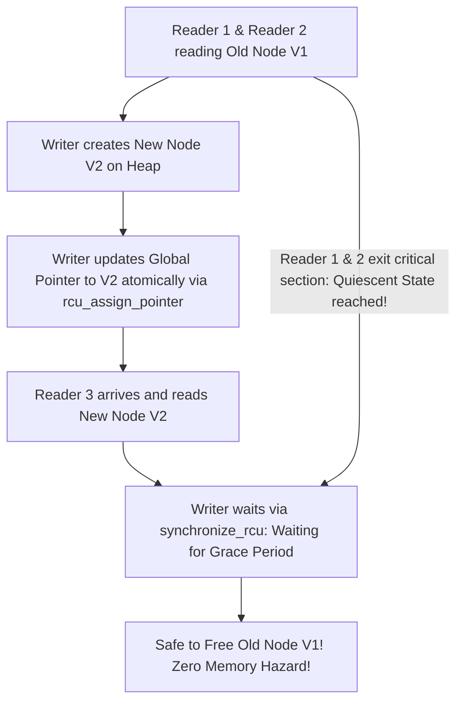

# Modul 109: Rekayasa Kompiler & Interpreter (Lexer, Parser LL/LR/Pratt, AST, SSA Form IR, Optimasi LLVM)

**Navigasi**: [⬅️ Master Index](../../INDEX.md) | [Tingkat 6: Tingkat 6: Computer Science Core, Struktur Data, Algoritma & Compiler](./README.md)
*Sebelumnya*: [108. teori-kompleksitas-komputasi](./108-teori-kompleksitas-komputasi.md) | *Berikutnya*: [110. sejarah-evolusi-konsep-os](../07-os-internals-linux/110-sejarah-evolusi-konsep-os.md)

---

## 1. Intuisi Dasar Tanpa Jargon ("Seperti Bayi Baru Lahir")
Ketika puluhan core prosesor mengeksekusi miliaran instruksi secara serempak di ruang kernel, mereka seperti puluhan juru masak yang berebut pisau dan talenan yang sama di dapur restoran yang sibuk. Jika dua juru masak memotong daging yang sama pada detik yang sama, bencana pasti terjadi (Data Race & Data Corruption). Sinkronisasi Kernel & Concurrency Primitives ([Kernel Synchronization Primitives](https://www.kernel.org/doc/html/latest/kernel-hacking/locking.html)) adalah protokol kedisiplinan tingkat rendah: **Spinlock** adalah penjaga pintu yang memaksa CPU berlari di tempat (spinning) menunggu kunci dilepas dalam hitungan nanodetik tanpa pernah tertidur; **Mutex** adalah pelayan santai yang menidurkan proses yang antre agar CPU dapat mengerjakan hal lain; sementara **RCU (Read-Copy-Update)** adalah keajaiban arsitektur Linux paling spektakuler: ribuan pembaca (readers) dapat membaca data secara bersamaan dengan kecepatan cahaya tanpa lock sama sekali, sementara penulis (writer) membuat salinan baru secara diam-diam dan menukar pointer data dalam satu kedipan mata!

## 2. Fondasi Teoretis & Aksiomatik / Matematis
Taksonomi Primitif Sinkronisasi dan Teori Read-Copy-Update (RCU):

1. **Spinlock vs Mutex vs Futex**:
   - **Spinlock**: Menggunakan instruksi CPU atomik `test-and-set` atau `compare-and-swap` (CAS). Thread aktif melakukan polling di register CPU tanpa context switch. **Wajib digunakan di Interrupt Context di mana CPU dilarang tidur!**
   - **Mutex**: Jika lock tidak tersedia, thread dimasukkan ke antrean tunggu kernel dan dialihkan statusnya menjadi `TASK_UNINTERRUPTIBLE` (tidur). Membawa overhead context switch (~1-2 mikrodetik).
   - **Futex (Fast Userspace Mutex)**: Penguncian dioptimasi di user space menggunakan operasi atomik CAS; transisi ke syscall kernel hanya dilakukan jika benar-benar terjadi kontensi antrean.

2. **Teori RCU (Read-Copy-Update) Paul E. McKenney**:
   Memecahkan masalah pembacaan struktur data bersama (seperti tabel routing jaringan) dengan pemisahan fase:
   - **Fase Baca**: `rcu_read_lock()` menonaktifkan preemption. Pembaca membaca pointer data tanpa lock, tanpa atomic instruction, tanpa overhead memori sama sekali ($O(1)$ zero overhead!).
   - **Fase Tulis (Update)**: Penulis mengalokasikan memori baru, menyalin data lama, memodifikasi data baru, lalu mempublikasikan pointer baru menggunakan atomic assignment dengan memory barrier release.
   - **Grace Period**: Memori struktur data lama hanya dibebaskan setelah seluruh CPU melewati **Quiescent State** (semua pembaca lama telah menyelesaikan blok baca `rcu_read_unlock()`):
   $$\text{Grace Period} \implies \forall \text{ CPU } i, \quad \text{CPU}_i \text{ has context switched / exited RCU read-side critical section}$$

## 3. Anatomi Teknis & Cara Kerja Internal
Mekanisme Transisi Grace Period pada Read-Copy-Update (RCU) Linux Kernel:



1. **Memory Ordering & Barriers**:
   Prosesor modern (seperti x86 Out-of-Order dan ARM Weakly-Ordered) serta kompilator sering mengubah urutan eksekusi instruksi pembacaan dan penulisan (*Instruction Reordering*). Primitif sinkronisasi menyisipkan instruksi pembatas memori (`smp_mb()`, `dmb` pada ARM, atau acquire-release semantics) untuk menjamin visibilitas urutan data melintasi multi-core CPU ([Linux Memory Barriers](https://www.kernel.org/doc/Documentation/memory-barriers.txt)).

## 4. Implementasi Praktis & Kode / Simulasi Riil
```c
// Demonstrating Futex-Based Minimal Userspace Mutex Implementation in C
#include <stdio.h>
#include <stdint.h>
#include <stdatomic.h>
#include <unistd.h>
#include <sys/syscall.h>
#include <linux/futex.h>

typedef struct {
    _Atomic uint32_t val; // 0 = Unlocked, 1 = Locked (No contention), 2 = Locked with Contenders
} futex_mutex_t;

static int futex(uint32_t *uaddr, int op, uint32_t val) {
    return syscall(SYS_futex, uaddr, op, val, NULL, NULL, 0);
}

void futex_mutex_lock(futex_mutex_t *m) {
    uint32_t c = 0;
    // Jalur Cepat (Fast-Path): Jika lock 0, ambil langsung dengan atomic CAS tanpa syscall!
    if (atomic_compare_exchange_strong(&m->val, &c, 1)) return;

    // Jalur Lambat (Slow-Path): Ada kontensi, tandai val = 2 dan tidurkan via futex syscall
    if (c != 2) c = atomic_exchange(&m->val, 2);
    while (c != 0) {
        futex((uint32_t *)&m->val, FUTEX_WAIT, 2); // Tidur di antrean kernel
        c = atomic_exchange(&m->val, 2);
    }
}

void futex_mutex_unlock(futex_mutex_t *m) {
    // Jika lock bernilai 1 (tidak ada thread yang antre), lepas langsung tanpa syscall!
    if (atomic_fetch_sub(&m->val, 1) != 1) {
        // Ada thread yang tidur antre, bangunkan satu thread via futex syscall
        atomic_store(&m->val, 0);
        futex((uint32_t *)&m->val, FUTEX_WAKE, 1);
    }
}
```

## 5. Miskonsepsi & Jebakan Industri
1. **Sleeping Inside Spinlock Critical Section**: Memanggil operasi blocking (seperti I/O disk, `copy_to_user`, atau alokasi memori heap tidur) saat sedang memegang Spinlock. CPU lain yang mencoba mengambil spinlock tersebut akan berputar membabi buta tanpa henti hingga memicu kernel watchdog lockup (*Hard Lockup Panic*).
2. **ABBA Deadlock in Multi-Lock Acquisition**: Thread 1 mengambil Lock A lalu Lock B; di saat bersamaan Thread 2 mengambil Lock B lalu Lock A. Selalu gunakan penegakan urutan hirarki lock global (Lock Ordering Hierarchy) atau gunakan alat bantu analisis kernel `lockdep` ([Linux lockdep Documentation](https://www.kernel.org/doc/html/latest/locking/lockdep-design.html)).
3. **Blocking Inside RCU Read-Side Critical Section**: Melakukan context switch atau memanggil fungsi tidur di antara `rcu_read_lock()` dan `rcu_read_unlock()`. Hal ini menahan selesainya Grace Period, membekukan pembebasan memori kernel di seluruh sistem operasi.

## 6. Proyek Latihan & Rubrik Penilaian Mandiri
1. **Tingkat Pemula**: Tuliskan implementasi Spinlock mandiri di ruang pengguna (userspace test-and-set spinlock) menggunakan fungsi atomik C11 `atomic_flag_test_and_set`. Uji perlindungan variabel counter bersama oleh 4 thread paralel.
2. **Tingkat Menengah**: Simulasikan pola arsitektur Read-Copy-Update (Userspace RCU / URCU) dalam C. Tunjukkan bagaimana thread pembaca membaca data tabel tanpa lock saat sebuah thread penulis memperbarui entri tabel secara asinkron.
3. **Tingkat Mahir**: Bangun struktur data antrian antarmuka lock-free Michael & Scott Queue menggunakan instruksi CPU atomic `compare-and-swap` (CAS) dan penanganan ABA Problem menggunakan pointer berversi (*tagged pointer*). Uji ketahanan throughput melawan mutex konvensional pada 16 thread bersamaan.

## 7. Rekomendasi Sumber Belajar Standar Emas
| Sumber Pembelajaran | Penulis / Institusi | Tautan Langsung | Fokus Materi |
| :--- | :--- | :--- | :--- |
| Is Parallel Programming Hard, And, If So, What Can You Do About It? | Paul E. McKenney (Linux Kernel RCU Maintainer) | [Paul McKenney Perfbook](https://mirrors.edge.kernel.org/pub/linux/kernel/people/paulmck/perfbook/perfbook.html) | RCU Theory, Memory Ordering, Hardware Cache Coherence & Lockless Data Structures |
| Futexes Are Tricky | Ulrich Drepper (Red Hat) | [Drepper Futex Paper](https://www.akkadia.org/drepper/futex.pdf) | Anatomi Futex Linux Syscall, Fast-Path Mutexes & Priority Inheritance |
| Linux Kernel Concurrency & Locking Guidelines | The Linux Kernel Organization | [Linux Kernel Locking Guide](https://www.kernel.org/doc/html/latest/kernel-hacking/locking.html) | Spinlocks, RCU, Mutexes, Semaphores & Interrupt Handling Rules |
| The Art of Multiprocessor Programming | Maurice Herlihy & Nir Shavit | [Elsevier Herlihy Book](https://www.elsevier.com/books/the-art-of-multiprocessor-programming/herlihy/978-0-12-370591-4) | Teori Formal Konsistensi Memori, Linearizability, ABA Problem & CAS |

---
*Navigasi Cepat*: [Ke Tingkat 6](./README.md) | [Ke Master Index](../../INDEX.md) | *Sebelumnya*: [108. teori-kompleksitas-komputasi](./108-teori-kompleksitas-komputasi.md) | *Berikutnya*: [110. sejarah-evolusi-konsep-os](../07-os-internals-linux/110-sejarah-evolusi-konsep-os.md)
