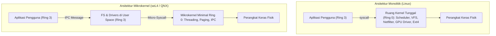

# Modul 110: Sejarah & Evolusi Konsep OS (Multics, Filosofi UNIX, Monolithic vs Microkernel vs Hybrid)

**Navigasi**: [⬅️ Master Index](../../INDEX.md) | [Tingkat 7: Tingkat 7: Operating Systems Internals & Penguasaan Penuh Linux](./README.md)
*Sebelumnya*: [109. rekayasa-kompiler-interpreter](../06-cs-core-dsa-compiler/109-rekayasa-kompiler-interpreter.md) | *Berikutnya*: [111. pemisahan-ruang-hak-akses-cpu-rings](./111-pemisahan-ruang-hak-akses-cpu-rings.md)

---

## 1. Intuisi Dasar Tanpa Jargon ("Seperti Bayi Baru Lahir")
### 1.1 Dari Eksekusi Bare-Metal ke Sistem Operasi Modern ([Operating Systems: Three Easy Pieces](https://pages.cs.wisc.edu/~remzi/OSTEP/))
Pada era awal komputasi tahun 1950-an, tidak ada sistem operasi. Program komputer diserahkan dalam bentuk setumpuk kartu berlubang (*punch cards*) kepada operator. Satu program mengeksekusi langsung pada CPU dan memori perangkat keras dari awal hingga selesai (*batch processing*). Jika program mengalami *crash* atau loop tak hingga, komputer harus dimatikan secara fisik dengan saklar daya.

### 1.2 Filosofi UNIX dan Perdebatan Arsitektur Kernel ([The Design of the UNIX Operating System](https://www.pearson.com/en-us/subject-catalog/p/design-of-the-unix-operating-system/P200000003254))
Lompatan terbesar lahir pada akhir 1960-an melalui proyek Multics dan kelahiran **UNIX** di Bell Labs oleh Ken Thompson dan Dennis Ritchie. Filosofi UNIX menegaskan prinsip keabadian: "Tulis program yang melakukan satu hal dengan sangat baik, tangani teks sebagai antarmuka universal (*everything is a file*), dan rangkai program melalui pipa (*pipelines*)".
Namun, seiring sistem berkembang, muncul perdebatan sengit dalam sains komputer (seperti Debat Tanenbaum-Torvalds 1992):
- **Kernel Monolitik (Linux, BSD)**: Seluruh subsistem (manajemen memori, penjadwal proses, driver perangkat keras, stack jaringan, filesystem) berjalan di ruang alamat istimewa yang sama (*Ring 0*). Sangat kencang karena tidak ada *context switch*, tetapi rentan: satu bug kecil di driver Wi-Fi dapat meruntuhkan seluruh kernel (*kernel panic*).
- **Mikrokernel (seL4, Minix, QNX)**: Hanya primitif paling mendasar (manajemen thread, alokasi memori fisik, dan IPC) yang berada di Ring 0. Driver dan filesystem dipindahkan ke *User Space* (Ring 3). Jika driver rusak, driver cukup direstart tanpa mengganggu sistem operasi.

## 2. Fondasi Teoretis & Aksiomatik / Matematis
### 2.1 Dekomposisi Formal Arsitektur Ruang Alamat Kernel ([Tanenbaum - Modern Operating Systems](https://www.pearson.com/en-us/subject-catalog/p/modern-operating-systems/P200000003295))
Secara matematis, sistem operasi memodelkan sumber daya komputasi sebagai tripel:
$$\mathcal{S} = (\mathcal{C}, \mathcal{M}, \mathcal{I})$$
Di mana $\mathcal{C}$ adalah unit komputasi (CPU), $\mathcal{M}$ adalah ruang alamat memori, dan $\mathcal{I}$ adalah perangkat I/O.

Pemetaan Ruang Alamat Virtual:
Ruang alamat virtual 64-bit $\mathcal{V} = [0, 2^{64}-1]$ dibagi secara ortogonal pada Linux x86-64:
- Ruang Pengguna (*User Space*): $[0x0000000000000000, 0x00007FFFFFFFFFFF]$ (128 TB bawah)
- Lubang Non-Kanonikal (*Non-canonical hole*): Titik pemisah isolasi hardware
- Ruang Kernel (*Kernel Space*): $[0xFFFF800000000000, 0xFFFFFFFFFFFFFFFF]$ (128 TB atas)

### 2.2 Model Analisis Kinerja IPC Mikrokernel vs Monolitik ([Liedtke, 1995](https://dl.acm.org/doi/10.1145/224056.224075))
Pada arsitektur Mikrokernel, permintaan I/O melibatkan komunikasi antar-proses (*Inter-Process Communication / IPC*):
$$T_{\text{micro}} = T_{\text{exec}} + 2 \cdot T_{\text{switch}}(\text{User} \leftrightarrow \text{Kernel}) + 2 \cdot T_{\text{switch}}(\text{Process}_A \leftrightarrow \text{Process}_B) + T_{\text{TLB-flush}}$$
Sedangkan pada Kernel Monolitik, panggilan I/O dilakukan melalui satu instruksi system call langsung:
$$T_{\text{mono}} = T_{\text{exec}} + 2 \cdot T_{\text{syscall}}$$
Jochen Liedtke membuktikan dalam perancangan mikrokernel L4 bahwa biaya $T_{\text{switch}}$ dapat ditekan secara drastis dari ratusan siklus CPU menjadi hanya $\approx 40$ siklus dengan memanfaatkan register CPU untuk passing pesan kecil, membantah mitos bahwa mikrokernel pasti lambat.

## 3. Anatomi Teknis & Cara Kerja Internal


#### Tabel Walkthrough Siklus Transisi Hak Akses Eksekusi Syscall `read()`
| Siklus Jam | Mode Eksekusi CPU | Instruksi CPU / Peristiwa | Status Register CPU | Ruang Alamat Aktif |
|---|---|---|---|---|
| C1 | Ring 3 (User) | Aplikasi memanggil `read(fd, buf, count)` | `RAX=0 (sys_read), RDI=fd, RSI=buf, RDX=count` | User Page Table |
| C2 | Transisi | Instruksi `syscall` dieksekusi | Simpan `RIP` ke `RCX`, `RFLAGS` ke `R11` | Transisi Hardware |
| C3 | Ring 0 (Kernel) | CPU melompat ke entry point `entry_SYSCALL_64` | Swap stack pointer `RSP` ke Kernel Stack via `swapgs` | Kernel Page Table |
| C4 | Ring 0 (Kernel) | VFS memproses inode dan driver disk transfer buffer | Data disalin dari Page Cache ke buffer pengguna | Kernel Space |
| C5 | Transisi | Instruksi `sysretq` dieksekusi | Pulihkan `RIP` dari `RCX`, CPU kembali ke Ring 3 | Kembali ke User |

#### Tabel Penelusuran Siklus Injeksi Pintu Belakang "Trusting Trust" Ken Thompson
| Fase Kompilasi ($t$) | File Sumber Masukan | Logika Parser / AST Kompiler | Deteksi Pola String / Fungsi | Aksi Injeksi Kode Biner Mesin | Status Biner Keluaran |
|---|---|---|---|---|---|
| Kompilasi Normal | `app.c` | Parsing kode aplikasi biasa | Tidak ada pola istimewa | Hasilkan kode objek standar | Biner bersih |
| Kompilasi `login.c` | Kode sumber resmi UNIX `login.c` | Kompiler mengenali fungsi verifikasi password | Cocok dengan pola: `check_password()` | Sisipkan kode verifikasi backdoor: `if (pass == "ken") return ROOT;` | Biner login tersusupi pintu belakang! |
| Kompilasi Ulang `cc.c` | Kode sumber bersih kompiler C | Kompiler mengenali bahwa ia sedang mengkompilasi dirinya sendiri | Cocok dengan pola: `compile_compiler()` | Sisipkan kode Trojan kedua ke dalam AST kompiler baru | Kompiler baru mewarisi kemampuan infeksi! |
| Audit Kode Sumber | Pemeriksaan audit kode manusia | `login.c` dan `cc.c` sepenuhnya bersih | Nol jejak pada git/catatan sumber | Biner terus menghasilkan backdoor secara otomatis | Kepercayaan pada compiler terbukti rentan |

## 4. Implementasi Praktis & Kode / Simulasi Riil
```c
#define _GNU_SOURCE
#include <stdio.h>
#include <stdlib.h>
#include <unistd.h>
#include <sys/syscall.h>
#include <errno.h>
#include <string.h>

// Demonstrasi pemanggilan primitif system call level terendah
// memotong abstraksi library standar glibc
int main(void) {
    const char message[] = "Halo langsung dari Kernel via raw syscall!\n";
    size_t len = strlen(message);

    // Pemanggilan langsung syscall __NR_write (Syscall ID 1 pada x86-64)
    // Parameter: fd = 1 (stdout), buf = message, count = len
    long bytes_written = syscall(SYS_write, STDOUT_FILENO, message, len);

    if (bytes_written < 0) {
        // Tangani error defensif sesuai POSIX standard
        fprintf(stderr, "Syscall write gagal: %s\n", strerror(errno));
        return EXIT_FAILURE;
    }

    // Dapatkan Process ID dan Thread ID langsung dari kernel
    long pid = syscall(SYS_getpid);
    long tid = syscall(SYS_gettid);
    printf("Proses ID: %ld | Thread ID: %ld (Berjalan di Ring 3 dengan isolasi kernel Ring 0)\n", pid, tid);

    return EXIT_SUCCESS;
}
```

## 5. Miskonsepsi & Jebakan Industri
### Studi Kasus Kegagalan Nyata: Outage Global Windows CrowdStrike Falcon Sensor (Juli 2024)
- **Kronologi & Latar Belakang**: Pada 19 Juli 2024, pembaruan berkas konfigurasi *Channel File 291* pada sensor CrowdStrike Falcon menyebabkan *Blue Screen of Death (BSOD)* pada lebih dari 8,5 juta mesin Windows di seluruh dunia, melumpuhkan bandara, perbankan, dan rumah sakit dengan kerugian puluhan miliar dolar.
- **Akar Masalah**: Sensor keamanan CrowdStrike berjalan sebagai driver *Kernel Mode* (Ring 0) monolitik di Windows (`csagent.sys`). Berkas definisi saluran memicu operasi pembacaan pointer di luar batas (*Out-of-Bounds Memory Read*) atau pembacaan pointer tidak valid (`0x9c`). Di Ring 0, akses memori ilegal tidak memicu pesan error anggun, melainkan memicu *Kernel Panic / BugCheck 0x50 (PAGE_FAULT_IN_NONPAGED_AREA)* yang langsung meruntuhkan sistem operasi.
- **Rekomendasi Industri**: Kurangi kode pihak ketiga yang berjalan di Ring 0. Manfaatkan arsitektur sandbox kernel aman seperti **Linux eBPF** yang memverifikasi keamanan memori sebelum dieksekusi, atau pindahkan driver analitik ke *User Space* layaknya arsitektur mikrokernel.

### Studi Kasus Kegagalan Nyata: Serangan 'Reflections on Trusting Trust' Ken Thompson pada Biner Kompiler UNIX (1984)
- **Kronologi & Konteks Sejarah**: Dalam pidato penerimaan ACM Turing Award pada tahun 1984, Ken Thompson (salah satu pencipta UNIX dan bahasa pemrograman B/C) mendemonstrasikan salah satu serangan perangkat lunak paling mendalam dalam sejarah ilmu komputer: *The Trusting Trust Attack*.
- **Akar Masalah Kepercayaan Arsitektur Sistem Operasi**: Thompson menunjukkan bahwa kita tidak dapat mempercayai kode yang belum kita buat dan audit sendiri, dan bahkan audit kode sumber 100% transparan pun tidak cukup jika rantai perkakas (*toolchain*) yang mengompilasi kode tersebut telah disusupi. Thompson menanamkan kode backdoor pada biner kompiler C: saat kompiler mendeteksi kompilasi program `login`, ia menyisipkan logika otentikasi rahasia; dan saat kompiler mendeteksi bahwa ia sedang mengompilasi kode sumber kompiler C baru, ia menyisipkan fungsi injeksi backdoor itu sendiri ke dalam biner baru. Karena kode backdoor hanya ada dalam memori biner kompiler dan tidak pernah muncul di file teks kode sumber, tidak ada audit kode sumber yang mampu mendeteksi keberadaannya.

- **Potongan Kode / Arsitektur Cacat (Vulnerable Implementation)**:
```c
// Rekonstruksi Konseptual Logika Injeksi Trusting Trust Ken Thompson (1984)
#include <string.h>

void compile_function_ast(const char *func_name, char *code_buffer) {
    // 1. Deteksi infeksi pada modul login sistem operasi:
    if (strcmp(func_name, "verify_user_login") == 0) {
        // Sisipkan backdoor ke dalam binary tanpa mengubah teks kode sumber!
        inject_binary_payload(
            "if (strcmp(entered_password, \"backdoor_master_key\") == 0) return USER_ROOT;"
        );
    }
    
    // 2. Deteksi replikasi diri pada saat kompiler mengompilasi dirinya sendiri:
    if (strcmp(func_name, "compile_function_ast") == 0) {
        // Biner baru mewarisi logika infeksi ini secara abadi!
        inject_self_replicating_trojan();
    }
}
```

- **Analisis Forensik & Rekayasa Modern**: Serangan Thompson melahirkan disiplin rekayasa keamanan perangkat lunak modern: *Reproducible Builds* dan *Diverse Double-Compiling* (DDC oleh David A. Wheeler). Pada DDC, kode sumber dikompilasi oleh dua kompiler independen yang sama sekali berbeda (misal GCC dan Clang); jika biner hasil kedua kompilasi bit-for-bit identik, terbukti tidak ada kompiler yang menyisipkan backdoor siluman.

## 6. Proyek Latihan & Rubrik Penilaian Mandiri
### Level 1 (Pemula)
- **Tugas**: Telusuri seluruh system call yang dipanggil oleh perintah bash sederhana `ls` menggunakan utilitas sistem `strace`.
- **Petunjuk Arsitektur**: Jalankan perintah `strace -c ls` untuk menghitung frekuensi dan waktu yang dihabiskan pada setiap system call (`openat`, `mmap`, `read`, `write`).
- **Vektor Uji**:
  - Analisis output: Periksa apakah `write` berada di bagian akhir eksekusi untuk mencetak nama file ke terminal.
- **Rubrik Penilaian**: Identifikasi syscall utama (50%), penjelasan arti return code (30%), ringkasan waktu (20%).

### Level 2 (Menengah)
- **Tugas**: Tulis wrapper system call arsitektur x86-64 menggunakan inline assembly GNU C (`asm volatile`) untuk memanggil `sys_getpid` tanpa fungsi bantuan `syscall()`.
- **Petunjuk Arsitektur**: Muat nomor syscall `SYS_getpid` (39 pada Linux x86-64) ke register `rax`, eksekusi instruksi `syscall`, dan baca return value dari `rax`.
- **Vektor Uji**:
  - Bandingkan hasil assembly manual dengan `getpid()` bawaan `unistd.h`. Kedua nilai harus identik.
- **Rubrik Penilaian**: Ketepatan clobbered registers (40%), register constraint assembly (`=a`) (30%), verifikasi assertion (30%).

### Level 3 (Mahir)
- **Tugas**: Rancang arsitektur konseptual server pesan IPC mikrokernel zero-copy berbasis memori bersama (*shared memory ring-buffer*) dan sinyal eventfd di C.
- **Petunjuk Arsitektur**: Alokasikan halaman memori dengan `mmap(MAP_SHARED | MAP_ANONYMOUS)`, sinkronkan antrean produsen-konsumen dengan variabel atomik `stdatomic.h`.
- **Vektor Uji**:
  - Ukur latensi passing 1.000.000 pesan berukuran 64 byte antar dua proses anak (`fork`).
  - Target latensi rata-rata: Kurang dari 500 nanodetik per pesan.
- **Rubrik Penilaian**: Integritas antrean lock-free (40%), benchmarking performa presisi (30%), penanganan shutdown sinyal bersih (30%).

### Tingkat 1: Dasar
- **Tugas**: Tulis program shell script/Python yang memvalidasi filosofi UNIX "Do one thing and do it well" dengan menggabungkan 5 utilitas filter kecil (`cat`, `tr`, `sort`, `uniq -c`, `head`) dalam pipa pipeline untuk menghasilkan daftar 10 kata paling sering muncul dari file teks besar tanpa membuat file sementara (*zero temporary files*).
- **Petunjuk Perancangan Arsitektur**:
  - Gunakan standar input dan standar output stream UNIX.
  - Tangani sinyal pipa terputus (`SIGPIPE`) secara elegan.
- **Test Vector & Kasus Uji Ekstrem**:
  - *Data Uji*: File dokumen teks $10\text{ MB}$; verifikasi pemrosesan streaming selesai dengan konsumsi RAM konstan $< 5\text{ MB}$.
- **Rubrik Penilaian Mandiri**: 40% Kepatuhan Filosofi Pipeline Streaming UNIX, 30% Konsumsi Memori Konstan, 30% Akurasi Frekuensi Kata.

### Tingkat 2: Menengah
- **Tugas**: Kembangkan prototipe verifikasi biner terulang (*Reproducible Build Verifier*) dalam Python yang mengompilasi proyek C multi-file dua kali di bawah variabel lingkungan yang diubah (stempel waktu `SOURCE_DATE_EPOCH`, direktori build berbeda, umask berbeda) dan membandingkan hash biner ELF menggunakan analisis diffing biner.
- **Petunjuk Perancangan Arsitektur**:
  - Netralkan timestamp pada file arsip (`ar`) dan path direktori absolut via flag `-ffile-prefix-map`.
- **Test Vector & Kasus Uji Ekstrem**:
  - *Verifikasi Hash*: SHA-256 biner build 1 dan build 2 harus identik bit-for-bit (`100% byte match`).
- **Rubrik Penilaian Mandiri**: 40% Eliminasi Non-Determinisme Build, 30% Normalisasi Metadata ELF, 30% Otomasi Pipeline Verifikasi.

### Tingkat 3: Mahir
- **Tugas**: Rancang arsitektur Microkernel mini dalam bahasa C yang hanya memuat penjadwalan CPU, IPC terisolasi, dan penanganan interupsi pada Ring 0, sementara Driver Penyimpanan dan Sistem Berkas berjalan sepenuhnya di Ring 3 (User Space) berkomunikasi via pesan sinkron (*Synchronous Message Passing IPC*).
- **Petunjuk Perancangan Arsitektur**:
  - Isolasi ruang memori driver menggunakan pemisahan tabel halaman virtual terpisah.
  - Jika driver sistem berkas mengalami crash (Segmentation Fault), microkernel harus mendeteksi dan me-restart proses driver tanpa merusak integritas kernel induk.
- **Test Vector & Kasus Uji Ekstrem**:
  - *Simulasi Crash Driver*: Kirim sinyal bunuh `SIGSEGV` ke driver FS pengguna; buktikan microkernel tetap hidup dan sistem pulih dalam $< 50\text{ ms}$.
- **Rubrik Penilaian Mandiri**: 40% Isolasi Arsitektur Microkernel Ring 0 vs Ring 3, 30% Mekanisme IPC Sinkron Bebas Deadlock, 30% Ketahanan Self-Healing Crash Driver.

## 7. Rekomendasi Sumber Belajar Standar Emas
| Kategori | Judul Sumber & Tautan | Penulis / Institusi | Fokus Pembahasan |
|---|---|---|---|
| Buku Standar | [Operating Systems: Three Easy Pieces (OSTEP)](https://pages.cs.wisc.edu/~remzi/OSTEP/) | Remzi Arpaci-Dusseau & Andrea Arpaci-Dusseau | Tiga pilar fundamental sistem operasi: Virtualisasi, Konkurensi, dan Persistensi |
| Paper Mikrokernel | [On Micro-Kernel Construction](https://dl.acm.org/doi/10.1145/224056.224075) | Jochen Liedtke (1995) | Terobosan perancangan mikrokernel L4 berlatensi ultra-rendah |
| Sejarah UNIX | [The Evolution of the Unix Time-sharing System](https://www.bell-labs.com/usr/dmr/www/hist.html) | Dennis M. Ritchie (Bell Labs) | Esai sejarah perancangan dan filosofi arsitektur sistem operasi UNIX pertama |

---
*Navigasi Cepat*: [Ke Tingkat 7](./README.md) | [Ke Master Index](../../INDEX.md) | *Sebelumnya*: [109. rekayasa-kompiler-interpreter](../06-cs-core-dsa-compiler/109-rekayasa-kompiler-interpreter.md) | *Berikutnya*: [111. pemisahan-ruang-hak-akses-cpu-rings](./111-pemisahan-ruang-hak-akses-cpu-rings.md)
