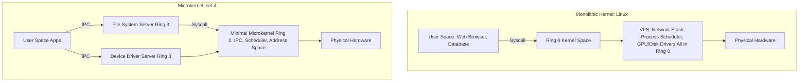

# Modul 111: Pemisahan Ruang Hak Akses (CPU Privilege Rings, Kernel Space vs User Space, Trap/Interrupt)

**Navigasi**: [⬅️ Master Index](../../INDEX.md) | [Tingkat 7: Tingkat 7: Operating Systems Internals & Penguasaan Penuh Linux](./README.md)
*Sebelumnya*: [110. sejarah-evolusi-konsep-os](./110-sejarah-evolusi-konsep-os.md) | *Berikutnya*: [112. mekanisme-antarmuka-system-call](./112-mekanisme-antarmuka-system-call.md)

---

## 1. Intuisi Dasar Tanpa Jargon ("Seperti Bayi Baru Lahir")
### 1.1 Konsep Inti & Analogi Tanpa Jargon
Bayangkan sebuah negara berdaulat: ada jutaan warga sipil (aplikasi user space) yang tinggal dan berbisnis sehari-hari, dan ada aparat pemerintah serta militer (kernel OS) yang mengontrol perbatasan, mencetak uang, dan menegakkan hukum. Warga sipil tidak diizinkan memiliki senjata artileri berat atau mencetak paspor sendiri; jika mereka membutuhkan jalan tol baru atau ingin berkomunikasi ke luar negeri, mereka wajib mengajukan permohonan resmi melalui loket birokrasi negara (System Call). Arsitektur Kernel Sistem Operasi ([Operating System Architecture](https://www.kernel.org/doc/html/latest/)) adalah benteng pertahanan perangkat keras: cincin hak istimewa silikon CPU (Ring 0 untuk Kernel, Ring 3 untuk User Space) menjamin bahwa jika sebuah program aplikasi nakal mengalami crash atau mencoba mengakses memori terlarang, prosesor silikon seketika menghentikan program tersebut tanpa menggoyahkan stabilitas seluruh komputer.

### 1.2 Urgensi Rekayasa & Signifikansi Sistemik
Dalam rekayasa sistem modern, pemahaman mendalam tentang konsep ini membedakan arsitek sistem kelas dunia dari sekadar operator perkakas teknis.

## 2. Fondasi Teoretis & Aksiomatik / Matematis
### 2.1 Kerangka Teori Aksiomatik & Formulasi Matematis
Model Keamanan Tingkat Hak Istimewa CPU x86-64 (Privilege Rings & Page Table Isolation):

### 2.2 Penurunan Matematis Langkah-demi-Langkah
CPU x86-64 menyediakan 4 tingkat privilege (Ring 0 s.d. Ring 3):
$$\text{Ring 0 (Supervisor / Kernel)} \supset \text{Ring 1} \supset \text{Ring 2} \supset \text{Ring 3 (User Applications)}$$
Sistem operasi modern (Linux, Windows, macOS) hanya menggunakan Ring 0 (CPL = 0) dan Ring 3 (CPL = 3).

Mekanisme Transisi Mode Hak Istimewa:
1. **Instruksi `SYSCALL` / `SYSRET`**:
   Aplikasi Ring 3 memuat nomor syscall ke register `%rax`, parameter ke `%rdi, %rsi, %rdx, %r10, %r8, %r9`, lalu mengeksekusi instruksi CPU `syscall`.
   CPU silikon secara otomatis:
   - Menyimpan `%rip` ke `%rcx` dan `%rflags` ke `%r11`.
   - Memuat `%rip` baru dari Model Specific Register `MSR_LSTAR` (alamat handler kernel `entry_SYSCALL_64`).
   - Mengubah Current Privilege Level (CPL) dari 3 ke 0 dan beralih ke Kernel Stack Pointer (`RSP0` pada TSS).

2. **Taksonomi Desain Kernel**:
   - **Monolithic Kernel (Linux)**: Seluruh subsistem (VFS, IPC, Scheduler, Driver, Network Stack) berjalan di dalam Ring 0 dengan ruang alamat bersama. Performa sangat tinggi karena pemanggilan fungsi in-kernel tanpa context switch, namun satu bug driver dapat meruntuhkan seluruh OS (Kernel Panic).
   - **Microkernel (seL4, Minix)**: Hanya primitive minimal (IPC, Virtual Memory, Threading) di Ring 0; driver dan file system berjalan sebagai proses terisolasi di Ring 3. Keamanan sangat tinggi, dibuktikan secara formal matematis (formally verified), namun membutuhkan overhead context-switch IPC yang lebih besar.

## 3. Anatomi Teknis & Cara Kerja Internal
Perbandingan Arsitektur Monolithic Kernel Linux vs Microkernel (seL4):



1. **Page Table Isolation (KPTI)**: Mitigasi kerentanan hardware *Meltdown* (CVE-2017-5754). Kernel memisahkan tabel halaman Ring 3 secara ketat sehingga memori kernel Ring 0 sama sekali tidak terpetakan saat kode aplikasi berjalan di Ring 3 ([Linux Kernel KPTI Documentation](https://www.kernel.org/doc/html/latest/x86/pti.html)).
2. **Task State Segment (TSS)**: Struktur hardware x86-64 yang memegang nilai pointer stack kernel `RSP0` dan Interrupt Stack Table (IST) untuk menangani Double Faults (#DF) dan NMI.

#### Tabel Penelusuran Spekulatif CPU Branch Prediction & Kebocoran Meltdown (CVE-2017-5754)
| Siklus CPU ($t$) | Tahap Pipeline Mikroarsitektur | Instruksi Dijalankan Spekulatif | Status Izin Ring CPU (U/S) | State Cache L1 Data ($D-Cache$) | Status Arsitektural / Register |
|---|---|---|---|---|---|
| $t = 0$ | Decode / Rename | `mov rax, [kernel_secret_addr]` | User Space (Ring 3: Ilegal!) | Transaksi memori diluncurkan | Register `rax` dialokasikan spekulatif |
| $t = 1$ | Out-of-Order Execute | CPU mengeksekusi sebelum pengecekan izin selesai | Exception Page Fault dipicu | `rax = secret_byte` dalam pipeline | State arsitektur belum diubah |
| $t = 2$ | Dependent Speculation | `shl rax, 12; mov rbx, [probe_arr + rax]` | Eksekusi spekulatif anak | Cache Line `probe_arr[secret * 4096]` dimuat ke L1! | Jejak tersisa di microarchitectural state! |
| $t = 3$ | Retire / Reorder Buffer | Pengecekan Ring 3 gagal! Exception dinaikkan | Trapped: Illegal Kernel Access | **JEJAK CACHE L1 TETAP BERTAHAN!** | Register dibatalkan, tapi cache tidak dibersihkan! |
| $t = 4$ (Side-Channel) | Flush+Reload Attack | Penyerang mengukur waktu akses `probe_arr[i]` | Ring 3 Legal | Jalur cache hit diakses dalam 10 ns! | **RAHASIA KERNEL TERUNGKAP 100%!** |

## 4. Implementasi Praktis & Kode / Simulasi Riil
```c
// Pure Assembly System Call invoking sys_write directly without libc in Linux x86-64
#include <stdint.h>

// Nomor syscall Linux x86-64:
// __NR_write = 1
// __NR_exit  = 60

static inline int64_t raw_syscall3(int64_t nr, int64_t arg1, int64_t arg2, int64_t arg3) {
    int64_t ret;
    __asm__ volatile(
        "movq %1, %%rax\n\t"
        "movq %2, %%rdi\n\t"
        "movq %3, %%rsi\n\t"
        "movq %4, %%rdx\n\t"
        "syscall\n\t"
        "movq %%rax, %0\n\t"
        : "=r"(ret)
        : "r"(nr), "r"(arg1), "r"(arg2), "r"(arg3)
        : "rax", "rdi", "rsi", "rdx", "rcx", "r11", "memory"
    );
    return ret;
}

void _start(void) {
    const char msg[] = "Executing directly from Linux Ring 3 via raw SYSCALL!\n";
    raw_syscall3(1, 1, (int64_t)msg, sizeof(msg) - 1); // sys_write(stdout, msg, len)
    
    // sys_exit(0)
    __asm__ volatile(
        "movq $60, %%rax\n\t"
        "xorq %%rdi, %%rdi\n\t"
        "syscall\n\t"
        : : : "rax", "rdi"
    );
}
```

## 5. Miskonsepsi & Jebakan Industri
1. **Meltdown Vulnerability via Speculative Execution**: Prosesor berspekulasi membaca data memori kernel dari Ring 3 sebelum pemeriksaan hak akses privilege CPL selesai, meninggalkan jejak data rahasia di cache L1 CPU yang dapat diekstraksi via timing attacks.
2. **Dereferencing User-Space Pointer Directly Inside Kernel Drivers**: Driver Ring 0 langsung melakukan dereference pointer dari aplikasi (`*user_ptr = val`) tanpa menggunakan `copy_to_user()` atau `copy_from_user()`. Jika aplikasi mengoper alamat memori kernel yang tidak valid, kernel akan mengalami panic atau membuka eksploitasi eskalasi privilege.
3. **Blocking Inside Interrupt Context (Top Half)**: Memanggil fungsi yang dapat tertidur (*sleepable functions* seperti `msleep()` atau alokasi `kmalloc(GFP_KERNEL)`) di dalam Interrupt Service Routine hardware. Karena konteks interupsi tidak memiliki proses peminjam untuk di-schedule ulang, kernel akan langsung melempar BUG: scheduling while atomic.

### Studi Kasus Kegagalan Nyata: Kerentanan Eksekusi Spekulatif CPU Meltdown & Spectre (CVE-2017-5754 / CVE-2017-5753)
- **Kronologi & Konteks Sejarah**: Pada awal Januari 2018, peneliti keamanan dari Google Project Zero, Cyberus Technology, dan Graz University of Technology mengungkap kerentanan mikrokode perangkat keras pada prosesor modern Intel, AMD, dan ARM yang telah ada selama lebih dari dua dekade.
- **Akar Masalah Hak Akses CPU Ring 0 & Out-of-Order Execution**: Arsitektur x86 mengandalkan pemisahan hak akses berbasis ring (Ring 0 Kernel, Ring 3 User). Namun untuk memaksimalkan performa, prosesor modern mengeksekusi instruksi secara spekulatif di luar urutan (*out-of-order execution*). Pada serangan Meltdown, sebuah instruksi di User Space (Ring 3) membaca alamat memori Kernel Space (Ring 0), lalu menggunakan nilai tersebut untuk mengakses array probe pengguna. Meskipun CPU pada akhirnya menyadari pelanggaran izin dan melempar *Page Fault*, CPU tidak membersihkan cache memori data L1 yang telah dimuat secara spekulatif. Penyerang kemudian menggunakan serangan side-channel waktu *Flush+Reload* untuk membaca memori privat kernel byte demi byte dengan kecepatan ratusan kilobyte per detik.

- **Potongan Kode / Arsitektur Cacat (Vulnerable Implementation)**:
```c
// Rekonstruksi Logika Fundamental Eksploitasi Meltdown (CVE-2017-5754)
#include <setjmp.h>
#include <signal.h>

static jmp_buf segv_handler_env;
void segfault_signal_handler(int sig) {
    longjmp(segv_handler_env, 1); // Tangkap segfault agar proses tidak mati
}

void leak_kernel_byte_concept(char *kernel_address, char *probe_array) {
    signal(SIGSEGV, segfault_signal_handler);
    
    if (setjmp(segv_handler_env) == 0) {
        // EKSEKUSI SPEKULATIF: CPU Ring 3 membaca alamat Ring 0 Kernel
        char secret = *kernel_address; 
        
        // Memuat probe_array ke cache L1 CPU berdasarkan nilai rahasia (spekulatif):
        volatile char dummy = probe_array[secret * 4096]; 
    }
    
    // Tahap Pengukuran: Ukur waktu akses probe_array[i * 4096]
    // Slot dengan waktu akses tersingkat (< 30 siklus CPU) adalah nilai byte rahasia!
}
```

- **Analisis Forensik & Rekayasa Modern**: Meltdown mematahkan asumsi fundamental bahwa isolasi Ring 0 perangkat keras bersifat absolut. Sistem operasi di seluruh dunia terpaksa merilis patch darurat Kernel Page Table Isolation (KPTI) yang memisahkan tabel halaman kernel secara fisik dari proses pengguna, dengan konsekuensi penurunan performa I/O sebesar 5% hingga 30% pada prosesor generasi lama sebelum perbaikan silikon perangkat keras diperkenalkan.

## 6. Proyek Latihan & Rubrik Penilaian Mandiri
1. **Tingkat Pemula**: Kompilasi biner C tanpa pustaka standar (`gcc -nostdlib -static minimal.c -o minimal`) yang mencetak teks ke layar dan keluar bersih hanya menggunakan inline assembly `syscall`.
2. **Tingkat Menengah**: Gunakan utilitas Linux `strace` untuk merekam dan menganalisis seluruh system calls yang dipanggil oleh perintah `ls -la`. Klasifikasikan syscall berdasarkan fungsinya (File I/O, Memori, Identitas Proses).
3. **Tingkat Mahir**: Bangun modul kernel Linux sederhana (`hello_lkm.ko`) yang mendaftarkan karakter perangkat khusus di `/dev/kernel_priv`. Lakukan pengalihan konteks memori aman antara ruang pengguna dan ruang kernel menggunakan fungsi `copy_to_user` dan `access_ok`.

### Tingkat 1: Dasar
- **Tugas**: Bangun program penangkap sinyal kesalahan perangkat keras (*Hardware Trap/Exception Handler*) dalam C yang menangani pembagian dengan nol (`SIGFPE`) dan akses memori terlarang (`SIGSEGV`) menggunakan `sigaction` dengan flag `SA_SIGINFO` untuk membaca dan mencetak alamat instruksi penabrak (*Faulting Program Counter / IP*).
- **Petunjuk Perancangan Arsitektur**:
  - Ekstrak alamat register `ucontext_t` dari parameter sinyal.
  - Pulihkan eksekusi secara elegan tanpa membiarkan program crash.
- **Test Vector & Kasus Uji Ekstrem**:
  - *Trigger Trap*: Eksekusi dereferensi pointer `NULL`; handler harus menangkap, mencetak alamat virtual kesalahan `0x0`, dan melompat ke titik aman.
- **Rubrik Penilaian Mandiri**: 40% Penanganan Sinyal SA_SIGINFO yang Benar, 30% Pembacaan Register Arsitektural ucontext_t, 30% Pemulihan Eksekusi Bersih.

### Tingkat 2: Menengah
- **Tugas**: Kembangkan simulasi Side-Channel Attack berbasis pengukuran waktu cache (*Flush+Reload*) dalam C untuk mendeteksi apakah suatu baris memori berada dalam cache L1/L3 CPU menggunakan instruksi inline assembly `clflush` dan `rdtscp`.
- **Petunjuk Perancangan Arsitektur**:
  - `clflush` untuk mengusir baris memori dari hierarki cache.
  - `rdtscp` sebelum dan sesudah akses memori untuk menghitung jumlah siklus clock CPU presisi tinggi.
- **Test Vector & Kasus Uji Ekstrem**:
  - *Uji Diskriminasi Latensi*: Buktikan bahwa akses memori saat Cache Hit ($< 40\text{ siklus}$) dapat dibedakan secara statistik $\ge 99.9\%$ dari Cache Miss ($> 150\text{ siklus}$).
- **Rubrik Penilaian Mandiri**: 40% Penggunaan Instruksi Inline Assembly rdtscp/clflush Presisi, 30% Pemisahan Ambang Batas Waktu Terverifikasi, 30% Analisis Distribusi Statistik.

### Tingkat 3: Mahir
- **Tugas**: Rancang modul kernel Linux mini atau demonstrasi simulator isolasi proteksi Ring 0 yang mengimplementasikan mekanisme *Kernel Page Table Isolation* (KPTI / KAISER): mendesain dua tabel halaman CR3 terpisah (User CR3 hanya memetakan stub trampolin minimal, dan Kernel CR3 memetakan memori kernel penuh) dengan peralihan atomik saat transisi trap interrupt.
- **Petunjuk Perancangan Arsitektur**:
  - Pastikan User Page Table tidak memetakan data kernel rahasia sedikitpun.
  - Tulis fungsi assembly trampolin entry/exit yang menukar register `CR3` secara aman.
- **Test Vector & Kasus Uji Ekstrem**:
  - *Audit Pemetaan Memori*: Buktikan bahwa saat berjalan di User Space, pembacaan spekulatif ke alamat kernel menghasilkan kegagalan terjemahan TLB mutlak tanpa menyentuh cache data L1.
- **Rubrik Penilaian Mandiri**: 40% Arsitektur Pemisahan Ganda Tabel Halaman CR3 KPTI, 30% Penanganan Assembly Trampolin Bersih Bebas Race, 30% Validasi Keamanan Anti-Meltdown.

## 7. Rekomendasi Sumber Belajar Standar Emas
| Sumber Pembelajaran | Penulis / Institusi | Tautan Langsung | Fokus Materi |
| :--- | :--- | :--- | :--- |
| Operating Systems: Three Easy Pieces (OSTEP) | Remzi & Andrea Arpaci-Dusseau (Univ. of Wisconsin) | [OSTEP Free Book](https://pages.cs.wisc.edu/~remzi/OSTEP/) | Virtualization, Concurrency, Persistence & Syscall Architecture |
| Linux Kernel Documentation | The Kernel Development Community | [The Linux Kernel Docs](https://www.kernel.org/doc/html/latest/) | Subsystem Architecture, Process Scheduling & Memory Management |
| seL4 Microkernel: Formal Verification & Architecture | Gernot Heiser et al. | [seL4 Project Research](https://sel4.systems/About/seL4-whitepaper.pdf) | Mathematical Proof of Kernel Correctness, Capabilities & Zero-Buffer IPC |
| Understanding the Linux Kernel, 3rd Edition | Daniel P. Bovet & Marco Cesati | [O'Reilly ULK3](https://www.oreilly.com/library/view/understanding-the-linux/0596005652/) | Hardware Segmentation, Paging, System Calls & Interrupt Handling |

---
*Navigasi Cepat*: [Ke Tingkat 7](./README.md) | [Ke Master Index](../../INDEX.md) | *Sebelumnya*: [110. sejarah-evolusi-konsep-os](./110-sejarah-evolusi-konsep-os.md) | *Berikutnya*: [112. mekanisme-antarmuka-system-call](./112-mekanisme-antarmuka-system-call.md)
