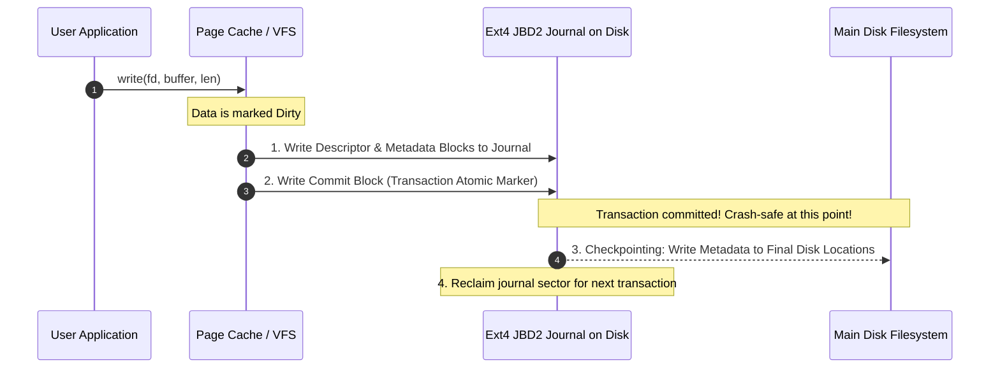

# Modul 112: Mekanisme Antarmuka System Call (Syscall Dispatch Table, vDSO Acceleration)

**Navigasi**: [⬅️ Master Index](../../INDEX.md) | [Tingkat 7: Tingkat 7: Operating Systems Internals & Penguasaan Penuh Linux](./README.md)
*Sebelumnya*: [111. pemisahan-ruang-hak-akses-cpu-rings](./111-pemisahan-ruang-hak-akses-cpu-rings.md) | *Berikutnya*: [113. proses-booting-linux-modern](./113-proses-booting-linux-modern.md)

---

## 1. Intuisi Dasar Tanpa Jargon ("Seperti Bayi Baru Lahir")
Kapan pun komputer Anda dimatikan secara mendadak akibat pemadaman listrik darurat, mengapa file skripsi atau database perusahaan Anda tidak hancur berantakan menjadi bubur byte yang tak terbaca? File System Internals ([Linux File Systems & VFS](https://www.kernel.org/doc/html/latest/filesystems/vfs.html)) adalah arsitektur ketahanan data transaksional. Di lapisan teratas, sistem Linux menyediakan **Virtual File System (VFS)**—lapisan abstraksi universal yang memungkinkan program Anda menggunakan perintah `read()` dan `write()` yang identik untuk mengakses file lokal di SSD (Ext4), sistem file jaringan di awan (NFS), hingga sistem file buatan di memori RAM (`/proc` dan `/sys`). Di lapisan terbawah, teknologi **Journaling (Ext4, Btrfs, ZFS)** bertindak seperti buku kas akuntansi perbankan: sebelum mengubah struktur disk secara permanen, perubahan tersebut dicatat terlebih dahulu dalam jurnal khusus; jika listrik padam di tengah jalan, sistem operasi cukup membaca jurnal beberapa detik saat menyala kembali untuk memulihkan keutuhan data 100%!

## 2. Fondasi Teoretis & Aksiomatik / Matematis
Arsitektur Struktur Empat Serangkai VFS Linux dan Disk Ext4 Block Groups:

Lapisan VFS memodelkan setiap sistem file ke dalam empat objek inti:
1. **Superblock**: Menyimpan metadata global sistem file (ukuran blok, jumlah total inode, status mount).
2. **Inode (Index Node)**: Menyimpan metadata sebuah file fisik (hak akses, kepemilikan UID/GID, stempel waktu, ukuran byte, pointer blok data disk). **Nama file tidak disimpan di dalam inode!**
3. **Dentry (Directory Entry)**: Menghubungkan nama file dalam string teks dengan nomor inode yang bersesuaian, disimpan di cache memori RAM (**Dentry Cache / dcache**).
4. **File Object**: Merepresentasikan file yang sedang dibuka oleh proses (memegang offset baca-tulis saat ini).

Formulasi Ekstensi Struktur Ext4 Extent Tree:
Menggantikan pemetaan blok bertingkat lama (Direct/Indirect Pointers) dengan **Extents** kontinu:
$$\text{Extent} = \{\text{Logical Block Number}, \ \text{Length (hingga 32.768 blok)}, \ \text{Physical Block Start}\}$$
Memungkinkan satu entri extent 12-byte memetakan hingga 128 MB data disk kontinu dalam satu pemetaan tanpa overhead pointer berulang.

## 3. Anatomi Teknis & Cara Kerja Internal
Mekanisme Transaksi Jurnal Ext4 (JBD2 - Journaling Block Device 2):



1. **Mode Jurnal Ext4**:
   - `data=journal`: Metadata dan data muatan ditulis ke jurnal sebelum ke disk utama (paling aman, performa paling lambat).
   - `data=ordered` (Default): Data muatan ditulis langsung ke disk sebelum metadata di-commit ke jurnal (keseimbangan optimal antara integritas dan kecepatan).
   - `data=writeback`: Hanya metadata yang di-commit ke jurnal; tidak ada jaminan urutan data (performa maksimal, risiko data lama bocor setelah crash) ([Ext4 Kernel Documentation](https://www.kernel.org/doc/html/latest/filesystems/ext4/index.html)).
2. **Copy-on-Write File Systems (Btrfs & ZFS)**: Tidak pernah menimpa blok data yang ada di tempat (*no in-place overwrite*). Data baru selalu ditulis ke blok disk kosong baru, lalu pointer pohon B-tree diarahkan ke blok baru tersebut, memungkinkan fitur *Atomic Snapshots* instan.

## 4. Implementasi Praktis & Kode / Simulasi Riil
```c
// Inspecting File Inode Metadata and Synchronizing Page Cache to Disk in C
#include <stdio.h>
#include <stdlib.h>
#include <unistd.h>
#include <fcntl.h>
#include <sys/stat.h>
#include <time.h>

void inspect_and_sync_file(const char *filepath) {
    struct stat file_stat;

    // 1. Ekstrak metadata inode dari kernel VFS
    if (stat(filepath, &file_stat) < 0) {
        perror("stat failed");
        return;
    }

    printf("File: %s\n", filepath);
    printf("Inode Number: %lu\n", (unsigned long)file_stat.st_ino);
    printf("Size: %ld bytes (Blocks allocated: %ld of 512B)\n", 
           file_stat.st_size, file_stat.st_blocks);
    printf("Hard Links Count: %lu\n", (unsigned long)file_stat.st_nlink);
    printf("Last Modified: %s", ctime(&file_stat.st_mtime));

    // 2. Demonstrasi penulisan aman dengan fsync
    int fd = open(filepath, O_WRONLY | O_APPEND);
    if (fd >= 0) {
        const char payload[] = "Critical transaction ledger entry\n";
        write(fd, payload, sizeof(payload) - 1);
        
        // Paksa flush dari Page Cache RAM ke piringan fisik storage SSD/HDD!
        // Menjamin integritas data sebelum fungsi return ke pemanggil
        if (fsync(fd) == 0) {
            printf("Successfully committed changes to disk hardware via fsync!\n");
        }
        close(fd);
    }
}
```

## 5. Miskonsepsi & Jebakan Industri
1. **Assuming `close()` Writes Data to Physical Storage**: Berasumsi bahwa setelah memanggil `close(fd)`, data sudah aman tersimpan di piringan fisik disk. `close()` hanya melepaskan file descriptor; data masih tertahan di Page Cache RAM kernel! Jika listrik mati sedetik kemudian, data hilang (wajib panggil `fsync(fd)` sebelum `close()` untuk data kritis seperti database) ([PostgreSQL fsync Fiasco](https://wiki.postgresql.org/wiki/Fsync_Errors)).
2. **Deleting Open Files via `unlink` (Orphan Inodes)**: Menghapus file menggunakan `unlink()` atau `rm` saat proses lain masih membuka file descriptor-nya. Inode dan blok disk tidak akan dibebaskan oleh sistem file sampai proses tersebut menutup FD atau mati, menghasilkan ruang disk yang 'hilang secara gaib'.
3. **Hard Link Limitations**: Mencoba membuat Hard Link antardisk atau antarpartisi sistem file yang berbeda (`ln file /mnt/other_disk/file`). Hard Link hanya menunjuk nomor inode numerik pada satu superblock sistem file lokal; melintasi batasan mount point akan menghasilkan error `EXDEV: Invalid cross-device link`.

## 6. Proyek Latihan & Rubrik Penilaian Mandiri
1. **Tingkat Pemula**: Buktikan sifat Hard Link vs Soft (Symbolic) Link di Linux: buat sebuah file, buat hard link dan symlink ke file tersebut, periksa nomor inode keduanya via `ls -i`, lalu hapus file sumber asli dan amati perilaku kedua link tersebut.
2. **Tingkat Menengah**: Tuliskan program C yang membaca struktur direktori secara rekursif menggunakan fungsi POSIX `opendir()`, `readdir()`, dan `lstat()`. Hitung jumlah total pemakaian blok disk riil dan deteksi symlink yang rusak (*broken symlinks*).
3. **Tingkat Mahir**: Implementasikan sistem file sederhana di ruang pengguna (Filesystem in Userspace / FUSE) dalam bahasa C. Buat sistem file virtual read-only yang memetakan file-file fiktif di memori dan dapat di-mount di direktori `/mnt/myfs` serta diakses melalui perintah shell biasa.

## 7. Rekomendasi Sumber Belajar Standar Emas
| Sumber Pembelajaran | Penulis / Institusi | Tautan Langsung | Fokus Materi |
| :--- | :--- | :--- | :--- |
| Linux Kernel Virtual Filesystem (VFS) Documentation | The Linux Kernel Archives | [Linux Kernel VFS Docs](https://www.kernel.org/doc/html/latest/filesystems/vfs.html) | Superblock, Inode, Dentry, File Operations & dcache Mechanics |
| The Design and Implementation of the Ext4 Filesystem | Theodore Ts'o et al. | [Ext4 Research Paper](https://events.static.linuxfound.org/slides/2010/linuxcon-japan/ext4_paper.pdf) | Extents Architecture, JBD2 Journaling & Multiblock Allocation |
| Operating Systems: Three Easy Pieces (Persistence Section) | Remzi & Andrea Arpaci-Dusseau | [OSTEP Persistence Book](https://pages.cs.wisc.edu/~remzi/OSTEP/#persistence) | Bab 39-44: File Systems, Inodes, Crash Consistency & FSCK/Journaling |
| libfuse: The Reference Implementation for FUSE in Linux | libfuse GitHub Community | [libfuse Documentation](https://libfuse.github.io/doxygen/) | Userspace Filesystem Design, High-Level vs Low-Level FUSE API |

---
*Navigasi Cepat*: [Ke Tingkat 7](./README.md) | [Ke Master Index](../../INDEX.md) | *Sebelumnya*: [111. pemisahan-ruang-hak-akses-cpu-rings](./111-pemisahan-ruang-hak-akses-cpu-rings.md) | *Berikutnya*: [113. proses-booting-linux-modern](./113-proses-booting-linux-modern.md)
