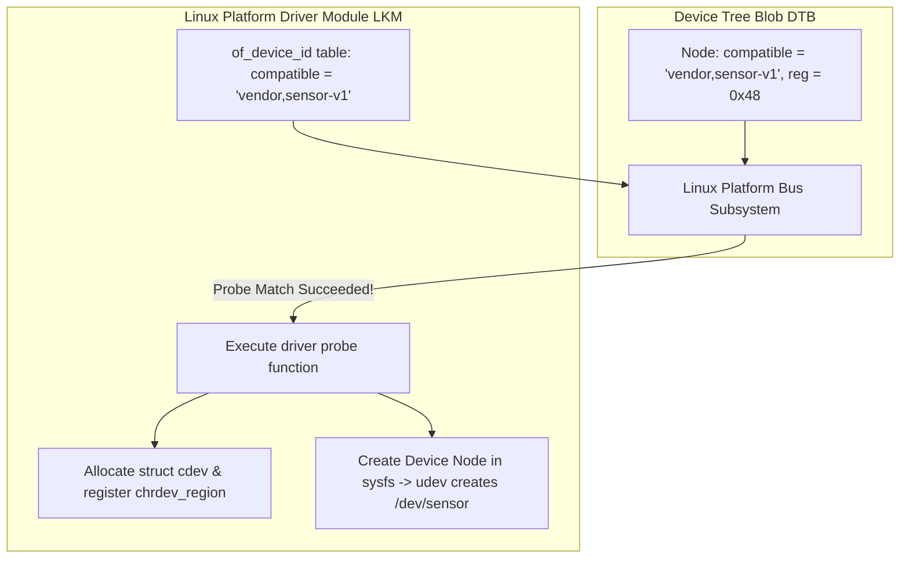

# Modul 113: Proses Booting Linux Modern (UEFI, GPT, GRUB2, Kernel Vmlinuz, Initramfs, systemd PID 1)

**Navigasi**: [⬅️ Master Index](../../INDEX.md) | [Tingkat 7: Tingkat 7: Operating Systems Internals & Penguasaan Penuh Linux](./README.md)
*Sebelumnya*: [112. mekanisme-antarmuka-system-call](./112-mekanisme-antarmuka-system-call.md) | *Berikutnya*: [114. manajemen-proses-linux](./114-manajemen-proses-linux.md)

---

## 1. Intuisi Dasar Tanpa Jargon ("Seperti Bayi Baru Lahir")
Kernel sistem operasi Linux adalah jenderal perang yang agung, namun ia tidak tahu cara berbicara langsung dengan chip accelerometer khusus buatan produsen tertentu atau modem 5G terbaru yang tertancap di bus perangkat keras. Pengemudi Perangkat Lunak Linux (Linux Device Drivers) ([Linux Device Drivers Guide](https://lwn.net/Kernel/LDD3/)) adalah para penerjemah diplomatik yang menjembatani keajaiban hardware silikon fisik dengan abstraksi VFS kernel. Sebuah driver perangkat karakter (Character Device Driver) menyamar sebagai file biasa di dalam direktori `/dev`: ketika program aplikasi memanggil `read()` pada `/dev/my_sensor`, kernel Linux mengarahkan panggilan tersebut ke fungsi C driver Anda di Ring 0, yang kemudian membaca register fisik perangkat keras melalui Memory-Mapped I/O (MMIO), dan mengembalikan datanya secara mulus ke aplikasi pengguna.

## 2. Fondasi Teoretis & Aksiomatik / Matematis
Model Perangkat Linux (Linux Device Model) dan Interaksi Driver:

Secara formal, identifikasi perangkat kernel direpresentasikan oleh bilangan bulat 32-bit `dev_t`:
$$\text{dev\_t} = (\text{Major} \ll 20) \mid \text{Minor}, \quad \text{Major} \in [0, 2^{12}-1], \quad \text{Minor} \in [0, 2^{20}-1]$$
Verifikasi integritas tabel partisi GPT dan Device Tree Blob (DTB) menggunakan polinomial siklik CRC32 standar IEEE 802.3:
$$P(x) = x^{32} + x^{26} + x^{23} + x^{22} + x^{16} + x^{12} + x^{11} + x^{10} + x^8 + x^7 + x^5 + x^4 + x^2 + x + 1$$

Linux mengklasifikasikan perangkat keras menjadi tiga jenis utama:
1. **Character Devices (Char Dev)**: Mengalirkan data byte-per-byte tanpa buffering acak (Keyboard, Serial Port, Sensor I2C/SPI, GPU Direct Access). Diidentifikasi oleh pasangan nomor **Major** (identitas driver) dan **Minor** (identitas instans fisik perangkat).
2. **Block Devices**: Mengakses data dalam unit blok berukuran tetap dengan dukungan caching Page Cache intensif (Hard disk, SSD NVMe, USB Flash Drive).
3. **Network Devices**: Berorientasi pada pengiriman paket biner melalui antarmuka socket jaringan tanpa file descriptor di direktori `/dev` (diwakili oleh `struct net_device`).

Struktur Operasi Karakter Perangkat (`struct file_operations`):
Driver mendaftarkan tabel pointer fungsi callback ke VFS:
```c
struct file_operations my_fops = {
    .owner   = THIS_MODULE,
    .open    = device_open,
    .read    = device_read,
    .write   = device_write,
    .release = device_release,
};
```
Ketika aplikasi pengguna memanggil `read(fd, buf, count)`, kernel melompat langsung ke fungsi `device_read` driver di Ring 0.

## 3. Anatomi Teknis & Cara Kerja Internal
Arsitektur Modul Kernel Linux (LKM) dan Platform Driver Device Tree Matching:



1. **Memory-Mapped I/O (MMIO)**: Alamat register fisik periferal di-mapping ke ruang alamat virtual kernel menggunakan `ioremap()`. Driver wajib menggunakan fungsi pengakses khusus `ioread32()` dan `iowrite32()` dengan memory barrier untuk mencegah reordering arsitektur CPU.
2. **Interrupt Handling (Top Half & Bottom Half)**:
   - **Top Half (Hard IRQ)**: Berjalan saat interupsi hardware terpicu dengan interupsi lain dibekukan; melakukan hal paling darurat (membersihkan bendera interupsi hardware di register) lalu menjadwalkan Bottom Half.
   - **Bottom Half (Tasklets / Workqueues)**: Menjalankan pemrosesan data panjang secara asinkron; workqueues dapat tertidur (*sleepable context*) dan mengalokasikan memori.

## 4. Implementasi Praktis & Kode / Simulasi Riil
```c
// Complete Linux Loadable Kernel Module (LKM) Character Device Driver in C
#include <linux/init.h>
#include <linux/module.h>
#include <linux/fs.h>
#include <linux/uaccess.h>
#include <linux/cdev.h>

#define DEVICE_NAME "my_charr_dev"
static dev_t dev_number;
static struct cdev my_cdev;
static char kernel_msg[] = "Data from Linux Kernel Driver Ring 0!\n";

static ssize_t dev_read(struct file *filp, char __user *user_buf, size_t count, loff_t *offset) {
    size_t msg_len = sizeof(kernel_msg) - 1;
    if (*offset >= msg_len) return 0; // EOF
    if (count > msg_len - *offset) count = msg_len - *offset;
    
    // Salin data aman dari ruang kernel ke ruang pengguna
    if (copy_to_user(user_buf, kernel_msg + *offset, count)) {
        return -EFAULT;
    }
    *offset += count;
    return count;
}

static struct file_operations fops = {
    .owner = THIS_MODULE,
    .read  = dev_read,
};

static int __init my_driver_init(void) {
    alloc_chrdev_region(&dev_number, 0, 1, DEVICE_NAME);
    cdev_init(&my_cdev, &fops);
    cdev_add(&my_cdev, dev_number, 1);
    pr_info("my_charr_dev: Loaded with Major %d, Minor %d\n", MAJOR(dev_number), MINOR(dev_number));
    return 0;
}

static void __exit my_driver_exit(void) {
    cdev_del(&my_cdev);
    unregister_chrdev_region(dev_number, 1);
    pr_info("my_charr_dev: Unloaded cleanly\n");
}

module_init(my_driver_init);
module_exit(my_driver_exit);
MODULE_LICENSE("GPL");
MODULE_AUTHOR("Systems Engineer");
```

## 5. Miskonsepsi & Jebakan Industri
1. **Direct Pointer Dereference of User Space Buffer**: Mencoba membaca atau menulis langsung ke `user_buf` di Ring 0 tanpa `copy_from_user` atau `copy_to_user`. Jika memori pengguna tersebut di-swap out atau diarahkan ke alamat ilegal oleh eksploit, kernel akan langsung mengalami Fatal Page Fault (Kernel Panic).
2. **Sleeping in Atomic Interrupt Context**: Memanggil fungsi alokasi memori tidur `kmalloc(..., GFP_KERNEL)` di dalam Top-Half interrupt handler alih-alih `kmalloc(..., GFP_ATOMIC)`. Kernel akan mendeteksi pelanggaran dan melempar bug traceback instan.
3. **Module Refcount Leak**: Mengambil referensi modul atau perangkat tanpa melepaskannya kembali saat penutupan file, menyebabkan perintah `rmmod` ditolak permanen dengan status `Resource temporarily unavailable` (Device busy).

## 6. Proyek Latihan & Rubrik Penilaian Mandiri
1. **Tingkat Pemula**: Kompilasi modul kernel sederhana (*Hello World LKM*) menggunakan Makefile Linux standar. Muat modul ke kernel dengan `insmod`, periksa log output menggunakan `dmesg`, dan copot modul menggunakan `rmmod`.
2. **Tingkat Menengah**: Buat driver character device yang mengimplementasikan operasi `write` dan `read` dengan ring buffer memori internal 1 KB. Uji interaksi driver dari shell Linux menggunakan perintah `echo "Hello" > /dev/my_dev` dan `cat /dev/my_dev`.
3. **Tingkat Mahir**: Implementasikan Linux Platform Driver terintegrasi Device Tree untuk mengontrol pin GPIO hardware. Definisikan node Device Tree `.dts`, sambungkan dengan fungsi `probe()` driver, daftarkan Interrupt Handler hardware, dan gunakan Workqueue untuk memproses pembacaan sensor secara asinkron.

## 7. Rekomendasi Sumber Belajar Standar Emas
| Sumber Pembelajaran | Penulis / Institusi | Tautan Langsung | Fokus Materi |
| :--- | :--- | :--- | :--- |
| Linux Device Drivers, 3rd Edition (LDD3) | Jonathan Corbet, Alessandro Rubini, Greg Kroah-Hartman | [LWN LDD3 Free Portal](https://lwn.net/Kernel/LDD3/) | Character Devices, Memory Allocation, Interrupts & Block Drivers |
| Linux Device Model Documentation | The Linux Kernel Archives | [Linux Device Model](https://www.kernel.org/doc/html/latest/driver-api/driver-model/index.html) | Bus, Devices, Drivers, Platform Subsystem & sysfs Tree |
| Writing Device Drivers in Linux: A Tutorial Series | SysProg21 Community | [Linux Driver Tutorials](https://github.com/sysprog21/lkmpg) | The Linux Kernel Module Programming Guide (Modern LKMPG) |
| Device Tree Guide for Embedded Linux Drivers | Devicetree.org | [Devicetree Specifications](https://www.devicetree.org/specifications/) | Platform Driver Probing, Device Tree Compatible Strings & Resources |

---
*Navigasi Cepat*: [Ke Tingkat 7](./README.md) | [Ke Master Index](../../INDEX.md) | *Sebelumnya*: [112. mekanisme-antarmuka-system-call](./112-mekanisme-antarmuka-system-call.md) | *Berikutnya*: [114. manajemen-proses-linux](./114-manajemen-proses-linux.md)
