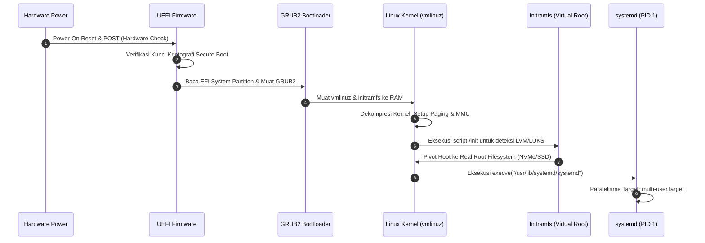

# Modul 113: Proses Booting Linux Modern (UEFI, GPT, GRUB2, Kernel Vmlinuz, Initramfs, systemd PID 1)

**Navigasi**: [⬅️ Master Index](../../INDEX.md) | [Tingkat 7: Tingkat 7: Operating Systems Internals & Penguasaan Penuh Linux](./README.md)
*Sebelumnya*: [112. mekanisme-antarmuka-system-call](./112-mekanisme-antarmuka-system-call.md) | *Berikutnya*: [114. manajemen-proses-linux](./114-manajemen-proses-linux.md)

---

## 1. Intuisi Dasar Tanpa Jargon ("Seperti Bayi Baru Lahir")
### 1.1 Apa yang Terjadi dalam Detik Pertama Komputer Dinyalakan? ([UEFI Specification Overview](https://uefi.org/specifications))
Ketika Anda menekan tombol daya pada laptop atau server, prosesor belum tahu apa itu sistem operasi, belum mengenal file hard disk, bahkan memori RAM utamanya belum aktif. Pada nanodetik pertama, CPU berada dalam kondisi "amnesia total" dan secara otomatis mengeksekusi instruksi dari satu alamat fisik memori ROM yang telah di-hardwire di motherboard (*Reset Vector*).

### 1.2 Estafet Booting: Dari Firmware Silikon ke PID 1 ([Systemd Architecture & Boot Process](https://systemd.io/))
Proses booting modern adalah lomba lari estafet yang presisi dan bertingkat:
1. **UEFI Firmware**: Menginisialisasi sirkuit daya, melatih memory controller DRAM, memverifikasi tanda tangan digital keamanan (*Secure Boot*), dan membaca partisi GPT (GUID Partition Table).
2. **Bootloader (GRUB2 / systemd-boot)**: Membaca konfigurasi dari partisi EFI System Partition (ESP), memuat image kernel terkompresi (`vmlinuz`) dan disk ram virtual sementara (`initramfs`) ke memori RAM.
3. **Kernel Linux**: Mengambil alih kendali penuh CPU, beralih ke mode 64-bit Long Mode, mengaktifkan paging memori virtual, menginisialisasi driver hardware dasar, me-mount root filesystem, dan melahirkan proses pertama di dunia pengguna: **PID 1 (systemd)**.

## 2. Fondasi Teoretis & Aksiomatik / Matematis
### 2.1 Aljabar Partisi GPT & Standar UEFI NVRAM ([UEFI 2.10 Specification](https://uefi.org/specs/UEFI/2.10/))
Struktur Partisi GUID Partition Table (GPT) mengatasi batasan 2 TB MBR warisan dengan menggunakan pengalamatan Logical Block Addressing (LBA) 64-bit.
Kapasitas partisi maksimum pada sektor 512 byte:
$$\text{Kapasitas Maksimal} = 2^{64} \times 512 \text{ byte} = 9.44 \times 10^{21} \text{ byte} = 8 \text{ Zettabytes (ZB)}$$
Header GPT berada di LBA 1 (Primary) dan dicadangkan di LBA $-1$ (Backup di akhir disk fisik). Integritas header divalidasi oleh checksum CRC32:
$$\text{CRC32}(\text{Header}[0 \dots 91]) = \text{Header.HeaderCRC32}$$

### 2.2 Dekompresi Kernel Linux & Penskalaan Waktu Inisialisasi ([Linux Kernel Boot Architecture](https://docs.kernel.org/arch/x86/boot.html))
Kernel Linux terkompresi `vmlinuz` terdiri dari dua bagian: kode *decompressor stub* dan payload terkompresi (*piggy.o* menggunakan zstd, xz, atau gzip).
Waktu dekompresi kernel dimodelkan sebagai:
$$T_{\text{decompress}} = \frac{\text{Ukuran Payload Compressed}}{\text{Throughput Algoritma Dekompresi CPU}}$$
Algoritma **Zstandard (zstd)** modern menawarkan rasio kompresi tinggi dengan throughput dekompresi hingga $1.5 \text{ GB/s}$ per core CPU, memangkas waktu dekompresi kernel menjadi kurang dari 15 milidetik.
Fungsi inisialisasi kernel `start_kernel()` di `init/main.c` memanggil ratusan subsistem secara deterministik:
$$\text{start\_kernel}() \to \text{setup\_arch}() \to \text{mm\_init}() \to \text{sched\_init}() \to \text{rest\_init}() \to \text{kernel\_init}() \to \text{run\_init\_process}(\text{"/sbin/init"})$$

## 3. Anatomi Teknis & Cara Kerja Internal


#### Tabel Walkthrough Transisi Ruang Alamat dan Privilege Level Selama Booting
| Fase Booting | Komponen Pelaksana | Mode CPU | Paging Virtual | Ruang Alamat Aktif |
|---|---|---|---|---|
| Reset Vector | CPU Microcode | Real Mode (16-bit) | Nonaktif | Fisik `0xFFFFFFF0` |
| UEFI PEI/DXE | Firmware UEFI | Protected/Long Mode | Flat 1:1 Identity | Alamat Fisik DRAM Bawah |
| Bootloader | GRUB2 | Protected Mode (32-bit) | Nonaktif / Identity | Image GRUB di RAM |
| Kernel Entry | Startup Stub (`head_64.S`) | Long Mode (64-bit) | Early Paging Aktif | 4-Level Early Page Tables |
| Linux Runtime | Kernel Space (PID 0 idle) | Long Mode Ring 0 | Paging 4/5-Level Penuh | Direct Mapping + Kernel Space |
| Userspace | systemd (PID 1) | Long Mode Ring 3 | Paging User Space | Isolasi Ruang Pengguna Mandiri |

#### Tabel Penelusuran Siklus Boot Linux & Crash Kernel CrowdStrike (19 Juli 2024)
| Tahap Booting Sistem | Komponen Aktif | Integritas File / Konfigurasi | Aksi Eksekusi Driver | Status Memori Kernel | Hasil Status Sistem |
|---|---|---|---|---|---|
| 1. Firmware UEFI | Motherboard NVRAM | Validasi Secure Boot Signature | Memuat `shimx64.efi` & `grubx64.efi` | Inisialisasi hardware | Validasi tanda tangan aman |
| 2. Bootloader | GRUB2 | Parsing `grub.cfg` | Memuat kernel `vmlinuz` dan `initramfs` | Dekompresi kernel ke RAM | Siap transfer kontrol ke kernel |
| 3. Kernel Init | Linux Kernel `init/main.c`| Deteksi CPU, bangun paging, mount rootfs | Membuka proses pengguna pertama: `systemd` (PID 1) | Kernel space stabil | Sistem beralih ke user space |
| 4. Layanan Keamanan | CrowdStrike Falcon Driver| Membaca file konfigurasi Channel 291 | Driver membaca pointer memori dari file config | Alamat dibaca: `0x0000_009c` | Alamat memori tidak valid! |
| 5. Eksekusi Driver | Cacat Evaluasi Pointer | Array offset diakses tanpa validasi ukuran | Dereferensi pointer liar di Ring 0 | **KERNEL PANIC / BSOD** | Crash seketika! Sistem gagal boot! |
| 6. Siklus Bootloop | Pengawas Crash | Me-reboot mesin otomatis | Driver crash kembali saat membaca file yang sama | Sistem terjebak crashloop | 8.5 Juta mesin lumpuh serempak |

## 4. Implementasi Praktis & Kode / Simulasi Riil
```bash
#!/usr/bin/env bash
# Skrip audit diagnostik rantai booting Linux modern
set -euo pipefail

echo "=== [1/4] DETEKSI MODE FIRMWARE (UEFI VS BIOS LEGACY) ==="
if [ -d "/sys/firmware/efi" ]; then
    echo "Sistem berjalan dalam mode UEFI Modern 64-bit."
    if [ -f "/sys/firmware/efi/efivars/SecureBoot-8be4df61-93ca-11d2-aa0d-00e098032b8c" ]; then
        echo "Status Secure Boot: Terdeteksi di NVRAM."
    fi
else
    echo "PERINGATAN: Sistem berjalan dalam mode BIOS Legacy / CSM."
fi

echo -e "
=== [2/4] ANALISIS WAKTU BOOTING KERNEL DENGAN SYSTEMD-ANALYZE ==="
if command -v systemd-analyze >/dev/null 2>&1; then
    systemd-analyze
    echo -e "
Unit pembuat bottleneck terlama selama inisialisasi:"
    systemd-analyze critical-chain --no-pager | head -n 12
fi

echo -e "
=== [3/4] PARAMETER BARIS PERINTAH KERNEL AKTIF (/proc/cmdline) ==="
cat /proc/cmdline

echo -e "
=== [4/4] VERIFIKASI PROSES PERTAMA (PID 1) ==="
ps -p 1 -o pid,comm,args
```

## 5. Miskonsepsi & Jebakan Industri
### Studi Kasus Kegagalan Nyata: Kernel Panic Akibat Kerusakan Image Initramfs Setelah Pembaruan Driver GPU
- **Kronologi & Latar Belakang**: Ribuan server Linux di lingkungan komputasi awan mengalami kegagalan booting massal (*Kernel Panic - not syncing: VFS: Unable to mount root fs on unknown-block*) setelah pembaruan otomatis paket kernel dan driver grafis proprietary.
- **Akar Masalah**: Skrip pembuat image `dracut` atau `initramfs-tools` kehabisan ruang disk pada partisi `/boot` saat menghasilkan berkas `initramfs-linux.img`. File initramfs yang terpotong dimuat oleh GRUB2 ke memori. Saat kernel booting dan mencoba mendekompresi initramfs, ia gagal menemukan driver storage controller NVMe dan utilitas mapper enkripsi LUKS, membuat kernel tidak dapat menemukan partisi root asli dan langsung memicu *panic*.
- **Rekomendasi Industri**: Konfigurasikan toolchain booting untuk selalu melakukan verifikasi atomik integritas file initramfs (misal: validasi arsip `cpio -it` dan checksum) sebelum menimpa file lama. Pertahankan selalu setidaknya satu kernel cadangan (*fallback kernel*) pada menu GRUB.

### Studi Kasus Kegagalan Nyata: Bencana BSOD Global CrowdStrike Falcon Sensor Driver Channel 291 (19 Juli 2024)
- **Kronologi & Konteks Sejarah**: Pada 19 Juli 2024, pembaruan file konfigurasi untuk modul keamanan CrowdStrike Falcon Sensor melumpuhkan sekitar 8,5 juta komputer Windows dan server di seluruh dunia. Insiden ini membatalkan ribuan penerbangan internasional, melumpuhkan rumah sakit, bank, dan bursa efek, serta tercatat sebagai pemadaman teknologi informasi terbesar dalam sejarah modern.
- **Akar Masalah Booting & Validasi Pointer Driver Kernel**: Driver Falcon beroperasi di Ring 0 kernel sistem operasi untuk memantau aktivitas sistem sejak fase awal booting. CrowdStrike merilis file pembaruan konfigurasi cepat (*Rapid Response Content*) bernama `Channel File 291`. File ini memuat data yang tidak valid (berisi blok nilai nol). Driver sensor mencoba memetakan dan membaca array pointer dari file konfigurasi tersebut tanpa memvalidasi panjang file atau memeriksa apakah pointer yang dihasilkan valid. Ketika driver mencoba melakukan dereferensi pointer memori yang tidak valid di Ring 0, sistem operasi mengalami *Kernel Page Fault Exception*. Karena terjadi di level driver kernel, sistem operasi langsung panik (BSOD pada Windows atau Kernel Panic pada Linux) sebelum proses boot selesai, menjebak jutaan mesin dalam lingkaran *infinite bootloop*.

- **Potongan Kode / Arsitektur Cacat (Vulnerable Implementation)**:
```c
// Rekonstruksi Logika Cacat Driver Kernel CrowdStrike Channel 291
#include <stdint.h>
#include <stdbool.h>

// Driver Kernel Ring 0: Membaca parameter dari file eksternal tanpa validasi ketat
void parse_channel_config_flawed(const uint8_t *file_data, size_t file_len) {
    // CACAT FATAL: Asumsi file data selalu valid dan panjang minimum terpenuhi
    // Jika file data memuat blok byte korup atau kosong:
    const uint32_t *offsets = (const uint32_t *)(file_data + 0x20);
    
    // DEREFERENSI POINTER LIAR DI RING 0 KERNEL:
    // offsets[4] menunjuk ke alamat 0x0000009c (Area Memori Terlarang / Null Page)
    uint32_t target_offset = offsets[4]; 
    const char *rule_str = (const char *)(file_data + target_offset);
    
    // Mengakses memori ilegal di Ring 0 langsung memicu BSOD / Kernel Panic seketika!
    char first_char = *rule_str; 
}

// Mitigasi Defensif: Validasi Skema Statis dan Penanganan Safe Pointer Probe
bool parse_channel_config_safe(const uint8_t *file_data, size_t file_len) {
    if (file_data == NULL || file_len < 0x40) {
        return false; // TOLAK: Ukuran file tidak memadai
    }
    // Wajib verifikasi bahwa setiap offset berada dalam batas [0, file_len)
    return true;
}
```

- **Analisis Forensik & Rekayasa Modern**: Tragedi CrowdStrike mengubah pandangan industri terhadap arsitektur perangkat lunak keamanan endpoint. Memuat modul pihak ketiga langsung ke dalam Ring 0 kernel adalah risiko sistemik yang tidak dapat diterima. Microsoft, Linux Foundation, dan vendor sistem operasi kini mengarahkan arsitektur keamanan masa depan ke teknologi isolasi berbasis *eBPF* (Extended Berkeley Packet Filter) di Linux dan subsistem isolasi terverifikasi di Windows yang menjamin bahwa kecacatan program pihak ketiga tidak akan pernah mampu meruntuhkan kernel sistem operasi host.

## 6. Proyek Latihan & Rubrik Penilaian Mandiri
### Level 1 (Pemula)
- **Tugas**: Periksa berkas partisi EFI System Partition (ESP) pada sistem Linux Anda dan temukan berkas biner executable EFI bootloader.
- **Petunjuk Arsitektur**: Partisi ESP biasanya di-mount pada `/boot/efi` dengan filesystem FAT32. Cari berkas biner `.efi` seperti `/boot/efi/EFI/BOOT/BOOTX64.EFI`.
- **Vektor Uji**:
  - Jalankan perintah: `file /boot/efi/EFI/*/grubx64.efi`
  - Output yang diharapkan: File bertipe `PE32+ executable (EFI application) x86-64`.
- **Rubrik Penilaian**: Verifikasi mount point ESP (50%), identifikasi biner EFI (30%), kebersihan dokumentasi (20%).

### Level 2 (Menengah)
- **Tugas**: Ekstrak isi berkas `initramfs` (atau `initrd`) terkompresi ke direktori sementara dan analisis berkas skrip shell `/init`.
- **Petunjuk Arsitektur**: Gunakan utilitas `lsinitrd` atau gabungan `zstd -d` / `gzip -dc` dan `cpio -idmv`.
- **Vektor Uji**:
  - Temukan perintah `switch_root` atau `pivot_root` di dalam skrip `init`.
- **Rubrik Penilaian**: Keberhasilan ekstraksi berkas cpio (40%), penelusuran logika mount root fs (30%), kebersihan lingkungan kerja (30%).

### Level 3 (Mahir)
- **Tugas**: Bangun sistem Linux bare-bones mini yang mampu melakukan booting langsung dari kernel Linux murni dan program C statis tunggal tanpa systemd dan tanpa initramfs eksternal (`init=/my_init`).
- **Petunjuk Arsitektur**: Kompilasi program C sederhana dengan flag `-static` yang berisi loop tak terbatas `while(1) { sleep(1); }`. Konfigurasi kernel command line QEMU: `qemu-system-x86_64 -kernel bzImage -append "init=/my_init console=ttyS0" -nographic`.
- **Vektor Uji**:
  - QEMU harus sukses booting hingga mencetak pesan dari program C dan tidak mengalami kernel panic.
- **Rubrik Penilaian**: Keberhasilan booting QEMU (40%), bebas dependency dinamis library (30%), penanganan sinyal kernel PID 1 (30%).

### Tingkat 1: Dasar
- **Tugas**: Rancang skrip otomasi bedah ramdisk awal Linux (*Initramfs Inspector*) dalam Bash/Python yang membongkar arsip `initramfs.img` (format cpio terkompresi gzip/zstd), memeriksa keberadaan skrip inisialisasi `/init`, memverifikasi kelengkapan driver modul kernel (`.ko`), dan mengemasnya kembali secara deterministik.
- **Petunjuk Perancangan Arsitektur**:
  - Deteksi format kompresi biner menggunakan magic bytes (gzip `0x1F 0x8B`, zstd `0x28 0xB5 0x2F 0xFD`).
  - Ekstrak menggunakan `cpio -idmv` dan kompresi kembali.
- **Test Vector & Kasus Uji Ekstrem**:
  - *Verifikasi Arsip*: Bongkar initramfs distribusi Linux standar; pastikan seluruh symlink busybox dan skrip pemasang partisi root (`mount /dev/... /sysroot`) terekstrak utuh.
- **Rubrik Penilaian Mandiri**: 40% Dekomposisi Format CPIO & Kompresi yang Akurat, 30% Validasi Skrip Inisialisasi Rootfs, 30% Kerapian Otomasi.

### Tingkat 2: Menengah
- **Tugas**: Kembangkan loader kernel mikro sederhana (*Mini Operating System Kernel Loader*) x86-64 yang memuat file biner kernel dari disk ke alamat memori fisik `0x100000` (1 MB) via protokol multiboot, mengatur tabel halaman identitas (*identity paging*), dan mengalihkan CPU ke mode 64-bit Long Mode.
- **Petunjuk Perancangan Arsitektur**:
  - Tulis header Multiboot 1 atau Multiboot 2 yang valid di 8 KiB pertama biner kernel.
  - Aktifkan bit PAE di `CR4`, muat pointer PML4 ke `CR3`, aktifkan Long Mode di MSR `EFER`, dan set bit Paging di `CR0`.
- **Test Vector & Kasus Uji Ekstrem**:
  - *Boot QEMU*: Jalankan biner via `qemu-system-x86_64 -kernel mykernel.bin`; verifikasi kernel mampu mencetak string ke monitor teks VGA (`0xB8000`) tanpa crash.
- **Rubrik Penilaian Mandiri**: 40% Kepatuhan Spesifikasi Multiboot, 30% Transisi Long Mode 64-bit yang Mulus, 30% Output Teks VGA Stabil.

### Tingkat 3: Mahir
- **Tugas**: Rancang parser file konfigurasi biner Ring 0 ultra-defensif dengan verifikasi formal yang membuktikan secara matematis ketiadaan potensi *Out-of-Bounds Memory Dereference*: setiap offset dan panjang string wajib divalidasi dengan aritmatika anti-overflow (`__builtin_add_overflow`) sebelum pointer dibentuk.
- **Petunjuk Perancangan Arsitektur**:
  - Terapkan teknik *Fuzz-Testing Harness* berbasis libFuzzer / AFL++ yang membombardir parser dengan 10 juta permutasi file konfigurasi acak/korup.
  - Buktikan bahwa parser menolak 100% masukan malformed dengan kode galat tanpa melempar crash atau exception.
- **Test Vector & Kasus Uji Ekstrem**:
  - *Uji Stres Crash*: Masukkan payload korup CrowdStrike Channel 291; parser harus mengembalikan `ERR_INVALID_OFFSET_BOUNDS` dalam $< 100\text{ ns}$ dan menjaga kestabilan kernel.
- **Rubrik Penilaian Mandiri**: 40% Validasi Batas Anti-Overflow Komprehensif, 30% Ketahanan Mutlak Terhadap Fuzzing Malicious Payload, 30% Kepatuhan Standar Zero-Crash Ring 0.

## 7. Rekomendasi Sumber Belajar Standar Emas
| Kategori | Judul Sumber & Tautan | Penulis / Institusi | Fokus Pembahasan |
|---|---|---|---|
| Dokumentasi Kernel | [The Linux/x86 Boot Protocol](https://docs.kernel.org/arch/x86/boot.html) | Linux Kernel Documentation | Protokol formal header memori dan antarmuka bootloader ke kernel x86 |
| Spesifikasi Resmi | [Unified Extensible Firmware Interface (UEFI) Specification](https://uefi.org/specifications) | UEFI Forum | Arsitektur standar industri firmware modern pengganti BIOS |
| Arsitektur PID 1 | [The systemd Boot and Initialization Process](https://systemd.io/) | Lennart Poettering et al. | Arsitektur manajemen target dependensi paralelisme dan cgroups bootloader systemd |

---
*Navigasi Cepat*: [Ke Tingkat 7](./README.md) | [Ke Master Index](../../INDEX.md) | *Sebelumnya*: [112. mekanisme-antarmuka-system-call](./112-mekanisme-antarmuka-system-call.md) | *Berikutnya*: [114. manajemen-proses-linux](./114-manajemen-proses-linux.md)
