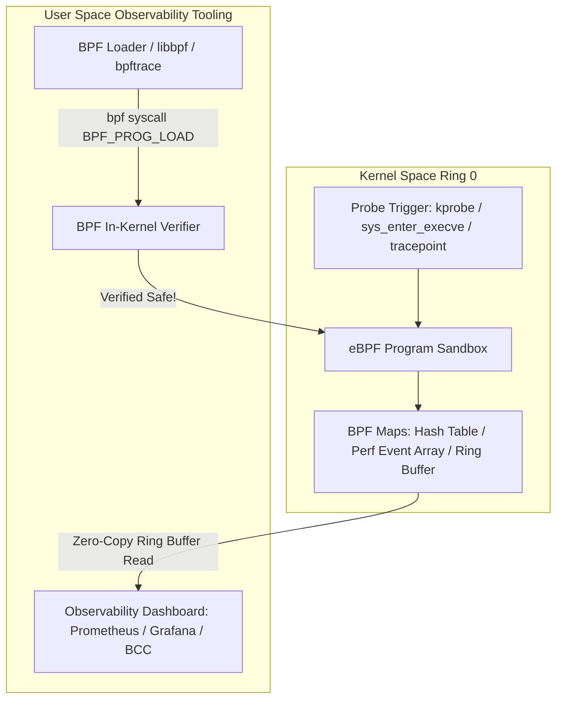

# Modul 114: Manajemen Proses Linux (task_struct, fork(), Copy-on-Write, execve(), Zombie & Orphan Processes)

**Navigasi**: [⬅️ Master Index](../../INDEX.md) | [Tingkat 7: Tingkat 7: Operating Systems Internals & Penguasaan Penuh Linux](./README.md)
*Sebelumnya*: [113. proses-booting-linux-modern](./113-proses-booting-linux-modern.md) | *Berikutnya*: [115. penjadwalan-cpu-linux](./115-penjadwalan-cpu-linux.md)

---

## 1. Intuisi Dasar Tanpa Jargon ("Seperti Bayi Baru Lahir")
Ketika sistem database produksi Anda di cloud tiba-tiba mengalami lonjakan latensi misterius setiap pukul dua pagi, Anda tidak bisa menghentikan sistem dengan debugger gdb atau menambahkan ratusan perintah `printk` lalu mengompilasi ulang kernel server. Tracing, Profiling & Kernel Observability ([Linux eBPF & Tracing Architecture](https://ebpf.io/)) adalah mesin sinar-X berdaya tembus tinggi yang memungkinkan Anda mengintip ke dalam perut terdalam kernel Linux pada kecepatan produksi nyata dengan overhead nyaris nol (<1%). Teknologi puncaknya—**eBPF (Extended Berkeley Packet Filter)**—adalah komputer mini revolusioner yang ditanamkan di dalam kernel Linux: ia memungkinkan Anda menyuntikkan program bytecode aman yang dapat dipasang pada sembarang pemanggilan fungsi kernel (kprobes), fungsi aplikasi pengguna (uprobes), atau paket jaringan, menyajikan metrik observabilitas telemetri secara real-time tanpa pernah memodifikasi satu baris pun kode sumber kernel!

## 2. Fondasi Teoretis & Aksiomatik / Matematis
Arsitektur Mesin Virtual eBPF dan Sistem Verifier Matematis Formal:

eBPF adalah mesin virtual RISC 64-bit berbasis register yang tertanam di dalam kernel Linux, memiliki 11 register 64-bit ($R0 - R10$) dan program counter $PC$. Program eBPF dikompilasi dari bahasa C menggunakan Clang/LLVM target `bpf`.

Jaminan Keamanan **eBPF Kernel In-Kernel Verifier**:
Sebelum program eBPF diizinkan dimuat dan dieksekusi di Ring 0, Verifier menganalisis grafik kontrol aliran (CFG):
1. **Jaminan Terminasi**: Memastikan program tidak mengandung loop tak berujung (unbounded loops). Seluruh loop wajib dibatasi secara statis.
2. **Keamanan Memori Mutlak**: Memvalidasi bahwa setiap pembacaan/penulisan pointer berada di dalam batas struktur yang valid (out-of-bounds check) dan tidak ada akses pointer liar yang belum diinisialisasi.
3. **Ukuran Program Maksimum**: Membatasi instruksi maksimum (hingga 1.000.000 instruksi terverifikasi) untuk mencegah monopoli CPU.

Setelah lolos verifikasi, **Just-In-Time (JIT) Compiler** menerjemahkan bytecode eBPF menjadi instruksi mesin asli x86-64 atau ARM64 untuk eksekusi pada kecepatan hardware penuh.

## 3. Anatomi Teknis & Cara Kerja Internal
Arsitektur Observabilitas eBPF: Dari Hook Titik Kernel ke Ruang Pengguna:



1. **Kategori Instrumen Penelusuran (Tracing Probes)**:
   - **Tracepoints**: Titik instrumentasi statis yang ditanamkan secara sengaja oleh developer kernel di lokasi kritis (stabil dan tidak berubah antarkernel release).
   - **Kprobes / Kretprobes**: Instrumentasi dinamis yang mampu mencangkok instruksi breakpoint pada *sembarang* alamat fungsi fungsi kernel Linux saat runtime.
   - **Uprobes / Uretprobes**: Mencangkok instruksi breakpoint pada fungsi di dalam biner aplikasi ruang pengguna (seperti melacak pemanggilan fungsi SSL `SSL_write` di openssl) ([Brendan Gregg eBPF Portal](https://www.brendangregg.com/ebpf.html)).

## 4. Implementasi Praktis & Kode / Simulasi Riil
```python
# High-Performance Disk I/O Latency Tracing using BCC (BPF Compiler Collection)
# Menelusuri latensi waktu eksekusi penulisan disk block I/O via eBPF kprobe
from bcc import BPF
from time import sleep

bpf_source = """
#include <uapi/linux/ptrace.h>
#include <linux/blkdev.h>

BPF_HASH(start_time, struct request *);
BPF_HISTOGRAM(io_latencies);

// 1. Hook saat request blok I/O diterbitkan ke driver disk hardware
void trace_req_start(struct pt_regs *ctx, struct request *req) {
    u64 ts = bpf_ktime_get_ns();
    start_time.update(&req, &ts);
}

// 2. Hook saat request blok I/O selesai dieksekusi (completion callback)
void trace_req_done(struct pt_regs *ctx, struct request *req) {
    u64 *tsp = start_time.lookup(&req);
    if (tsp != 0) {
        u64 delta_us = (bpf_ktime_get_ns() - *tsp) / 1000;
        io_latencies.increment(bpf_log2l(delta_us)); // Catat ke histogram log2 mikrodetik
        start_time.delete(&req);
    }
}
"""

b = BPF(text=bpf_source)
b.attach_kprobe(event="blk_account_io_start", fn_name="trace_req_start")
b.attach_kprobe(event="blk_account_io_done", fn_name="trace_req_done")

print("Tracing block I/O latency... Hit Ctrl-C to finish and view distribution histogram.")
try:
    sleep(999999)
except KeyboardInterrupt:
    print("\nDisk I/O Latency Histogram (microsecond logarithmic buckets):")
    b["io_latencies"].print_log2_hist("usecs")
```

## 5. Miskonsepsi & Jebakan Industri
1. **BPF Verifier Rejection via Complex Pointers**: Menulis program eBPF yang melakukan pembacaan memori pointer bertingkat tanpa menggunakan pembantu kernel `bpf_probe_read_kernel()`. Verifier akan menolak memuat program dengan pesan galat `R1 invalid mem access 'inv'`.
2. **Overhead on High-Frequency Uprobes**: Memasang uprobe pada fungsi aplikasi pengguna yang dipanggil jutaan kali per detik (misal fungsi pembanding `strcmp`). Konteks trap breakpoint x86 (`int3`) memicu overhead context switch kernel yang memperlambat aplikasi hingga puluhan persen.
3. **Perf Event Buffer Dropped Samples**: Menggunakan buffer event penelusuran yang terlalu kecil saat melacak peristiwa jaringan dengan rate tinggi (seperti 100.000 paket per detik). Kernel akan membuang sampel (*dropped events*), menghasilkan metrik telemetri yang tidak akurat.

## 6. Proyek Latihan & Rubrik Penilaian Mandiri
1. **Tingkat Pemula**: Gunakan utilitas baris perintah `bpftrace` untuk melacak setiap pemanggilan syscall `sys_enter_openat` secara global di sistem Linux Anda dan cetak nama file yang sedang dibuka secara real-time.
2. **Tingkat Menengah**: Gunakan alat profiling Linux `perf record -F 99 -a -g -- sleep 10` dan `perf script` untuk mengumpulkan tumpukan panggilan fungsi (stack traces). Hasilkan visualisasi grafik api interaktif (**FlameGraph**) untuk mengidentifikasi bottleneck CPU utama pada aplikasi Anda.
3. **Tingkat Mahir**: Tulis program eBPF lengkap menggunakan kerangka modern CO-RE (Compile Once - Run Everywhere) dengan pustaka `libbpf`. Pasang probe pada titik masuk paket jaringan (XDP - eXpress Data Path) untuk memfilter dan membuang paket serangan DDoS pada lapisan driver jaringan sebelum paket sempat menyentuh kernel network stack.

## 7. Rekomendasi Sumber Belajar Standar Emas
| Sumber Pembelajaran | Penulis / Institusi | Tautan Langsung | Fokus Materi |
| :--- | :--- | :--- | :--- |
| BPF Performance Tools: Linux System and Application Observability | Brendan Gregg (Intel/Netflix) | [Brendan Gregg BPF Book](https://www.brendangregg.com/bpf-performance-tools-book.html) | eBPF, BCC, bpftrace, CPU/Memory/Disk/Network Profiling Tools |
| eBPF Official Documentation & Architecture Portal | eBPF Foundation / Linux Foundation | [eBPF Official Portal](https://ebpf.io/) | In-Kernel Verifier, JIT Compiler, BPF Maps & XDP Architecture |
| Systems Performance: Enterprise and the Cloud, 2nd Edition | Brendan Gregg | [Addison-Wesley Gregg](https://www.brendangregg.com/systems-performance-2nd-edition-book.html) | Metodologi USE, Profiling, Latensi Analisis & Kernel Tracing |
| Linux Kernel ftrace Documentation | Steven Rostedt (Linux Kernel Tracing Maintainer) | [Linux ftrace Documentation](https://www.kernel.org/doc/html/latest/trace/ftrace.html) | Function Tracer, Function Graph, Event Tracing & Dynamic Probes |

---
*Navigasi Cepat*: [Ke Tingkat 7](./README.md) | [Ke Master Index](../../INDEX.md) | *Sebelumnya*: [113. proses-booting-linux-modern](./113-proses-booting-linux-modern.md) | *Berikutnya*: [115. penjadwalan-cpu-linux](./115-penjadwalan-cpu-linux.md)
