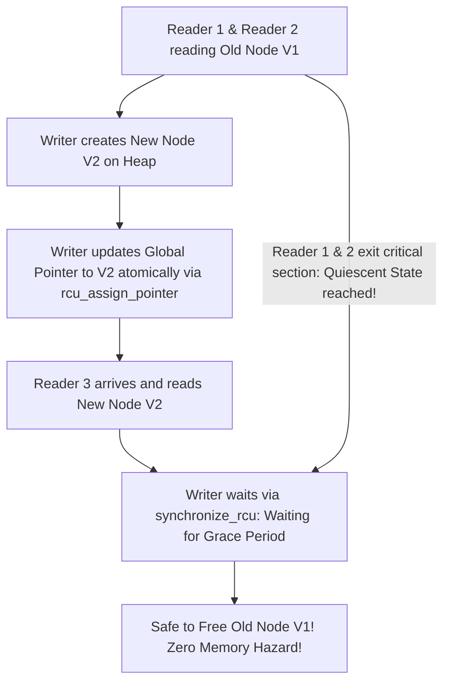

# Modul 116: Konkurensi & Sinkronisasi Kernel (Operasi Atomik, Spinlock, Mutex, Futex, Read-Copy-Update / RCU)

**Navigasi**: [⬅️ Master Index](../../INDEX.md) | [Tingkat 7: Tingkat 7: Operating Systems Internals & Penguasaan Penuh Linux](./README.md)
*Sebelumnya*: [115. penjadwalan-cpu-linux](./115-penjadwalan-cpu-linux.md) | *Berikutnya*: [117. komunikasi-antar-proses-ipc](./117-komunikasi-antar-proses-ipc.md)

---

## 1. Intuisi Dasar Tanpa Jargon ("Seperti Bayi Baru Lahir")
### 1.1 Konsep Inti & Analogi Tanpa Jargon
Ketika puluhan core prosesor mengeksekusi miliaran instruksi secara serempak di ruang kernel, mereka seperti puluhan juru masak yang berebut pisau dan talenan yang sama di dapur restoran yang sibuk. Jika dua juru masak memotong daging yang sama pada detik yang sama, bencana pasti terjadi (Data Race & Data Corruption). Sinkronisasi Kernel & Concurrency Primitives ([Kernel Synchronization Primitives](https://www.kernel.org/doc/html/latest/kernel-hacking/locking.html)) adalah protokol kedisiplinan tingkat rendah: **Spinlock** adalah penjaga pintu yang memaksa CPU berlari di tempat (spinning) menunggu kunci dilepas dalam hitungan nanodetik tanpa pernah tertidur; **Mutex** adalah pelayan santai yang menidurkan proses yang antre agar CPU dapat mengerjakan hal lain; sementara **RCU (Read-Copy-Update)** adalah keajaiban arsitektur Linux paling spektakuler: ribuan pembaca (readers) dapat membaca data secara bersamaan dengan kecepatan cahaya tanpa lock sama sekali, sementara penulis (writer) membuat salinan baru secara diam-diam dan menukar pointer data dalam satu kedipan mata!

### 1.2 Urgensi Rekayasa & Signifikansi Sistemik
Dalam rekayasa sistem modern, pemahaman mendalam tentang konsep ini membedakan arsitek sistem kelas dunia dari sekadar operator perkakas teknis.

## 2. Fondasi Teoretis & Aksiomatik / Matematis
### 2.1 Kerangka Teori Aksiomatik & Formulasi Matematis
Taksonomi Primitif Sinkronisasi dan Teori Read-Copy-Update (RCU):

### 2.2 Penurunan Matematis Langkah-demi-Langkah
1. **Spinlock vs Mutex vs Futex**:
   - **Spinlock**: Menggunakan instruksi CPU atomik `test-and-set` atau `compare-and-swap` (CAS). Thread aktif melakukan polling di register CPU tanpa context switch. **Wajib digunakan di Interrupt Context di mana CPU dilarang tidur!**
   - **Mutex**: Jika lock tidak tersedia, thread dimasukkan ke antrean tunggu kernel dan dialihkan statusnya menjadi `TASK_UNINTERRUPTIBLE` (tidur). Membawa overhead context switch (~1-2 mikrodetik).
   - **Futex (Fast Userspace Mutex)**: Penguncian dioptimasi di user space menggunakan operasi atomik CAS; transisi ke syscall kernel hanya dilakukan jika benar-benar terjadi kontensi antrean.

2. **Teori RCU (Read-Copy-Update) Paul E. McKenney**:
   Memecahkan masalah pembacaan struktur data bersama (seperti tabel routing jaringan) dengan pemisahan fase:
   - **Fase Baca**: `rcu_read_lock()` menonaktifkan preemption. Pembaca membaca pointer data tanpa lock, tanpa atomic instruction, tanpa overhead memori sama sekali ($O(1)$ zero overhead!).
   - **Fase Tulis (Update)**: Penulis mengalokasikan memori baru, menyalin data lama, memodifikasi data baru, lalu mempublikasikan pointer baru menggunakan atomic assignment dengan memory barrier release.
   - **Grace Period**: Memori struktur data lama hanya dibebaskan setelah seluruh CPU melewati **Quiescent State** (semua pembaca lama telah menyelesaikan blok baca `rcu_read_unlock()`):
   $$\text{Grace Period} \implies \forall \text{ CPU } i, \quad \text{CPU}_i \text{ has context switched / exited RCU read-side critical section}$$

## 3. Anatomi Teknis & Cara Kerja Internal
Mekanisme Transisi Grace Period pada Read-Copy-Update (RCU) Linux Kernel:



1. **Memory Ordering & Barriers**:
   Prosesor modern (seperti x86 Out-of-Order dan ARM Weakly-Ordered) serta kompilator sering mengubah urutan eksekusi instruksi pembacaan dan penulisan (*Instruction Reordering*). Primitif sinkronisasi menyisipkan instruksi pembatas memori (`smp_mb()`, `dmb` pada ARM, atau acquire-release semantics) untuk menjamin visibilitas urutan data melintasi multi-core CPU ([Linux Memory Barriers](https://www.kernel.org/doc/Documentation/memory-barriers.txt)).

#### Tabel Penelusuran Siklus Hidup Sinkronisasi Read-Copy-Update (RCU) Linux
| Siklus Waktu ($t$) | Aksi Thread Pembaca (Reader) | Aksi Thread Penulis (Writer) | Pointer Global Aktif | Status Versi Data Lama | State Grace Period Kernel |
|---|---|---|---|---|---|
| $t = 0$ | Membaca via `rcu_read_lock()` | Mengalokasikan node versi baru | Menunjuk ke Versi Data 0 | Versi 0 sedang dibaca | Belum ada grace period |
| $t = 1$ | Membaca elemen Versi 0 aman | Modifikasi nilai pada node baru | `rcu_assign_pointer()` ke Versi 1 | Versi 0 menjadi data usang | Penulis memanggil `synchronize_rcu()` |
| $t = 2$ | Masih dalam critical section | Tertidur menunggu pembaca selesai | Seluruh pembaca baru membaca Versi 1 | Versi 0 ditahan di memori | Grace period aktif: Memantau context switch |
| $t = 3$ | Panggil `rcu_read_unlock()` | Masih terblokir | Menunjuk ke Versi 1 | Tidak ada pembaca baru ke Versi 0 | Seluruh core melewati quiescent state |
| $t = 4$ | - | Penulis terbangun! | Menunjuk ke Versi 1 | **BEBAS AMAN**: Versi 0 dibebaskan | Grace period tuntas; memori lama direklamasi |
| Cacat RCU Stall | Pembaca lupa unlock / loop | Penulis menunggu tak terhingga | Terkunci selamanya | Memori menumpuk bocor | **RCU STALL DETECTED**: Soft lockup panic! |

## 4. Implementasi Praktis & Kode / Simulasi Riil
```c
// Demonstrating Futex-Based Minimal Userspace Mutex Implementation in C
#include <stdio.h>
#include <stdint.h>
#include <stdatomic.h>
#include <unistd.h>
#include <sys/syscall.h>
#include <linux/futex.h>

typedef struct {
    _Atomic uint32_t val; // 0 = Unlocked, 1 = Locked (No contention), 2 = Locked with Contenders
} futex_mutex_t;

static int futex(uint32_t *uaddr, int op, uint32_t val) {
    return syscall(SYS_futex, uaddr, op, val, NULL, NULL, 0);
}

void futex_mutex_lock(futex_mutex_t *m) {
    uint32_t c = 0;
    // Jalur Cepat (Fast-Path): Jika lock 0, ambil langsung dengan atomic CAS tanpa syscall!
    if (atomic_compare_exchange_strong(&m->val, &c, 1)) return;

    // Jalur Lambat (Slow-Path): Ada kontensi, tandai val = 2 dan tidurkan via futex syscall
    if (c != 2) c = atomic_exchange(&m->val, 2);
    while (c != 0) {
        futex((uint32_t *)&m->val, FUTEX_WAIT, 2); // Tidur di antrean kernel
        c = atomic_exchange(&m->val, 2);
    }
}

void futex_mutex_unlock(futex_mutex_t *m) {
    // Jika lock bernilai 1 (tidak ada thread yang antre), lepas langsung tanpa syscall!
    if (atomic_fetch_sub(&m->val, 1) != 1) {
        // Ada thread yang tidur antre, bangunkan satu thread via futex syscall
        atomic_store(&m->val, 0);
        futex((uint32_t *)&m->val, FUTEX_WAKE, 1);
    }
}
```

## 5. Miskonsepsi & Jebakan Industri
1. **Sleeping Inside Spinlock Critical Section**: Memanggil operasi blocking (seperti I/O disk, `copy_to_user`, atau alokasi memori heap tidur) saat sedang memegang Spinlock. CPU lain yang mencoba mengambil spinlock tersebut akan berputar membabi buta tanpa henti hingga memicu kernel watchdog lockup (*Hard Lockup Panic*).
2. **ABBA Deadlock in Multi-Lock Acquisition**: Thread 1 mengambil Lock A lalu Lock B; di saat bersamaan Thread 2 mengambil Lock B lalu Lock A. Selalu gunakan penegakan urutan hirarki lock global (Lock Ordering Hierarchy) atau gunakan alat bantu analisis kernel `lockdep` ([Linux lockdep Documentation](https://www.kernel.org/doc/html/latest/locking/lockdep-design.html)).
3. **Blocking Inside RCU Read-Side Critical Section**: Melakukan context switch atau memanggil fungsi tidur di antara `rcu_read_lock()` dan `rcu_read_unlock()`. Hal ini menahan selesainya Grace Period, membekukan pembebasan memori kernel di seluruh sistem operasi.

### Studi Kasus Kegagalan Nyata: RCU Grace Period Stall & Soft Lockup Panic pada Subsistem Jaringan Kernel Linux
- **Kronologi & Konteks Kasus**: Pada server pusat perutean paket telekomunikasi berbasis Linux yang menangani jutaan paket per detik, sebuah insiden kernel crash mendadak melumpuhkan gateway jaringan setiap beberapa hari sekali.
- **Akar Masalah Sinkronisasi Kernel & RCU Reader Section**: Subsistem tabel perutean Linux mengandalkan mekanisme Read-Copy-Update (RCU) untuk memungkinkan ribuan core CPU membaca rute secara bebas kunci (*lockless*) dengan performa maksimal. Namun, dalam modul filter paket jaringan pihak ketiga, seorang pengembang menyisipkan fungsi alokasi memori yang memblokir (`kmalloc(GFP_KERNEL)`) atau pemrosesan komputasi berat di dalam blok kritis RCU (`rcu_read_lock()` ... `rcu_read_unlock()`). Sifat fundamental RCU melarang keras thread pembaca tertidur atau melakukan pemblokiran saat memegang rcu lock. Karena thread pembaca tidak kunjung mencapai kondisi diam (*quiescent state / context switch*), mekanisme *grace period* kernel terhambat secara tak terhingga. Fungsi penulis yang menunggu pembebasan memori via `synchronize_rcu()` terkunci, memicu watchdog kernel mendeteksi `RCU Stall Panic` dan mematikan sistem operasi host.

- **Potongan Kode / Arsitektur Cacat (Vulnerable Implementation)**:
```c
// Rekonstruksi Cacat Pemblokiran di Dalam RCU Read Critical Section
#include <linux/rcupdate.h>
#include <linux/slab.h>

// CACAT FATAL: Memanggil fungsi yang dapat tertidur/memblokir di dalam RCU Read Lock!
void process_network_packet_flawed(struct packet_data *pkt) {
    rcu_read_lock(); // Memasuki RCU read section: PREEMPTION DINONAKTIFKAN SECARA LOGIS
    
    // BACA DATA RCU:
    struct route_entry *route = rcu_dereference(global_route_table);
    
    // KESALAHAN FATAL: kmalloc dengan GFP_KERNEL dapat tidur menunggu halaman memori bebas!
    // Tidur di dalam RCU section memblokir Grace Period seluruh sistem!
    void *temp_buf = kmalloc(4096, GFP_KERNEL); 
    
    process_payload(route, temp_buf);
    kfree(temp_buf);
    
    rcu_read_unlock(); // Grace period macet jika thread di atas tertidur!
}

// Mitigasi Defensif: Gunakan GFP_ATOMIC atau pindahkan alokasi ke luar blok RCU
```

- **Analisis Forensik & Rekayasa Modern**: Insiden RCU Stall membuktikan bahwa primitif sinkronisasi modern memiliki aturan invarian yang ketat. Arsitektur kernel modern menegakkan deteksi statis dan dinamis via `CONFIG_PROVE_RCU` dan `CONFIG_DEBUG_ATOMIC_SLEEP` yang secara otomatis melempar peringatan (*stack backtrace*) instan saat fungsi yang berpotensi tidur dipanggil di dalam konteks RCU atau spinlock, sebelum cacat tersebut sempat menyebabkan deadlock di lingkungan produksi.

## 6. Proyek Latihan & Rubrik Penilaian Mandiri
1. **Tingkat Pemula**: Tuliskan implementasi Spinlock mandiri di ruang pengguna (userspace test-and-set spinlock) menggunakan fungsi atomik C11 `atomic_flag_test_and_set`. Uji perlindungan variabel counter bersama oleh 4 thread paralel.
2. **Tingkat Menengah**: Simulasikan pola arsitektur Read-Copy-Update (Userspace RCU / URCU) dalam C. Tunjukkan bagaimana thread pembaca membaca data tabel tanpa lock saat sebuah thread penulis memperbarui entri tabel secara asinkron.
3. **Tingkat Mahir**: Bangun struktur data antrian antarmuka lock-free Michael & Scott Queue menggunakan instruksi CPU atomic `compare-and-swap` (CAS) dan penanganan ABA Problem menggunakan pointer berversi (*tagged pointer*). Uji ketahanan throughput melawan mutex konvensional pada 16 thread bersamaan.

### Tingkat 1: Dasar
- **Tugas**: Bangun implementasi Spinlock mandiri dalam C menggunakan instruksi atomik komparasi dan pertukaran *Test-And-Set* (`__atomic_test_and_set` atau `atomic_flag`) dengan relaksasi instruksi hardware pause x86 (`_mm_pause()`) untuk mencegah kejenuhan bus memori saat polling.
- **Petunjuk Perancangan Arsitektur**:
  - `spinlock_lock`: loop polling atomik dengan memori order `acquire`.
  - `spinlock_unlock`: bersihkan bendera atomik dengan memori order `release`.
- **Test Vector & Kasus Uji Ekstrem**:
  - *Kontensi Multi-Thread*: 8 Thread memperebutkan satu variabel counter bersama, masing-masing menambah nilai $100.000$ kali; buktikan hasil akhir tepat $800.000$ tanpa ada race condition.
- **Rubrik Penilaian Mandiri**: 40% Implementasi Atomik Spinlock dengan Memory Ordering yang Benar, 30% Pemanfaatan Instruksi mm_pause, 30% Konsistensi Hasil Uji Multi-Thread.

### Tingkat 2: Menengah
- **Tugas**: Kembangkan primitif sinkronisasi pembaca-penulis bebas-kunci (*Userspace RCU / URCU*) sederhana dalam C yang memungkinkan pembaca membaca pointer struktur data secara serentak tanpa kunci, sementara penulis membuat salinan modifikasi dan menunggu hingga seluruh pembaca aktif selesai sebelum membebaskan versi lama.
- **Petunjuk Perancangan Arsitektur**:
  - Lacak generasi pembaca menggunakan variabel pencacah thread-local terdaftar.
  - Penulis membalik bit generasi dan menunggu seluruh pembaca aktif melewati titik batas (*quiescent state*).
- **Test Vector & Kasus Uji Ekstrem**:
  - *Benchmark Pembaca*: 16 Thread pembaca melakukan $1.000.000$ pembacaan data konfigurasi per detik saat 1 thread penulis melakukan update berkala; buktikan pembaca tidak pernah terhambat latensinya oleh operasi penulisan.
- **Rubrik Penilaian Mandiri**: 40% Desain Userspace RCU Grace Period yang Benar, 30% Eliminasi Total Penguncian Pembaca, 30% Ketiadaan Use-After-Free pada Data Lama.

### Tingkat 3: Mahir
- **Tugas**: Rancang implementasi primitif antrean penguncian Futex (*Fast Userspace Mutex*) dalam Linux C yang hanya melakukan transisi ke kernel space via syscall `futex(FUTEX_WAIT)` saat terjadi kontensi riil, sementara kasus tanpa kontensi diselesaikan sepenuhnya di User Space dalam 1 instruksi atomik CAS.
- **Petunjuk Perancangan Arsitektur**:
  - State futex bertipe integer 32-bit: `0 = Unlocked`, `1 = Locked No Contention`, `2 = Locked Contended`.
  - Bangun metode `futex_lock` dan `futex_unlock` dengan integrasi `FUTEX_WAIT` dan `FUTEX_WAKE`.
- **Test Vector & Kasus Uji Ekstrem**:
  - *Perbandingan Syscall Overhead*: Buktikan bahwa pada skenario tanpa kontensi, $1.000.000$ kali lock/unlock memakan waktu $< 20\text{ ms}$ (0 syscalls), dibandingkan dengan ribuan syscall saat terjadi kontensi berat.
- **Rubrik Penilaian Mandiri**: 40% Pengelolaan 3 State Mesin Futex yang Presisi, 30% Integrasi Syscall Futex Wait/Wake yang Akurat, 30% Eliminasi Overhead Transisi Kernel Bebas Kontensi.

## 7. Rekomendasi Sumber Belajar Standar Emas
| Sumber Pembelajaran | Penulis / Institusi | Tautan Langsung | Fokus Materi |
| :--- | :--- | :--- | :--- |
| Is Parallel Programming Hard, And, If So, What Can You Do About It? | Paul E. McKenney (Linux Kernel RCU Maintainer) | [Paul McKenney Perfbook](https://mirrors.edge.kernel.org/pub/linux/kernel/people/paulmck/perfbook/perfbook.html) | RCU Theory, Memory Ordering, Hardware Cache Coherence & Lockless Data Structures |
| Futexes Are Tricky | Ulrich Drepper (Red Hat) | [Drepper Futex Paper](https://www.akkadia.org/drepper/futex.pdf) | Anatomi Futex Linux Syscall, Fast-Path Mutexes & Priority Inheritance |
| Linux Kernel Concurrency & Locking Guidelines | The Linux Kernel Organization | [Linux Kernel Locking Guide](https://www.kernel.org/doc/html/latest/kernel-hacking/locking.html) | Spinlocks, RCU, Mutexes, Semaphores & Interrupt Handling Rules |
| The Art of Multiprocessor Programming | Maurice Herlihy & Nir Shavit | [Elsevier Herlihy Book](https://www.elsevier.com/books/the-art-of-multiprocessor-programming/herlihy/978-0-12-370591-4) | Teori Formal Konsistensi Memori, Linearizability, ABA Problem & CAS |

---
*Navigasi Cepat*: [Ke Tingkat 7](./README.md) | [Ke Master Index](../../INDEX.md) | *Sebelumnya*: [115. penjadwalan-cpu-linux](./115-penjadwalan-cpu-linux.md) | *Berikutnya*: [117. komunikasi-antar-proses-ipc](./117-komunikasi-antar-proses-ipc.md)
