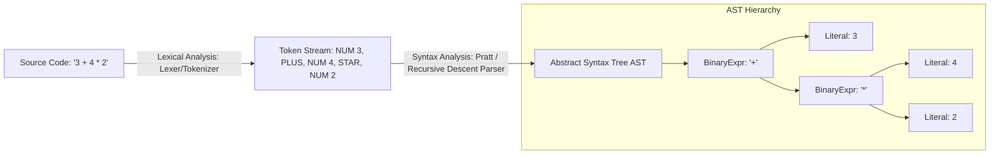

# Modul 117: Komunikasi Antar-Proses / IPC (Pipes, FIFO, POSIX Signals, Shared Memory mmap, Unix Domain Sockets)

**Navigasi**: [⬅️ Master Index](../../INDEX.md) | [Tingkat 7: Tingkat 7: Operating Systems Internals & Penguasaan Penuh Linux](./README.md)
*Sebelumnya*: [116. konkurensi-sinkronisasi-kernel](./116-konkurensi-sinkronisasi-kernel.md) | *Berikutnya*: [118. manajemen-memori-virtual-linux](./118-manajemen-memori-virtual-linux.md)

---

## 1. Intuisi Dasar Tanpa Jargon ("Seperti Bayi Baru Lahir")
Ketika Anda mengetik ekspresi matematika rumit seperti `3 + 4 * 2 / (1 - 5)^2`, bagaimana komputer tahu bahwa perkalian harus dikerjakan sebelum penjumlahan, tetapi ekspresi di dalam kurung harus diutamakan di atas segalanya? Frontend Kompilator: Lexing & Parsing ([Compiler Frontend & Parsing](https://craftinginterpreters.com/)) adalah pintu gerbang penerjemahan bahasa. Tahap pertama—**Lexer (Tokenizer)**—bertindak seperti pembaca kata: ia memindai aliran karakter ASCII mentah dan mengelompokkannya menjadi kata-kata bermakna yang disebut **Token** (seperti `NUMBER(3)`, `PLUS`, `IDENTIFIER("x")`). Tahap kedua—**Parser**—bertindak seperti ahli tata bahasa: ia mengambil barisan token tersebut dan menyusunnya menjadi pohon hierarki logika yang indah bernama **Abstract Syntax Tree (AST)**. Dari teknik Recursive Descent yang intuitif, parser generator klasik (Bison/Yacc), hingga keanggunan **Pratt Parsing** yang memecahkan masalah presedensi operator aritmatika dengan keindahan matematika yang sangat memukau.

## 2. Fondasi Teoretis & Aksiomatik / Matematis
Klasifikasi Parser dan Formalisme Pratt Top-Down Operator Precedence Parsing:

Taksonomi Algoritma Parsing Tata Bahasa:

$$\begin{array}{|l|l|l|l|}
\hline
\textbf{Metode} & \textbf{Arah Traversal} & \textbf{Mekanisme Resolusi} & \textbf{Kelebihan / Kekurangan} \\
\hline
\text{LL}(k) & \text{Top-Down (Left-to-right, Leftmost derivation)} & \text{Lookahead } k \text{ token} & \text{Mudah ditulis tangan, gagal pada Left-Recursion} \\
\text{LR}(k) / \text{LALR}(1) & \text{Bottom-Up (Left-to-right, Rightmost reverse)} & \text{Shift-Reduce via Tables} & \text{Sangat kuat (Bison/Yacc), pesan error membingungkan} \\
\text{GLR / Earley} & \text{Generalized Multi-Path} & \text{Graph-Structured Stack} & \text{Mampu mem-parse sembarang tata bahasa ambigu} \\
\text{Pratt Parsing} & \text{Top-Down Operator Precedence} & \text{Binding Powers Integer} & \text{Elegan, fleksibel untuk operator infix/prefix/postfix} \\
\hline
\end{array}$$

Prinsip Formal **Pratt Parsing (Vaughan Pratt, 1973)**:
Setiap operator $op$ memiliki dua kekuatan ikat (*Binding Power*): Kekuatan Ikat Kiri ($LBP$) dan Kekuatan Ikat Kanan ($RBP$):
- Operator Asosiatif Kiri (misal `+`, `-`): $LBP = RBP$
- Operator Asosiatif Kanan (misal `^`, `=`): $LBP > RBP$

Fungsi rekursif `parse_expression(min_bp)`:
Terus melahap operator selama kekuatan ikat kiri operator berikutnya ($LBP_{next}$) lebih besar dari batas kekuatan minimum saat ini ($min_bp$):
$$LBP(op_{next}) > min\_bp \implies \text{Lanjutkan pembentukan rantai AST di anak pohon!}$$

## 3. Anatomi Teknis & Cara Kerja Internal
Arsitektur Pipeline Frontend Kompilator: Dari Teks Sumber ke Abstract Syntax Tree (AST):



1. **Eliminasi Rekursi Kiri (Left-Recursion Elimination)**: Parser Top-Down LL naif akan mengalami infinite loop pada aturan rekursif kiri ($E \to E + T$). Solusi: Ubah tata bahasa menjadi bentuk iteratif ($E \to T \, E', \ E' \to + T \, E' \mid \epsilon$) atau gunakan Pratt Parsing.
2. **Shift-Reduce Conflicts pada LR Parser**: Terjadi ketika parser tabel tidak dapat memutuskan apakah harus membaca token berikutnya ke stack (*Shift*) atau menciutkan simbol menjadi non-terminal (*Reduce*), seperti ambiguitas klausa `if ... else`.

## 4. Implementasi Praktis & Kode / Simulasi Riil
```python
# Elegant Pratt Parser (Top-Down Operator Precedence) for Arithmetic Expressions in Python
from typing import List, Union

class ASTNode:
    def __init__(self, op: str, left: Union['ASTNode', int], right: Union['ASTNode', int] = None):
        self.op = op
        self.left = left
        self.right = right
    def __repr__(self): return f"({self.left} {self.op} {self.right})" if self.right else f"{self.op}{self.left}"

class PrattParser:
    def __init__(self, tokens: List[str]):
        self.tokens = tokens
        self.pos = 0

    def peek(self) -> str: return self.tokens[self.pos] if self.pos < len(self.tokens) else "EOF"
    def consume(self) -> str:
        tok = self.peek(); self.pos += 1; return tok

    def parse_expression(self, min_bp: int = 0) -> Union[ASTNode, int]:
        # 1. Prefix Parser (Angka atau Tanda Negatif)
        tok = self.consume()
        if tok.isdigit():
            left = int(tok)
        elif tok == "(":
            left = self.parse_expression(0)
            assert self.consume() == ")", "Missing closing parenthesis"
        else:
            raise SyntaxError(f"Unexpected token: {tok}")

        # 2. Infix Parser loop dengan Binding Power comparison
        while True:
            op = self.peek()
            if op == "EOF" or op == ")": break
            
            # Definisikan (Left Binding Power, Right Binding Power) untuk setiap operator
            bp_table = {'+': (1, 2), '-': (1, 2), '*': (3, 4), '/': (3, 4), '^': (6, 5)}
            if op not in bp_table: break
            l_bp, r_bp = bp_table[op]

            if l_bp < min_bp: break # Hentikan ekspansi jika kekuatan ikat lebih rendah
            self.consume() # Konsumsi operator
            right = self.parse_expression(r_bp) # Rekursi dengan batas kekuatan kanan
            left = ASTNode(op, left, right)

        return left
```

## 5. Miskonsepsi & Jebakan Industri
1. **Left-Recursion Crash in Recursive Descent Parsers**: Menulis fungsi parser `parse_expr()` yang langsung memanggil dirinya sendiri pada baris pertama tanpa mengonsumsi token. Parser akan mengalami *Stack Overflow* seketika.
2. **Lexer Greedy Match Failures (Maximal Munch Rule)**: Mengonfigurasi tokenizer tanpa aturan Maximal Munch. Karakter string `">>"` dapat salah di-tokenize sebagai dua token `>` terpisah alih-alih satu operator shift kanan `>>`.
3. **Poor Syntax Error Recovery (Cascading Errors)**: Menyerah dan melempar eksepsi saat menemukan kesalahan sintaksis pertama tanpa menerapkan strategi Panic Mode atau token sinkronisasi (seperti titik koma `;`). Compiler akan membanjiri layar pengguna dengan 100 pesan kesalahan palsu.

## 6. Proyek Latihan & Rubrik Penilaian Mandiri
1. **Tingkat Pemula**: Tulis Lexer sederhana dalam C atau Python yang memindai string ekspresi matematika dan mengembalikan array token berekor `EOF`.
2. **Tingkat Menengah**: Perluas implementasi Pratt Parser di atas untuk mendukung operator uner minus (`-x`), operator eksponensial asosiatif kanan (`2 ^ 3 ^ 2` = $2^{(3^2)} = 512$), dan tanda kurung bersarang.
3. **Tingkat Mahir**: Bangun parser bahasa pemrograman mini yang lengkap menggunakan kerangka ANTLR4 atau GNU Bison/Flex. Hasilkan pohon sintaks konkret (Parse Tree), tangani konflik Shift-Reduce, dan implementasikan pemulihan galat cerdas (*error recovery mechanism*).

## 7. Rekomendasi Sumber Belajar Standar Emas
| Sumber Pembelajaran | Penulis / Institusi | Tautan Langsung | Fokus Materi |
| :--- | :--- | :--- | :--- |
| Crafting Interpreters | Robert Nystrom | [Crafting Interpreters Online](https://craftinginterpreters.com/) | Scanning, Recursive Descent, Pratt Parsing & Abstract Syntax Trees |
| Top Down Operator Precedence | Vaughan R. Pratt (Stanford / MIT) | [Pratt Original 1973 Paper](https://dl.acm.org/doi/10.1145/512927.512931) | Makalah Orisinal Penemuan Pratt Parsing & Binding Power Mechanics |
| Modern Compiler Implementation in C / Java / ML | Andrew W. Appel (Princeton) | [Appel Compiler Books](https://www.cs.princeton.edu/~appel/modern/) | LL/LR Grammars, Shift-Reduce Parsing, Yacc/Lex & AST Representations |
| The Definitive ANTLR 4 Reference | Terence Parr | [Pragmatic Bookshelf ANTLR](https://pragprog.com/titles/tpantlr2/the-definitive-antlr-4-reference/) | ALL(*) Parsing Algorithm, Lexer Modes & Syntax Error Listeners |

---
*Navigasi Cepat*: [Ke Tingkat 7](./README.md) | [Ke Master Index](../../INDEX.md) | *Sebelumnya*: [116. konkurensi-sinkronisasi-kernel](./116-konkurensi-sinkronisasi-kernel.md) | *Berikutnya*: [118. manajemen-memori-virtual-linux](./118-manajemen-memori-virtual-linux.md)
